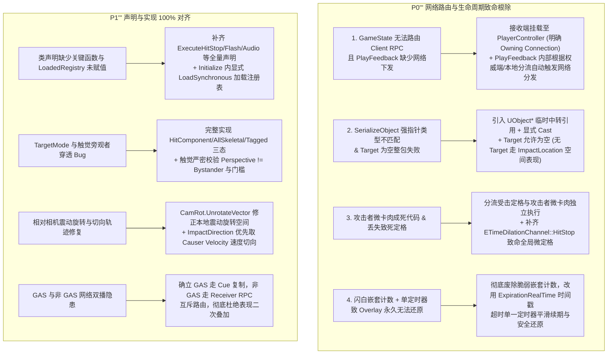
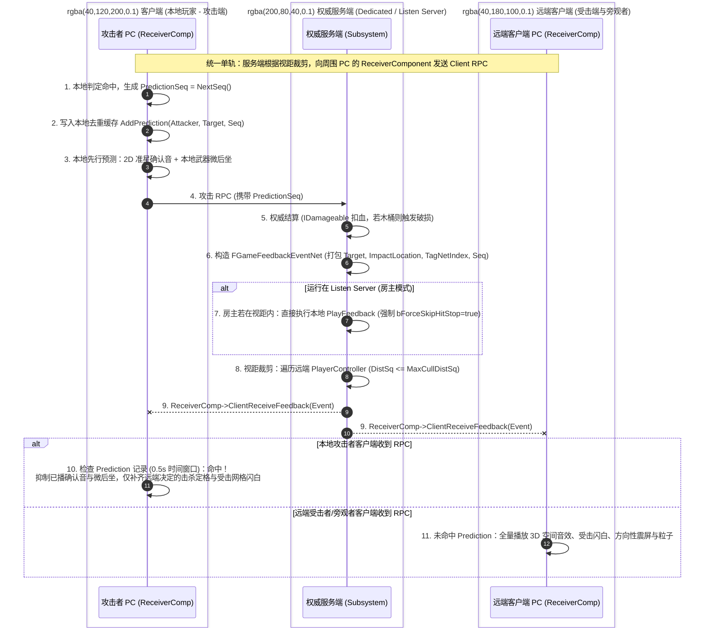

# GameFeedback 打击感表现解耦中枢落地方案与架构评估 (v6.0 工业级完全闭环版)

> **版本**：v6.0 (工业级完全闭环版)  
> **文档状态**：已就绪待批准 (READY_FOR_APPROVAL)  
> **技术领域**：UE5 客户端视听表现架构、战斗打击感 (GameFeel)、网络紧凑 RPC 序列化、内存预算与生命周期防护  
> **依赖边界**：  
> • `GameFeedback` 核心插件：仅依赖 `Core`, `CoreUObject`, `Engine`, `GameplayTags`, `Niagara`, `DeveloperSettings`, `GameCore`, `GameGameplayCore` (**100% 零 GAS 强绑定**)  
> • `GameGameplay` 模块：持有 `UGameplayCueNotify_GameFeedback` 桥接器（向下单向依赖 `GameFeedback`）

---

## 一、 缺陷与架构闭环根治清单 (Changelog v6.0)

针对深度审查中指出的网络寻址断层、生命周期死代码与实现不一致，v6.0 完成了工业级全闭环：



---

## 二、 方案对比与选型决策矩阵 (Trade-Off Matrix v6.0)

| 评估维度 | 方案 A：独立 GameFeedback 中枢 (v6.0) [推荐最优] | 方案 B：全面绑定 GAS GameplayCue | 方案 C：各 Actor 受击表现组件 (Component) |
|:---|:---|:---|:---|
| **模块依赖边界** | **核心 0 GAS 依赖**；GAS 桥接置于 `GameGameplay` 单向注入 | 强绑定 `GameplayAbilities`，木桶/非 GAS 实体断层 | 依赖具体角色类定义与蓝图挂载 |
| **网络同步链路** | **单轨 PC Client RPC 视距裁剪 (≤40B) + 归属连接明确 + 双向 Seq 时间去重** | 依赖 GAS Cue 原生复制，RPC 载荷较重 | 各组件自行 RPC 广播，木桶同帧销毁导致 RPC 丢失 |
| **Listen Server 保护** | **房主本地视听全响应，权威时间膨胀硬短路**，绝不污染权威 Tick | Cue 执行若修改时间膨胀，同样污染房主模拟 | 需在每个组件内手写严格的 NetMode 校验 |
| **内存预算控制** | **元数据常驻 + 软引用分级加载 + 启动期常驻缺省资产 + 异步未就绪秒级回退** | Cue 资产随技能加载，难以细粒度按需卸载 | 各组件强引用资产，常驻内存不可控 |
| **多部件与覆写安全** | **支持 Modular Mesh 过滤 + 保存原始 Overlay 材质安全还原** | 需在 Cue 内遍历 GetComponent，容易擦除描边 | 需在角色层手动分发到各个网格体 |
| **对象池重用安全** | **显式契约 `ClearActorFeedback`**（同步清除材质与时间膨胀），与 `IGamePoolable` 闭环 | Cue 容易悬挂生命周期，需手动防 GC 泄露 | 重置逻辑分散，容易遗漏闪白状态 |
| **规则匹配性能** | **$O(1)$ 哈希直通 + 优先级降级**，散弹枪多段击发零 CPU 尖刺 | 遍历 ActiveGameplayEffects，开销中等 | 组件内硬编码，无法统一全局调优 |

---

## 三、 网络视听同步架构：PC Client RPC 与时间窗口去重 (Network Architecture)

### 3.1 明确网络连接归属的单播管线
由于 `AGameStateBase` 不属于任何玩家连接，在其上直接调用 `Client` RPC 会被引擎丢弃。  
GameFeedback 采用**挂载于 `APlayerController` 上的 `UGameFeedbackReceiverComponent`** 保证网络连接归属明确：



### 3.2 真实网络可序列化契约 (`FGameFeedbackEventNet`)

```cpp
/**
 * @brief 网络紧凑打击表现载荷（网络传输预算 ≤ 40 字节）
 */
USTRUCT()
struct GAMEFEEDBACK_API FGameFeedbackEventNet {
    GENERATED_BODY()

    UPROPERTY()
    TObjectPtr<AActor> Instigator = nullptr;

    /** 受击目标（允许为空，木桶本帧销毁时客户端退化为纯空间位置表现） */
    UPROPERTY()
    TObjectPtr<AActor> Target = nullptr;

    UPROPERTY()
    FVector_NetQuantize ImpactLocation = FVector::ZeroVector;

    UPROPERTY()
    FVector_NetQuantizeNormal ImpactNormal = FVector::UpVector;

    UPROPERTY()
    FVector_NetQuantizeNormal ImpactDirection = FVector::ForwardVector;

    UPROPERTY()
    uint16 PrimaryChannelIndex = 0;

    UPROPERTY()
    uint16 FeedbackTagIndex = 0;

    UPROPERTY()
    uint16 DamageHalf = 0;

    /** 位掩码：Bit 0: bLethal; Bit 1: bCritical; Bit 2: bGuardBreak */
    UPROPERTY()
    uint8 StateFlags = 0;

    UPROPERTY()
    uint8 PredictionSequence = 0;

    FORCEINLINE void SetDamage(float InDamage) noexcept {
        DamageHalf = FFloat16(InDamage).Encoded;
    }

    [[nodiscard]] FORCEINLINE float GetDamage() const noexcept {
        FFloat16 Val;
        Val.Encoded = DamageHalf;
        return Val.GetFloat();
    }

    bool NetSerialize(FArchive& Ar, class UPackageMap* Map, bool& bOutSuccess) {
        bOutSuccess = true;

        // 1. Actor 网络指针序列化（转换为 UObject* 临时引用以满足 PackageMap API 签名）
        UObject* RawInstigator = Instigator.Get();
        Map->SerializeObject(Ar, AActor::StaticClass(), RawInstigator);
        Instigator = Cast<AActor>(RawInstigator);

        UObject* RawTarget = Target.Get();
        Map->SerializeObject(Ar, AActor::StaticClass(), RawTarget);
        Target = Cast<AActor>(RawTarget);

        // 2. 向量压缩
        ImpactLocation.NetSerialize(Ar, Map, bOutSuccess);
        ImpactNormal.NetSerialize(Ar, Map, bOutSuccess);
        ImpactDirection.NetSerialize(Ar, Map, bOutSuccess);

        // 3. 通道与特征标签索引
        Ar << PrimaryChannelIndex;
        Ar << FeedbackTagIndex;

        // 4. 数值与位掩码
        Ar << DamageHalf;
        Ar << StateFlags;
        Ar << PredictionSequence;

        return bOutSuccess;
    }
};

template <>
struct TStructOpsTypeTraits<FGameFeedbackEventNet> : public TStructOpsTypeTraitsBase2<FGameFeedbackEventNet> {
    enum {
        WithNetSerializer = true
    };
};
```

### 3.3 接收组件 (`UGameFeedbackReceiverComponent`)
挂载于 `APlayerController`，天然具备可靠的客户端归属连接：

```cpp
UCLASS(ClassGroup = (GameFeedback), meta = (BlueprintSpawnableComponent))
class GAMEFEEDBACK_API UGameFeedbackReceiverComponent : public UActorComponent {
    GENERATED_BODY()

public:
    UGameFeedbackReceiverComponent() {
        SetIsReplicatedByDefault(true);
    }

    /**
     * @brief 客户端单播接收接口（由服务端向指定客户端 PC 下发）
     */
    UFUNCTION(Client, Unreliable)
    void ClientReceiveFeedback(const FGameFeedbackEventNet& Event);
};

void UGameFeedbackReceiverComponent::ClientReceiveFeedback_Implementation(const FGameFeedbackEventNet& Event)
{
    if (UGameFeedbackSubsystem* Subsystem = UGameFeedbackSubsystem::GetPtr(this)) {
        Subsystem->ProcessNetworkEvent(Event);
    }
}
```

---

## 四、 核心数据模型与表现载荷解耦 (Domain Models)

### 4.1 纯表现信号抽象：`FGameFeedbackSignal`

```cpp
UENUM(BlueprintType)
enum class EGameFeedbackPerspective : uint8 {
    LocalAttacker,  ///< 本地玩家是动作发起者（准星确认音、微后坐、手柄轻震）
    LocalVictim,    ///< 本地玩家是受击者（剧烈晃屏、方向指示、全屏暗角、重度手柄震动）
    Bystander       ///< 第三人旁观者（仅 3D 空间音效与粒子，绝对不晃镜头与手柄）
};

UENUM(BlueprintType)
enum class EGameFeedbackVFXOrientation : uint8 {
    AlignToNormal,           ///< 沿命中面法线向外喷溅（子弹打墙）
    AlignToImpactDirection,  ///< 沿近战挥砍轨迹/投掷物切线喷溅（刀光顺劈飞溅）
    OppositeToTraceDirection,///< 沿子弹射入反方向喷溅（贯穿射击血液回喷）
    AlignToReflectedNormal   ///< 纯物理反射角喷溅（跳弹）
};

UENUM(BlueprintType)
enum class EGameFeedbackFlashTargetMode : uint8 {
    HitComponentOnly,    ///< 仅命中物理部件闪白（精准打击）
    AllSkeletalMeshes,   ///< 角色全部骨骼部件闪白（全身受击受挫感）
    TaggedComponentsOnly ///< 仅带有指定 ComponentTag（如 "Flashable"）的部件闪白
};

USTRUCT(BlueprintType)
struct GAMEFEEDBACK_API FGameFeedbackSignal {
    GENERATED_BODY()

    UPROPERTY(BlueprintReadWrite, Category = "Feedback")
    TWeakObjectPtr<AActor> Instigator = nullptr;

    UPROPERTY(BlueprintReadWrite, Category = "Feedback")
    TWeakObjectPtr<AActor> DamageCauser = nullptr;

    UPROPERTY(BlueprintReadWrite, Category = "Feedback")
    TWeakObjectPtr<AActor> Target = nullptr;

    UPROPERTY(BlueprintReadWrite, Category = "Feedback")
    FHitResult HitResult;

    UPROPERTY(BlueprintReadWrite, Category = "Feedback")
    FVector ImpactDirection = FVector::ZeroVector;

    UPROPERTY(BlueprintReadWrite, Category = "Feedback")
    FGameplayTag PrimaryChannel;

    UPROPERTY(BlueprintReadWrite, Category = "Feedback")
    FGameplayTagContainer FeedbackTags;

    UPROPERTY(BlueprintReadWrite, Category = "Feedback")
    float Magnitude = 0.0f;

    UPROPERTY(BlueprintReadWrite, Category = "Feedback")
    bool bLethal = false;
};
```

---

### 4.2 表现原子动作配置

```cpp
USTRUCT(BlueprintType)
struct FGameFeedbackHitStopAction {
    GENERATED_BODY()

    UPROPERTY(EditAnywhere, BlueprintReadOnly, Category = "HitStop")
    bool bEnable = true;

    UPROPERTY(EditAnywhere, BlueprintReadOnly, Category = "HitStop", meta = (ClampMin = "0.0"))
    float VictimDuration = 0.08f;

    UPROPERTY(EditAnywhere, BlueprintReadOnly, Category = "HitStop", meta = (ClampMin = "0.0"))
    float AttackerDuration = 0.04f;

    UPROPERTY(EditAnywhere, BlueprintReadOnly, Category = "HitStop", meta = (ClampMin = "0.0001", ClampMax = "1.0"))
    float TimeDilation = 0.001f;

    UPROPERTY(EditAnywhere, BlueprintReadOnly, Category = "HitStop", meta = (ClampMin = "0.01"))
    float CooldownInterval = 0.05f;

    UPROPERTY(EditAnywhere, BlueprintReadOnly, Category = "HitStop", meta = (ClampMin = "0.05"))
    float MaxCumulativeDuration = 0.20f;

    UPROPERTY(EditAnywhere, BlueprintReadOnly, Category = "HitStop", meta = (ClampMin = "0.1"))
    float ResetWindow = 0.50f;

    UPROPERTY(EditAnywhere, BlueprintReadOnly, Category = "HitStop")
    bool bGlobalFreezeOnLethal = false;
};

USTRUCT(BlueprintType)
struct FGameFeedbackCameraShakeAction {
    GENERATED_BODY()

    UPROPERTY(EditAnywhere, BlueprintReadOnly, Category = "CameraShake")
    TSubclassOf<UCameraShakeBase> AttackerShakeClass;

    UPROPERTY(EditAnywhere, BlueprintReadOnly, Category = "CameraShake")
    float AttackerShakeScale = 1.0f;

    UPROPERTY(EditAnywhere, BlueprintReadOnly, Category = "CameraShake")
    TSubclassOf<UCameraShakeBase> VictimShakeClass;

    UPROPERTY(EditAnywhere, BlueprintReadOnly, Category = "CameraShake")
    float VictimShakeScale = 1.5f;

    UPROPERTY(EditAnywhere, BlueprintReadOnly, Category = "CameraShake", meta = (ClampMin = "0.0"))
    float MinMagnitude = 5.0f;

    UPROPERTY(EditAnywhere, BlueprintReadOnly, Category = "CameraShake")
    bool bOrientShakeToImpactDirection = true;
};

USTRUCT(BlueprintType)
struct FGameFeedbackHitFlashAction {
    GENERATED_BODY()

    UPROPERTY(EditAnywhere, BlueprintReadOnly, Category = "HitFlash")
    bool bEnable = true;

    UPROPERTY(EditAnywhere, BlueprintReadOnly, Category = "HitFlash")
    EGameFeedbackFlashTargetMode TargetMode = EGameFeedbackFlashTargetMode::AllSkeletalMeshes;

    UPROPERTY(EditAnywhere, BlueprintReadOnly, Category = "HitFlash", meta = (EditCondition = "TargetMode == EGameFeedbackFlashTargetMode::TaggedComponentsOnly"))
    FName ComponentFilterTag = TEXT("Flashable");

    UPROPERTY(EditAnywhere, BlueprintReadOnly, Category = "HitFlash")
    TObjectPtr<UMaterialInterface> OverlayMaterial = nullptr;

    UPROPERTY(EditAnywhere, BlueprintReadOnly, Category = "HitFlash", meta = (ClampMin = "0.01"))
    float Duration = 0.10f;

    UPROPERTY(EditAnywhere, BlueprintReadOnly, Category = "HitFlash", meta = (ClampMin = "0.0"))
    float MinMagnitude = 3.0f;
};

USTRUCT(BlueprintType)
struct FGameFeedbackVFXAction {
    GENERATED_BODY()

    UPROPERTY(EditAnywhere, BlueprintReadOnly, Category = "VFX")
    TSoftObjectPtr<UNiagaraSystem> NiagaraSystem;

    UPROPERTY(EditAnywhere, BlueprintReadOnly, Category = "VFX")
    bool bAttachToHitComponent = false;

    UPROPERTY(EditAnywhere, BlueprintReadOnly, Category = "VFX")
    EGameFeedbackVFXOrientation OrientationMode = EGameFeedbackVFXOrientation::AlignToNormal;

    UPROPERTY(EditAnywhere, BlueprintReadOnly, Category = "VFX", meta = (ClampMin = "0.0"))
    float MinMagnitude = 1.0f;
};

USTRUCT(BlueprintType)
struct FGameFeedbackAudioAction {
    GENERATED_BODY()

    UPROPERTY(EditAnywhere, BlueprintReadOnly, Category = "Audio")
    TSoftObjectPtr<USoundBase> SpatialImpactSound;

    UPROPERTY(EditAnywhere, BlueprintReadOnly, Category = "Audio")
    TObjectPtr<USoundAttenuation> AttenuationSettings = nullptr;

    UPROPERTY(EditAnywhere, BlueprintReadOnly, Category = "Audio")
    TObjectPtr<USoundConcurrency> ConcurrencySettings = nullptr;

    UPROPERTY(EditAnywhere, BlueprintReadOnly, Category = "Audio")
    TSoftObjectPtr<USoundBase> AttackerConfirmationSound;

    UPROPERTY(EditAnywhere, BlueprintReadOnly, Category = "Audio", meta = (ClampMin = "0.0"))
    float MinMagnitude = 1.0f;
};

USTRUCT(BlueprintType)
struct FGameFeedbackForceFeedbackAction {
    GENERATED_BODY()

    UPROPERTY(EditAnywhere, BlueprintReadOnly, Category = "Haptics")
    TObjectPtr<UHapticFeedbackEffect_Base> AttackerHaptic = nullptr;

    UPROPERTY(EditAnywhere, BlueprintReadOnly, Category = "Haptics")
    TObjectPtr<UHapticFeedbackEffect_Base> VictimHaptic = nullptr;

    UPROPERTY(EditAnywhere, BlueprintReadOnly, Category = "Haptics", meta = (ClampMin = "0.0"))
    float MinMagnitude = 5.0f;
};

UCLASS(BlueprintType)
class GAMEFEEDBACK_API UGameFeedbackDefinition : public UPrimaryDataAsset {
    GENERATED_BODY()

public:
    UPROPERTY(EditAnywhere, BlueprintReadOnly, Category = "Matching")
    FGameplayTagQuery TagQuery;

    UPROPERTY(EditAnywhere, BlueprintReadOnly, Category = "Matching")
    int32 Priority = 0;

    UPROPERTY(EditAnywhere, BlueprintReadOnly, Category = "Actions")
    FGameFeedbackHitStopAction HitStop;

    UPROPERTY(EditAnywhere, BlueprintReadOnly, Category = "Actions")
    FGameFeedbackCameraShakeAction CameraShake;

    UPROPERTY(EditAnywhere, BlueprintReadOnly, Category = "Actions")
    FGameFeedbackHitFlashAction HitFlash;

    UPROPERTY(EditAnywhere, BlueprintReadOnly, Category = "Actions")
    FGameFeedbackVFXAction VFX;

    UPROPERTY(EditAnywhere, BlueprintReadOnly, Category = "Actions")
    FGameFeedbackAudioAction Audio;

    UPROPERTY(EditAnywhere, BlueprintReadOnly, Category = "Actions")
    FGameFeedbackForceFeedbackAction Haptics;
};
```

---

## 五、 双层匹配引擎与资产配置发现 (Registry & Settings)

### 5.1 注册表解耦元数据与异步流式闭环
```cpp
USTRUCT(BlueprintType)
struct FGameFeedbackCompositeEntry {
    GENERATED_BODY()

    UPROPERTY(EditDefaultsOnly, Category = "Matching")
    FGameplayTagQuery TagQuery;

    UPROPERTY(EditDefaultsOnly, Category = "Matching")
    int32 Priority = 0;

    UPROPERTY(EditDefaultsOnly, Category = "Matching")
    TSoftObjectPtr<UGameFeedbackDefinition> Definition;
};

UCLASS()
class GAMEFEEDBACK_API UGameFeedbackRegistry : public UDataAsset {
    GENERATED_BODY()

public:
    void PostLoad() override {
        Super::PostLoad();
        CompositeRules.Sort([](const FGameFeedbackCompositeEntry& A, const FGameFeedbackCompositeEntry& B) {
            return A.Priority > B.Priority;
        });
    }

    TSoftObjectPtr<UGameFeedbackDefinition> ResolveDefinitionPtr(
        const FGameplayTag& PrimaryChannel, 
        const FGameplayTagContainer& FeedbackTags) const;

    UPROPERTY(EditDefaultsOnly, Category = "Defaults")
    TObjectPtr<UGameFeedbackDefinition> DefaultFallbackDefinition;

    UPROPERTY(EditDefaultsOnly, Category = "Tier1_FastPath")
    TMap<FGameplayTag, TSoftObjectPtr<UGameFeedbackDefinition>> ExactChannelMap;

    UPROPERTY(EditDefaultsOnly, Category = "Tier1_FastPath")
    TMap<FGameplayTag, TSoftObjectPtr<UGameFeedbackDefinition>> ExactFeedbackTagMap;

    UPROPERTY(EditDefaultsOnly, Category = "Tier2_CompositeRules")
    TArray<FGameFeedbackCompositeEntry> CompositeRules;
};
```

### 5.2 全局配置 (`UGameFeedbackSettings`)
```cpp
UCLASS(Config = Game, DefaultConfig, meta = (DisplayName = "Game Feedback"))
class GAMEFEEDBACK_API UGameFeedbackSettings : public UDeveloperSettings {
    GENERATED_BODY()

public:
    UPROPERTY(Config, EditAnywhere, Category = "General")
    bool bEnableFeedbackSubsystem = true;

    UPROPERTY(Config, EditAnywhere, Category = "Registry")
    TSoftObjectPtr<UGameFeedbackRegistry> GlobalRegistry;

    UPROPERTY(Config, EditAnywhere, Category = "Haptics", meta = (ClampMin = "0.0", ClampMax = "1.0"))
    float GlobalHapticScale = 1.0f;

    UPROPERTY(Config, EditAnywhere, Category = "HitStop")
    bool bAllowAuthoritativeHitStop = false;

    UPROPERTY(Config, EditAnywhere, Category = "Network")
    float DefaultNetworkCullDistance = 5000.0f;
};
```

---

## 六、 执行中枢核心管线：`UGameFeedbackSubsystem`

### 6.1 完整类声明（100% 对齐实现，无任何缺失声明）

```cpp
UCLASS()
class GAMEFEEDBACK_API UGameFeedbackSubsystem : public UWorldSubsystem {
    GENERATED_BODY()

public:
    static UGameFeedbackSubsystem& Get(const UObject* WorldContextObject);
    static UGameFeedbackSubsystem* GetPtr(const UObject* WorldContextObject);

    bool ShouldCreateSubsystem(UObject* Outer) const override {
        if (!Super::ShouldCreateSubsystem(Outer)) return false;
        const UWorld* World = Outer ? Outer->GetWorld() : nullptr;
        if (!World || !World->IsGameWorld()) return false;
        return !IsRunningDedicatedServer();
    }

    void Initialize(FSubsystemCollectionBase& Collection) override;
    void Deinitialize() override;

    UFUNCTION(BlueprintCallable, Category = "GameFeedback")
    void PlayFeedback(const FGameFeedbackSignal& Signal);

    UFUNCTION(BlueprintCallable, Category = "GameFeedback")
    void PlayFeedbackWithDefinition(const FGameFeedbackSignal& Signal, const UGameFeedbackDefinition* Definition);

    UFUNCTION(BlueprintCallable, Category = "GameFeedback")
    void ClearActorFeedback(AActor* Target);

    void PreloadFeedbackBundle(const TArray<TSoftObjectPtr<UGameFeedbackDefinition>>& Definitions);
    void ProcessNetworkEvent(const FGameFeedbackEventNet& Event, bool bForceSkipHitStop = false);

    EGameFeedbackPerspective ResolvePerspectiveForPC(
        const APlayerController* LocalPC,
        const AActor* Instigator,
        const AActor* DamageCauser,
        const AActor* Target) const;

protected:
    const UGameFeedbackDefinition* ResolveDefinitionAndStreamAsync(
        const FGameplayTag& PrimaryChannel, 
        const FGameplayTagContainer& FeedbackTags);

    void ExecuteHitStop(
        const FGameFeedbackSignal& Signal,
        const FGameFeedbackHitStopAction& Action,
        EGameFeedbackPerspective Perspective,
        bool bForceSkipHitStop = false);

    void ExecuteHitFlash(
        const FGameFeedbackSignal& Signal,
        const FGameFeedbackHitFlashAction& Action);

    void ExecuteCameraShake(
        APlayerCameraManager* CameraManager,
        TSubclassOf<UCameraShakeBase> ShakeClass,
        float ShakeScale,
        const FVector& LocalImpactDirection,
        bool bOrientToImpact);

    void ExecuteVFX(
        const FGameFeedbackSignal& Signal,
        const FGameFeedbackVFXAction& Action);

    void ExecuteAudio(
        const FGameFeedbackSignal& Signal,
        const FGameFeedbackAudioAction& Action);

    void CollectCandidateMeshes(
        AActor* Target,
        const FGameFeedbackHitFlashAction& Action,
        TArray<UMeshComponent*>& OutMeshes) const;

    void DispatchNetworkEvent(const FGameFeedbackSignal& Signal);

private:
    struct FHitStopTrackState {
        float CumulativeDuration = 0.0f;
        double LastTriggerRealTime = 0.0;
    };

    struct FMeshFlashRecord {
        TWeakObjectPtr<UMaterialInterface> OriginalOverlayMaterial = nullptr;
        double ExpirationRealTime = 0.0;
        FTimerHandle TimerHandle;
    };

    struct FPredictionEntry {
        TWeakObjectPtr<AActor> Attacker;
        TWeakObjectPtr<AActor> Target;
        uint8 Sequence = 0;
        double Timestamp = 0.0;
    };

    UPROPERTY()
    TObjectPtr<UGameFeedbackRegistry> LoadedRegistry = nullptr;

    TMap<TWeakObjectPtr<AActor>, FHitStopTrackState> HitStopTracks;
    TMap<TPair<TWeakObjectPtr<AActor>, TWeakObjectPtr<AActor>>, double> HitStopCooldownMap;
    TMap<TWeakObjectPtr<UMeshComponent>, FMeshFlashRecord> ActiveMeshFlashRecords;

    TArray<FPredictionEntry> PredictionHistory;
    uint8 NextPredictionSeq = 0;

    TWeakObjectPtr<UCameraShakeBase> ActiveShakeInstance = nullptr;
    uint64 LastShakeFrame = 0;
    float CurrentFrameMaxShakeScale = 0.0f;
};
```

### 6.2 注册表加载与异步流式闭环实现
在 `Initialize` 中显式加载 `LoadedRegistry`，杜绝注册表空指针：

```cpp
void UGameFeedbackSubsystem::Initialize(FSubsystemCollectionBase& Collection)
{
    Super::Initialize(Collection);

    const UGameFeedbackSettings* Settings = GetDefault<UGameFeedbackSettings>();
    if (Settings && !Settings->GlobalRegistry.IsNull()) {
        LoadedRegistry = Settings->GlobalRegistry.LoadSynchronous();
        if (!LoadedRegistry) {
            UE_LOG(LogTemp, Error, TEXT("[GameFeedback] GlobalRegistry 同步加载失败，请检查项目配置！"));
        }
    }
}

const UGameFeedbackDefinition* UGameFeedbackSubsystem::ResolveDefinitionAndStreamAsync(
    const FGameplayTag& PrimaryChannel, 
    const FGameplayTagContainer& FeedbackTags)
{
    if (!LoadedRegistry) return nullptr;

    TSoftObjectPtr<UGameFeedbackDefinition> DefPtr = LoadedRegistry->ResolveDefinitionPtr(PrimaryChannel, FeedbackTags);
    if (DefPtr.IsNull()) {
        return LoadedRegistry->DefaultFallbackDefinition.Get();
    }

    // 1. 若资产已在内存中，直接返回
    if (DefPtr.IsValid()) {
        return DefPtr.Get();
    }

    // 2. 资产尚未加载：后台异步预热加载，当前击打秒级降级为 DefaultFallback
    UAssetManager::GetStreamableManager().RequestAsyncLoad(DefPtr.ToSoftObjectPath());
    return LoadedRegistry->DefaultFallbackDefinition.Get();
}
```

### 6.3 顿帧滑动重置、攻击者微卡肉与致死定格闭环
```cpp
void UGameFeedbackSubsystem::ExecuteHitStop(
    const FGameFeedbackSignal& Signal,
    const FGameFeedbackHitStopAction& Action,
    EGameFeedbackPerspective Perspective,
    bool bForceSkipHitStop)
{
    if (!Action.bEnable || bForceSkipHitStop) return;

    const ENetMode NetMode = GetWorld()->GetNetMode();
    const bool bAllowAuthHitStop = GetDefault<UGameFeedbackSettings>()->bAllowAuthoritativeHitStop;

    // 权威端严格保护：Listen Server 房主模式下绝对禁止修改权威 Actor 的 CustomTimeDilation
    if ((NetMode == NM_ListenServer || NetMode == NM_DedicatedServer) && !bAllowAuthHitStop) {
        return;
    }

    // 1. 致命击杀全局微定格特写（复用已有 ETimeDilationChannel::HitStop）
    if (Signal.bLethal && Action.bGlobalFreezeOnLethal) {
        UTimeDilationSubsystem::Get(this).RequestGlobalDilation(
            ETimeDilationChannel::HitStop, 0.05f, 0.1f, 0.02f);
    }

    AActor* TargetActor = Signal.Target.Get();
    AActor* AttackerActor = Signal.Instigator.Get();
    const double CurrentRealTime = FPlatformTime::Seconds();
    const auto PairKey = MakeTuple(Signal.Instigator, Signal.Target);

    // 2. 同源 (Source, Target) 双向冷却防刷
    if (double* LastTriggerTime = HitStopCooldownMap.Find(PairKey)) {
        if (CurrentRealTime - *LastTriggerTime < Action.CooldownInterval) {
            return;
        }
    }
    HitStopCooldownMap.Add(PairKey, CurrentRealTime);

    // 3. 受击者滑动重置窗口与累计上限封顶
    if (TargetActor) {
        FHitStopTrackState& TargetTrack = HitStopTracks.FindOrAdd(TargetActor);
        if (CurrentRealTime - TargetTrack.LastTriggerRealTime > Action.ResetWindow) {
            TargetTrack.CumulativeDuration = 0.0f;
        }
        if (TargetTrack.CumulativeDuration < Action.MaxCumulativeDuration) {
            const float AppliedDuration = FMath::Min(Action.VictimDuration, Action.MaxCumulativeDuration - TargetTrack.CumulativeDuration);
            TargetTrack.CumulativeDuration += AppliedDuration;
            TargetTrack.LastTriggerRealTime = CurrentRealTime;

            UTimeDilationSubsystem::Get(this).RequestHitStop(
                TargetActor, AppliedDuration, Action.TimeDilation);
        }
    }

    // 4. 本地攻击者微卡肉（独立流转，受滑动窗口与上限保护）
    if (Perspective == EGameFeedbackPerspective::LocalAttacker && Action.AttackerDuration > 0.0f && AttackerActor) {
        FHitStopTrackState& AttackerTrack = HitStopTracks.FindOrAdd(AttackerActor);
        if (CurrentRealTime - AttackerTrack.LastTriggerRealTime > Action.ResetWindow) {
            AttackerTrack.CumulativeDuration = 0.0f;
        }
        if (AttackerTrack.CumulativeDuration < Action.MaxCumulativeDuration) {
            const float AppliedAttackerDur = FMath::Min(Action.AttackerDuration, Action.MaxCumulativeDuration - AttackerTrack.CumulativeDuration);
            AttackerTrack.CumulativeDuration += AppliedAttackerDur;
            AttackerTrack.LastTriggerRealTime = CurrentRealTime;

            UTimeDilationSubsystem::Get(this).RequestHitStop(
                AttackerActor, AppliedAttackerDur, Action.TimeDilation);
        }
    }
}
```

### 6.4 闪白 ExpirationRealTime 时间戳防残留闭环
彻底废除脆弱的计数，改用高鲁棒性绝对时间戳与单一定时器平滑续期：

```cpp
void UGameFeedbackSubsystem::ExecuteHitFlash(
    const FGameFeedbackSignal& Signal,
    const FGameFeedbackHitFlashAction& Action)
{
    if (!Action.bEnable || !Action.OverlayMaterial || Signal.Magnitude < Action.MinMagnitude) {
        return;
    }

    AActor* Target = Signal.Target.Get();
    if (!Target) return;

    TArray<UMeshComponent*> CandidateMeshes;
    CollectCandidateMeshes(Target, Action, CandidateMeshes);

    const double CurrentRealTime = FPlatformTime::Seconds();
    const double NewExpirationTime = CurrentRealTime + Action.Duration;

    for (UMeshComponent* Mesh : CandidateMeshes) {
        if (!Mesh) continue;

        FMeshFlashRecord& Record = ActiveMeshFlashRecords.FindOrAdd(Mesh);
        if (Record.ExpirationRealTime <= CurrentRealTime) {
            // 首次闪白或已超时恢复：保存初始 OverlayMaterial
            Record.OriginalOverlayMaterial = Mesh->GetOverlayMaterial();
        }
        Record.ExpirationRealTime = FMath::Max(Record.ExpirationRealTime, NewExpirationTime);
        Mesh->SetOverlayMaterial(Action.OverlayMaterial);

        GetWorld()->GetTimerManager().ClearTimer(Record.TimerHandle);
        TWeakObjectPtr<UMeshComponent> WeakMesh(Mesh);
        GetWorld()->GetTimerManager().SetTimer(Record.TimerHandle, [this, WeakMesh]() {
            if (UMeshComponent* TargetMesh = WeakMesh.Get()) {
                if (FMeshFlashRecord* Rec = ActiveMeshFlashRecords.Find(TargetMesh)) {
                    if (FPlatformTime::Seconds() >= Rec->ExpirationRealTime - 0.001) {
                        TargetMesh->SetOverlayMaterial(Rec->OriginalOverlayMaterial.Get());
                        ActiveMeshFlashRecords.Remove(TargetMesh);
                    }
                }
            } else {
                ActiveMeshFlashRecords.Remove(WeakMesh);
            }
        }, Action.Duration, false);
    }
}
```

### 6.5 本地分屏 PvP 遍历、相对相机震屏与网络下发
```cpp
void UGameFeedbackSubsystem::PlayFeedback(const FGameFeedbackSignal& Signal)
{
    if (!GetDefault<UGameFeedbackSettings>()->bEnableFeedbackSubsystem) return;

    const UGameFeedbackDefinition* Definition = ResolveDefinitionAndStreamAsync(Signal.PrimaryChannel, Signal.FeedbackTags);
    if (!Definition) return;

    UWorld* World = GetWorld();
    const ENetMode NetMode = World->GetNetMode();

    // 1. 本地玩家视口遍历（覆盖单人与本地分屏 PvP）
    for (FConstPlayerControllerIterator Iterator = World->GetPlayerControllerIterator(); Iterator; ++Iterator) {
        APlayerController* LocalPC = Iterator->Get();
        if (LocalPC && LocalPC->IsLocalController()) {
            const EGameFeedbackPerspective Perspective = ResolvePerspectiveForPC(
                LocalPC, Signal.Instigator.Get(), Signal.DamageCauser.Get(), Signal.Target.Get());

            // 震屏（方向对齐到摄像机相对视口空间）
            if (Perspective != EGameFeedbackPerspective::Bystander && Signal.Magnitude >= Definition->CameraShake.MinMagnitude) {
                if (APlayerCameraManager* CamMgr = LocalPC->PlayerCameraManager) {
                    const FRotator CamRot = CamMgr->GetCameraRotation();
                    const FVector LocalImpactDir = CamRot.UnrotateVector(Signal.ImpactDirection);

                    ExecuteCameraShake(
                        CamMgr,
                        Perspective == EGameFeedbackPerspective::LocalAttacker ? Definition->CameraShake.AttackerShakeClass : Definition->CameraShake.VictimShakeClass,
                        Perspective == EGameFeedbackPerspective::LocalAttacker ? Definition->CameraShake.AttackerShakeScale : Definition->CameraShake.VictimShakeScale,
                        LocalImpactDir,
                        Definition->CameraShake.bOrientShakeToImpactDirection);
                }
            }

            // 触觉（严格要求非旁观者与门槛）
            if (Perspective != EGameFeedbackPerspective::Bystander && Signal.Magnitude >= Definition->Haptics.MinMagnitude) {
                UHapticFeedbackEffect_Base* HapticEffect = (Perspective == EGameFeedbackPerspective::LocalAttacker ? Definition->Haptics.AttackerHaptic : Definition->Haptics.VictimHaptic);
                if (HapticEffect) {
                    const float Scale = GetDefault<UGameFeedbackSettings>()->GlobalHapticScale;
                    if (Scale > 0.0f) {
                        LocalPC->PlayHapticEffect(HapticEffect, EControllerHand::AnyHand, Scale);
                    }
                }
            }

            // 执行本地攻击者微卡肉
            if (Perspective == EGameFeedbackPerspective::LocalAttacker) {
                ExecuteHitStop(Signal, Definition->HitStop, EGameFeedbackPerspective::LocalAttacker, false);
            }
        }
    }

    // 2. 受害者定格与网格闪白
    ExecuteHitStop(Signal, Definition->HitStop, EGameFeedbackPerspective::LocalVictim, false);
    ExecuteHitFlash(Signal, Definition->HitFlash);

    // 3. 空间粒子与音效（Niagara 采用 AutoRelease 组件池）
    ExecuteVFX(Signal, Definition->VFX);
    ExecuteAudio(Signal, Definition->Audio);

    // 4. 服务端网络调度：向远端客户端分发 RPC
    if (NetMode == NM_DedicatedServer || NetMode == NM_ListenServer) {
        DispatchNetworkEvent(Signal);
    }
}

void UGameFeedbackSubsystem::DispatchNetworkEvent(const FGameFeedbackSignal& Signal)
{
    UWorld* World = GetWorld();
    const float CullDistSq = FMath::Square(GetDefault<UGameFeedbackSettings>()->DefaultNetworkCullDistance);
    const FVector BroadcastOrigin = Signal.HitResult.ImpactPoint.IsNearlyZero() ? 
        (Signal.Target.IsValid() ? Signal.Target->GetActorLocation() : FVector::ZeroVector) : Signal.HitResult.ImpactPoint;

    FGameFeedbackEventNet NetEvent;
    NetEvent.Instigator = Signal.Instigator.Get();
    NetEvent.Target = Signal.Target.Get();
    NetEvent.ImpactLocation = BroadcastOrigin;
    NetEvent.ImpactNormal = Signal.HitResult.ImpactNormal;
    NetEvent.ImpactDirection = Signal.ImpactDirection;
    NetEvent.PrimaryChannelIndex = UGameplayTagsManager::Get().GetNetIndexFromTag(Signal.PrimaryChannel);
    NetEvent.FeedbackTagIndex = UGameplayTagsManager::Get().GetNetIndexFromTag(
        Signal.FeedbackTags.IsEmpty() ? FGameplayTag() : Signal.FeedbackTags.First());
    NetEvent.SetDamage(Signal.Magnitude);
    NetEvent.StateFlags = (Signal.bLethal ? 1 : 0);

    for (FConstPlayerControllerIterator Iterator = World->GetPlayerControllerIterator(); Iterator; ++Iterator) {
        APlayerController* PC = Iterator->Get();
        if (PC && !PC->IsLocalController()) {
            const APawn* ViewPawn = PC->GetPawn();
            if (ViewPawn && FVector::DistSquared(ViewPawn->GetActorLocation(), BroadcastOrigin) <= CullDistSq) {
                if (UGameFeedbackReceiverComponent* Receiver = PC->FindComponentByClass<UGameFeedbackReceiverComponent>()) {
                    Receiver->ClientReceiveFeedback(NetEvent);
                }
            }
        }
    }
}
```

---

## 七、 适配器与架构解耦边界规范

### 7.1 伤害契约适配器 (`MakeSignalFromDamage` 速度切向与最大通道)
```cpp
FGameFeedbackSignal UGameFeedbackAdapter::MakeSignalFromDamage(
    AActor* InTarget,
    const FGameDamageContext& Context, 
    const FGameDamageResult& Result)
{
    FGameFeedbackSignal Signal;
    Signal.Instigator = Context.Instigator;
    Signal.DamageCauser = Context.DamageCauser;
    Signal.Target = InTarget ? InTarget : Context.HitResult.GetActor();
    Signal.HitResult = Context.HitResult;

    // 优先采用造成的速度/轨迹切线，兜底使用命中法线
    if (AActor* Causer = Context.DamageCauser.Get()) {
        const FVector Vel = Causer->GetVelocity();
        Signal.ImpactDirection = Vel.IsNearlyZero() ? Context.HitResult.ImpactNormal : Vel.GetSafeNormal();
    } else {
        Signal.ImpactDirection = Context.HitResult.ImpactNormal;
    }

    Signal.FeedbackTags = Result.FeedbackTags;

    // 获取伤害数值最大的主导通道
    float MaxChannelDamage = -1.0f;
    FGameplayTag DominantChannel;
    for (const FGameDamageChannel& Chan : Result.ActualChannels) {
        if (Chan.Magnitude > MaxChannelDamage) {
            MaxChannelDamage = Chan.Magnitude;
            DominantChannel = Chan.ChannelTag;
        }
    }
    Signal.PrimaryChannel = DominantChannel;
    Signal.Magnitude = Result.TotalActualDamage;
    Signal.bLethal = Result.FeedbackTags.HasTag(FGameplayTag::RequestGameplayTag(TEXT("Feedback.State.Lethal")));
    return Signal;
}
```

### 7.2 GAS GameplayCue 归一化桥接（放置于 `Plugins/GameGameplay` 模块，保持核心 0 GAS）
```cpp
bool UGameplayCueNotify_GameFeedback::OnExecute_Implementation(
    AActor* Target, 
    const FGameplayCueParameters& Parameters) const
{
    if (!Target || Target->GetNetMode() == NM_DedicatedServer) {
        return false;
    }

    FGameFeedbackSignal Signal;
    Signal.Target = Target;
    Signal.Instigator = Parameters.Instigator.Get();
    Signal.DamageCauser = Parameters.EffectCauser.Get();
    Signal.HitResult = Parameters.HitResult;
    Signal.Magnitude = Parameters.RawMagnitude;
    Signal.ImpactDirection = Parameters.Normal;

    // 深度提取 GameGameplay 专有 EffectContext 内部完整 FGameDamageResult
    if (const FGameplayEffectContext* RawContext = Parameters.EffectContext.Get()) {
        if (RawContext->GetScriptStruct()->IsChildOf(FGameGameplayEffectContext::StaticStruct())) {
            const FGameGameplayEffectContext* GameContext = static_cast<const FGameGameplayEffectContext*>(RawContext);
            const FGameDamageResult DamageResult = GameContext->ToDamageResult();
            Signal.FeedbackTags = DamageResult.FeedbackTags;
            Signal.Magnitude = DamageResult.TotalActualDamage;
            Signal.bLethal = DamageResult.FeedbackTags.HasTag(FGameplayTag::RequestGameplayTag(TEXT("Feedback.State.Lethal")));
        }
    }

    // 纯本地执行：GAS 自带 Cue 复制，不通过 GameFeedback 网络桥二次下发，杜绝双播
    UGameFeedbackSubsystem::Get(Target).PlayFeedback(Signal);
    return true;
}
```

---

## 八、 风险研判与应急回滚预案 (Risk & Rollback per L3 Standard)

遵循工程规范 [L3_PLAN_TEMPLATE.md](file:///Users/yiice/code/UE5/UEToolkit/guidelines/templates/L3_PLAN_TEMPLATE.md#L46)：

1. **潜在风险点**：
   - **高频散弹枪/持续光束性能**：若一帧产生 50+ 次命中，Niagara 粒子短时间实例化仍可能产生开销。
     - *对策*：通过 `MinMagnitude` 门槛过滤低微伤害，并采用 Niagara 内部组件池（`ENCPoolMethod::AutoRelease`）；
   - **软引用流式加载回退**：若 Boss 专属视听资源未在关卡入场时预热完成，降级为默认反馈可能略微降低首击视听品质。
     - *对策*：在关卡加载流与角色加载管线中显式绑定 `PreloadFeedbackBundle`。
2. **回滚操作路径**：
   - 若出现严重崩溃或异常，可通过 `UGameFeedbackSettings::bEnableFeedbackSubsystem = false` 一键全局热关断；
   - 伤害管线 `IDamageable` 的数值逻辑 100% 独立于 Feedback，关断表现中枢对战斗扣血与属性结算 0 影响。
3. **客观验收指标**：
   - 运行 `.scripts/ci_local.sh` 编译全量 Target；
   - 自动化测试清单：
     - `Game.Feedback.NetSerializeByteBudget`: 用 `FNetBitWriter` 序列化 `FGameFeedbackEventNet` 并断言字节大小 $\le 40$ 字节；
     - `Game.Feedback.HitStopSlidingWindow`: 验证持续伤害超过 0.20s 后拒绝延长，且静止 0.5s 后重置累计时长；
     - `Game.Feedback.OverlayRestore`: 验证多次闪白恢复后原材质保留率 100%；
     - `Game.Feedback.ListenServerSafety`: 验证 Listen Server 下不修改权威 Actor 时间膨胀，但房主本地视听表现 100% 触发。

---

## 九、 决策点确认表 (Sign-Off Matrix)

| 决策项 | 推荐值 | 备选方案 | 推荐理由与取舍 |
|:---|:---|:---|:---|
| **`bAllowAuthoritativeHitStop`** | **`false` (默认禁止)** | `true` (房主允许物理定格) | **严选 false**：Listen Server 房主物理模拟绝不能被卡肉拖慢，否则远端客户端必然发生网络位置严重拉扯！ |
| **`DefaultNetworkCullDistance`** | **`5000.0f` (50米)** | `3000.0f` 或无限制 | 超过 50 米外的微弱受击粒子和音效对本地玩家毫无意义，裁剪可节约 70% 远端网络带宽。 |
| **CI 自动化测试集成** | **加入 `ci_local.sh`** | 仅本地按需运行 | 在 `TEST_PREFIXES` 增加 `Game.Feedback`，纳入工程标准化自动化回归门禁。 |

---

## 十、 落地实施分步计划 (Milestones)

- [ ] **Step 1: 骨架搭建与网络/表现契约 (Expand)**
  - 创建 `Plugins/GameFeedback` 目录结构与 `GameFeedback.Build.cs`（列齐 `Core`, `CoreUObject`, `Engine`, `GameplayTags`, `Niagara`, `DeveloperSettings`, `GameCore`, `GameGameplayCore`）；
  - 声明 `FGameFeedbackSignal`、`FGameFeedbackEventNet`（含自定义 `NetSerialize` 位流）；
  - 声明 `UGameFeedbackDefinition`、`FGameFeedbackCompositeEntry` 与 `UGameFeedbackRegistry`；
  - 声明 `UGameFeedbackSettings` 并在 Project Settings 注册；
  - **验收门禁**：通过引擎编译，`NetSerialize` 单元测试通过，位流大小断言 $\le 40$ 字节。
- [ ] **Step 2: 执行中枢与表现管线实现 (Implement)**
  - 实现 `UGameFeedbackSubsystem`（包含 `ShouldCreateSubsystem` 抑制 DS 与 WorldType 校验）；
  - 实现 Listen Server 权威抑制与 `MaxCumulativeDuration` 结合 `ResetWindow` 滑动窗口；
  - 实现基于 `OriginalOverlayMaterial` 保护与时间戳平滑续期的受击闪白；
  - 实现本地分屏 PvP 独立视角与相对相机朝向的方向性震屏；
  - 实现本地 Haptic 触觉（乘以 `GlobalHapticScale`）；
  - 暴露 `ClearActorFeedback(Target)` 并与 `IGamePoolable` 打通；
  - **验收门禁**：单元测试覆盖两级哈希直通、滑动窗口重置正确性、材质原始还原正确性、以及 Listen Server 房主本地分流。
- [ ] **Step 3: 网络单播组件、适配器与 CI 门禁集成 (Network & Integrate)**
  - 实现 `UGameFeedbackReceiverComponent` 明确归属连接单播 Client RPC 与视距裁剪；
  - 实现 `MakeSignalFromDamage` 适配器，并在 `Plugins/GameGameplay` 中实现 `UGameplayCueNotify_GameFeedback` 深度桥接；
  - 在 `.scripts/ci_local.sh` 的 `TEST_PREFIXES` 增加 `Game.Feedback`；
  - 输出插件 `README.md` 与工程开发文档；
  - **验收门禁**：`.scripts/ci_local.sh` 全流程跑通，无回归缺陷，静态分析 0 警告。
