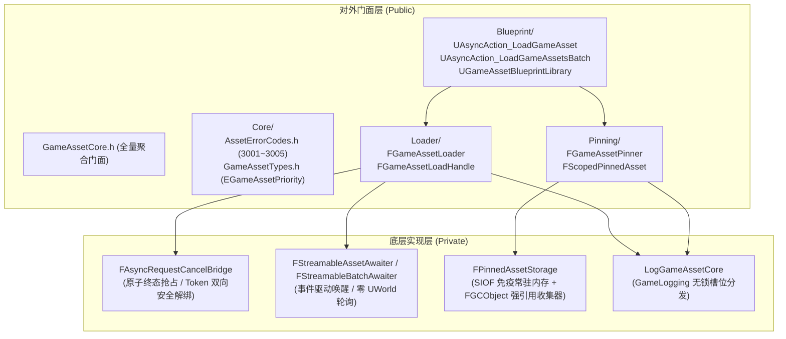

# GameAssetCore 架构概述与核心机制

**版本**: 2.0.0  
**定位**: Level 1 基础设施通用插件（异步资产流送、事件驱动 C++20 协程原语、FGCObject 常驻保活与蓝图异步节点）  
**依赖关系**: 公开依赖 `GameCore` + 引擎核心模块（`Core` / `CoreUObject` / `Engine`）；私有单向依赖 `GameLogging`（`LogGameAssetCore`）；**零横向业务/对象池依赖**。

---

## 一、 架构分层与组件拓扑

---

## 二、 四大关键工程设计

### 1. 事件驱动 C++20 协程加载（零逐帧轮询、零世界子系统耦合）
- **驻留快路径（Zero-Suspend Fast Path）**：协程进入后首先通过 `SoftAsset.Get()` 检查目标资产是否已驻留内存；若命中则直接 `co_return` 有效强类型指针，不创建流式句柄、不触发协程挂起。
- **单次挂起事件唤醒**：未驻留资产通过内部 `FStreamableAssetAwaiter` / `FStreamableBatchAwaiter` 直接向 `UAssetManager::GetStreamableManager().RequestAsyncLoad` 注册 `FStreamableDelegate`，依托 `GameCore` 的 `FGameCoroSuspensionGuard` 在加载完成时单次精确恢复，**无需依赖 `UWorld` 或 `UTimeSlicedTaskSubsystem`，彻底消除帧内忙等空转**。
- **全通道取消即时收敛**：同时监听外部 `FCancellationToken`、协程句柄 `Task.Cancel()` 以及宿主 `UObject` 存活守卫（`BindContext`）。任一取消条件触发时，立即通过线程安全 `FSharedCoroLoadState` 调用 `FStreamableHandle::CancelHandle()` 中止在途流式请求并安全销毁协程帧。

### 2. 严格强类型与类继承契约校验
- 单资产加载（`LoadAsync` / `LoadAsyncCoro` / `LoadSync`）在驻留态与流送完成态统一通过 `::GetValid` + `Cast<TAsset>` 过滤已标记垃圾回收（`MarkAsGarbage`）对象与类型不匹配资产。
- 类加载（`LoadClassAsync` / `LoadClassAsyncCoro` / `LoadClassSync`）统一返回 `TSubclassOf<TClass>` 并强制校验 `LoadedClass->IsChildOf(TClass::StaticClass())`，杜绝跨继承树误返回不兼容 `UClass*`；同步接口精确区分 `LoadFailed (3002)` 与 `TypeMismatch (3003)`。

### 3. SIOF 免疫与真 GC 强引用常驻保活 (`FGameAssetPinner` & `FScopedPinnedAsset`)
- **SIOF 免疫存储**：底层 `FPinnedAssetStorage` 在对齐静态缓冲区内通过 C++20 `std::construct_at` 原地构造，彻底消除跨编译单元静态初始化与退出期逆序析构崩溃。
- **单点 `FGCObject` 强引用收集**：内部唯一 `FGCObject` 收集器在 GC 屏障期间遍历常驻表并向引擎报告 `TObjectPtr<UObject>` 强引用。即便对于无磁盘包体的运行时动态 `UObject`，在 `PinAsset` 期间亦 100% 免疫 `CollectGarbage` 误杀，且已驻留对象锁定无需额外分配 `FStreamableHandle`。
- **单次加锁构造与零锁读取**：`PinAsset` 直接返回 `TGameStatusResult<UObject*>`，`FScopedPinnedAsset` 构造仅需 **1 次**加锁与哈希查找即可缓存原生指针，后续 `Get()` / `Get<T>()` 为纯栈指针读取。

### 4. 可观测性与日志分级纪律 (`LogGameAssetCore`)
- 通过 `PrivateDependencyModuleNames` 单向接入 `GameLogging`，公共头文件零日志宏泄漏，并受 `Game::Config::bEnableLog` 编译期开关控制（Shipping 零开销）：
  - **`Log`**：仅模块 `StartupModule` / `ShutdownModule` 生命周期里程碑；
  - **`Warning`**：磁盘流送失败、路径不存在、资产/基类类型契约不匹配、非游戏线程请求冷同步加载；
  - **`Verbose`**：异步流式请求发起、首次常驻建立、引用归零释放与全局清空；
  - **热路径静默**：内存驻留短路、常驻引用计数命中增减与高频状态查询路径绝对零日志输出。
