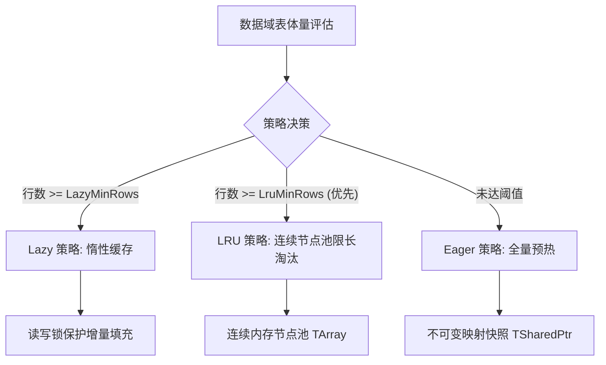
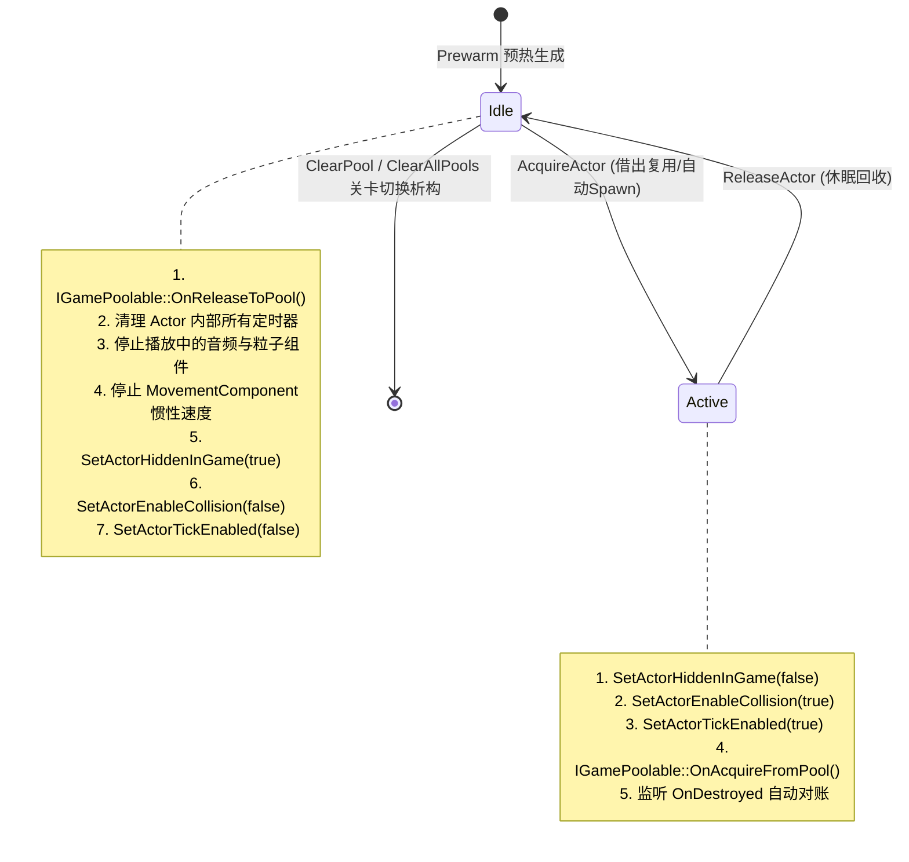

# GameCore 缓存与内存管理架构

本架构文档阐述 `GameCore` 中两个关键的高性能资源管理机制：**三策略版本化缓存（`FVersionedCache`）** 与 **通用 Actor 对象池（`UObjectPoolSubsystem`）**。

---

## 1. 三策略版本化缓存 (`FVersionedCache`)

在游戏运行时（尤其是配置数据、计算管线、复合数据查询中），不同数据规模对缓存的需求差异极大：
- **微小数据量（< 100 行）**：全量预热（Eager）开销极小且单次查询即最快；
- **超大规模数据量（> 10000 行）**：全量预热占用高内存且冷启动拖慢，适合惰性构建（Lazy）或 LRU 限长淘汰；
- **高并发读**：多线程查询时不能因缓存重建或扩容搬移而导致读取方拿到悬垂指针。

### 1.1 三种策略定义与自适应切换

- **策略配置**：`FCachePolicy::Resolve(Domain)` 从 `FConfigRegistry` 按 `Cache.{Domain}.*` 解析；默认阈值为 `MAX_int64`（即 Automatic 默认落 Eager），由项目按域配置 `LazyMinRows` / `LruMinRows` / `LruCapacity`。

- **Eager 策略**：
  整个缓存容器被包装在一个 `TSharedPtr<const TMap<KeyType, ValueType>>` 不可变快照中。重构时在锁外构建全新 Map，完成后只需原子替换共享指针。读取路径仅持极短只读读锁，并发性能无限逼近原生只读指针。
- **Lazy 策略**：
  未查询过的 Key 在首次命中时动态构建，后续查询直接命中缓存。
- **LRU 策略**：
  采用预分配的连续节点池（`TArray<FLruNode>`），利用 `int32` 索引构成双向链表。当缓存容量到达上限时，直接 O(1) 淘汰最久未访问节点，无零散小对象内存分配，彻底消灭内存碎片。

### 1.2 指针稳定化、单键失效与引用计数兜底
所有从缓存中取出的复合数据，均以 `TSharedPtr<const ValueType>` 形式交付给调用方。即便在缓存执行 `Rebuild()`、执行 LRU 驱逐或调用 `Invalidate(Key)` 精确单条剔除时：
- 被驱逐或失效的对象只是从缓存字典中移除；
- 外部正在使用该对象的线程持有着 `TSharedPtr`，对象的强引用计数仍大于零，对象不会被提前析构；
- 外部使用完毕后对象正常析构，彻底消灭野指针与生命周期竞态。
- 支持 `Invalidate(FName Key)` 精确失效单个配置键，配合目录监听实现按文件细粒度热更新，无需全量整表重建。
- **代次守卫（Generation Guard）**：每次 `Rebuild()` 自增代次；Lazy / LRU 在锁外完成构建后，若发现代次已变化（期间发生了新一次重建），丢弃旧代构建结果并重新取数，杜绝旧数据覆盖新快照。对应自动化测试 `Game.Core.Cache.GenerationGuard`。

---

## 2. 通用 Actor 对象池 (`UObjectPoolSubsystem`)

在动作、射击、弹幕或大规模怪物刷新场景中，频繁调用 `UWorld::SpawnActor` 与 `AActor::Destroy` 会导致：
1. 大量物理碰撞体注册与注销开销；
2. 组件层级重构；
3. 垃圾回收器（Garbage Collector）标记清理负担加剧，引发定时丢帧与卡顿。

### 2.1 对象池生命周期流转状态机

### 2.2 防 GC 顿卡核心技术
- **强引用容器持有与 O(1) 快速判定**：每个 Actor Class 对应一个 `FPoolBucket`，闲置 Actor 存放于 `UPROPERTY() TArray<TObjectPtr<AActor>> IdleActors` 中防止 GC，并同步维护 `UPROPERTY() TSet<TObjectPtr<AActor>> IdleActorSet`，使回收时的重复归还检查由 $O(N)$ 降至 $O(1)$。
- **无感休眠、深度状态复位与激活**：
  - 休眠时自动关闭渲染（`SetActorHiddenInGame(true)`）、关闭物理碰撞（`SetActorEnableCollision(false)`）、关闭每帧 Tick（`SetActorTickEnabled(false)`）；同时清理挂接的全部定时器（`ClearAllTimersForObject`）、停止活跃音效与粒子系统、清空移动速度，杜绝复用脏状态；
  - 借出唤醒时重置 Transform 并恢复显隐碰撞与 Tick，耗时不足原生 SpawnActor 的 5%。
- **容量上限与优雅淘汰**：支持 `MaxIdleCount` 容量保护，超出容量的回收行为直接走真实 `DestroyActor`，防止关卡内对象无限堆积造成内存泄漏。
- **外部异常销毁自愈**：借出时自动监听 `Actor->OnDestroyed`，一旦被外界意外 Destroy，活跃计数 `ActiveCount` 自动自愈扣减，消除计数永久虚高缺陷。

