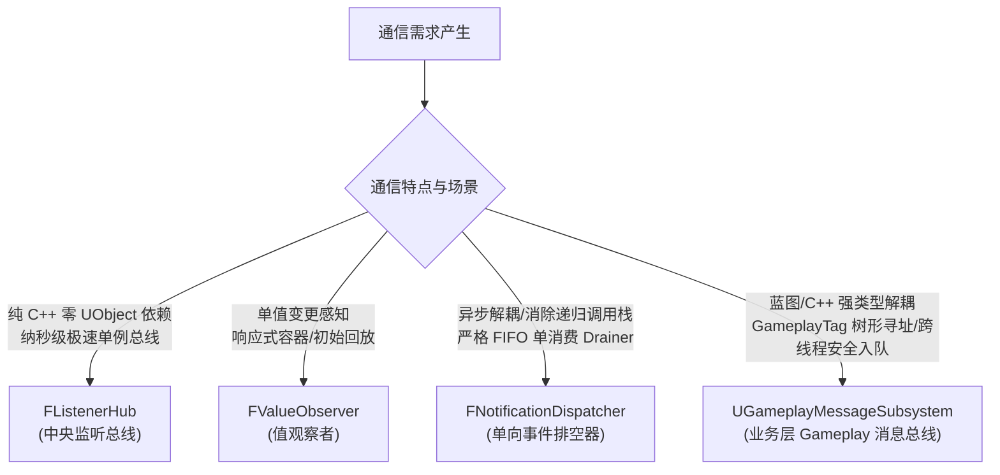
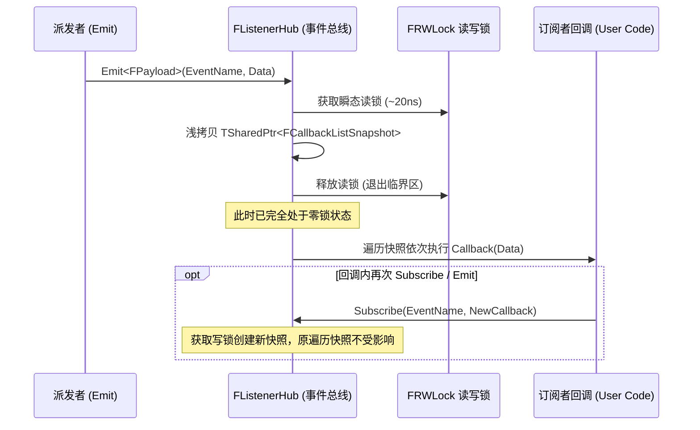

# GameCore 事件与消息通信体系架构

在大型游戏项目中，跨模块、跨对象的通信需求极其多样。`GameCore` 针对不同维度的通信场景，提供了职责清晰、定位互补的三层通信设施：



---

## 1. 通信机制详细对比与技术选型

| 特性 | `FListenerHub` | `FValueObserver<T>` | `FNotificationDispatcher` | `UGameplayMessageSubsystem` (Tier 1) |
| :--- | :--- | :--- | :--- | :--- |
| **存在形态** | 纯 C++ 静态单例 | 独立 C++ 实例 (可内嵌到任意类) | 纯 C++ 实例 / 单例 | `UGameInstanceSubsystem` (伴随游戏生命周期) |
| **推荐定位** | **引擎底层纯 C++ 高频内部通信** | **实体/组件内部响应式属性** | **异步解耦、削平调用栈深度** | **业务层/跨插件 Gameplay 解耦通信骨干** |
| **寻址方式** | `FName` 事件名 | 变量直接持有绑定 | `FName` 消息通道标识 | `FGameplayTag` 标签 (支持层级匹配与通配) |
| **载荷类型** | 任意 C++ 结构体/类 (非 UObject) | 单一泛型类型 `T` | 任意 C++ 结构体 | `UScriptStruct` 反射结构体 (支持动态多态) |
| **类型安全机制** | 64 位编译期指纹 + `sizeof` 校验 | 模板静态强类型 | 64 位编译期指纹校验 | `UScriptStruct` 强类型 RTTI 校验 |
| **当前值回放** | 否（事件无状态） | 支持 `SubscribeWithReplay` | 否（队列消费） | 否 |
| **蓝图支持** | 否 (专为高性能 C++ 设计) | 否 | 否 | 是 (`UAsyncAction_ListenForGameplayMessage`) |
| **并发保证** | Copy-on-Write 瞬态读锁快照，出锁派发 | 内部锁保护，出锁通知 | 互斥锁队列保护，单 Drainer 消费 | 主线程派发 + `EnqueueMessage` 跨线程安全入队 |
| **退订管理** | `FObserverSubscription` (RAII) | `FObserverSubscription` (RAII) | `FObserverSubscription` (RAII) | `FGameplayMessageListenerHandle` |

---

## 2. FListenerHub 架构与类型指纹安全

### 2.1 跨动态库类型指纹 (Type Fingerprint)
在动态链接库（DLL / dylib）环境下，C++ 原生 RTTI（`typeid`）可能因各模块符号独立而产生跨模块指针不一致问题。
`FListenerHub` 采用宏提取函数特征签名，并在编译期计算 64 位稳定哈希（CityHash64）：
```cpp
#if defined(_MSC_VER)
    #define GAME_TYPE_FINGERPRINT __FUNCSIG__
#elif defined(__clang__) || defined(__GNUC__)
    #define GAME_TYPE_FINGERPRINT __PRETTY_FUNCTION__
#endif
```
在订阅时，事件结构体通过 `GetPayloadTypeId()` 固化该类型的 64 位哈希指纹；在 `Emit` 派发时，校验入参类型的指纹与 `sizeof` 是否一致。不匹配时静默忽略并记录 Error 日志，避免在预期失败路径上触发断言。

### 2.2 Copy-on-Write 回调快照模型


---

## 3. FNotificationDispatcher 防重入与单 Drainer 机制

在深度嵌套的业务逻辑中，如果在回调过程中又触发新的事件派发，调用栈会急剧膨胀，极易引发爆栈或状态不同步。
`FNotificationDispatcher` 引入了 **FIFO 消息队列 + 原子单 Drainer** 消费机制：
- 任意线程调用 `EnqueueNotification` 将通知推入内部队列；
- 当前正在执行 `DrainQueue()` 的线程成为唯一 Drainer；
- 回调中新产生的入队操作仅向队尾追加，不会打断当前消费循环，杜绝递归重入；
- 消费完全按先进先出（FIFO）顺序展开，彻底抹平调用栈。
