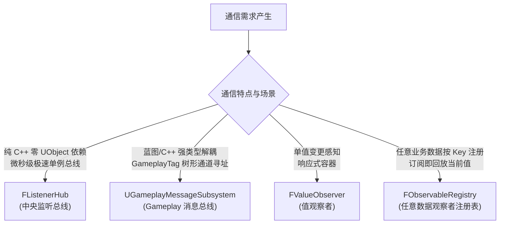
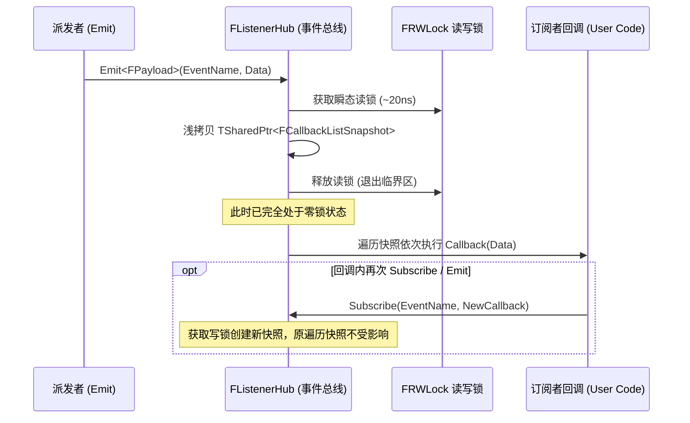

# GameCore 事件与消息通信体系架构

在大型游戏项目中，跨模块、跨对象的通信需求极其多样。`GameCore` 针对不同维度的通信场景，提供了四种职责清晰、定位互补的通信设施：



---

## 1. 四种通信机制详细对比

| 特性 | `FListenerHub` | `UGameplayMessageSubsystem` | `FValueObserver<T>` | `FObservableRegistry` |
| :--- | :--- | :--- | :--- | :--- |
| **存在形态** | 纯 C++ 静态单例 (函数局部静态) | `UGameInstanceSubsystem` (伴随游戏生命周期) | 独立 C++ 实例 (可内嵌到任意类中) | 纯 C++ 注册表 + `UWorldSubsystem` 入口 |
| **寻址方式** | `FName` 事件名 | `FGameplayTag` 标签 (支持层级匹配) | 变量直接持有绑定 | `FName` 数据键 |
| **载荷类型** | 任意 C++ 结构体/类 (值传递或引用) | `UScriptStruct` 反射结构体 (支持动态多态) | 单一泛型类型 `T` | 任意泛型类型 `T`，由注册方决定 |
| **类型安全机制** | `GAME_TYPE_FINGERPRINT` 64 位编译期哈希 + `sizeof` 双指纹校验 | `UScriptStruct` 强类型 RTTI 校验 | C++ 模板静态类型检查 | `GetTypeFingerprint<T>()` 类型指纹守卫 |
| **当前值回放** | 否（事件无状态） | 否 | `SubscribeWithReplay` | `Subscribe` 内部即回放 |
| **蓝图支持** | 否 (专为高性能 C++ 设计) | 是 (`UAsyncAction_ListenForGameplayMessage` 异步动作监听与 `HasListener` 判定) | 否 | 否 |
| **并发保证** | Copy-on-Write 瞬态读锁快照，出锁派发 | 主线程派发 | 内部锁保护，出锁通知 | 键表读写锁保护，观察者出锁通知 |
| **退订管理** | `FObserverSubscription` (RAII 守卫) | `FGameplayMessageListenerHandle` | `FObserverSubscription` (RAII 守卫) | `TSharedPtr<FObserverSubscription>` (RAII 守卫) |

---

## 2. FListenerHub 架构与类型指纹安全

### 2.1 跨动态库类型指纹 (Type Fingerprint)
在动态链接库（DLL / dylib）环境下，C++ 原生 RTTI（`typeid`）可能因各模块符号独立而产生跨模块指针不一致问题。
`FListenerHub` 采用宏提取函数特征签名，并在编译期计算 64 位稳定哈希（CityHash64）：
```cpp
#if defined(_MSC_VER)
    #define GAME_TYPE_FINGERPRINT __FUNCSIG__
#elif defined(__clang__) || defined(__GNUC__)
    #define GAME_TYPE_FINGERPRINT __PRETTY_FUNCTION__
#endif
```
在订阅时，事件结构体通过 `GetPayloadTypeId()` 固化该类型的 64 位哈希指纹；在 `Emit` 派发时，校验入参类型的指纹与 `sizeof` 是否一致。不匹配时静默忽略并记录 Error 日志，避免在预期失败路径上触发断言。

### 2.2 Copy-on-Write 回调快照模型


---

## 3. UGameplayMessageSubsystem 架构

### 3.1 基于 GameplayTag 的分层匹配
`UGameplayMessageSubsystem` 采用标签树进行消息寻址。支持两种匹配策略：
- `ExactMatch`：只有完全匹配该 Tag（如 `Event.Item.Obtain.Gold`）才收到通知。
- `PartialMatch`：支持父标签广播与子标签监听（基于 `FGameplayTag::MatchesTag`）。例如监听 `Event.Item` 的系统，可以捕获 `Event.Item.Obtain`、`Event.Item.Use` 等全部子级事件。

### 3.2 强类型结构体验证
派发载荷必须派生自 `UScriptStruct`（通过 `USTRUCT()` 宏声明）。注册监听器时，监听器声明期望的 `UScriptStruct`；派发时，系统校验实际传入的结构体类型是否与期望类型匹配，若不匹配则拒绝派发并打印错误，确保类型绝对安全。

---

## 4. FObservableRegistry 架构

### 4.1 按 Key 的任意类型注册
`Game::Core::FObservableRegistry` 将「数据键」与「值类型」一起注册：

```cpp
Registry.Register<float>(TEXT("Combat.CritChance"));
Registry.Register<int32>(TEXT("Skill.Fire.CooldownMs"));
```

- 同一 Key 只能绑定一种值类型；类型不一致时注册/查找返回 `nullptr` 并记录 Error。
- 暴击、闪避、冷却等属性无需框架预定义，完全由业务决定。

### 4.2 订阅即回放
`Subscribe<T>` 内部复用 `FValueObserver<T>::SubscribeWithReplay`：先注入监听，再回放当前值，保证订阅方不会因为「数据在订阅前已就绪」而漏读。

### 4.3 世界级生命周期
`UObservableRegistrySubsystem` 为 `UWorldSubsystem`，注册表随 World 销毁自动回收；跨关卡不残留监听与数据，避免 PIE 多次运行间的脏状态。

