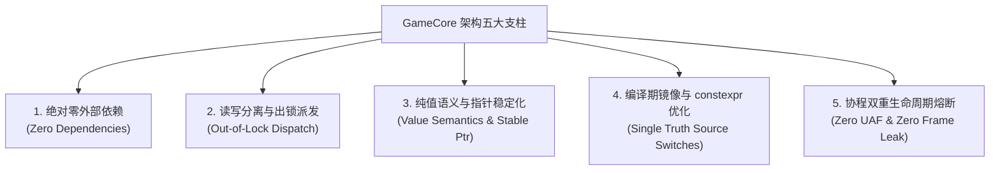
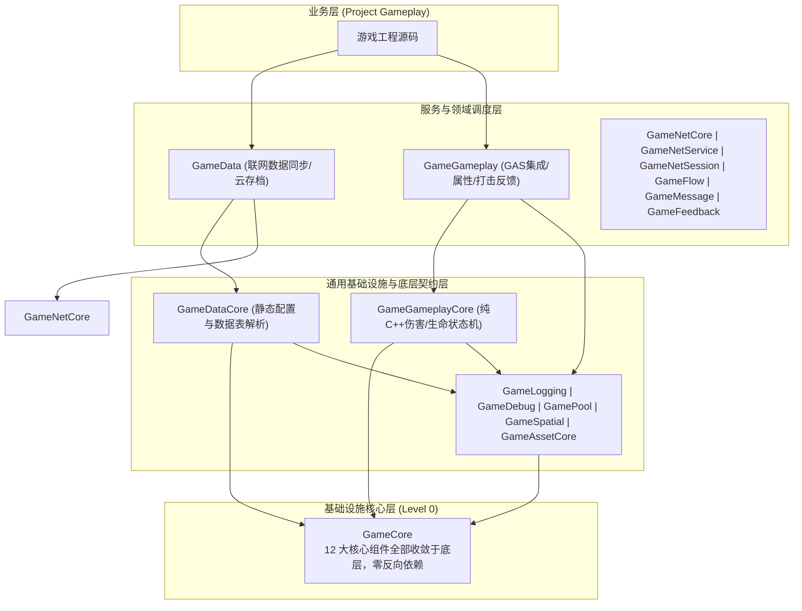

# GameCore 架构概览与核心设计原则

## 1. 定位与设计哲学

`GameCore` 是整个架构体系的基石底座（Level 0）。为了保证其在各类 UE5 项目中的通用性、健壮性与可移植性，其严格遵循以下五大设计公理：

1. **绝对零外部依赖**：仅依赖引擎原生 `Core`, `CoreUObject`, `Engine`, `GameplayTags`，绝不引用任何上层业务插件，保证可独立插拔并任意跨项目复用。
2. **出锁派发铁律（Never Call User Code Inside A Lock）**：
   - 读接口在内部加读锁完成值拷贝后立即释放锁，调用方处于绝对零锁状态。
   - 写入操作在写锁内完成数据变更，**出锁后再派发用户回调**（涵盖 `FConfigRegistry`、`FCancellationToken`、`TGameCoroTask`）。严禁在持锁状态下调用任何外部函数或代理，彻底消灭递归重入与跨锁死锁。
3. **纯值语义与指针稳定化**：
   - 配置与消息采用值语义（TVariant / Copy）或不可变共享智能指针（`TSharedPtr<const T>`）。
   - 缓存驱逐与重构期间由引用计数兜底，外部已持有的读取指针绝不悬垂。
4. **宏为唯一真源，constexpr 派生镜像**：
   - 所有编译期硬开关集中在 `GameCompileSwitches.h`，统一派生为 `namespace Game::Config` 内的 `constexpr bool`，消除预处理器宏与 C++ 常量漂移问题。
5. **协程双重生命周期熔断 (Zero UAF & Zero Leak)**：
   - `TGameCoroTask` 挂起点守卫 `FGameCoroSuspensionGuard` 在唤醒协程恢复前二次校验宿主存活与取消状态；若失效或被取消，自动原地调用 `CoroHandle.destroy()` 触发协程帧局部 RAII 析构，绝不恢复执行挂起点之后的悬垂代码。

---

## 2. 核心 12 组件全景矩阵

`GameCore` 内部涵盖 12 个高内聚、机制与外壳彻底解耦的纯 C++ 子系统：

| 组件 ID | 核心设施与原语 | 机制特点 | 专属 API 规范链接 |
|---|---|---|:---:|
| **01. Config** | `FConfigRegistry`, `FConfigSourceBridge` | 读写锁、单向级联多源覆盖、PIE 自动回滚 | [ConfigRegistry.md](../API/ConfigRegistry.md) |
| **02. Types** | `TGameResult<T>`, `FGameError`, `FFastTagBitmask`, `FGameDistId` | 强类型错误、64 位快速标签位掩码、无撞车 Snowflake 分布式 ID | [RandomAndTypes.md](../API/RandomAndTypes.md) |
| **03. Containers** | `TSlotMap`, `TSortedVectorMap`, `TLockFreeRingBuffer` | 紧凑存储代际句柄防 ABA、连续内存二分查找、SPSC 零锁环形缓冲 | [Containers.md](../API/Containers.md) |
| **04. Memory** | `TLinearArena`, `FScopedFrameScratchpad`, `TFixedBlockAllocator`, `TScratchArray` | 1~3ns 极速线性分配、双缓冲帧局部暂存栈、侵入式空闲链表、栈保底动态数组 | [Memory.md](../API/Memory.md) |
| **05. Determinism** | `FFixedTimestepAccumulator`, `TRewindSnapshotBuffer` | 亚毫秒固定步长累加器、确定性逻辑回放快照环形缓冲区 | [Determinism.md](../API/Determinism.md) |
| **06. Random** | `FGameRandomStream`, `FPseudoRandomDistribution`, `UGameRandomManager` | PCG32 高质量伪随机、PRD 真实保底暴击分布、子系统状态序列化 | [Random.md](../API/Random.md) |
| **07. State** | `TGameStateMachine`, `TPriorityArbitrator` | 编译期强类型层次有限状态机、动态权值多源仲裁器 | [State.md](../API/State.md) |
| **08. Math** | `FGameMath`, `FGameQuantization`, `FStateChecksum` | 平滑曲线与插值、64 位高精度向量压缩量化、增量状态 Adler32/CRC32 校验 | [Math.md](../API/Math.md) |
| **09. Listener** | `FListenerHub`, `FValueObserver<T>`, `FNotificationDispatcher` | 64 位类型指纹 COW 快照事件总线、响应式属性观察、单 Drainer 防重入派发器 | [ListenerHub.md](../API/ListenerHub.md) |
| **10. Cache** | `FVersionedCache`, `FCachePolicy` | Eager 快照/Lazy/LRU 节点池/Clock 二次机会自适应、代次守卫防脏写 | [Cache.md](../API/Cache.md) |
| **11. Async** | `FGameThreadTaskRunner`, `UTimeSlicedTaskSubsystem`, `UThrottledTickerSubsystem`, `TGameCoroTask` | 工作线程安全投递、帧预算切片、分相交错节流、C++20 生产级无栈协程 | [Async.md](../API/Async.md) |
| **12. Profiling & Service** | `FScopedCpuTimer`, `FGameServiceLocator`, `FGameCoreModule` | 零开销 RAII 微秒采样、滑动平均统计、纯 C++ 依赖注入定位、模块关停协同排空 | [ProfilingAndService.md](../API/ProfilingAndService.md) |

---

## 3. 模块分层与工程拓扑

---

## 4. 并发与内存安全规范

### 4.1 读写锁与 COW 快照
- `FConfigRegistry`：写操作在 `FRWLock` 独占写锁下更新配置变体并捕获待触发订阅列表，退出写锁后再无锁触发回调。
- `FListenerHub`：采用 **Copy-on-Write (COW)** 快照模式。事件触发 `Emit` 时仅瞬态持读锁约 20ns 复制回调列表共享指针，随后出锁遍历快照。用户回调内部可安全地再次 `Subscribe` 或 `Emit`，零死锁风险。

### 4.2 节点池化与无每 Key 堆分配 (LRU Cache)
传统 LRU 实现通常依赖 `std::list` 与 `std::unordered_map`，在缓存插入和更新时频繁进行小内存堆分配与指针解引用，极易导致内存碎片并引发 Cache Miss。
`FVersionedCache` 的 LRU 实现采用 **连续节点池数组（`TArray<FLruIndexPool::FLruNode>`）+ `int32` 索引双向链表**：
- 节点分配在预分配的连续内存块中，具备极佳的 CPU 缓存局部性；
- 索引链操作代替裸指针，消灭指针悬垂和释放后使用（UAF）漏洞。
