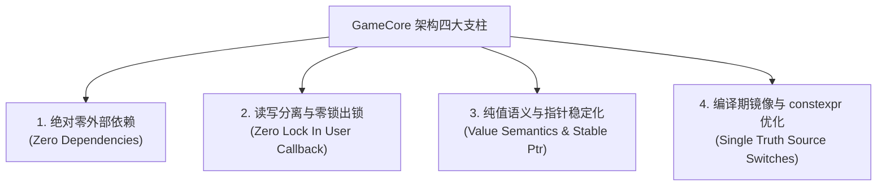
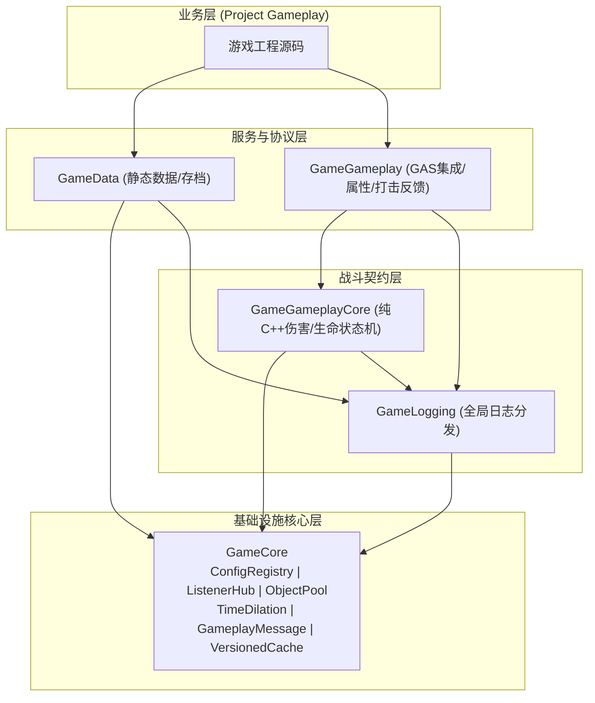

# GameCore 架构概览与核心设计原则

## 1. 定位与设计哲学

`GameCore` 是整个架构体系的根基（Layer 0）。为了保证其在各类 UE5 项目中的通用性、健壮性与可移植性，其严格遵循以下四大设计公理：

1. **绝对零外部依赖**：仅依赖引擎底层 `Core`, `CoreUObject`, `Engine`, `GameplayTags`，绝不引用上层业务插件，保证可独立拔插并任意迁移。
2. **出锁派发铁律（Never Call User Code Inside A Lock）**：
   - 读接口在内部加读锁完成值拷贝后立即释放锁，调用方处于绝对零锁状态。
   - 写入操作在写锁内完成数据变更，**出锁后再派发用户回调**。严禁在持锁状态下调用任何外部函数或代理，彻底消灭递归重入与跨锁死锁。
3. **纯值语义与指针稳定化**：
   - 配置与消息采用值语义（TVariant / Copy）或不可变共享智能指针（`TSharedPtr<const T>`）。
   - 缓存驱逐与重构期间由引用计数兜底，外部已持有的读取指针绝不悬垂。
4. **宏为唯一真源，constexpr 派生镜像**：
   - 所有编译期硬开关集中在 `GameCompileSwitches.h`，统一派生为 `namespace Game::Config` 内的 `constexpr bool`，消除预处理器宏与 C++ 常量漂移问题。

---

## 2. 模块分层与依赖关系

---

## 3. 并发与内存安全规范

### 3.1 读写锁与 COW 快照
- `FConfigRegistry`：写操作在 `FRWLock` 独占写锁下更新配置变体并捕获待触发订阅列表，退出写锁后再无锁触发回调。
- `FListenerHub`：采用 **Copy-on-Write (COW)** 快照模式。事件触发 `Emit` 时仅瞬态持读锁约 20ns 复制回调列表共享指针，随后出锁遍历快照。用户回调内部可安全地再次 `Subscribe` 或 `Emit`，零死锁风险。

### 3.2 节点池化与无每 Key 堆分配 (LRU Cache)
传统 LRU 实现通常依赖 `std::list` 与 `std::unordered_map`，在缓存插入和更新时频繁进行小内存堆分配与指针解引用，极易导致内存碎片并引发 Cache Miss。
`FVersionedCache` 的 LRU 实现采用 **连续节点池数组（`TArray<FLruNode>`）+ `int32` 索引双向链表**：
- 节点分配在预分配的连续内存块中，具备极佳的 CPU 缓存局部性；
- 索引链操作代替裸指针，消灭指针悬垂和释放后使用（UAF）漏洞。

