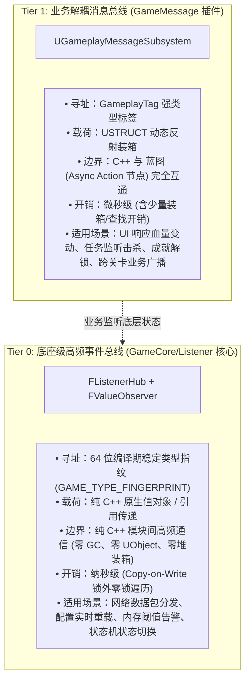

# 两级事件总线架构规范 (Two-Tier Event Architecture)

**版本**: 1.0.0  
**适用范围**: 全项目所有插件与业务开发

---

## 一、 为什么需要两级事件总线？

大型游戏工程中，单一通信模型无法同时满足“极端性能”与“蓝图高灵活性”的诉求：
- 如果全部使用 UE 原生反射（如 `GameplayMessageSubsystem` 或多播委托）：在网络高频包解析、内存告警、物理步进、Tick级状态监听等微秒级高频路径上，反射动态查找、USTRUCT 堆装箱与 GC 引用跟踪会产生严重的性能损耗与内存抖动。
- 如果全部使用纯 C++ 函数指针或静态委托：Gameplay 策划与蓝图开发者无法通过节点订阅事件，业务松耦合与异步流转难以推行。

为此，本项目正式确立 **两级事件模型（Two-Tier Event Model）**：



---

## 二、 详细选型决策矩阵

| 评估维度 | Tier 0：`FListenerHub` (底座级) | Tier 1：`UGameplayMessageSubsystem` (业务级) |
|---|---|---|
| **代码位置** | `Plugins/GameCore/Source/GameCore/Public/Listener/` | `Plugins/GameMessage/Source/GameMessage/Public/` |
| **寻址机制** | 强类型 C++ 结构体 64 位指纹（编译期确定） | `FGameplayTag`（层级标签，支持通配/继承） |
| **蓝图支持** | 否（纯 C++ 内部基石） | 是（支持蓝图异步监听节点、动态 Payload） |
| **内存与 GC** | **绝对零堆装箱、零 GC 扫描、零 UObject 依赖** | 依赖 UE 反射，Payload 为 USTRUCT |
| **并发安全性** | Copy-on-Write 快照，支持并发读取与重入订阅 | 依赖主线程/世界子系统生命周期 |
| **单次派发耗时** | **~5 - 20 纳秒**（数组指针偏移直接调用） | **~200 - 800 纳秒**（Tag 树匹配与反射解包） |

---

## 三、 典型应用范例

### 1. 何时使用 Tier 0 (`FListenerHub`)
```cpp
// 场景：网络层底层反序列化出一个数据包，需要极速通知逻辑层，每秒上千次
struct FNetPacketArrivedEvent {
    int32 ChannelId;
    TArrayView<const uint8> Payload;
};

// 订阅（极速零 GC）
FObserverSubscription Sub = FListenerHub::Get().Subscribe<FNetPacketArrivedEvent>(
    [](const FNetPacketArrivedEvent& Evt) {
        // 处理数据包
    }
);

// 广播（纳秒级无锁遍历）
FListenerHub::Get().Broadcast(FNetPacketArrivedEvent{1, DataView});
```

### 2. 何时使用 Tier 1 (`UGameplayMessageSubsystem`)
```cpp
// 场景：怪物死亡，UI 弹出结算面板，成就系统监听进度
USTRUCT(BlueprintType)
struct FMonsterKilledMessage {
    GENERATED_BODY()
    UPROPERTY(EditAnywhere, BlueprintReadWrite)
    FName MonsterId;
};

// 蓝图或 C++ 广播
UGameplayMessageSubsystem::Get(this).BroadcastMessage(
    FGameplayTag::RequestGameplayTag("Event.Combat.MonsterKilled"),
    FMonsterKilledMessage{TEXT("Boss_Dragon")}
);
```

---

## 四、 架构红线
1. **严禁在每帧高频 Tick 路径或底层网络协议循环中使用 Tier 1 消息总线**。
2. **严禁让 Tier 0 (`FListenerHub`) 反向依赖任何上层业务类型或 GameplayTag**。
