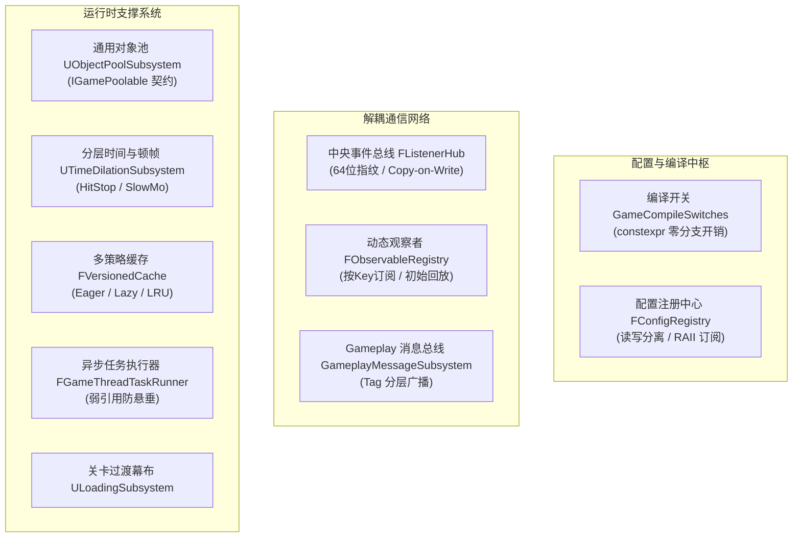

# GameCore 插件

**GameCore** 是全项目的通用底层核心框架库。它遵循**零外部依赖、跨项目无缝拔插复用、纯值语义、强类型安全与高并发无锁/快照并发**设计原则，为上层模块提供统一的配置注册中心、类型安全解耦消息通信、高复用对象池、分层时间缩放（HitStop）、多策略自适应缓存、异步续体调度与关卡加载中枢。

---

## 架构全景



---

## 核心特性一览

| 模块 / 机制 | 关键技术亮点 | 核心文件 / 接口 |
| :--- | :--- | :--- |
| **集中编译开关** | 宏为唯一真源，派生 `constexpr bool` 镜像，消除双源漂移与分支损耗 | `Config/GameCompileSwitches.h` |
| **配置注册中心** | `FRWLock` 读写分离，纯值语义拷贝出锁，RAII 订阅（`FObserverSubscription`），只读保护 | `Config/FConfigRegistry.h`<br>`Config/UConfigBPLibrary.h` |
| **中央事件总线** | 跨 DLL 稳定 64 位类型指纹（`GAME_TYPE_FINGERPRINT`），Copy-on-Write 回调快照，回调遍历全程零锁 | `Listener/FListenerHub.h` |
| **响应式数值观察者** | 泛型响应式容器 `FValueObserver<T>`，值变更时自动触发订阅通知，`SubscribeWithReplay` 订阅即得当前值 | `Listener/FValueObserver.h` |
| **任意数据观察者注册表** | 按 `FName` 键注册任意类型观察者（`FObservableRegistry`），跨 DLL 类型指纹守卫，世界级子系统 `UObservableRegistrySubsystem` 随关卡自动隔离 | `Listener/FObservableRegistry.h`<br>`System/UObservableRegistrySubsystem.h` |
| **Gameplay 消息子系统** | 基于 `GameplayTag` 分层寻址与 `UScriptStruct` 强类型校验的解耦消息总线 | `Message/GameplayMessageSubsystem.h` |
| **通用 Actor 对象池** | 世界级子系统，自动休眠/唤醒/容量控制，防 GC 卡顿，契约式 `IGamePoolable` | `Pool/ObjectPoolSubsystem.h`<br>`Pool/IGamePoolable.h` |
| **分层时间与顿帧 (HitStop)** | 局部 Actor 卡肉顿帧 + 全局分层时间缩放，优先级覆盖与时间平滑恢复 | `Time/TimeDilationSubsystem.h` |
| **三策略版本化缓存** | Eager 全量预热 / Lazy 惰性填充 / LRU 限长连续节点池，不可变快照与指针稳定化 | `Cache/FVersionedCache.h` |
| **目录变更监听器** | `FTSTicker` 周期扫描文件时间戳，自增序号广播，消费方零轮询成本 | `IO/FDirectoryChangeWatcher.h` |
| **异步任务执行器** | `UE::Tasks::Launch` 配合主线程 `AsyncTask` 续体，宿主弱引用（`TWeakObjectPtr`）自动短路防悬垂 | `Tasks/FGameThreadTaskRunner.h` |
| **关卡流转与加载幕布** | 配置驱动的平滑关卡过渡中枢，无硬编码关卡名 | `System/ULoadingSubsystem.h` |

---

## 插件依赖

- **依赖项**：仅依赖引擎基础模块：`Core`, `CoreUObject`, `Engine`, `GameplayTags`
- **外部依赖**：0（零依赖其他业务插件，可直接复制到任何 UE5 工程根目录的 Plugins 中独立使用）
- **C++ 标准**：C++20

---

## 快速上手示例

### 1. 动态配置注册与监听
```cpp
#include "Config/FConfigRegistry.h"

// 注册并获取配置
Game::Config::FConfigRegistry::Get().SetConfig(TEXT("Player.WalkSpeed"), 600.0f);
float WalkSpeed = Game::Config::FConfigRegistry::Get().GetConfig<float>(TEXT("Player.WalkSpeed"), 450.0f);

// 响应式监听（RAII 订阅，离开作用域自动退订）
const TSharedRef<FObserverSubscription> Sub = Game::Config::FConfigRegistry::Get().WatchConfig<float>(
    TEXT("Player.WalkSpeed"),
    [](float NewSpeed) {
        UE_LOG(LogTemp, Log, TEXT("Player walk speed changed to: %.1f"), NewSpeed);
    }
);
```

### 2. 注册任意游戏数据并订阅

```cpp
#include "System/UObservableRegistrySubsystem.h"

UObservableRegistrySubsystem* Observables = UObservableRegistrySubsystem::Get(this);
Game::Core::FObservableRegistry& Registry = Observables->GetRegistry();

Registry.Register<float>(TEXT("Combat.CritChance"));
Registry.Set<float>(TEXT("Combat.CritChance"), 0.25f);

// 订阅即回放当前值，之后每次 Set 收到更新
const TSharedPtr<FObserverSubscription> CritSub = Registry.Subscribe<float>(
    TEXT("Combat.CritChance"),
    [](const float& Value) {
        UE_LOG(LogTemp, Log, TEXT("Crit chance: %.2f"), Value);
    }
);
```

- Key 与值类型均由业务决定，暴击、闪避、冷却等任意数据无需框架预定义。
- 同一 Key 注册为不同类型时返回 `nullptr` 并记录错误，绝不静默踩踏。
- 注册表随 World 销毁自动回收，不跨关卡泄漏。

### 3. 对象池借出与归还 Actor
```cpp
#include "Pool/ObjectPoolSubsystem.h"

// 从池中借出 Actor 并自动唤醒（复用或自动 Spawn）
APawn* Monster = UObjectPoolSubsystem::Get(GetWorld()).AcquireActor<APawn>(MonsterClass, SpawnTransform);

// 使用完毕后归还给池休眠，避免 SpawnActor/DestroyActor 的 GC 与分配开销
UObjectPoolSubsystem::Get(GetWorld()).ReleaseActor(Monster);
```

### 4. HitStop 顿帧（打击感停顿）
```cpp
#include "Time/TimeDilationSubsystem.h"

// 受击者受击定格 0.08 秒
UTimeDilationSubsystem::Get(GetWorld()).RequestHitStop(VictimActor, 0.08f);

// 全局慢动作（子弹时间）：将全局 SlowMo 通道缩放设为 0.2，持续 1.0 秒（结束时 0.2 秒平滑淡出）
UTimeDilationSubsystem::Get(GetWorld()).RequestGlobalDilation(ETimeDilationChannel::SlowMo, 1.0f, 0.2f, 0.2f);
```

---

## 目录结构

```text
Plugins/GameCore/
├── Source/
│   └── GameCore/
│       ├── Public/
│       │   ├── GameCore.h
│       │   ├── Cache/         # FVersionedCache 多策略缓存
│       │   ├── Config/        # 编译开关与配置注册表
│       │   ├── IO/            # 目录与文件变更监听器
│       │   ├── Listener/      # FListenerHub 事件总线、FValueObserver、FObservableRegistry
│       │   ├── Message/       # GameplayMessageSubsystem 消息总线
│       │   ├── Pool/          # UObjectPoolSubsystem 通用对象池
│       │   ├── Registration/  # 模块生命周期注册契约
│       │   ├── System/        # ULoadingSubsystem、UObservableRegistrySubsystem
│       │   ├── Tasks/         # FGameThreadTaskRunner 异步任务调度
│       │   ├── Tests/         # 自动化单元测试
│       │   └── Time/          # UTimeDilationSubsystem 时间与顿帧
│       ├── Private/
│       │   └── ... (对应实现文件)
│       └── GameCore.Build.cs
├── Docs/                      # 分类技术文档库
│   ├── Architecture/          # 核心架构设计文档
│   │   ├── Overview.md
│   │   ├── EventAndMessaging.md
│   │   ├── CachingAndMemory.md
│   │   └── Performance.md
│   ├── API/                   # 公共接口详细参考
│   │   ├── ConfigRegistry.md
│   │   ├── ListenerHub.md
│   │   ├── ObservableRegistry.md
│   │   ├── GameplayMessageSubsystem.md
│   │   ├── ObjectPoolSubsystem.md
│   │   ├── TimeDilationSubsystem.md
│   │   └── AsyncAndIO.md
│   └── Guides/                # 实践与集成指南
│       ├── QuickStart.md
│       ├── ConfigAndSwitchesGuide.md
│       ├── ObjectPoolingGuide.md
│       └── MessagingGuide.md
├── GameCore.uplugin
└── README.md
```

---

## 文档导航

所有完整文档已按职责分类收录于 `Docs/` 目录中：

- **架构设计 (Architecture)**
  - [架构概览与并发哲学](Docs/Architecture/Overview.md)：阐述读写锁语义、零外部依赖设计、指针稳定化与出锁派发铁律。
  - [事件与消息通信体系架构](Docs/Architecture/EventAndMessaging.md)：对比 `FListenerHub`、`GameplayMessageSubsystem` 与 `FValueObserver` 的选型与底层设计。
  - [缓存与内存管理架构](Docs/Architecture/CachingAndMemory.md)：不可变快照、LRU 连续节点池与通用对象池的复用机制。
  - [性能基准与预算](Docs/Architecture/Performance.md)：缓存查找、监听吞吐、Stat 查询的实测基线与回归阈值。
- **接口参考 (API Reference)**
  - [配置注册中心 API](Docs/API/ConfigRegistry.md)：`FConfigRegistry`、`UConfigBPLibrary`、`FConfigVariant`。
  - [中央监听总线 API](Docs/API/ListenerHub.md)：`FListenerHub`、`FValueObserver`、`FObserverSubscription`。
  - [任意数据观察者注册表 API](Docs/API/ObservableRegistry.md)：`FObservableRegistry`、`UObservableRegistrySubsystem`。
  - [Gameplay 消息总线 API](Docs/API/GameplayMessageSubsystem.md)：`UGameplayMessageSubsystem` 标签消息派发与注册句柄。
  - [通用对象池 API](Docs/API/ObjectPoolSubsystem.md)：`UObjectPoolSubsystem`、`IGamePoolable` 生命周期接口。
  - [时间膨胀与顿帧 API](Docs/API/TimeDilationSubsystem.md)：`UTimeDilationSubsystem`、通道优先级与 HitStop 状态。
  - [异步任务与 I/O 监听 API](Docs/API/AsyncAndIO.md)：`FGameThreadTaskRunner`、`FDirectoryChangeWatcher`、`ULoadingSubsystem`。
- **使用指南 (Guides)**
  - [快速上手指南](Docs/Guides/QuickStart.md)：新工程挂载与核心基础设施初始化。
  - [编译开关与动态配置指南](Docs/Guides/ConfigAndSwitchesGuide.md)：硬开关定制、只读保护与蓝图读写。
  - [对象池使用与最佳实践](Docs/Guides/ObjectPoolingGuide.md)：预热、生成、回收、防 GC 卡顿实战。
  - [消息通信实战指南](Docs/Guides/MessagingGuide.md)：跨模块解耦通信的最佳选型与实战代码样例。

