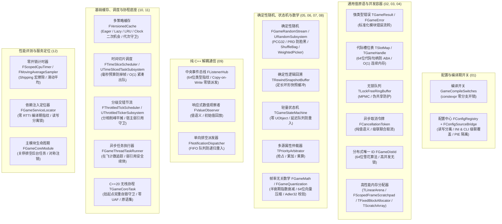

# GameCore 插件

**GameCore** 是全项目的通用底层核心框架库（当前版本 **3.1.0**）。它遵循**绝对零业务依赖、机制与外壳彻底解耦、纯值语义、强类型安全与高并发无锁/快照并发**设计原则，为上层模块提供最底层的通用基础设施：编译开关镜像、配置中心与多源级联桥接、确定性随机数与抽卡算法、强类型错误与代际槽位表、轻量表驱动状态机与帧率无关游戏数学、通用异步取消令牌、无锁 MPMC 环形缓冲区、多源优先级属性仲裁器、中央纯 C++ 事件总线与响应式数值观察者、四策略版本化缓存、主线程帧预算时间切片与分级交错节流调度器、C++20 轻量无栈协程原语集，以及零开销高精度性能评测与纯 C++ 线程安全服务定位容器。

---

## 架构全景



---

## 12 核心组件一览与 API 规范索引

| 序号 | 核心组件 | 关键原语与设计亮点 | 专属技术规范 |
|:---:|---|---|:---:|
| **01** | **Config** | `FConfigRegistry`, `FConfigSourceBridge`, `GameCompileSwitches`<br>读写分离锁出锁派发、多源单向覆盖、PIE 独立隔离与退出自动回滚 | [ConfigRegistry.md](Docs/API/ConfigRegistry.md) |
| **02** | **Types** | `TGameResult<T>`, `FGameError`, `FFastTagBitmask`, `FGameDistId`, `FGameLocalId`<br>强类型链式错误流转、64位标签快速位掩码、雪花算法唯一分布式 ID | [RandomAndTypes.md](Docs/API/RandomAndTypes.md) |
| **03** | **Containers** | `TSlotMap`, `TSortedVectorMap`, `TLockFreeRingBuffer`<br>密集连续内存与 64 位代际句柄防 ABA、连续内存二分排序、MPMC 零锁队列 | [Containers.md](Docs/API/Containers.md) |
| **04** | **Memory** | `TLinearArena`, `FScopedFrameScratchpad`, `TFixedBlockAllocator`, `TScratchArray`<br>1~3ns 极速线性分配、双缓冲帧局部暂存栈、侵入式空闲链表、栈保底动态数组 | [Memory.md](Docs/API/Memory.md) |
| **05** | **Determinism** | `FFixedTimestepAccumulator`, `TRewindSnapshotBuffer`<br>亚毫秒固定步长累加器、防螺旋死锁截断、确定性历史回放快照环形缓冲区 | [Determinism.md](Docs/API/Determinism.md) |
| **06** | **Random** | `FGameRandomStream`, `FPseudoRandomDistribution`, `URandomSubsystem`<br>纯整数 PCG32 跨平台位级一致流、PRD 伪随机防连黑、洗牌袋与权重抽取 | [Random.md](Docs/API/Random.md) |
| **07** | **State** | `TGameStateMachine`, `TPriorityArbitrator`<br>编译期类型安全有限状态机（延迟队列防重入）、抢占/累加/乘算多源属性仲裁器 | [State.md](Docs/API/State.md) |
| **08** | **Math** | `FGameMath`, `FGameQuantization`, `FStateChecksum`<br>半衰期指数衰减阻尼与临界弹簧、64位高精度向量压缩、Adler32/CRC32 校验 | [Math.md](Docs/API/Math.md) |
| **09** | **Listener** | `FListenerHub`, `FValueObserver<T>`, `FNotificationDispatcher`<br>64位类型指纹 COW 快照事件总线、响应式属性观察、单 Drainer 防重入派发器 | [ListenerHub.md](Docs/API/ListenerHub.md) |
| **10** | **Cache** | `FVersionedCache`, `FCachePolicy`<br>Eager 全量快照/Lazy/LRU 节点池/Clock 二次机会自适应、代次守卫与指针稳定化 | [Cache.md](Docs/API/Cache.md) |
| **11** | **Async** | `FGameThreadTaskRunner`, `UTimeSlicedTaskSubsystem`, `UThrottledTickerSubsystem`, `TGameCoroTask`<br>后台任务与主线程安全续体、帧预算切片、分相交错节流、C++20 协程双重自毁防 UAF | [Async.md](Docs/API/Async.md) |
| **12** | **Profiling & Service** | `FScopedCpuTimer`, `FGameServiceLocator`, `FGameCoreModule`<br>零开销微秒 RAII 计时（Shipping 完全擦除）、滑动平均、纯 C++ 服务定位容器、关停排空 | [ProfilingAndService.md](Docs/API/ProfilingAndService.md) |

> **架构极纯解耦与归位说明**：
> 为保证 GameCore 作为 Level 0 基石的纯粹性与零业务冗余，下列功能已全部拆出为独立插件或归位至对应业务层：
> - **GM 调试指令与屏幕诊断** ➔ 独立插件 **`GameDebug`** (`FGameCheatRegistry` / `FGameDebugPrint` / `FGameDebugDraw`)
> - **对象池系统** ➔ 独立插件 **`GamePool`** (`UObjectPoolSubsystem` / `IGamePoolable`)
> - **空间哈希与视锥节流驱动** ➔ 独立插件 **`GameSpatial`** (`TSpatialHashGrid2D` / `TSpatialHashGrid3D` / `FSpatialThrottleDriver`)
> - **Gameplay 消息总线** ➔ 独立插件 **`GameMessage`** (`UGameplayMessageSubsystem`)
> - **战斗顿帧与时间缩放** ➔ 归位至表现层 **`GameFeedback`** (`UTimeDilationSubsystem`)
> - **资源流式加载与内存保活** ➔ 独立插件 **`GameAssetCore`** (`FGameAssetLoader`)
> - **关卡流转与就绪屏障** ➔ 独立插件 **`GameFlow`** (`ULoadingSubsystem`)
> - **目录与文件变更监听** ➔ 归位至数据层 **`GameData` (`GameDataCore/Utils`)**

---

## 插件依赖

- **依赖项**：仅依赖引擎基础模块：`Core`, `CoreUObject`, `Engine`, `GameplayTags`
- **外部依赖**：0（零依赖其他业务插件，可直接复制到任何 UE5 工程中独立使用）
- **C++ 标准**：C++20

---

## 快速上手示例

### 1. 动态配置注册、外部桥接与监听
```cpp
#include "Config/FConfigRegistry.h"
#include "Config/FConfigSourceBridge.h"

FConfigRegistry::Get().RegisterConfig<float>(TEXT("Player.WalkSpeed"), 600.0f);
FConfigSourceBridge::ApplyCommandLineOverrides(FCommandLine::Get(), TEXT("Config."));

const TSharedRef<FObserverSubscription> Sub = FConfigRegistry::Get().WatchConfig<float>(
    TEXT("Player.WalkSpeed"),
    [](const float& NewSpeed) {
        UE_LOG(LogTemp, Log, TEXT("Player walk speed changed to: %.1f"), NewSpeed);
    }
);
```

### 2. 确定性随机流与防脸黑伪随机 (PRD)
```cpp
#include "Random/URandomSubsystem.h"
#include "Random/FPseudoRandomDistribution.h"

URandomSubsystem& Rng = URandomSubsystem::Get(GetWorld());
Rng.InitializeSeed(1024ULL);

FGameRandomStream& CritStream = Rng.GetOrCreateStream(TEXT("Combat.Crit"));
FPseudoRandomDistribution CritPrd(0.25f);
const bool bIsCrit = CritPrd.Roll(CritStream);
```

### 3. 帧率无关平滑阻尼与代际槽位表
```cpp
#include "Math/FGameMath.h"
#include "Containers/TSlotMap.h"

TSlotMap<FVector> EntityPositions;
TGameHandle<FVector> Handle = EntityPositions.Emplace(FVector(0.0f, 0.0f, 0.0f));

CurrentPos = FGameMath::ExpDecayVector(CurrentPos, TargetPos, 0.06f, DeltaSeconds);
if (FVector* Pos = EntityPositions.Find(Handle)) {
    *Pos = CurrentPos;
}
```

### 4. 主线程帧预算时间切片调度
```cpp
#include "Async/UTimeSlicedTaskSubsystem.h"

UTimeSlicedTaskSubsystem& TaskSub = UTimeSlicedTaskSubsystem::Get(GetWorld());

// 注册绑定宿主的对象级批处理任务（单帧按配置预算推进，超帧自动跨帧恢复，全部完成后触发收尾回调）
TaskSub.EnqueueBatch(
    this,
    10000,
    [this](int32 Index) {
        this->ProcessPathfindingNode(Index);
    },
    [this]() {
        UE_LOG(LogTemp, Log, TEXT("全部 10000 个寻路节点分帧处理完成！"));
    }
);
```

### 5. C++20 协程调度与双重自毁防 UAF
```cpp
#include "Async/TGameCoroTask.h"
#include "Async/FGameCoroAwaiters.h"

TGameCoroTask<int32> AMyActor::CalculateAsync(FCancellationToken Token)
{
    // 绑定宿主生命周期：若 Actor 销毁则在挂起点自动自毁协程，杜绝 UAF
    co_await Game::Coro::BindContext(this, Token);

    const int32 Result = co_await Game::Coro::RunOnBackground<int32>([]() {
        return PerformHeavyComputation();
    });

    co_await Game::Coro::NextFrame(this);
    this->ApplyResult(Result);
    co_return Result;
}
```

---

## 目录结构

```text
Plugins/GameCore/
├── Source/
│   └── GameCore/
│       ├── Public/
│       │   ├── GameCore.h
│       │   ├── Async/         # 异步取消令牌、C++20 协程原语、跨线程任务与主线程帧切片/节流调度
│       │   ├── Cache/         # FVersionedCache 四策略版本化缓存与 FLruIndexPool
│       │   ├── Config/        # 编译开关、FConfigRegistry、FConfigSourceBridge 与 FGameCoreRegistration
│       │   ├── Containers/    # TSlotMap 代际槽位表、TLockFreeRingBuffer 无锁队列与 TSortedVectorMap
│       │   ├── Determinism/   # FFixedTimestepAccumulator 固定步长与 TRewindSnapshotBuffer 快照回滚
│       │   ├── Listener/      # FListenerHub 纯 C++ 事件总线、FValueObserver 与 FNotificationDispatcher
│       │   ├── Math/          # FGameMath 帧率无关数学、FGameQuantization 与 FStateChecksum
│       │   ├── Memory/        # TLinearArena、TFixedBlockAllocator、FScopedFrameScratchpad 与 TScratchArray
│       │   ├── Profiling/     # FScopedCpuTimer 性能计时器与 FMovingAverageSampler 滑动平均统计器
│       │   ├── Random/        # PCG32 确定性随机流、PRD、洗牌袋、权重抽取与 URandomSubsystem
│       │   ├── Service/       # FGameServiceLocator 纯 C++ 线程安全服务定位与依赖注入容器
│       │   ├── State/         # TGameStateMachine 有限状态机与 TPriorityArbitrator 多源优先级仲裁器
│       │   └── Types/         # TGameResult、FGameError、FFastTagBitmask、FGameDistId、TGameHandle
│       ├── Private/
│       │   └── ... (对应实现文件与自动化单元测试)
│       └── GameCore.Build.cs
├── Docs/                      # 分类技术文档库
│   ├── Architecture/          # 核心架构设计与性能基准文档
│   ├── API/                   # 12 大核心组件公共接口详细规范 (SSOT)
│   └── Guides/                # 快速上手与集成指南
├── GameCore.uplugin
└── README.md
```

---

## 自动化测试与持续集成

`GameCore` 拥有一套涵盖 12 大组件全部原语的高覆盖率自动化测试套件（**共计 100+ 条真测试用例，核心算法行/分支覆盖率达到 $\ge 95\%$**），杜绝任何滥竽充数测试与空洞断言。

一键全量回归所有测试套件：
```bash
python3 .scripts/run_automation_tests.py --prefix Game.Core
```
