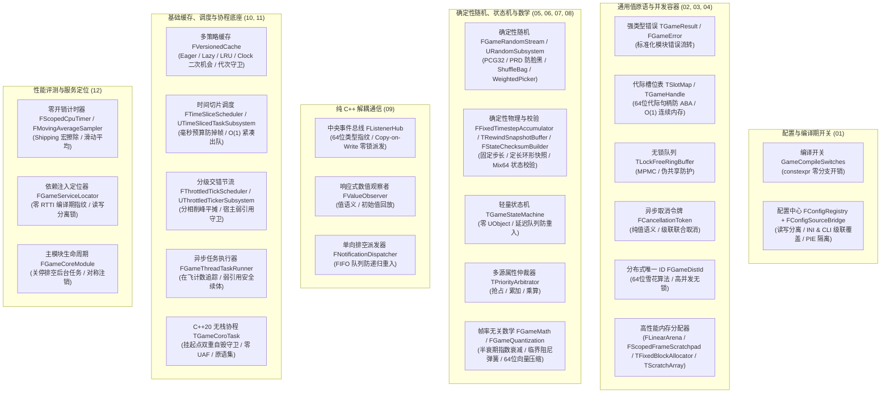

# GameCore

> **一句话**：UEToolkit 的 Level 0 通用底座，提供配置、类型、容器、内存、确定性、随机、状态、数学、事件、缓存、异步调度与性能 / 服务定位原语。
> **版本** v3.0.0 · **引擎** UE 5.1 ~ 5.8 · **层级** Level 0 · **直接依赖** 无（仅引擎 `Core` / `CoreUObject` / `Engine` / `GameplayTags`）

## 30 秒速览

- **解决什么**：把跨项目复用的底层能力收敛为纯 C++、零业务依赖的基础设施，供上层插件与游戏模块共享同一套配置、随机、协程、容器与调度语义。
- **核心能力**：
  - 配置注册表与编译期开关，支持多源级联覆盖与 PIE 隔离；
  - 强类型错误、代际槽位表、无锁环形队列、线性 / 定长内存分配器；
  - PCG32 确定性随机、PRD、固定步长与回滚快照、轻量状态机、帧率无关数学；
  - COW 事件总线、响应式数值观察、三策略版本化缓存；
  - 帧预算时间切片、分级节流、后台任务续体与 C++20 无栈协程。
- **什么时候用**：新建 UE5 工程或插件需要统一底座；多个模块要共享配置、随机、协程、事件或帧预算调度。
- **什么时候不用**：只缺单一领域能力时，优先直接引入对应的 Level 1 / 2 插件（消息、对象池、空间查询、关卡流转等），不必自建底层。

## 快速开始

### 1. 引入模块

```csharp
public class MyGameModule : ModuleRules
{
    public MyGameModule(ReadOnlyTargetRules Target) : base(Target)
    {
        PCHUsage = PCHUsageMode.UseExplicitOrSharedPCHs;
        CppStandard = CppStandardVersion.Cpp20;

        PublicDependencyModuleNames.AddRange(new string[] {
            "Core",
            "CoreUObject",
            "Engine",
            "GameplayTags",
            "GameCore",
        });
    }
}
```

### 2. 注册并监听配置

```cpp
#include "Config/FConfigRegistry.h"

void UMyGameInstance::Init()
{
    Super::Init();

    FConfigRegistry::Get().RegisterConfig(TEXT("Game.MaxPlayers"), 8);

    ConfigSub = FConfigRegistry::Get().WatchConfig<int32>(
        TEXT("Game.MaxPlayers"),
        [this](const int32& NewLimit) {
            UE_LOG(LogTemp, Log, TEXT("玩家上限调整为: %d"), NewLimit);
        }
    );
}
```

> 槽位表、服务定位、C++20 协程、时间切片与性能计时示例见 [QuickStart.md](Docs/Guides/QuickStart.md)。

<details>
<summary><b>展开更多核心示例（随机 / 阻尼槽位表 / 时间切片）</b></summary>

#### 确定性随机流与防脸黑伪随机 (PRD)

```cpp
#include "Random/URandomSubsystem.h"
#include "Random/FPseudoRandomDistribution.h"

URandomSubsystem& Rng = URandomSubsystem::Get(GetWorld());
FGameRandomStream& CritStream = Rng.InitializeStream(TEXT("Combat.Crit"), 1024ULL);

FPseudoRandomDistribution CritPrd(0.25f);
const bool bIsCrit = CritPrd.Roll(CritStream);
```

#### 帧率无关平滑阻尼与代际槽位表

```cpp
#include "Math/FGameMath.h"
#include "Containers/TSlotMap.h"

TSlotMap<FVector> EntityPositions;
TGameHandle<FVector> Handle = EntityPositions.Emplace(FVector(0.0f, 0.0f, 0.0f));

CurrentPos = FGameMath::ExpDecayVector(CurrentPos, TargetPos, 0.06f, DeltaSeconds);
if (FVector* Pos = EntityPositions.Find(Handle)) {
    *Pos = CurrentPos;
}
```

#### 主线程帧预算时间切片调度

```cpp
#include "Async/UTimeSlicedTaskSubsystem.h"

UTimeSlicedTaskSubsystem& TaskSub = UTimeSlicedTaskSubsystem::Get(GetWorld());

TaskSub.EnqueueBatch(
    this,
    10000,
    [this](int32 Index) {
        this->ProcessPathfindingNode(Index);
    },
    [this]() {
        UE_LOG(LogTemp, Log, TEXT("全部 10000 个寻路节点分帧处理完成！"));
    }
);
```

#### C++20 协程调度与双重自毁防 UAF

见 [QuickStart.md 场景 E](Docs/Guides/QuickStart.md)。

</details>


## 核心能力

### 配置与编译期开关

- `FConfigRegistry`：函数局部静态单例，提供 `RegisterConfig` / `SetConfig` / `GetConfig` / `WatchConfig`，读接口在锁内完成值拷贝后立即出锁。
- `FConfigSourceBridge`：多源单向覆盖（INI / 命令行等）与 PIE 独立隔离，退出时自动回滚。
- `GameCompileSwitches`：编译期硬开关统一派生为 `namespace Game::Config` 下的 `constexpr bool`，`if constexpr` 分支可被编译优化抹除。

### 值类型、容器与内存

- `TGameResult<T>` / `FGameError`：强类型链式错误流转；`TBitMask`、`FGameDistId`（雪花 ID）、`FGameLocalId`、`TGameHandle`、`TGameCustomTypeFingerprint`。
- `TSlotMap`：密集连续存储 + 64 位代际句柄防 ABA；`TSortedVectorMap` 连续内存二分字典；`TLockFreeRingBuffer` 为 Vyukov MPMC 无锁队列；另有 `FFastTagBitmask`、`TScratchArray`。
- `FLinearArena`、`FScopedFrameScratchpad`、`TFixedBlockAllocator`、`TFixedSizePool`、`FByteSpanReader/Writer`：覆盖线性分配、帧局部暂存、定长对象池与零拷贝二进制切片。

### 确定性、随机、状态机与游戏数学

- `FGameRandomStream`（PCG32）、`FGameRandomManager`、`FPseudoRandomDistribution`（PRD）、`TShuffleBag`、`TWeightedPicker`（Vose 别名表）、`URandomSubsystem`。
- `FFixedTimestepAccumulator`、`TRewindSnapshotBuffer`、`FStateChecksumBuilder`、`FDesyncDetector`：固定步长、回滚快照环、Mix64 状态校验与双端分叉检测。
- `TGameStateMachine`：零 `UObject`、延迟队列防重入；`TPriorityArbitrator`：抢占 / 累加 / 乘算多源属性仲裁。
- `FGameMath` / `FGameQuantization`：半衰期指数衰减、临界阻尼弹簧与 64 位向量压缩量化。

### 解耦通信与响应式观察

- `FListenerHub`：64 位类型指纹寻址、Copy-on-Write 回调快照，`Emit` 仅在拷贝快照时瞬态持读锁。
- `FValueObserver<T>`：值语义响应式观察，支持初始值回放；`FNotificationDispatcher`：全局 FIFO 队列延后排空，防递归重入。
- 回调内可安全再次 `Subscribe` / `Emit`；未注册事件由 `Subscribe` 自动创建、`Emit` 静默忽略。

### 缓存与异步调度

- `FVersionedCache` / `FCachePolicy` / `FLruIndexPool`：Eager / Lazy / LRU（Clock 二次机会热度位）三策略与代次守卫。
- `UTimeSlicedTaskSubsystem` / `FTimeSliceScheduler`：按毫秒帧预算推进，`EnqueueBatch` 支持跨帧续跑与收尾回调。
- `UThrottledTickerSubsystem` / `FThrottledTickScheduler`：分相交错削峰，宿主弱引用守卫。
- `FCancellationToken` / `FCancellationTokenSource` 提供级联取消，`FGameThreadTaskRunner` 提供在飞任务计数与弱引用续体，`TGameCoroTask` 提供 `BindContext` / `RunOnBackground` / `NextFrame` 与挂起点双重自毁守卫。

### 性能评测与服务定位

- `FScopedCpuTimer` / `GAME_SCOPED_CPU_TIMER` / `FMovingAverageSampler`：RAII 微秒计时与固定窗口滑动平均，Shipping 下宏擦除。
- `FGameServiceLocator`：零 RTTI 的 64 位编译期类型指纹、类型 / 具名双寻址、`FRWLock` 读写分离。
- `FGameCoreModule`：模块关停时排空后台任务并对称注销。

## 架构与依赖

- **依赖**：仅引擎 `Core`、`CoreUObject`、`Engine`、`GameplayTags`；零其他业务插件依赖，C++20。
- **分层**：Level 0，位于所有插件依赖链末端；上层插件可单独引入，GameCore 不反向依赖任何插件。
- **关键类**：配置 `FConfigRegistry` / `FConfigSourceBridge`；原语 `TGameResult` / `TSlotMap` / `TLockFreeRingBuffer`；通信 `FListenerHub`；缓存 `FVersionedCache`；调度 `UTimeSlicedTaskSubsystem` / `TGameCoroTask`；服务 `FGameServiceLocator`。

<details>
<summary><b>展开 12 组件与关键原语索引</b></summary>

| 序号 | 核心组件 | 关键原语与设计亮点 | 专属技术规范 |
|:---:|---|---|:---:|
| **01** | **Config** | `FConfigRegistry`, `FConfigSourceBridge`, `GameCompileSwitches`<br>读写分离锁出锁派发、多源单向覆盖、PIE 独立隔离与退出自动回滚 | [ConfigRegistry.md](Docs/API/ConfigRegistry.md) |
| **02** | **Types** | `TGameResult<T>`, `FGameError`, `TBitMask`, `FGameDistId`, `FGameLocalId`, `TGameHandle`, `TGameCustomTypeFingerprint`<br>强类型链式错误流转、枚举位掩码、雪花分布式 ID、极速本地 ID 与跨库类型指纹 | [RandomAndTypes.md](Docs/API/RandomAndTypes.md) |
| **03** | **Containers** | `TSlotMap`, `TSortedVectorMap`, `TLockFreeRingBuffer`, `FFastTagBitmask`, `TScratchArray`<br>密集连续内存代际槽位表、连续内存二分字典、Vyukov MPMC 无锁队列与 64 位状态标签 | [Containers.md](Docs/API/Containers.md) |
| **04** | **Memory** | `FLinearArena`, `FScopedFrameScratchpad`, `TFixedBlockAllocator`, `TFixedSizePool`, `FByteSpanReader/Writer`<br>1~3ns 极速线性分配（UE 5.8 / Mac arm64 / Development 实测）、帧局部暂存栈、侵入式空闲链表对象池与零拷贝二进制切片流 | [Memory.md](Docs/API/Memory.md) |
| **05** | **Determinism** | `FFixedTimestepAccumulator`, `TRewindSnapshotBuffer`, `FStateChecksumBuilder`, `FDesyncDetector`<br>亚毫秒固定步长累加器、确定性回放快照环、Mix64 零堆分配状态校验与双端分叉检测 | [Determinism.md](Docs/API/Determinism.md) |
| **06** | **Random** | `FGameRandomStream`, `FGameRandomManager`, `FPseudoRandomDistribution`, `TShuffleBag`, `TWeightedPicker`, `URandomSubsystem`<br>纯整数 PCG32 跨平台位级一致流、PRD 伪随机防连黑、洗牌袋与 Vose 别名表权重抽取 | [Random.md](Docs/API/Random.md) |
| **07** | **State** | `TGameStateMachine`, `TPriorityArbitrator`<br>编译期类型安全有限状态机（延迟队列防重入）、抢占/累加/乘算多源属性仲裁器 | [State.md](Docs/API/State.md) |
| **08** | **Math** | `FGameMath`, `FGameQuantization`<br>半衰期指数衰减阻尼、临界弹簧平滑与 64 位高精度向量压缩量化 | [Math.md](Docs/API/Math.md) |
| **09** | **Listener** | `FListenerHub`, `FValueObserver<T>`, `FNotificationDispatcher`<br>64 位类型指纹 COW 快照事件总线、响应式属性观察、单 Drainer 防重入派发器 | [ListenerHub.md](Docs/API/ListenerHub.md) |
| **10** | **Cache** | `FVersionedCache`, `FCachePolicy`, `FLruIndexPool`<br>Eager 全量预热 / Lazy / LRU（Clock 二次机会热度位）三策略自适应与代次守卫 | [Cache.md](Docs/API/Cache.md) |
| **11** | **Async** | `FGameThreadTaskRunner`, `UTimeSlicedTaskSubsystem`, `UThrottledTickerSubsystem`, `TGameCoroTask`<br>后台任务与主线程安全续体、帧预算切片、分相交错节流、C++20 协程双重自毁防 UAF | [Async.md](Docs/API/Async.md) |
| **12** | **Profiling & Service** | `FScopedCpuTimer`, `FGameServiceLocator`, `FGameCoreModule`<br>零开销微秒 RAII 计时（Shipping 完全擦除）、滑动平均、纯 C++ 服务定位容器、关停排空 | [ProfilingAndService.md](Docs/API/ProfilingAndService.md) |

</details>

<details>
<summary><b>展开架构全景图</b></summary>



</details>

<details>
<summary><b>展开已拆出的能力与归属插件</b></summary>

为保证 GameCore 作为 Level 0 基石的纯粹性与零业务冗余，下列功能已拆出为独立插件或归位至对应业务层：

- **GM 调试指令与屏幕诊断** → 独立插件 **`GameDebug`**（`FGameCheatRegistry` / `FGameDebugPrint` / `FGameDebugDraw`）
- **对象池系统** → 独立插件 **`GamePool`**（`UObjectPoolSubsystem` / `IGamePoolable`）
- **空间哈希与视锥节流驱动** → 独立插件 **`GameSpatial`**（`TSpatialHashGrid2D` / `TSpatialHashGrid3D` / `FSpatialThrottleDriver`）
- **Gameplay 消息总线** → 独立插件 **`GameMessage`**（`UGameplayMessageSubsystem`）
- **战斗顿帧与时间缩放** → 表现层 **`GameFeedback`**（`UTimeDilationSubsystem`）
- **资源流式加载与内存保活** → 独立插件 **`GameAssetCore`**（`FGameAssetLoader`）
- **关卡流转与就绪屏障** → 独立插件 **`GameFlow`**（`ULoadingSubsystem`）
- **目录与文件变更监听** → 数据层 **`GameData`（`GameDataCore/Utils`）**

</details>

<details>
<summary><b>展开目录结构</b></summary>

```text
Plugins/GameCore/
├── Source/
│   └── GameCore/
│       ├── Public/
│       │   ├── GameCore.h
│       │   ├── Async/         # 异步取消令牌、C++20 协程原语、跨线程任务与主线程帧切片/节流调度
│       │   ├── Cache/         # FVersionedCache 三策略版本化缓存与 FLruIndexPool
│       │   ├── Config/        # 编译开关、FConfigRegistry、TCachedConfigHandle、FConfigSourceBridge 与 FGameCoreRegistration
│       │   ├── Containers/    # TSlotMap 代际槽位表、TLockFreeRingBuffer MPMC 无锁队列、TSortedVectorMap、TScratchArray 与 FFastTagBitmask
│       │   ├── Determinism/   # FFixedTimestepAccumulator、TRewindSnapshotBuffer、FStateChecksumBuilder 与 FDesyncDetector
│       │   ├── Listener/      # FListenerHub 纯 C++ 事件总线、FValueObserver 与 FNotificationDispatcher
│       │   ├── Math/          # FGameMath 帧率无关数学与 FGameQuantization 量化压缩
│       │   ├── Memory/        # FLinearArena、TFixedBlockAllocator、TFixedSizePool、FScopedFrameScratchpad 与 FByteSpanReader/Writer
│       │   ├── Profiling/     # FScopedCpuTimer 性能计时器与 FMovingAverageSampler 滑动平均统计器
│       │   ├── Random/        # PCG32 确定性随机流、PRD、洗牌袋、权重抽取与 URandomSubsystem
│       │   ├── Service/       # FGameServiceLocator 纯 C++ 线程安全服务定位与依赖注入容器
│       │   ├── State/         # TGameStateMachine 有限状态机与 TPriorityArbitrator 多源优先级仲裁器
│       │   └── Types/         # TGameResult、FGameError、TBitMask、FGameDistId、FGameLocalId、TGameHandle 与 FGameTypeFingerprint
│       ├── Private/
│       │   └── ... (对应实现文件与自动化单元测试)
│       └── GameCore.Build.cs
├── Docs/                      # 分类技术文档库
│   ├── Architecture/          # 核心架构设计与性能基准文档
│   ├── API/                   # 12 大核心组件公共接口详细规范 (SSOT)
│   └── Guides/                # 快速上手与集成指南
├── GameCore.uplugin
└── README.md
```

</details>

## 性能与边界

<details>
<summary>展开性能基准（历史 Development 构建参考值）</summary>

测量环境：UE 5.8 / macOS arm64 / Development；数据来自 `Game.Core.Perf.*` 自动化基准。预算刻意放宽，只拦截数量级退化。

| 基准项 | 实测中位数参考 | 预算门禁 |
| :--- | ---: | ---: |
| `FByteSpanWriter/Reader` 连续编解码 | ~0.6 ns/op | < 300 ns/op |
| `TSlotMap::Find` 代际句柄查找 | ~1.3 ns/op（745 Mops/s） | < 100 ns/op |
| `TCachedConfigHandle<float>::Get()` | ~2.3 ns/op（2.80× vs Registry） | < 300 ns/op |
| `TSortedVectorMap::Find` 扁平二分 | ~2.7 ns/op（370 Mops/s） | < 150 ns/op |
| `TLockFreeRingBuffer` MPMC 入队/出队往返 | ~3.6 ns/op（278 Mops/s） | < 200 ns/op |
| `TFixedSizePool` New/Free | ~5.1 ns/op（194 Mops/s） | < 200 ns/op |
| `TWeightedPicker` 32 项 Vose 别名表 | ~6.7 ns/op（150 Mops/s） | < 150 ns/op |
| `TPriorityArbitrator` 8 通道仲裁 | ~7.3 ns/op（137 Mops/s） | < 500 ns/op |
| `FVersionedCache::FindShared` Eager 快照 | ~8.9 ns/op（112 Mops/s） | < 2000 ns/op |
| `TRewindSnapshotBuffer` 128 帧二分插值 | ~9.3 ns/op（108 Mops/s） | < 300 ns/op |
| `FListenerHub::Emit` 单订阅广播 | ~13.9 ns/op（72 Mops/s） | < 5000 ns/op |
| `FStateChecksumBuilder` Mix64 状态混入 | ~25.8 ns/op（38.8 Mops/s） | < 500 ns/op |
| `TScratchArray` 128 元素全周期 | ~79.9 ns/op（2.96× vs Heap） | < 2000 ns/op |
| `FGameServiceLocator::Resolve` 并发读 | 100% 成功 | 零数据撕裂与死锁 |
| `FMovingAverageSampler` 滑动平均 | < 1 ns/op | 纯栈计算零堆分配 |

</details>

- **线程与重入**：`FGameServiceLocator` 使用 `FRWLock` 读写分离；`FListenerHub::Emit` 在调用线程同步直派 COW 快照，回调内可再次 `Subscribe` / `Emit`。
- **生命周期**：`UTimeSlicedTaskSubsystem` / `UThrottledTickerSubsystem` 为世界级子系统，World 销毁时清空待执行任务；`TGameCoroTask` 在挂起点二次校验宿主存活与取消状态，失效即销毁协程帧。
- **Shipping 与只读键**：`GAME_SCOPED_CPU_TIMER` 在 `GAME_ENABLE_CPU_PROFILER` 关闭（默认 `UE_BUILD_SHIPPING == 0`）时宏擦除；`Env.*` 恒只读，Shipping 下 `Dev.*` / `Feature.GM` 只读。
- **配置派发**：`SetConfig` 在写锁内改值、出锁后派发订阅回调，持锁期间不调用任何用户代码。
- **测试与性能声明**：12 组件自动化套件含 100+ 条用例，核心算法行 / 分支覆盖 ≥95%，回归命令 `python3 .scripts/run_automation_tests.py --prefix Game.Core`；性能数值为历史 Development 参考，未纳入 CI 自动复测，不构成 Shipping 性能承诺。

## 文档导航

| 文档 | 内容 |
| :--- | :--- |
| [QuickStart.md](Docs/Guides/QuickStart.md) | 模块接入与配置、槽位表、服务定位、协程、计时示例 |
| [Overview.md](Docs/Architecture/Overview.md) | 设计公理、12 组件矩阵与并发 / 内存规范 |
| [Performance.md](Docs/Architecture/Performance.md) | 基准清单、预算门禁与复现方式 |
| [ConfigRegistry.md](Docs/API/ConfigRegistry.md) | 配置注册表与多源桥接 API |
| [RandomAndTypes.md](Docs/API/RandomAndTypes.md) | 错误类型、ID、句柄与类型指纹 |
| [Containers.md](Docs/API/Containers.md) | `TSlotMap`、`TLockFreeRingBuffer` 等容器 |
| [Memory.md](Docs/API/Memory.md) | 线性分配器、对象池与二进制切片流 |
| [Determinism.md](Docs/API/Determinism.md) | 固定步长、回滚快照与状态校验 |
| [Random.md](Docs/API/Random.md) | PCG32、PRD、洗牌袋与权重抽取 |
| [State.md](Docs/API/State.md) | 轻量状态机与优先级仲裁器 |
| [Math.md](Docs/API/Math.md) | 帧率无关数学与量化压缩 |
| [ListenerHub.md](Docs/API/ListenerHub.md) | 事件总线、值观察者与派发器 |
| [Cache.md](Docs/API/Cache.md) | 三策略版本化缓存 |
| [Async.md](Docs/API/Async.md) | 时间切片、节流、任务续体与协程 |
| [ProfilingAndService.md](Docs/API/ProfilingAndService.md) | CPU 计时、滑动平均与服务定位 |
