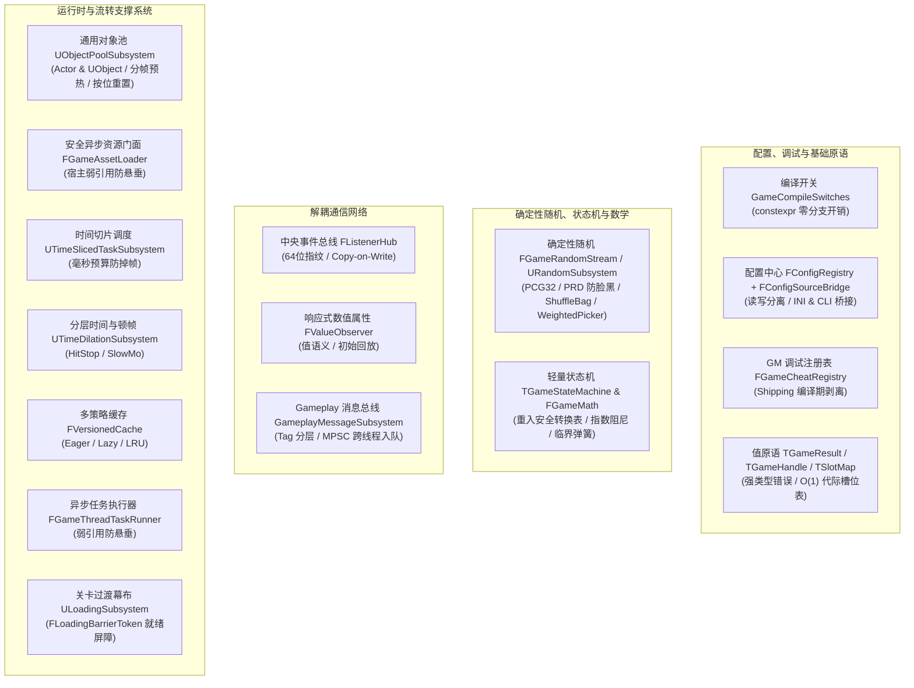

# GameCore 插件

**GameCore** 是全项目的通用底层核心框架库（当前版本 **2.2.0**）。它遵循**零外部依赖、跨项目无缝拔插复用、纯值语义、强类型安全与高并发无锁/快照并发**设计原则，为上层模块提供统一的配置注册中心与外部源桥接、确定性随机数与抽卡算法、强类型结果与代际槽位表、纯逻辑 2D/3D 空间哈希网格、轻量状态机与帧率无关游戏数学、通用异步取消令牌、无锁 MPMC 环形缓冲区、多源优先级属性仲裁器、类型安全解耦消息通信、Actor/UObject 双轨通用对象池、分层时间缩放（HitStop）、多策略自适应缓存、安全软引用批量资源加载、主线程时间切片调度、模块化 GM 注册表与关卡加载屏障中枢。

---

## 架构全景



---

## 核心特性一览

| 模块 / 机制 | 关键技术亮点 | 核心文件 / 接口 |
| :--- | :--- | :--- |
| **集中编译开关** | 宏为唯一真源，派生 `constexpr bool` 镜像，消除双源漂移与分支损耗 | `Config/GameCompileSwitches.h` |
| **配置中心与外部桥接** | `FRWLock` 读写分离，纯值拷贝出锁，RAII 订阅；支持 INI 节与命令行引号参数按已注册类型自动注入及只读拦截 | `Config/FConfigRegistry.h`<br>`Config/FConfigSourceBridge.h`<br>`Config/UConfigBPLibrary.h` |
| **确定性随机数体系** | 纯整数算术 PCG32 跨平台位级一致随机流、子流 `Fork` 与回滚快照、PRD 伪随机防连黑、洗牌袋、二分权重抽取及世界级命名流隔离 | `Random/FGameRandomStream.h`<br>`Random/FPseudoRandomDistribution.h`<br>`Random/TShuffleBag.h`<br>`Random/TWeightedPicker.h`<br>`Random/URandomSubsystem.h` |
| **强类型结果与槽位表** | `TGameResult<T, E>` 链式错误处理；`TGameHandle` 64 位代际防悬垂句柄与 $O(1)$ 紧凑缓存友好容器 `TSlotMap` | `Types/TGameResult.h`<br>`Types/TGameHandle.h`<br>`Types/TSlotMap.h` |
| **通用异步取消令牌** | 纯值语义 `FCancellationToken` 与 `FCancellationTokenSource`，支持级联取消、超时取消、弱引用守卫与零锁轮询 | `Types/FCancellationToken.h` |
| **无锁 MPMC 环形缓冲区** | 基于 Vyukov 序列号算法的固定容量无锁环形队列，Cache-line 对齐防伪共享，等待自由零堆分配 | `Types/TLockFreeRingBuffer.h` |
| **多源优先级属性仲裁器** | 纯值模板 `TPriorityArbitrator<T>`，支持抢占覆盖、加权累加与链式乘算三种仲裁策略 | `Types/TPriorityArbitrator.h` |
| **可取消事务作用域守卫** | 纯值语义 RAII 守卫，支持早退回滚与 `.Dismiss()` 事务提交，零堆分配与移动安全 | `Types/TCancelableScopeGuard.h` |
| **64 位雪花分布式唯一 ID** | 毫秒时间戳 + 节点号 + 自增序列，多线程无锁高并发零碰撞，时间戳自解与极低网络带宽 | `Types/FGameDistId.h` |
| **纯逻辑空间哈希网格** | 2D/3D 均匀网格分桶，脱离物理引擎，同单元微移零开销，纳秒级半径球/圆、AABB、圆柱体及最近邻查询 | `Spatial/TSpatialHashGrid2D.h`<br>`Spatial/TSpatialHashGrid3D.h` |
| **轻量状态机与数学库** | 零 UObject 表驱动 `TGameStateMachine`（延迟队列防重入）；帧率无关半衰期指数衰减阻尼与二阶临界阻尼弹簧 `FGameMath` | `FSM/TGameStateMachine.h`<br>`Math/FGameMath.h` |
| **中央事件总线** | 跨 DLL 稳定 64 位类型指纹（`GAME_TYPE_FINGERPRINT`），Copy-on-Write 回调快照，回调遍历全程零锁 | `Listener/FListenerHub.h` |
| **响应式数值观察者** | 泛型响应式容器 `FValueObserver<T>`，值变更时自动触发订阅通知，`SubscribeWithReplay` 订阅即得当前值 | `Listener/FValueObserver.h` |
| **Gameplay 消息子系统** | `GameplayTag` 分层寻址、`UScriptStruct` 强类型校验、零闭包拷贝快照与 `EnqueueMessage` 无锁跨线程安全入队 | `Message/GameplayMessageSubsystem.h` |
| **Actor & UObject 对象池** | 同时支持 `AActor` 与纯 `UObject` 池化、分帧渐进预热、`EPoolResetFlags` 按位组件重置与零插件依赖 `UFXSystemComponent` 停用 | `Pool/ObjectPoolSubsystem.h`<br>`Pool/ObjectPoolTypes.h`<br>`Pool/IGamePoolable.h` |
| **软引用异步资源加载** | 封装 `FStreamableManager`，内置宿主 `TWeakObjectPtr` 守卫（宿主销毁自动丢弃回调）与可取消 `FGameAssetLoadHandle` | `Asset/FGameAssetLoader.h`<br>`Asset/FGameAssetLoadHandle.h` |
| **主线程帧预算时间切片** | 按单帧毫秒预算（默认 `1.5ms`）增量步进重型主线程任务，空闲时自动休眠零 Tick 开销 | `Tasks/UTimeSlicedTaskSubsystem.h`<br>`Tasks/FTimeSlicedTaskHandle.h` |
| **分级交错节流调度器** | 频率分级分桶（30Hz/10Hz/2Hz/1Hz），交错分相打散平摊峰值，宿主弱引用守卫与空闲零开销休眠 | `Tasks/UThrottledTickerSubsystem.h`<br>`Tasks/FThrottledTickTypes.h` |
| **分层时间与顿帧 (HitStop)** | 局部 Actor 卡肉顿帧 + 全局分层时间缩放，优先级覆盖与时间平滑恢复 | `Time/TimeDilationSubsystem.h` |
| **三策略版本化缓存** | Eager 全量预热 / Lazy 惰性填充 / LRU 限长连续节点池，不可变快照与指针稳定化 | `Cache/FVersionedCache.h` |
| **目录变更监听器** | `FTSTicker` 周期扫描文件时间戳，自增序号广播，消费方零轮询成本 | `IO/FDirectoryChangeWatcher.h` |
| **异步任务执行器** | `UE::Tasks::Launch` 配合主线程 `AsyncTask` 续体，宿主弱引用（`TWeakObjectPtr`）自动短路防悬垂 | `Tasks/FGameThreadTaskRunner.h` |
| **关卡流转与就绪屏障** | 平滑关卡过渡中枢，支持多子系统并发申请 `FLoadingBarrierToken` 异步就绪投票后再揭开加载幕布 | `System/ULoadingSubsystem.h`<br>`System/FLoadingBarrierToken.h` |
| **模块化 GM 调试注册表** | 统一注册 GM 指令并联动 `IConsoleManager`，Shipping 构建自动编译期零开销裁剪 | `Debug/FGameCheatRegistry.h` |

---

## 插件依赖

- **依赖项**：仅依赖引擎基础模块：`Core`, `CoreUObject`, `Engine`, `GameplayTags`
- **外部依赖**：0（零依赖其他业务插件，可直接复制到任何 UE5 工程根目录的 Plugins 中独立使用）
- **C++ 标准**：C++20

---

## 快速上手示例

### 1. 动态配置注册、外部桥接与监听
```cpp
#include "Config/FConfigRegistry.h"
#include "Config/FConfigSourceBridge.h"

FConfigRegistry::Get().RegisterConfig<float>(TEXT("Player.WalkSpeed"), 600.0f);
FConfigSourceBridge::ApplyCommandLineOverrides(FCommandLine::Get(), TEXT("Config."));

const TSharedRef<FObserverSubscription> Sub = FConfigRegistry::Get().WatchConfig<float>(
    TEXT("Player.WalkSpeed"),
    [](const float& NewSpeed) {
        UE_LOG(LogTemp, Log, TEXT("Player walk speed changed to: %.1f"), NewSpeed);
    }
);
```

### 2. 确定性随机流与防脸黑伪随机 (PRD)
```cpp
#include "Random/URandomSubsystem.h"
#include "Random/FPseudoRandomDistribution.h"

URandomSubsystem& Rng = URandomSubsystem::Get(GetWorld());
Rng.InitializeMasterSeed(1024ULL);

FGameRandomStream& CritStream = Rng.GetOrCreateStream(TEXT("Combat.Crit"));
FPseudoRandomDistribution CritPrd(0.25f);
const bool bIsCrit = CritPrd.Roll(CritStream);
```

### 3. 对象池分帧预热与借出归还
```cpp
#include "Pool/ObjectPoolSubsystem.h"

UObjectPoolSubsystem& Pool = UObjectPoolSubsystem::Get(GetWorld());
Pool.PrewarmTimeSliced(MonsterClass, 30, 2);

APawn* Monster = Pool.AcquireActor<APawn>(MonsterClass, SpawnTransform);
Pool.ReleaseActor(Monster);
```

### 4. HitStop 顿帧与帧率无关相机阻尼
```cpp
#include "Time/TimeDilationSubsystem.h"
#include "Math/FGameMath.h"

UTimeDilationSubsystem::Get(GetWorld()).RequestHitStop(VictimActor, 0.08f);
CameraLocation = FGameMath::ExpDecayVector(CameraLocation, TargetLocation, 0.06f, DeltaSeconds);
```

---

## 目录结构

```text
Plugins/GameCore/
├── Source/
│   └── GameCore/
│       ├── Public/
│       │   ├── GameCore.h
│       │   ├── Asset/         # FGameAssetLoader 软引用安全异步资源加载
│       │   ├── Cache/         # FVersionedCache 多策略缓存
│       │   ├── Config/        # 编译开关、配置注册表与 FConfigSourceBridge
│       │   ├── Debug/         # FGameCheatRegistry 模块化 GM 指令注册表
│       │   ├── FSM/           # TGameStateMachine 轻量表驱动状态机
│       │   ├── IO/            # 目录与文件变更监听器
│       │   ├── Listener/      # FListenerHub 纯 C++ 事件总线、FValueObserver 响应式观察者
│       │   ├── Math/          # FGameMath 帧率无关指数衰减与临界阻尼弹簧
│       │   ├── Message/       # GameplayMessageSubsystem 消息总线（含跨线程入队）
│       │   ├── Pool/          # UObjectPoolSubsystem Actor & UObject 双轨对象池（带参借出与深度清理）
│       │   ├── Random/        # PCG32 确定性随机流、PRD、洗牌袋、权重抽取与 URandomSubsystem
│       │   ├── Registration/  # 模块生命周期注册契约
│       │   ├── Spatial/       # TSpatialHashGrid2D 与 TSpatialHashGrid3D 纯逻辑空间哈希网格
│       │   ├── System/        # ULoadingSubsystem（含 FLoadingBarrierToken 就绪幕布）
│       │   ├── Tasks/         # FGameThreadTaskRunner、UThrottledTickerSubsystem 与 UTimeSlicedTaskSubsystem
│       │   ├── Tests/         # 自动化单元测试
│       │   ├── Time/          # UTimeDilationSubsystem、FActorHitStopTable、FGlobalDilationMixer
│       │   └── Types/         # TGameResult、TSlotMap、FCancellationToken、TLockFreeRingBuffer、TPriorityArbitrator
│       ├── Private/
│       │   └── ... (对应实现文件)
│       └── GameCore.Build.cs
├── Docs/                      # 分类技术文档库
│   ├── Architecture/          # 核心架构设计文档
│   ├── API/                   # 公共接口详细参考
│   └── Guides/                # 实践与集成指南
├── GameCore.uplugin
└── README.md
```

---

## 文档导航

所有完整文档已按职责分类收录于 `Docs/` 目录中：

- **架构设计 (Architecture)**
  - [架构概览与并发哲学](Docs/Architecture/Overview.md)：阐述读写锁语义、零外部依赖设计、指针稳定化与出锁派发铁律。
  - [事件与消息通信体系架构](Docs/Architecture/EventAndMessaging.md)：对比 `FListenerHub`、`GameplayMessageSubsystem` 与 `FValueObserver` 的选型与底层设计。
  - [缓存与内存管理架构](Docs/Architecture/CachingAndMemory.md)：不可变快照、LRU 连续节点池与通用对象池的复用机制。
  - [性能基准与预算](Docs/Architecture/Performance.md)：缓存查找、监听吞吐、Stat 查询的实测基线与回归阈值。
- **接口参考 (API Reference)**
  - [配置注册中心、外部桥接与 GM 注册表 API](Docs/API/ConfigRegistry.md)：`FConfigRegistry`、`FConfigSourceBridge`、`FGameCheatRegistry`、`UConfigBPLibrary`。
  - [确定性随机数、强类型结果与槽位容器 API](Docs/API/RandomAndTypes.md)：`TGameResult`、`TGameHandle`、`TSlotMap`、`FGameRandomStream`、`FPseudoRandomDistribution`、`TShuffleBag`、`TWeightedPicker`、`URandomSubsystem`。
  - [轻量状态机与游戏数学库 API](Docs/API/StateMachineAndMath.md)：`TGameStateMachine`、`FGameMath`。
  - [中央监听总线 API](Docs/API/ListenerHub.md)：`FListenerHub`、`FValueObserver`、`FObserverSubscription`。
  - [Gameplay 消息总线 API](Docs/API/GameplayMessageSubsystem.md)：`UGameplayMessageSubsystem` 标签消息派发、跨线程入队与注册句柄。
  - [通用对象池 API](Docs/API/ObjectPoolSubsystem.md)：`UObjectPoolSubsystem`（Actor & UObject 池化、分帧预热与按位重置）、`IGamePoolable`。
  - [时间膨胀与顿帧 API](Docs/API/TimeDilationSubsystem.md)：`UTimeDilationSubsystem`、通道优先级与 HitStop 状态。
  - [异步任务、时间切片、资源加载与关卡屏障 API](Docs/API/AsyncAndIO.md)：`FGameThreadTaskRunner`、`UTimeSlicedTaskSubsystem`、`FGameAssetLoader`、`FDirectoryChangeWatcher`、`ULoadingSubsystem`、`FLoadingBarrierToken`。
- **使用指南 (Guides)**
  - [快速上手指南](Docs/Guides/QuickStart.md)：新工程挂载与核心基础设施初始化。
  - [编译开关与动态配置指南](Docs/Guides/ConfigAndSwitchesGuide.md)：硬开关定制、只读保护与蓝图读写。
  - [对象池使用与最佳实践](Docs/Guides/ObjectPoolingGuide.md)：预热、生成、回收、防 GC 卡顿实战。
  - [消息通信实战指南](Docs/Guides/MessagingGuide.md)：跨模块解耦通信的最佳选型与实战代码样例。
