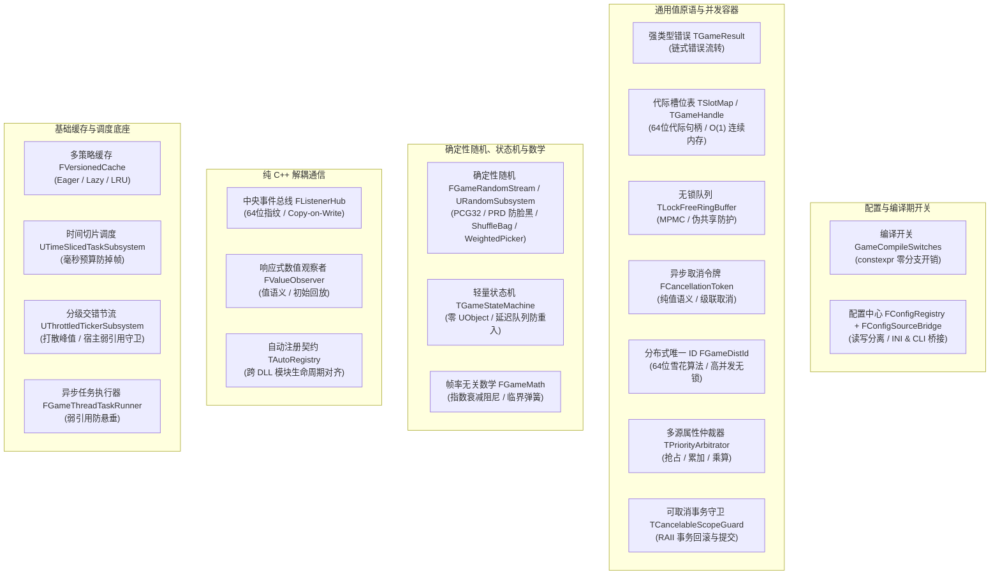

# GameCore 插件

**GameCore** 是全项目的通用底层核心框架库（当前版本 **3.0.0**）。它遵循**绝对零业务依赖、极致纯粹、纯值语义、强类型安全与高并发无锁/快照并发**设计原则，为上层模块提供最底层的通用基础设施：编译开关镜像、配置中心与外部源桥接、确定性随机数与抽卡算法、强类型结果与代际槽位表、轻量表驱动状态机与帧率无关游戏数学、通用异步取消令牌、无锁 MPMC 环形缓冲区、多源优先级属性仲裁器、中央纯 C++ 事件总线与响应式数值观察者、三策略版本化缓存、主线程帧预算时间切片与分级交错节流调度器，以及模块化 GM 指令注册表。

---

## 架构全景



---

## 核心特性一览

| 模块 / 机制 | 关键技术亮点 | 核心文件 / 接口 |
| :--- | :--- | :--- |
| **集中编译开关** | 宏为唯一真源，派生 `constexpr bool` 镜像，消除双源漂移与分支损耗 | `Config/GameCompileSwitches.h` |
| **单帧线性分配器** | 纯现代 C++ 零堆锁游标分配器，指针 100% 稳定，支持 `FScopeMarker` 作用域标记与非平凡逆序析构链 | `Memory/TLinearArena.h` |
| **固定尺寸块分配器** | 侵入式 Free-list 链表，$O(1)$ 纳秒级分配与归还，多 Chunk 自动扩容，提供类型安全对象池 `TFixedSizePool` | `Memory/TFixedBlockAllocator.h` |
| **固定时间步长累加器** | 纯数学等步长累加器，脱离渲染帧率驱动确定性更新，内建防螺旋死锁截断与渲染插值 Alpha 输出 | `Determinism/FFixedTimestepAccumulator.h` |
| **数据量化与位打包** | 16位 IEEE 半精度互转、8/16位范围量化、64位向量紧凑打包与欧拉角压缩 | `Math/FGameQuantization.h` |
| **强类型枚举位掩码** | 编译期与运行期越界防护的紧凑枚举位集合模板 `TBitMask<TEnum>` | `Types/TBitMask.h` |
| **标准化错误契约** | `FGameError` 统一模块 ID、错误码、严重级别与语义文本，与 `TGameResult` 原生绑定为 `TGameStatusResult<T>` | `Types/FGameError.h`<br>`Types/TGameResult.h` |
| **配置中心与外部桥接** | `FRWLock` 读写分离，纯值拷贝出锁；支持 `Get(WorldContext)` 编辑器 PIE 独立 World 隔离，非编辑器零开销回退 | `Config/FConfigRegistry.h`<br>`Config/FConfigSourceBridge.h`<br>`Config/UConfigBPLibrary.h` |
| **确定性随机数体系** | 纯整数算术 PCG32 跨平台位级一致随机流、子流 `Fork` 与回滚快照、PRD 伪随机防连黑、洗牌袋、二分权重抽取；核心算法解耦为纯 C++ `FGameRandomManager`，子系统作为 Thin-Shell | `Random/FGameRandomStream.h`<br>`Random/FGameRandomManager.h`<br>`Random/FPseudoRandomDistribution.h`<br>`Random/TShuffleBag.h`<br>`Random/TWeightedPicker.h`<br>`Random/URandomSubsystem.h` |
| **强类型结果与标准化错误** | `TGameResult<T, E>` 链式错误流转与 `FGameError` 统一模块级错误契约（`TGameStatusResult<T>`） | `Types/TGameResult.h`<br>`Types/FGameError.h` |
| **代际槽位表容器** | `TGameHandle` 64 位代际防悬垂句柄与 $O(1)$ 紧凑缓存友好容器 `TSlotMap` | `Types/TGameHandle.h`<br>`Containers/TSlotMap.h` |
| **通用异步取消令牌** | 纯值语义 `FCancellationToken` 与 `FCancellationTokenSource`，支持级联取消、超时取消、弱引用守卫与零锁轮询 | `Async/FCancellationToken.h` |
| **无锁 MPMC 环形缓冲区** | 基于 Vyukov 序列号算法的固定容量无锁环形队列，Cache-line 对齐防伪共享，等待自由零堆分配 | `Containers/TLockFreeRingBuffer.h` |
| **多源优先级属性仲裁器** | 纯值模板 `TPriorityArbitrator<T>`，支持抢占覆盖、加权累加与链式乘算三种仲裁策略 | `State/TPriorityArbitrator.h` |
| **可取消事务作用域守卫** | 纯值语义 RAII 守卫，支持早退回滚与 `.Dismiss()` 事务提交，零堆分配与移动安全 | `Types/TCancelableScopeGuard.h` |
| **64 位雪花分布式唯一 ID** | 毫秒时间戳 + 节点号 + 自增序列，多线程无锁高并发零碰撞，时间戳自解与极低网络带宽 | `Types/FGameDistId.h` |
| **轻量状态机与数学库** | 零 UObject 表驱动 `TGameStateMachine`（延迟队列防重入）；帧率无关半衰期指数衰减阻尼与二阶临界阻尼弹簧 `FGameMath` | `State/TGameStateMachine.h`<br>`Math/FGameMath.h` |
| **中央事件总线** | 跨 DLL 稳定 64 位类型指纹（`GAME_TYPE_FINGERPRINT`），Copy-on-Write 回调快照，回调遍历全程零锁 | `Listener/FListenerHub.h` |
| **响应式数值观察者** | 泛型响应式容器 `FValueObserver<T>`，值变更时自动触发订阅通知，`SubscribeWithReplay` 订阅即得当前值 | `Listener/FValueObserver.h` |
| **主线程帧预算时间切片** | 核心算法下沉为纯 C++ `FTimeSliceScheduler`（按毫秒预算推进，支持非 World 环境脱离引擎独立跑），子系统作为 Thin-Shell | `Async/FTimeSliceScheduler.h`<br>`Async/UTimeSlicedTaskSubsystem.h`<br>`Async/FTimeSlicedTaskHandle.h` |
| **分级交错节流调度器** | 核心算法下沉为纯 C++ `FThrottledTickScheduler`（30Hz/10Hz/2Hz/1Hz 分级分相平摊峰值），子系统作为 Thin-Shell | `Async/FThrottledTickScheduler.h`<br>`Async/UThrottledTickerSubsystem.h`<br>`Async/FThrottledTickTypes.h` |
| **三策略版本化缓存** | Eager 全量预热 / Lazy 惰性填充 / LRU 限长连续节点池，不可变快照与指针稳定化 | `Cache/FVersionedCache.h` |
| **异步任务执行器** | `UE::Tasks::Launch` 配合主线程 `AsyncTask` 续体，宿主弱引用（`TWeakObjectPtr`）自动短路防悬垂 | `Async/FGameThreadTaskRunner.h` |
| **C++20 轻量协程原语** | `TGameCoroTask<T>` 配合跨线程切换、帧延时/条件等待、时间切片让出 Awaiter，挂起点自动校验宿主弱引用与取消令牌并安全自毁栈帧 | `Async/TGameCoroTask.h`<br>`Async/FGameCoroAwaiters.h` |

> **架构极纯解耦与归位说明**：
> 为保证 GameCore 作为 Layer 0 基石的纯粹性与零业务冗余，下列功能已全部拆出为独立插件或归位至对应业务层：
> - **GM 调试指令与屏幕诊断** ➔ 独立插件 **`GameDebug`** (`FGameCheatRegistry` / `FGameDebugPrint` / `FGameDebugDraw`)
> - **对象池系统** ➔ 独立插件 **`GamePool`** (`UObjectPoolSubsystem` / `IGamePoolable`)
> - **空间哈希与视锥节流驱动** ➔ 独立插件 **`GameSpatial`** (`TSpatialHashGrid2D` / `TSpatialHashGrid3D` / `FSpatialThrottleDriver`)
> - **Gameplay 消息总线** ➔ 独立插件 **`GameMessage`** (`UGameplayMessageSubsystem`)
> - **战斗顿帧与时间缩放** ➔ 归位至表现层 **`GameFeedback`** (`UTimeDilationSubsystem`)
> - **资源流式加载与内存保活** ➔ 独立插件 **`GameAssetCore`** (`FGameAssetLoader`)
> - **关卡流转与就绪屏障** ➔ 独立插件 **`GameFlow`** (`ULoadingSubsystem`)
> - **目录与文件变更监听** ➔ 归位至数据层 **`GameData` (`GameDataCore/Utils`)**

---

## 插件依赖

- **依赖项**：仅依赖引擎基础模块：`Core`, `CoreUObject`, `Engine`, `GameplayTags`
- **外部依赖**：0（零依赖其他业务插件，可直接复制到任何 UE5 工程根目录的 Plugins 中独立使用）
- **C++ 标准**：C++20

---

## 快速上手示例

### 1. 动态配置注册、外部桥接与监听
```cpp
#include "Config/FConfigRegistry.h"
#include "Config/FConfigSourceBridge.h"

FConfigRegistry::Get().RegisterConfig<float>(TEXT("Player.WalkSpeed"), 600.0f);
FConfigSourceBridge::ApplyCommandLineOverrides(FCommandLine::Get(), TEXT("Config."));

const TSharedRef<FObserverSubscription> Sub = FConfigRegistry::Get().WatchConfig<float>(
    TEXT("Player.WalkSpeed"),
    [](const float& NewSpeed) {
        UE_LOG(LogTemp, Log, TEXT("Player walk speed changed to: %.1f"), NewSpeed);
    }
);
```

### 2. 确定性随机流与防脸黑伪随机 (PRD)
```cpp
#include "Random/URandomSubsystem.h"
#include "Random/FPseudoRandomDistribution.h"

URandomSubsystem& Rng = URandomSubsystem::Get(GetWorld());
Rng.InitializeMasterSeed(1024ULL);

FGameRandomStream& CritStream = Rng.GetOrCreateStream(TEXT("Combat.Crit"));
FPseudoRandomDistribution CritPrd(0.25f);
const bool bIsCrit = CritPrd.Roll(CritStream);
```

### 3. 帧率无关平滑阻尼与代际槽位表
```cpp
#include "Math/FGameMath.h"
#include "Containers/TSlotMap.h"

TSlotMap<FVector> EntityPositions;
TGameHandle<FVector> Handle = EntityPositions.Emplace(FVector(0.0f, 0.0f, 0.0f));

CurrentPos = FGameMath::ExpDecayVector(CurrentPos, TargetPos, 0.06f, DeltaSeconds);
if (FVector* Pos = EntityPositions.Find(Handle)) {
    *Pos = CurrentPos;
}
```

### 4. 主线程帧预算时间切片调度
```cpp
#include "Async/UTimeSlicedTaskSubsystem.h"

UTimeSlicedTaskSubsystem& TaskSub = UTimeSlicedTaskSubsystem::Get(GetWorld());
TaskSub.ScheduleTask(
    TEXT("PathfindingMeshSlice"),
    [CurrentIndex = 0, TotalNodes = 10000](double RemainingBudgetMs) mutable -> bool {
        while (RemainingBudgetMs > 0.1 && CurrentIndex < TotalNodes) {
            // 增量执行计算
            ++CurrentIndex;
        }
        return CurrentIndex < TotalNodes; // 返回 true 继续分帧推进，false 完成
    }
);
```

---

## 目录结构

```text
Plugins/GameCore/
├── Source/
│   └── GameCore/
│       ├── Public/
│       │   ├── GameCore.h
│       │   ├── Async/         # 异步取消令牌、C++20 协程原语、跨线程任务与主线程帧调度 (ThrottledTick / TimeSlice)
│       │   ├── Cache/         # FVersionedCache 三策略版本化缓存与 FLruIndexPool
│       │   ├── Config/        # 编译开关、FConfigRegistry、FConfigSourceBridge 与 FGameCoreRegistration
│       │   ├── Containers/    # TSlotMap 代际槽位表、TLockFreeRingBuffer 无锁队列与 FFastTagBitmask
│       │   ├── Determinism/   # FFixedTimestepAccumulator 固定步长、TRewindSnapshotBuffer 快照回滚与 FStateChecksum
│       │   ├── Listener/      # FListenerHub 纯 C++ 事件总线与 FValueObserver 响应式观察者
│       │   ├── Math/          # FGameMath 帧率无关数学与 FGameQuantization 数值量化
│       │   ├── Memory/        # TLinearArena 线性分配器、TFixedBlockAllocator 块分配器与 FScopedFrameScratchpad
│       │   ├── Random/        # PCG32 确定性随机流、PRD、洗牌袋、权重抽取与 URandomSubsystem
│       │   ├── State/         # TGameStateMachine 有限状态机与 TPriorityArbitrator 多源优先级仲裁器
│       │   └── Types/         # TGameResult、FGameError、FGameDistId、TGameHandle、TBitMask 与 TCancelableScopeGuard
│       ├── Private/
│       │   └── ... (对应实现文件与单元测试)
│       └── GameCore.Build.cs
├── Docs/                      # 分类技术文档库
│   ├── Architecture/          # 核心架构设计文档
│   ├── API/                   # 公共接口详细参考
│   └── Guides/                # 实践与集成指南
├── GameCore.uplugin
└── README.md
```
