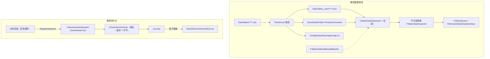

# GameData 架构概览

## 1. 模块分层

`GameData` 插件由两个模块组成，示例域独立为 `GameDataSamples` 插件：

| 模块 / 插件 | 职责 | 是否随通用安装 |
| :--- | :--- | :--- |
| `GameDataCore` | 手写通用基础设施：`FStaticDataRepository`、`DataTableLoaderUtils`、`UGameSaveArchive`、`USaveGameSubsystem` | 是（随 GameData 插件） |
| `GameData` | 生成代码宿主：Excel 管线写入 `Public/Generated`、`Private/Generated` | 是 |
| `GameDataSamples` | Item / Shop 示例域、`UGamePlayerDataRegistry`、`UGamePlayerProfileSaveAdapter` | 否（`--all` 跳过） |

---

## 2. 静态数据原则

### 2.1 不可变快照
- 每次加载/热更都构建一份全新 `FStaticDataSnapshot`，完成后一次性原子发布并自增数据版本。
- 读者必须先 `GetSnapshot()`，在本次逻辑栈内持有该快照；后续提交不会修改旧快照内容。
- 行查询返回 `TSharedPtr<const Row>`，以别名共享指针延长快照生命周期，避免裸指针跨版本悬垂。

### 2.2 冷启动确定性
- 冷启动同步加载（`LoadAllStaticData(false)`），保证首个游戏逻辑栈即可读到完整数据。
- 热重载异步预热，预热完成后回主线程原子发布；失败自动回滚到旧快照。

### 2.3 通道选择
- 运行期优先读取 `.bin`；magic/版本/CRC 任一不符或表缺失时整体回落 JSON。
- 命令行 `-GameStaticDataChannel=json` 可强制 JSON 通道，用于 CI 双通道对拍与冷启动基准。

---

## 3. 持久化原则

- 子系统零业务字段：业务方通过 `RegisterSegment` 注册段名、段版本与保存/加载委托。
- 保存时主线程捕获各段字节到内存归档，后台线程写 `.sav.tmp` 并原子替换 `.sav`。
- 加载时先校验文件 magic 与最小头长度，再反序列化；正式档缺失时尝试从 `.sav.tmp` 抢救。
- 段版本由业务方迁移；槽位名默认校验非法字符，可选白名单。

---

## 4. 依赖红线

- `GameDataCore` 不依赖 `GameData` 生成模块、不依赖 Gameplay 插件。
- `GameData` 仅依赖 `GameDataCore`。
- 业务域与 Profile 等示例只允许出现在 `GameDataSamples`。
