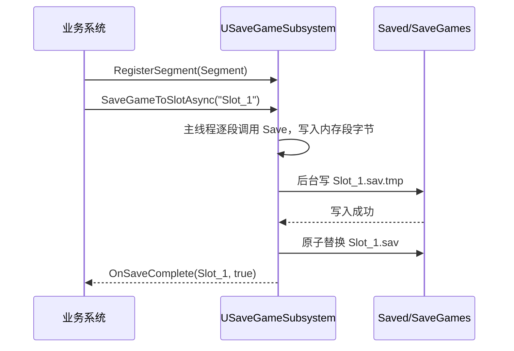

# GameData 动态持久化与存档架构

## 1. 设计目标

1. **子系统零业务字段**：`USaveGameSubsystem` 不感知等级、金币、背包等任何具体数据。
2. **段化保存与迁移**：业务方按段注册保存/加载委托，段版本由业务方解释与迁移。
3. **原子写保护**：先写 `.sav.tmp`，成功后再原子替换 `.sav`，防止断电导致旧档损毁。
4. **真异步 I/O**：主线程只捕获段字节，磁盘读写与替换在后台线程执行。
5. **损坏档前置拒绝**：读取前校验文件 magic 与最小头长度，避免引擎反序列化断言。

---

## 2. 数据结构

```cpp
USTRUCT(BlueprintType)
struct FGameSaveSlotMetadata {
    FString SlotName;
    FDateTime SaveTimestamp;
    int32 ArchiveVersion = 1;
};

USTRUCT(BlueprintType)
struct FGameSaveSegmentPayload {
    int32 SegmentVersion = 0;
    TArray<uint8> Bytes;
};

UCLASS(BlueprintType)
class UGameSaveArchive : public USaveGame {
    FGameSaveSlotMetadata Metadata;
    TMap<FName, FGameSaveSegmentPayload> Segments;
};
```

- `UGameSaveArchive` 可派生出带额外字段的存档类，并通过 `SetSaveGameClass` 替换。
- 每个段独立版本，互不影响；新增段不要求旧档升级。

```cpp
struct FGameSaveSegment {
    FName SegmentName;
    int32 SegmentVersion = 1;
    TFunction<void(FArchive&)> Save;
    TFunction<bool(FArchive&, int32 StoredVersion)> Load;
};
```

---

## 3. 保存流程



- 同步版本 `SaveGameToSlot` 使用同一段捕获与原子写路径，仅省去线程切换。
- 任一段保存委托抛出/失败时整次保存失败，不产生半成品正式档。

---

## 4. 加载与迁移流程

1. 读取 `.sav`；缺失或文件内容截断/损坏时自动尝试 `.sav.tmp` 抢救。
2. 校验文件类型 tag 与最小长度，失败返回 `false` 并记录 Warning。
3. 反序列化 `UGameSaveArchive`，遍历已注册段。
4. 对每个段：
   - 落盘版本 == 当前版本：直接 `Load`。
   - 落盘版本 < 当前版本：调用 `Load(Ar, StoredVersion)`，由业务方迁移。
   - 落盘版本 > 当前版本：视为不兼容，该段加载失败并记录 Warning。
   - 档中缺少该段：跳过（新增段向后兼容）。
5. 全部段成功后返回 `true`；异步路径在后台读盘后回主线程应用。

---

## 5. 槽位安全

- 默认拒绝：空名、长度 > 64、包含 `/`、`\`、`.`。
- `SetAllowedSlotNames` 可进一步限定可用槽位（例如只允许 `Slot_1` ~ `Slot_3`）。
- `DeleteSaveSlot` 同时清理残留 `.sav.tmp`，并将槽位代次标记为失效（`MAX_uint64`），彻底阻止在途的后台异步写任务复活已删除槽位。

---

## 6. 逃生口

需要保存非分段结构时：

```cpp
SaveSubsystem->SaveObjectToSlot(TEXT("Settings"), MySettingsObject);
SaveSubsystem->LoadObjectFromSlot(TEXT("Settings"), UMySettings::StaticClass(), LoadedObject);
```

该路径同样经过 `.sav.tmp` 原子替换与损坏档前置校验。
