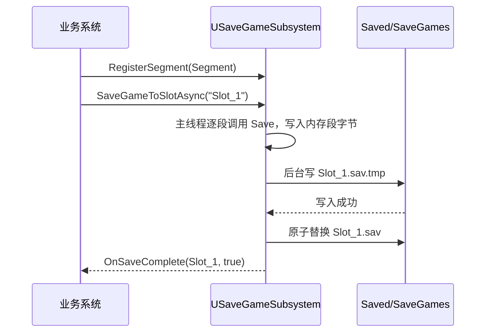
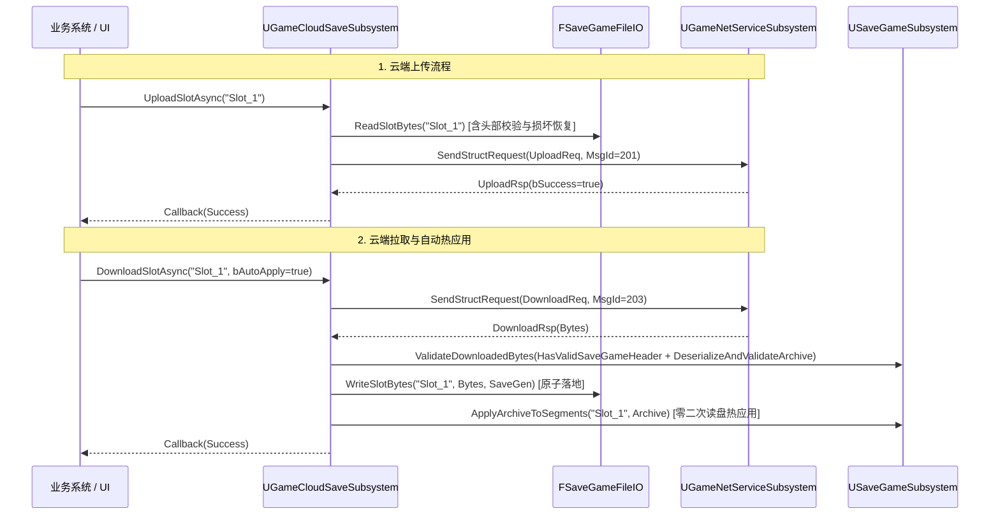

# GameData 动态持久化与存档架构

## 1. 设计目标

1. **子系统零业务字段**：`USaveGameSubsystem` 不感知等级、金币、背包等任何具体数据。
2. **段化保存与迁移**：业务方按段注册保存/加载委托，段版本由业务方解释与迁移。
3. **原子写保护**：先写 `.sav.tmp`，成功后再原子替换 `.sav`，防止断电导致旧档损毁。
4. **真异步 I/O**：主线程只捕获段字节，磁盘读写与替换在后台线程执行。
5. **损坏档前置拒绝**：读取前校验文件 magic 与最小头长度，避免引擎反序列化断言。
6. **云端无缝同步**：支持将本地快照一键上行备份至云端，并从云端安全拉取、校验防篡改、原子落盘与内存热应用。

---

## 2. 数据结构

```cpp
USTRUCT(BlueprintType)
struct FGameSaveSlotMetadata {
    FString SlotName;
    FDateTime SaveTimestamp;
    int32 ArchiveVersion = 1;
};

USTRUCT(BlueprintType)
struct FGameSaveSegmentPayload {
    int32 SegmentVersion = 0;
    TArray<uint8> Bytes;
};

UCLASS(BlueprintType)
class UGameSaveArchive : public USaveGame {
    FGameSaveSlotMetadata Metadata;
    TMap<FName, FGameSaveSegmentPayload> Segments;
};
```

- `UGameSaveArchive` 可派生出带额外字段的存档类，并通过 `SetSaveGameClass` 替换。
- 每个段独立版本，互不影响；新增段不要求旧档升级。

```cpp
struct FGameSaveSegment {
    FName SegmentName;
    int32 SegmentVersion = 1;
    TFunction<void(FArchive&)> Save;
    TFunction<bool(FArchive&, int32 StoredVersion)> Load;
};
```

---

## 3. 保存流程



- 同步版本 `SaveGameToSlot` 使用同一段捕获与原子写路径，仅省去线程切换。
- 任一段保存委托抛出/失败时整次保存失败，不产生半成品正式档。

---

## 4. 加载与迁移流程

1. 读取 `.sav`；缺失或文件内容截断/损坏时自动尝试 `.sav.tmp` 抢救。
2. 校验文件类型 tag 与最小长度（`>= 64` 字节），失败返回带 `Game::DataErrorCodes::CorruptedSaveFile` 的 `TGameStatusResult::Failure` 并输出告警/错误诊断日志。
3. 反序列化 `UGameSaveArchive` 并先执行归档版本校验（`1 <= ArchiveVersion <= CurrentArchiveVersion`）与全段只读版本兼容性预检（`ValidateArchiveCompatibility`，要求 `1 <= StoredVersion <= CurrentSegmentVersion`），再遍历已注册段应用。
4. 对每个段：
   - 落盘版本 == 当前版本：直接 `Load`。
   - 落盘版本 < 当前版本：调用 `Load(Ar, StoredVersion)`，由业务方迁移。
   - 落盘版本 > 当前版本：在只读预检阶段即整档拒绝，返回 `SegmentVersionMismatch` 失败并记录 Error，业务内存状态零半改写。
   - 档中缺少该段：跳过（新增段向后兼容）。
5. 全部段成功后返回 `TGameStatusResult<void>::Success()`；异步路径在后台读盘后回主线程应用。同槽位仅最新异步加载请求可反序列化并应用业务段，任何同步/异步保存、同步加载、云端热应用或删除槽位均会使在途旧异步加载代次失效。

---

## 5. 槽位安全

- 默认拒绝：空名、长度 > 64、首尾空白、控制字符或包含 `/`、`\`、`.`、`:`、`*`、`?`、`"`、`<`、`>`、`|`。
- `SetAllowedSlotNames` 可进一步限定可用槽位（例如只允许 `Slot_1` ~ `Slot_3`）。
- `DeleteSaveSlot` 同时清理残留 `.sav.tmp`，并保留槽位已签发保存代次高水位（`Committed = CurrentIssued`），使后续代次严格递增；写入门禁采用 `>=`（`*Committed >= SaveGeneration`）拦截全部旧写，即使旧写在新写落盘前到达也被绝对安全吸收，彻底根治 ABA 并发穿透；读取失败分支显式重置输出缓冲。

---

## 6. 逃生口

需要保存非分段结构时：

```cpp
(void)SaveSubsystem->SaveObjectToSlot(TEXT("Settings"), MySettingsObject);
TGameStatusResult<UMySettings*> LoadRes = SaveSubsystem->LoadObjectFromSlot<UMySettings>(TEXT("Settings"));
```

---

## 7. 云端存档网络同步与热应用 (`UGameCloudSaveSubsystem`)



- **分层边界**：网络同步由 `GameData` 模块持有，底层 `GameDataCore` 继续保持零网络依赖；
- **防坏包与高版本击穿**：云端返回字节在接触本地文件系统前必须通过 `ValidateDownloadedBytes`（`HasValidSaveGameHeader` + `DeserializeAndValidateArchive`），若由于网络截断、反序列化失败或段版本不兼容直接报错 `CorruptedData` / `VersionMismatch`，绝不破坏本地磁盘原有良好存档；
- **单调代次原子落盘**：下载数据调用 `FSaveGameFileIO::IssueSlotSaveGeneration` 签发最新代次写入；若写盘期间该槽位被更新或删除，自动跳过热应用并返回 `Cancelled`，杜绝内存与磁盘脑裂；
- **零二次读盘热应用**：拉取并落盘成功后若开启 `bAutoApplyToSubsystem`，直接调用 `USaveGameSubsystem::ApplyArchiveToSegments` 应用内存中已校验的归档对象。
