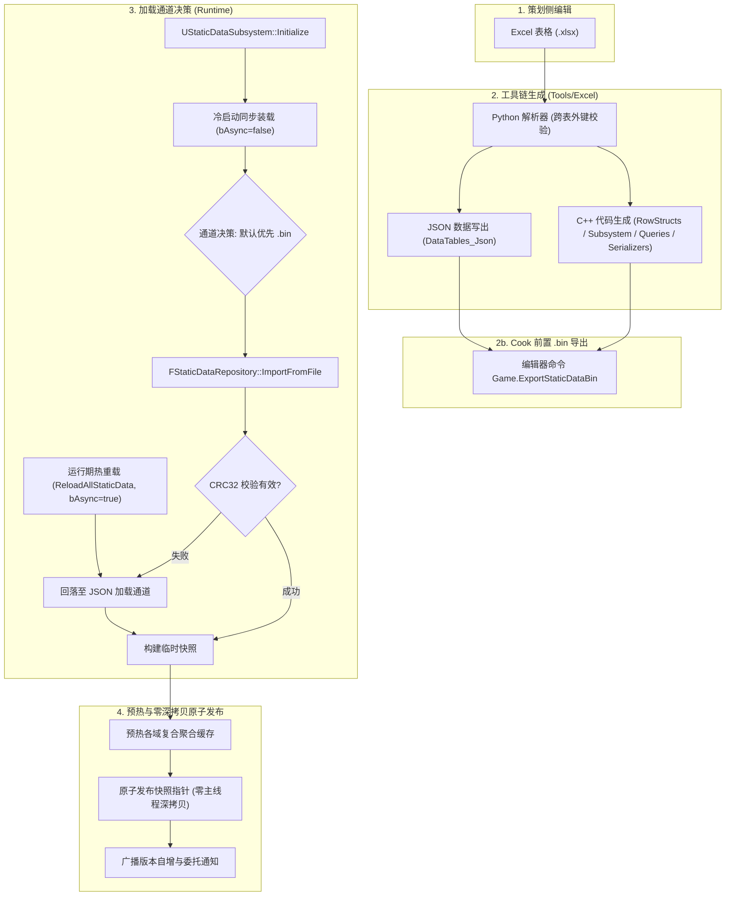

# GameData 静态数据端到端管线架构

本文档详细剖析从策划编辑 Excel 配表，到代码生成工具链处理，再到运行时以二进制极速加载和热重载的全链路流程。

---

## 1. 全流程流水线示意图



---

## 2. 二进制仓库格式与 CRC32 防篡改

`FStaticDataRepository` 采用了紧凑的平台端序直写格式：
```text
+-----------------------------------------------------------------------------------------+
| Magic (4B) | Version (4B) | TableCount (4B) | { [TableName FString] [RowCount 4B] ... } |
+-----------------------------------------------------------------------------------------+
|                                    CRC32 校验和 (4B)                                     |
+-----------------------------------------------------------------------------------------+
```

### 校验与容灾机制
1. **CRC32 全包覆盖**：CRC32 校验和覆盖自格式版本起至末行负载的所有字节。若在打包传输或磁盘写入时发生截断、损坏或人为篡改，加载立即整体拒绝；
2. **安全平滑回落**：当 `.bin` 格式损坏、版本不兼容或关键表格缺失时，系统不会引发 Crash，而是静默打印告警并无缝回退至 `JSON` 加载通道，确保开发期与测试期的最高鲁棒性；
3. **冷启动同步确定性**：`UStaticDataSubsystem::Initialize` 期间默认走同步加载路径，保证子系统初始化完毕后快照立即可用，彻底杜绝关卡 Actor 在 `BeginPlay` 中获取到空快照的时序竞态；
4. **提交期零主线程深拷贝**：子系统不常驻各域全量 TMap 镜像副本，提交时仅进行智能指针置换与版本广播，主线程开销控制在微秒级。

---

## 3. 热重载与目录监听机制

1. `FStaticDataHotReloadWatcher` 内部封装了 `GameCore` 的 `FDirectoryChangeWatcher`，监听 `DataTables_Json/` 目录；
2. 引入 `GWatcherRefCount` 会话引用计数，多 PIE 窗口调试时仅当最后一个窗口退出才释放全局监听器，避免误停；
3. 当策划修改并重新导出配表后，监听器捕获文件时间戳推进，自动触发 `UStaticDataSubsystem::ReloadAllWorldStaticData()`；
4. 重载全流程在后台异步完成反序列化与跨表复合缓存预热，预热完毕回主线程原子置换快照，游戏运行时无感热更最新数值。

