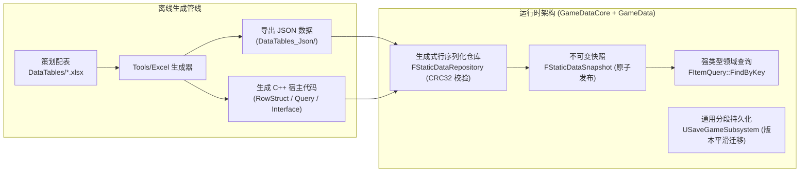

# GameData 插件

**GameData** 是静态配置与持久化中枢，内部拆分为两个模块：

1. **`GameDataCore`**：手写通用基础设施——生成式数据仓库、JSON 装载辅助、通用分段存档；与业务域完全无关。
2. **`GameData`**：生成代码宿主——`Tools/Excel` 把 RowStruct、静态数据容器、快照/缓存、Query/Interface/Service、Subsystem 与注册入口写入本模块的 `Public/Generated`、`Private/Generated`；自身不手写业务代码。

示例域（Item / Shop）与 `PlayerProfile` 适配器位于独立插件 `GameDataSamples`，`.scripts/install.sh --all` 默认跳过。

支持 UE 5.1 ~ 5.8 与 C++20。

---

## 数据与持久化架构



---

## 核心特性

| 模块 / 机制 | 关键技术亮点 | 核心文件 / 类 |
| :--- | :--- | :--- |
| 生成式行序列化仓库 | 纯 C++ 可独立实例化，`Serialize{Struct}` 逐行写入，CRC32 整包校验 | `GameDataCore/.../FStaticDataRepository.h` |
| 静态数据子系统 | 冷启动同步确定性加载、热重载后台预热、快照原子发布、数据版本观察者 | 生成于 `Generated/Data/StaticData/UStaticDataSubsystem.h` |
| 不可变快照 | 每次提交生成全新 `FStaticDataSnapshot`，读者持有期间内容绝对稳定 | `Generated/Data/StaticData/FStaticDataSnapshot.h` |
| 域查询与聚合缓存 | 每表生成 `F{Stem}Query::FindByKey`（返回持快照所有权的行共享指针）、`F{Domain}StaticDataInterface` 聚合缓存 | `Generated/Data/StaticData/{Domain}/` |
| 目录监听热更 | 复用 `GameCore` 的 `FDirectoryChangeWatcher`，多会话引用计数保护 | `Generated/Data/StaticData/FStaticDataHotReloadWatcher.h` |
| 通用分段存档 | `FGameSaveSegment` 段注册、段版本迁移、SlotName 白名单、`.sav.tmp` 原子替换、损坏档前置校验 | `GameDataCore/.../USaveGameSubsystem.h`<br>`GameDataCore/.../GameSaveArchive.h` |
| 任意存档逃生口 | `SaveObjectToSlot` / `LoadObjectFromSlot` 可存取任意 `USaveGame` | `GameDataCore/.../USaveGameSubsystem.h` |

---

## 依赖

- `GameDataCore` 公有：`Core`, `CoreUObject`, `Engine`, `Json`, `JsonUtilities`, `GameLogging`；私有：`GameCore`
- `GameData`：`GameDataCore`
- 不依赖 `Niagara` / `GameplayAbilities` / `GameGameplay`

---

## 快速上手

### 1. 生成静态数据代码与 JSON

生成器配置（`Tools/Excel/generator_config.json`）关键项：

```json
{
    "data_tables_source_dir": "DataTables",
    "json_output_dir": "DataTables_Json",
    "gameplay_tags_ini_path": "Config/DefaultGameplayTags.ini",
    "output_module_dir": "Plugins/GameData/Source/GameData",
    "api_macro": "GAMEDATA_API",
    "nested_struct_types": {
        "FWeaponAffix": "WeaponAffixTypes.h"
    }
}
```

- `nested_struct_types` 仅登记需要按对象解析的嵌套 USTRUCT，并确保该类型头文件位于生成模块的可见 include 路径。
- 键模式由 `row_key_mode` 决定：默认 `fname`，小表可选 `enum`（枚举键受 `uint8` 255 行上限约束）。
- 生成采用暂存树 + 原子换入，任一表失败整体回滚。

```bash
./Tools/Excel/generate_all_tables.sh --config Tools/Excel/generator_config.json --all
```

### 2. 查询静态数据

```cpp
#include "Generated/Data/StaticData/UStaticDataSubsystem.h"
#include "Generated/Data/StaticData/Item/ItemQuery.h"
#include "Generated/Data/StaticData/Item/ItemStaticDataInterface.h"

UStaticDataSubsystem* StaticData = GetGameInstance()->GetSubsystem<UStaticDataSubsystem>();
TSharedPtr<const FStaticDataSnapshot> Snapshot = StaticData->GetSnapshot();

if (const TSharedPtr<const FItemRow> Item = FItemQuery::FindByKey(Snapshot, FName(TEXT("1001")))) {
    GAME_LOG(Log, TEXT("Found Item: %s"), *Item->ItemName.ToString());
}

if (const TSharedPtr<const FItemCompositeData> Composite = FItemStaticDataInterface::FindCompositeData(Snapshot, FName(TEXT("1001")))) {
    GAME_LOG(Log, TEXT("Composite resolved: %s"), *Composite->Item.ItemName.ToString());
}
```

`FindByKey` 返回别名共享指针，调用方即使不长期持有 `Snapshot` 也能安全使用该行；跨版本数据不会被释放。

### 3. 注册存档段

```cpp
#include "Persistence/USaveGameSubsystem.h"

USaveGameSubsystem* SaveSubsystem = GetGameInstance()->GetSubsystem<USaveGameSubsystem>();

FGameSaveSegment Segment;
Segment.SegmentName = TEXT("Player.Profile");
Segment.SegmentVersion = 2;
Segment.Save = [](FArchive& Ar) {
    FString PlayerIdCopy = CurrentProfile.PlayerId;
    Ar << PlayerIdCopy;
    Ar << CurrentProfile.Level;
};
Segment.Load = [](FArchive& Ar, int32 StoredVersion) {
    FString LoadedId;
    Ar << LoadedId;
    int32 Level = 0;
    Ar << Level;
    ApplyProfile(LoadedId, Level, StoredVersion);
    return true;
};
SaveSubsystem->RegisterSegment(Segment);

SaveSubsystem->SaveGameToSlotAsync(TEXT("Slot_1"));
SaveSubsystem->LoadGameFromSlot(TEXT("Slot_1"));
```

- 段版本低于当前版本时在 `Load` 内完成迁移；高于当前版本视为不兼容并拒绝。
- 槽位名默认拒绝空名、超长名与路径分隔符/点号；`SetAllowedSlotNames` 可启用白名单。
- 存档类型可替换：`SetSaveGameClass(MyArchiveClass)`。

---

## 安装

```bash
# GameData 默认 copy，其余依赖插件 link
./.scripts/install.sh GameData /path/to/MyTargetProject

# 全量安装（跳过 GameDataSamples）
./.scripts/install.sh --all /path/to/MyTargetProject
```

安装器会：

1. 把 Excel 工具链接管到目标工程，并把生成器输出重绑到 `Plugins/GameData/Source/GameData`；
2. 在目标缺少数据目录时注入示例 `DataTables` / `DataTables_Json`；
3. 幂等注入 `[/Script/GameplayAbilities.AbilitySystemGlobals]`（与 GameGameplay 配合时生效）。

---

## 目录结构

```text
Plugins/GameData/
├── Source/
│   ├── GameDataCore/                 # 通用模块（GAMEDATACORE_API）
│   │   ├── Public/
│   │   │   ├── Data/StaticData/FStaticDataRepository.h
│   │   │   ├── Persistence/GameSaveArchive.h
│   │   │   ├── Persistence/USaveGameSubsystem.h
│   │   │   └── Utils/DataTableLoaderUtils.h
│   │   └── Private/
│   └── GameData/                     # 生成宿主（GAMEDATA_API）
│       ├── Public/Generated/         # 生成声明
│       └── Private/Generated/        # 生成实现
├── Docs/
└── README.md
```

---

## 文档导航

- [架构概览](Docs/Architecture/Overview.md)：双模块分工与数据流。
- [静态数据管线](Docs/Architecture/StaticDataPipeline.md)：Excel → C++ / JSON / Tag → 快照。
- [持久化架构](Docs/Architecture/PersistenceArchitecture.md)：分段存档、原子写与迁移。
- [静态数据子系统 API](Docs/API/StaticDataSubsystem.md)
- [领域查询 API](Docs/API/DomainQueries.md)
- [存档子系统 API](Docs/API/SaveGameSubsystem.md)
- [快速上手](Docs/Guides/QuickStart.md)
- [查询实战](Docs/Guides/StaticDataQueryGuide.md)
- [存档接入指南](Docs/Guides/SaveGameGuide.md)
