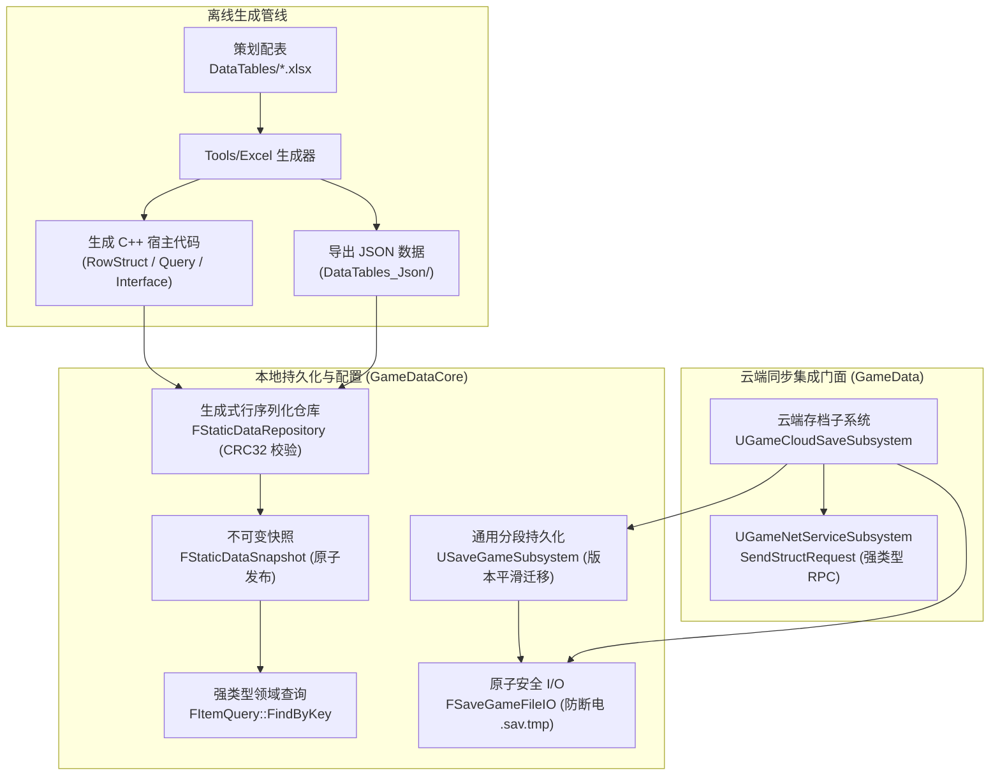

# GameData

> **一句话**：Excel 配表生成宿主，加上通用分段存档与云存档同步门面。
> **版本** v2.0.0 · **引擎** UE 5.1~5.8 · **层级** Level 2 · **直接依赖** GameCore, GameLogging, GameNetCore, GameNetService（内部模块 GameDataCore）

## 30 秒速览

- **解决什么问题**：把「策划 Excel → C++ RowStruct / 查询 / 子系统」的生成管线，与「业务无关的分段存档、原子落盘、云存档同步」收拢到同一个插件；通用基础设施放在 `GameDataCore`，业务宿主与网络门面放在 `GameData`。
- **核心能力**：
  - 生成静态数据仓库、不可变快照、`F{Stem}Query`、`F{Domain}StaticDataInterface` 与 `UStaticDataSubsystem`；
  - `FGameSaveSegment` 分段存档、段版本迁移、未知段保留与 `.sav.tmp` 原子写；
  - `UGameCloudSaveSubsystem` 经 `GameNetService` 强类型 RPC 上传 / 下载 / 查询，下载先校验后落盘；
  - 目录指纹监听驱动静态数据热重载。
- **什么时候用**：需要 Excel 配表管线、运行期不可变静态数据快照、分段存档或云存档。
- **什么时候不用**：只需要不依赖配表的数值 / Buff 契约时用 `GameGameplayCore`；只需要本地通用存档时可直接依赖 `GameDataCore`，不必引入云存档与网络依赖。

## 快速开始

业务模块先声明 `GameData`（已公开传递 `GameDataCore`、`GameLogging`、`GameCore`）：

```csharp
PublicDependencyModuleNames.AddRange(new string[] { "Core", "CoreUObject", "Engine", "GameData" });
```

查询生成式静态数据（来自 [QuickStart](Docs/Guides/QuickStart.md)）：

```cpp
#include "Generated/Data/StaticData/UStaticDataSubsystem.h"
#include "Generated/Data/StaticData/Item/ItemQuery.h"

UStaticDataSubsystem* StaticData = GetGameInstance()->GetSubsystem<UStaticDataSubsystem>();
const TSharedPtr<const FStaticDataSnapshot> Snapshot = StaticData->GetSnapshot();

if (const TSharedPtr<const FItemRow> Item = FItemQuery::FindByKey(Snapshot, FName(TEXT("Item_Potion")))) {
    GAME_LOG(Log, TEXT("Found Item: %s (GoldCost=%.1f)"), *Item->ItemName, Item->GoldCost);
}
```

生成与安装：

```bash
./Tools/Excel/generate_all_tables.sh --config Tools/Excel/generator_config.json --all
./.scripts/install.sh GameData /path/to/MyTargetProject
```

> 生成代码（`Generated/**`）写入宿主模块。本仓库示例生成代码位于 `GameDataSamples`；安装到目标工程时由 `install.py` 将生成输出重绑到 `Plugins/GameData/Source/GameData`。

## 核心能力

### 生成式静态数据

- `Tools/Excel` 以暂存树 + 原子换入生成 RowStruct、容器、快照、Query / Interface / Service 与 `UStaticDataSubsystem`，任一表失败整体回滚。
- 冷启动同步加载 `.bin`，magic / 版本 / CRC 不符时整体回落 JSON；运行期热重载走后台预热后原子发布。
- `F{Stem}Query::FindByKey` 返回持有快照所有权的行共享指针，调用方不长期持有 `Snapshot` 也可安全使用。
- `TStaticDataSnapshotStore<TSnapshot>` 用 `FRWLock` 发布、无锁读取，并用防重入闸门隔开同批热更。

### 通用分段存档

- 业务方注册 `FGameSaveSegment`（段名、段版本、`Save` / `Load` 委托），`USaveGameSubsystem` 不感知任何业务字段。
- `Load` 收到落盘时的 `StoredVersion`，段版本低于当前版本时由业务方自行迁移；高于注册版本整档拒绝。
- 未注册段在读取时保留、保存时原样写回；槽位名默认拒绝空名、控制字符和 `/ \ . : * ? " < > |`，可用 `SetAllowedSlotNames` 收紧。
- `SaveObjectToSlot` / `LoadObjectFromSlot` 可存取任意 `USaveGame`；`SetSaveGameClass` 可替换归档类型。

### 原子落盘与并发保护

- 所有写入走 `.sav.tmp` 原子替换，避免断电留下半截 `.sav`。
- 槽位级 I/O 锁与内存元数据锁分离；高水位单调代次防止旧写穿透与删除后复活。
- 同步接口返回 `TGameStatusResult<void>`；异步版 `SaveGameToSlotAsync` / `LoadGameFromSlotAsync` 在主线程序列化、后台写文件，完成后广播。
- 异步加载按槽位代次只应用最新请求，过期结果自动丢弃。

### 云存档同步

- `UGameCloudSaveSubsystem` 基于 `UGameNetServiceSubsystem::SendStructRequest`，使用预留 MessageId `201~206`。
- 上传：后台读取本地槽位字节 → 主线程发 RPC；下载：先做魔数头检查与内存反序列化 / 版本预检，通过后才原子落盘。
- 下载可直接把已校验的 `UGameSaveArchive` 热应用到当前已注册段，无需二次读盘。
- 上传 / 下载 / 查询均支持 `FCancellationToken`；结果映射为 `EGameCloudSaveResult`（含 `CorruptedData`、`VersionMismatch`、`Cancelled`）。

### 装载与热更辅助

- `FDataTableLoaderUtils` 提供 JSON 反序列化辅助。
- `FDirectoryChangeWatcher` 支持递归 / 非递归指纹采样，经 `FGameThreadTaskRunner` 统一在主线程派发热更。
- 静态数据版本可通过 `GetDataVersionObserver()` 或 `OnStaticDataReloaded` 订阅。

### 错误码与状态契约

- 静态数据与持久化错误集中定义在 `Game::DataErrorCodes`，状态携带 `Game::ModuleId::Data`。
- 核心接口统一返回 `TGameStatusResult`，失败时可直接读取 `GetError().Message`。

## 架构与依赖

| 模块 | 职责 | 直接依赖 |
| :--- | :--- | :--- |
| `GameDataCore` | 静态数据仓库、快照存储、分段存档、目录监听 | Core, CoreUObject, Engine, Json, JsonUtilities, GameLogging, GameCore |
| `GameData` | 生成代码宿主、`UGameCloudSaveSubsystem` | Core, CoreUObject, Engine, Json, JsonUtilities, GameplayTags, GameLogging, GameCore, GameDataCore, GameNetCore, GameNetService |

- `GameDataCore` 网络依赖为 0，不依赖 `Niagara` / `GameplayAbilities` / `GameGameplay` / `GamePool`。
- 关键类：`FStaticDataRepository`、`FStaticDataBinCodec`、`TStaticDataSnapshotStore`、`USaveGameSubsystem`、`FSaveGameFileIO`、`UGameCloudSaveSubsystem`。
- 示例域（Item / Shop）与 `PlayerProfile` 适配器在独立插件 `GameDataSamples`，`.scripts/install.sh --all` 默认跳过。

<details>
<summary><b>展开数据流与持久化架构图</b></summary>



</details>

<details>
<summary><b>展开目录结构</b></summary>

```text
Plugins/GameData/
├── Source/
│   ├── GameDataCore/                 # 通用模块（GAMEDATACORE_API，零网络依赖）
│   │   ├── Public/
│   │   │   ├── Core/DataErrorCodes.h                      # 统一错误码常量（Game::DataErrorCodes）
│   │   │   ├── StaticData/FStaticDataRepository.h         # 行负载容器与序列化器注册
│   │   │   ├── StaticData/FStaticDataBinCodec.h           # .bin 单缓冲编解码 / CRC32 / 长度前缀 UTF-8 摘要
│   │   │   ├── StaticData/FStaticDataRepositoryTypes.h    # 二进制错误枚举与数据结构
│   │   │   ├── StaticData/TStaticDataSnapshotStore.h      # 通用只读快照发布存储与防重入闸门模板
│   │   │   ├── Save/GameSaveTypes.h                       # 存档槽位元数据与分段契约
│   │   │   ├── Save/GameSaveArchive.h                     # 通用分段归档对象
│   │   │   ├── Save/FSaveGameSegmentRegistry.h            # 分段注册、只读预检与版本平滑迁移
│   │   │   ├── Save/FSaveGameFileIO.h                     # 槽位锁原子文件 I/O 与高水位代次保护
│   │   │   ├── Save/USaveGameSubsystem.h                  # 通用存档门面、异步调度与内存预校验
│   │   │   ├── Utils/DataTableLoaderUtils.h               # JSON 反序列化辅助工具
│   │   │   ├── Utils/FDirectoryChangeWatcher.h            # 目录指纹监听与异步热更驱动
│   │   │   └── Tests/GameDataBenchmarkUtils.h             # 共享微基准测试采样工具
│   │   └── Private/
│   └── GameData/                     # 业务宿主与云同步集成（GAMEDATA_API）
│       ├── Public/
│       │   ├── GameData.h                                 # 聚合头文件
│       │   ├── Cloud/
│       │   │   ├── GameCloudSaveTypes.h                   # 云存档结果枚举与 RPC 结构体
│       │   │   └── GameCloudSaveSubsystem.h               # 云存档门面子系统声明
│       │   └── Tests/GameCloudSaveTestTypes.h             # 云存档自动化测试辅助监听对象
│       └── Private/
│           ├── GameData.cpp
│           ├── Cloud/
│           │   └── GameCloudSaveSubsystem.cpp             # 云端 RPC 调度、先验后落盘与取消支持
│           └── Tests/
│               ├── GameCloudSaveSubsystemTest.cpp         # 端到端闭环自动化测试
│               └── GameCloudSavePerformanceTest.cpp       # 云存档吞吐微基准测试
├── Docs/
└── README.md
```

</details>

> 本仓库 `GameData` 模块当前不含 `Public/Generated` / `Private/Generated`；Item / Shop 等生成代码位于 `GameDataSamples`，安装到目标工程时由 `install.py` 重绑回本模块。

## 性能与边界

- **模块边界**：`GameDataCore` 不链接任何网络模块；只有 `GameData` 依赖 `GameNetCore` / `GameNetService`。
- **加载时序**：冷启动同步加载保证就绪；热重载后台预热，失败不影响在线快照。
- **快照生命周期**：读者持有 `TSharedPtr` 期间内容稳定，后续提交不会修改已有快照。
- **存档版本**：`SegmentVersion <= 0` 注册即拒绝；落盘段版本高于注册版本时整档拒绝，不做隐式降级。
- **云下载安全**：任何校验失败都在写盘前返回，不会覆盖本地健康存档。

<details>
<summary>展开性能基准（历史 Development 构建参考值）</summary>

下表为自动化测试中的中位耗时预算上限，不是仓库固化的实测值；实际数值随机器与构建配置变化。

| 基准用例 | 场景 | 预算 |
| :--- | :--- | :--- |
| `Game.Data.Perf.StaticData.BinCodec` | 编码 / 解码 1000 行 | < 1 ms / < 500 μs |
| `Game.Data.Perf.StaticData.ContentDigest` | 内容摘要 | < 500 μs |
| `Game.Data.Perf.StaticData.JsonLoad` | 500 行 JSON 加载 | < 25 ms |
| `Game.Data.Perf.StaticData.RepositoryRoundTrip` | 内存 Add+Extract / 文件 Export+Import（1000 行） | < 2 ms / < 5 ms |
| `Game.Data.Perf.StaticData.SnapshotStore` | `Acquire` / 无锁 `GetVersion` | < 500 ns / < 100 ns |
| `Game.Data.Perf.StaticData.DirectoryWatcherFingerprint` | 32 文件指纹扫描 | < 5 ms |
| `Game.Data.Perf.SaveGame.SegmentRegistry` | 16 段构建 / 恢复 | < 150 μs / < 100 μs |
| `Game.Data.Perf.SaveGame.AtomicFileIO` | 4 KB 写 / 读 | < 10 ms / < 1 ms |
| `Game.Data.Perf.SaveGame.AtomicFileIO` | 64 KB 写 / 读 | < 20 ms / < 2 ms |
| `Game.Data.Perf.SaveGame.SubsystemRoundTrip` | 同步存读往返 | < 15 ms |
| `Game.Data.Perf.CloudSave.Throughput` | 云上传 / 下载 / 元信息查询 | < 15 ms / < 15 ms / < 2 ms |

来源：`Source/GameDataCore/Private/Tests/StaticDataPerformanceTest.cpp`、`SaveGamePerformanceTest.cpp`、`Source/GameData/Private/Tests/GameCloudSavePerformanceTest.cpp`。

</details>

## 文档导航

| 文档 | 内容 |
| :--- | :--- |
| [快速上手](Docs/Guides/QuickStart.md) | 模块依赖、静态数据查询、分段存档接入 |
| [架构概览](Docs/Architecture/Overview.md) | 双模块分工、数据流与云同步体系 |
| [静态数据管线](Docs/Architecture/StaticDataPipeline.md) | Excel → C++ / JSON / Tag → 快照 |
| [持久化架构](Docs/Architecture/PersistenceArchitecture.md) | 分段存档、原子写、迁移与云端同步 |
| [云存档 API](Docs/API/GameCloudSaveSubsystem.md) | `UGameCloudSaveSubsystem` 上传 / 下载 / 查询契约 |
| [静态数据仓库 API](Docs/API/StaticDataRepository.md) | `FStaticDataRepository`、`FStaticDataBinCodec`、`TStaticDataSnapshotStore` |
| [静态数据子系统 API](Docs/API/StaticDataSubsystem.md) | `UStaticDataSubsystem` 与版本观察 |
| [领域查询 API](Docs/API/DomainQueries.md) | `F{Stem}Query` 与聚合查询 |
| [存档子系统 API](Docs/API/SaveGameSubsystem.md) | `USaveGameSubsystem` 接口与错误码 |
| [查询实战](Docs/Guides/StaticDataQueryGuide.md) | 静态数据查询用例 |
| [存档接入指南](Docs/Guides/SaveGameGuide.md) | 业务分段存档接入 |
| [GameDataCore 模块说明](Source/GameDataCore/README.md) | 通用数据模块职责边界 |
| [GameDataSamples 示例插件](../GameDataSamples/README.md) | Item / Shop 与 Profile 适配器 |
| [Excel 数据表工具链](../../Tools/Excel/README.md) | 生成器配置与输出 |
