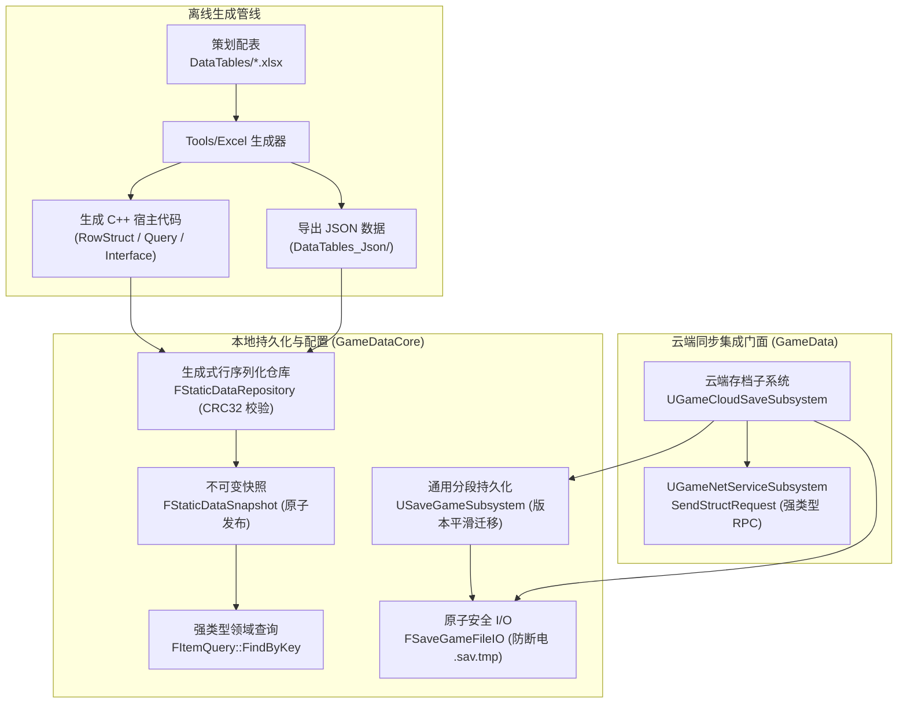

# GameData 插件

**GameData** 是静态配置与持久化中枢，内部拆分为两个模块：

1. **`GameDataCore`**：手写通用基础设施——生成式数据仓库、JSON 装载辅助、通用分段存档；与业务域完全无关，100% 保持本地纯净（零网络依赖）。
2. **`GameData`**：高层业务宿主与云同步集成门面——既作为 `Tools/Excel` 生成代码宿主（RowStruct、静态数据容器、快照/缓存、Query/Interface/Service、Subsystem），又集成 `GameNetCore` 与 `GameNetService` 提供 [`UGameCloudSaveSubsystem`](Source/GameData/Public/Cloud/GameCloudSaveSubsystem.h) 实现端到端云端存档上传、拉取校验、原子落盘与内存段自动热应用。

示例域（Item / Shop）与 `PlayerProfile` 适配器位于独立插件 `GameDataSamples`，`.scripts/install.sh --all` 默认跳过。

支持 UE 5.1 ~ 5.8 与 C++20。

---

## 数据与持久化架构



---

## 核心特性

| 模块 / 机制 | 关键技术亮点 | 核心文件 / 类 |
| :--- | :--- | :--- |
| 统一错误码契约 | 集中定义静态数据与持久化 `Game::DataErrorCodes`，配合 `TGameStatusResult<T>` 携带 `Game::ModuleId::Data` | `GameDataCore/.../Core/DataErrorCodes.h` |
| 生成式行序列化仓库 | 纯 C++ 可独立实例化，免反射，`Serialize{Struct}` 逐行调度，数据表解耦 | `GameDataCore/.../StaticData/FStaticDataRepository.h` |
| 二进制编解码与摘要 | `.bin` 单缓冲零拷贝编解码、全包 CRC32 防破坏校验、长度前缀抗碰撞 UTF-8 SHA-1 摘要 | `GameDataCore/.../StaticData/FStaticDataBinCodec.h` |
| 通用快照存储模板 | `TStaticDataSnapshotStore<TSnapshot>`：`FRWLock` 读写并发发布、无锁版本读取、原子热重载防重入闸门 | `GameDataCore/.../StaticData/TStaticDataSnapshotStore.h` |
| 静态数据子系统 | 冷启动同步确定性加载、热重载后台预热、快照原子发布、数据版本观察者 | 生成于 `Generated/Data/StaticData/UStaticDataSubsystem.h` |
| 不可变快照 | 每次提交生成全新 `FStaticDataSnapshot`，读者持有期间内容绝对稳定 | `Generated/Data/StaticData/FStaticDataSnapshot.h` |
| 域查询与聚合缓存 | 每表生成 `F{Stem}Query::FindByKey`（返回持快照所有权的行共享指针）、`F{Domain}StaticDataInterface` 聚合缓存 | `Generated/Data/StaticData/{Domain}/` |
| 目录监听热更 | 复用 `GameDataCore` 的 `FDirectoryChangeWatcher`（可配置递归/非递归指纹采样 + `FGameThreadTaskRunner` 统一派发） | `GameDataCore/.../Utils/FDirectoryChangeWatcher.h`<br>`Generated/Data/StaticData/FStaticDataHotReloadWatcher.h` |
| 通用分段存档 | `FGameSaveSegment` 段注册、只读版本兼容性预检、段版本迁移、未知段保留回写、SlotName 白名单 | `GameDataCore/.../Save/USaveGameSubsystem.h`<br>`GameDataCore/.../Save/FSaveGameSegmentRegistry.h` |
| 原子 I/O 与并发写保护 | `.sav.tmp` 原子替换、槽位级 I/O 锁与内存元数据锁分离、断电抢救恢复、高水位单调代次（严格防旧写穿透与 ABA 复活） | `GameDataCore/.../Save/FSaveGameFileIO.h`<br>`GameDataCore/.../Save/GameSaveArchive.h` |
| 任意存档逃生口 | `SaveObjectToSlot` / `LoadObjectFromSlot` 可存取任意 `USaveGame` | `GameDataCore/.../Save/USaveGameSubsystem.h` |
| **云端存档网络同步** | 结合 `GameNetService` 提供强类型 RPC 上传/下载/元数据查询；下载先内存反序列化与段版本预检再原子落盘（杜绝损坏包污染本地档），全链路支持 `FCancellationToken` | `GameData/Public/Cloud/GameCloudSaveSubsystem.h`<br>`GameData/Public/Cloud/GameCloudSaveTypes.h` |

---

## 依赖

- **`GameDataCore`**：
  - 公有：`Core`, `CoreUObject`, `Engine`, `Json`, `JsonUtilities`, `GameLogging`, `GameCore`
  - **网络依赖：0**（100% 保持本地独立性）
- **`GameData`**：
  - 公有：`Core`, `CoreUObject`, `Engine`, `Json`, `JsonUtilities`, `GameplayTags`, `GameLogging`, `GameCore`, `GameDataCore`, `GameNetCore`, `GameNetService`
- 不依赖 `Niagara` / `GameplayAbilities` / `GameGameplay` / `GamePool`

---

## 快速上手

### 1. 生成静态数据代码与 JSON

生成器配置（`Tools/Excel/generator_config.json`）关键项：

```json
{
    "data_tables_source_dir": "DataTables",
    "json_output_dir": "DataTables_Json",
    "gameplay_tags_ini_path": "Config/DefaultGameplayTags.ini",
    "output_module_dir": "Plugins/GameData/Source/GameData",
    "api_macro": "GAMEDATA_API",
    "nested_struct_types": {
        "FWeaponAffix": "WeaponAffixTypes.h"
    }
}
```

- `nested_struct_types` 仅登记需要按对象解析的嵌套 USTRUCT，并确保该类型头文件位于生成模块的可见 include 路径。
- 键模式由 `row_key_mode` 决定：默认 `fname`，小表可选 `enum`（枚举键受 `uint8` 255 枚举项上限约束，含 `None = 0` 最多支持 254 行数据）。
- 生成采用暂存树 + 原子换入，任一表失败整体回滚。

```bash
./Tools/Excel/generate_all_tables.sh --config Tools/Excel/generator_config.json --all
```

### 2. 查询静态数据

```cpp
#include "Generated/Data/StaticData/UStaticDataSubsystem.h"
#include "Generated/Data/StaticData/Item/ItemQuery.h"
#include "Generated/Data/StaticData/Item/ItemStaticDataInterface.h"

UStaticDataSubsystem* StaticData = GetGameInstance()->GetSubsystem<UStaticDataSubsystem>();
TSharedPtr<const FStaticDataSnapshot> Snapshot = StaticData->GetSnapshot();

if (const TSharedPtr<const FItemRow> Item = FItemQuery::FindByKey(Snapshot, FName(TEXT("Item_Potion")))) {
    GAME_LOG(Log, TEXT("Found Item: %s (GoldCost=%.1f)"), *Item->ItemName, Item->GoldCost);
}

if (const TSharedPtr<const FItemCompositeData> Composite = FItemStaticDataInterface::FindCompositeData(Snapshot, FName(TEXT("Item_Potion")))) {
    GAME_LOG(Log, TEXT("Composite resolved: %s"), *Composite->Item.ItemName);
}
```

`FindByKey` 返回别名共享指针，调用方即使不长期持有 `Snapshot` 也能安全使用该行；跨版本数据不会被释放。

### 3. 注册存档段与本地保存

```cpp
#include "Save/USaveGameSubsystem.h"

USaveGameSubsystem* SaveSubsystem = GetGameInstance()->GetSubsystem<USaveGameSubsystem>();

FGameSaveSegment Segment;
Segment.SegmentName = TEXT("Player.Profile");
Segment.SegmentVersion = 2;
Segment.Save = [](FArchive& Ar) {
    FString PlayerIdCopy = CurrentProfile.PlayerId;
    Ar << PlayerIdCopy;
    Ar << CurrentProfile.Level;
};
Segment.Load = [](FArchive& Ar, int32 StoredVersion) {
    FString LoadedId;
    Ar << LoadedId;
    int32 Level = 0;
    Ar << Level;
    ApplyProfile(LoadedId, Level, StoredVersion);
    return true;
};
if (const TGameStatusResult<void> RegRes = SaveSubsystem->RegisterSegment(Segment); RegRes.IsFailure()) {
    GAME_LOG(Error, TEXT("注册存档段失败: %s"), *RegRes.GetError().Message);
}

SaveSubsystem->SaveGameToSlotAsync(TEXT("Slot_1"));
if (const TGameStatusResult<void> LoadRes = SaveSubsystem->LoadGameFromSlot(TEXT("Slot_1")); LoadRes.IsFailure()) {
    GAME_LOG(Warning, TEXT("加载存档失败: %s"), *LoadRes.GetError().Message);
}
```

- 段版本低于当前版本时在 `Load` 内完成迁移；高于当前版本视为不兼容并拒绝（`SegmentVersion <= 0` 在注册时直接拒绝）。
- 槽位名默认拒绝空名、超长名、首尾空白、控制字符与非法文件名字符（`/`、`\`、`.`、`:`、`*`、`?`、`"`、`<`、`>`、`|`）；`SetAllowedSlotNames` 可启用白名单。
- 存档类型可替换：`SetSaveGameClass(MyArchiveClass)`（自动拦截抽象类 `CLASS_Abstract`）。

### 4. 云存档网络同步与热应用

```cpp
#include "Cloud/GameCloudSaveSubsystem.h"

if (UGameCloudSaveSubsystem* CloudSave = UGameCloudSaveSubsystem::GetPtr(this)) {
    CloudSave->UploadSlotAsync(
        TEXT("Slot_1"),
        10.0f,
        [](EGameCloudSaveResult Result, const FGameCloudSaveUploadRsp& Rsp) {
            if (Result == EGameCloudSaveResult::Success) {
                GAME_LOG(Log, TEXT("Slot_1 上传成功，云端时间戳: %s"), *Rsp.CloudTimestamp.ToString());
            }
        }
    );

    CloudSave->DownloadSlotAsync(
        TEXT("Slot_1"),
        true,
        10.0f,
        [](EGameCloudSaveResult Result, const FGameCloudSaveDownloadRsp& Rsp) {
            if (Result == EGameCloudSaveResult::Success) {
                GAME_LOG(Log, TEXT("Slot_1 下载并自动恢复完成！"));
            } else if (Result == EGameCloudSaveResult::CorruptedData) {
                GAME_LOG(Error, TEXT("云端数据损坏，已在写盘前拦截并保护本地存档"));
            }
        }
    );
}
```

---

## 安装

```bash
# GameData 默认 copy，其余依赖插件 link
./.scripts/install.sh GameData /path/to/MyTargetProject

# 全量安装（跳过 GameDataSamples）
./.scripts/install.sh --all /path/to/MyTargetProject
```

安装器会：

1. 把 Excel 工具链接管到目标工程，并把生成器输出重绑到 `Plugins/GameData/Source/GameData`；
2. 在目标缺少数据目录时注入示例 `DataTables` / `DataTables_Json`。

---

## 目录结构

```text
Plugins/GameData/
├── Source/
│   ├── GameDataCore/                 # 通用模块（GAMEDATACORE_API，零网络依赖）
│   │   ├── Public/
│   │   │   ├── Core/DataErrorCodes.h                      # 统一错误码常量（Game::DataErrorCodes）
│   │   │   ├── StaticData/FStaticDataRepository.h         # 行负载容器与序列化器注册
│   │   │   ├── StaticData/FStaticDataBinCodec.h           # .bin 单缓冲编解码 / CRC32 / 长度前缀 UTF-8 摘要
│   │   │   ├── StaticData/FStaticDataRepositoryTypes.h    # 二进制错误枚举与数据结构
│   │   │   ├── StaticData/TStaticDataSnapshotStore.h      # 通用只读快照发布存储与防重入闸门模板
│   │   │   ├── Save/GameSaveTypes.h                       # 存档槽位元数据与分段契约
│   │   │   ├── Save/GameSaveArchive.h                     # 通用分段归档对象
│   │   │   ├── Save/FSaveGameSegmentRegistry.h            # 分段注册、只读预检与版本平滑迁移
│   │   │   ├── Save/FSaveGameFileIO.h                     # 槽位锁原子文件 I/O 与高水位代次保护
│   │   │   ├── Save/USaveGameSubsystem.h                  # 通用存档门面、异步调度与内存预校验
│   │   │   ├── Utils/DataTableLoaderUtils.h               # JSON 反序列化辅助工具
│   │   │   ├── Utils/FDirectoryChangeWatcher.h            # 目录指纹监听与异步热更驱动
│   │   │   └── Tests/GameDataBenchmarkUtils.h             # 共享微基准测试采样工具
│   │   └── Private/
│   └── GameData/                     # 业务宿主与云同步集成（GAMEDATA_API）
│       ├── Public/
│       │   ├── GameData.h                                 # 聚合头文件
│       │   ├── Cloud/
│       │   │   ├── GameCloudSaveTypes.h                   # 云存档结果枚举与 RPC 结构体
│       │   │   └── GameCloudSaveSubsystem.h               # 云存档门面子系统声明
│       │   ├── Tests/GameCloudSaveTestTypes.h             # 云存档自动化测试辅助监听对象
│       │   └── Generated/                                 # 生成声明
│       └── Private/
│           ├── GameData.cpp
│           ├── Cloud/
│           │   └── GameCloudSaveSubsystem.cpp             # 云端 RPC 调度、先验后落盘与取消支持
│           ├── Generated/                                 # 生成实现
│           └── Tests/
│               ├── GameCloudSaveSubsystemTest.cpp         # 端到端闭环自动化测试
│               └── GameCloudSavePerformanceTest.cpp       # 云存档吞吐微基准测试
├── Docs/
└── README.md
```

---

## 文档导航

- [架构概览](Docs/Architecture/Overview.md)：双模块分工、数据流与云同步体系。
- [静态数据管线](Docs/Architecture/StaticDataPipeline.md)：Excel → C++ / JSON / Tag → 快照。
- [持久化架构](Docs/Architecture/PersistenceArchitecture.md)：分段存档、原子写、迁移与云端同步。
- [云存档子系统 API](Docs/API/GameCloudSaveSubsystem.md)：`UGameCloudSaveSubsystem` 上传/下载/元数据查询契约。
- [二进制数据仓库与快照存储 API](Docs/API/StaticDataRepository.md)：`FStaticDataRepository`、`FStaticDataBinCodec` 与 `TStaticDataSnapshotStore` 契约。
- [静态数据子系统 API](Docs/API/StaticDataSubsystem.md)
- [领域查询 API](Docs/API/DomainQueries.md)
- [存档子系统 API](Docs/API/SaveGameSubsystem.md)
- [快速上手](Docs/Guides/QuickStart.md)
- [查询实战](Docs/Guides/StaticDataQueryGuide.md)
- [存档接入指南](Docs/Guides/SaveGameGuide.md)
- [GameDataCore 模块说明](Source/GameDataCore/README.md)
- [GameDataSamples 示例插件说明](../GameDataSamples/README.md)
- [Excel 数据表工具链说明](../../Tools/Excel/README.md)
