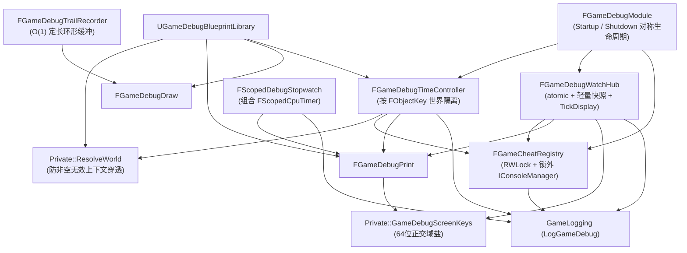

# GameDebug 架构概述与核心设计

## 1. 模块定位与依赖分层

`GameDebug` 归属全工程 **Level 1 基础设施层**：

- **Public 依赖**：`Core`、`CoreUObject`、`Engine`、`GameCore`
- **Private 依赖**：`GameLogging`（单向无环接入，在 [GameDebug.cpp](../../Source/GameDebug/Private/GameDebug.cpp) 注册统一日志分类 `LogGameDebug`）
- **严禁依赖**：不依赖 `Slate`/`SlateCore`（纯轻量零 UI 侵入），严禁横向依赖 `GamePool`、`GameSpatial`、`GameAssetCore` 或 Level 2+ 业务插件。

## 2. 关键架构机制

### 2.1 对称模块生命周期与防泄漏
- `FGameDebugModule::StartupModule()` 按序初始化 `FGameDebugTimeController::Initialize()`、`FGameDebugWatchHub::Get().Initialize()` 并注册 `WatchHub` 核心 `FTSTicker`。
- `FGameDebugModule::ShutdownModule()` 逆序移除 `WatchHub` Ticker、调用 `FGameDebugWatchHub::Get().Shutdown()`、`FGameDebugTimeController::Shutdown()`（取消所有世界的待执行 `StepFrame` Ticker 并清空状态表），最后清理 `FGameCheatRegistry`。
- `FGameDebugWatchHub` 构造器零副作用，杜绝跨静态单例析构序（SIOF）导致的悬空 `[this]` 回调。

### 2.2 锁序安全与无死锁 GM 注册/派发
- `FGameCheatRegistry` 使用独立 `ConsoleSyncLock` 串行化 `RegisterCheat`/`UnregisterCheat`/`ClearAll` 写路径，全程严禁持有 `RegistryLock` 交互 `IConsoleManager`，彻底根除 AB-BA 锁序死锁与同名高频注册/注销 ABA 竞态；注销时校验对象归属后按名称调用 $O(1)$ `UnregisterConsoleObject(Name)`，规避引擎指针重载的 $O(N)$ 全表扫描。
- `ExecuteCheat(FStringView)`、`HasCheat` 与 `GetCheatCount` 仅触碰 `RegistryLock` 读锁（零 `ConsoleSyncLock` 竞争）：先无分配切片首个命令词并经 `FName(View, FNAME_Find)` 查表，未注册命令零堆分配短路；命中后仅将参数子串单遍分词写入 `Args` 并在锁外调用回调，支持回调内安全自注销。

### 2.3 `int32` 截断免疫的 64 位域盐屏幕槽位隔离
`UEngine::AddOnScreenDebugMessage(uint64 Key, ...)` 内部会将 `Key` 截断为 `(int32)Key` 存入 `TMap<int32, FScreenMessageString>`。`GameDebugScreenKeys.h` 复用 `Game::Hash::Hash64To32` 进行雪崩混洗，并将低 32 位按最高位正交隔离：
- `FGameDebugPrint` 通道域：低 32 位恒落入 `[0x00000000, 0x7FFFFFFF]`；
- `FGameDebugWatchHub` 分类域：低 32 位恒落入 `[0x80000000, 0xFFFFFFFE]`（避开 `-1` 哨兵）。
由此确保即使两子系统使用完全相同的 `FName`（如 `"Player"`），在 `UEngine` 内部也绝对不会互踩槽位。

### 2.4 真 $O(1)$ 环形轨迹缓冲与零拷贝快照采样
- `FGameDebugTrailRecorder` 构造期一次分配 `MaxSamples` 槽位，满容覆写与过期清理仅无除法推进 `HeadIndex`，容量从 64 增至 256 时单次写入耗时稳定保持 `~3.7 ns/op`。
- `FGameDebugWatchHub` 将观察项闭包包装为 `TSharedPtr<const FValueGetter>`，`TickDisplay` 使用 `TInlineAllocator` 栈缓冲快照与 `TStringBuilder<512>` 格式化，消除每帧 `TFunction` 闭包深拷贝与临时 `FString` 分配。

### 2.5 分级日志契约 (`LogGameDebug`)
- **`Log`**：模块启停里程碑；
- **`Display`**：自动化微基准性能统计输出；
- **`Warning`**：重复/非法 GM 指令、引擎控制台冲突、非有限时间倍率、非法 GM 参数、秒表超阈值告警；
- **`Verbose`**：GM 注册/注销/清空、WatchHub 开关变更、时间倍率变更；
- **100% 静默热路径**：`Draw*`、`TrailRecorder`、`WatchHub::TickDisplay`、`Print::GetChannelKey`、`Stopwatch` 未超阈值路径零日志开销。
