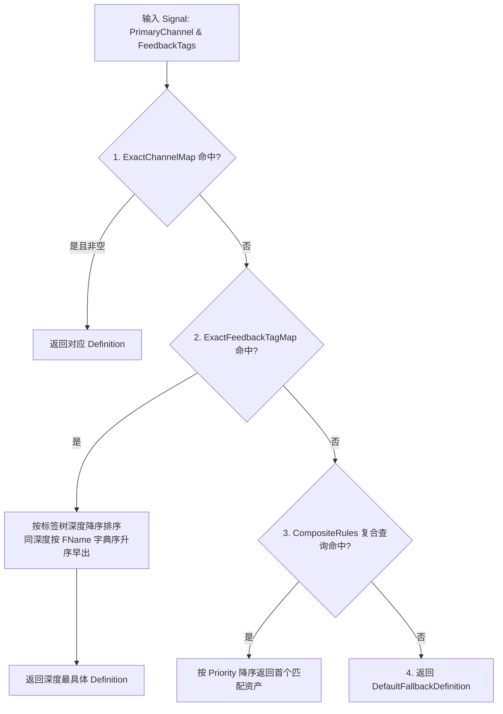

# GameFeedback 表现配置资产与注册表 API 参考

本文档详细介绍打击表现资产（`UGameFeedbackDefinition`）、表现路由注册表（`UGameFeedbackRegistry`）以及运行时资产解析服务（`UGameFeedbackDefinitionProvider`）。

- 头文件：
  - `#include "Asset/GameFeedbackDefinition.h"`
  - `#include "Asset/GameFeedbackRegistry.h"`
  - `#include "System/GameFeedbackDefinitionProvider.h"`

---

## 1. 单条表现资产定义 (`UGameFeedbackDefinition`)

`UGameFeedbackDefinition` 继承自 `UPrimaryDataAsset`，聚合了针对某种打击风格的完整视听配置：

```cpp
UCLASS(BlueprintType)
class GAMEFEEDBACK_API UGameFeedbackDefinition : public UPrimaryDataAsset {
    GENERATED_BODY()

public:
    UPROPERTY(EditAnywhere, BlueprintReadOnly, Category = "Actions")
    FGameFeedbackHitStopAction HitStop;

    UPROPERTY(EditAnywhere, BlueprintReadOnly, Category = "Actions")
    FGameFeedbackCameraShakeAction CameraShake;

    UPROPERTY(EditAnywhere, BlueprintReadOnly, Category = "Actions")
    FGameFeedbackHitFlashAction HitFlash;

    UPROPERTY(EditAnywhere, BlueprintReadOnly, Category = "Actions")
    FGameFeedbackVFXAction VFX;

    UPROPERTY(EditAnywhere, BlueprintReadOnly, Category = "Actions")
    FGameFeedbackAudioAction Audio;

    UPROPERTY(EditAnywhere, BlueprintReadOnly, Category = "Actions")
    FGameFeedbackForceFeedbackAction Haptics;
};
```

---

## 2. 全局表现映射注册表 (`UGameFeedbackRegistry`)

`UGameFeedbackRegistry` 负责根据信号中的伤害通道与特征标签，以最优性能匹配出最具体的表现资产：

### 2.1 四级匹配流水线 (Resolution Hierarchy)



1. **第一层：精确主伤害通道 (`ExactChannelMap`)**
   - 字典快速查找 `PrimaryChannel`（例如 `Damage.Channel.Fire` 直接映射到火焰打击资产）。
2. **第二层：特征标签深度匹配 (`ExactFeedbackTagMap`)**
   - 在 `PostLoad` 或 `RebuildDefinitionIndex` 时，字典条目预排序构建为 `SortedExactFeedbackTags`（深度深者优先，同深度按键字典序升序）；
   - 运行时 `ResolveDefinitionPtr` 直接遍历预排序数组，首个匹配 `FeedbackTags.HasTag` 的项即为最优项直接返回，避免高频受击时反复计算标签树深度。
3. **第三层：复合规则查询 (`CompositeRules`)**
   - 基于 `FGameplayTagQuery` 的高级组合匹配（如“受击者是机械 AND 武器是重锤”）；
   - 数组按 `Priority` 降序排列，首个匹配项胜出。
4. **第四层：缺省兜底资产 (`DefaultFallbackDefinition`)**
   - 上述三层均未命中时返回通用兜底打击资产，保证系统永不落空。

### 2.2 确定性网络身份与版本管理

```cpp
class GAMEFEEDBACK_API UGameFeedbackRegistry : public UDataAsset {
public:
    void RebuildDefinitionIndex();
    uint32 GetDefinitionId(const UGameFeedbackDefinition* Definition) const;
    TSoftObjectPtr<UGameFeedbackDefinition> FindDefinitionById(uint32 DefinitionId) const;
    uint32 GetDefinitionMappingVersion() const;
    static uint32 MakeDefinitionId(const FSoftObjectPath& DefinitionPath);
};
```

- **稳定 CRC32 ID**：通过 `MakeDefinitionId` 为完整软对象路径生成确定性 ID（0 映射为 1）；
- **冲突检测**：`RebuildDefinitionIndex` 会自动检测不同路径的 CRC32 冲突，冲突资产加入黑名单，禁止网络传输；
- **映射版本**：将所有映射规则归一化哈希后生成 `DefinitionMappingVersion`，客户端与服务端版本不一致时直接拒绝解析。

---

## 3. 资产解析与流式预热服务 (`UGameFeedbackDefinitionProvider`)

`UGameFeedbackDefinitionProvider` 是一个 `UWorldSubsystem`（仅在游戏世界创建，包含 Dedicated Server），是运行期访问资产的**唯一定义来源**：

```cpp
UCLASS()
class GAMEFEEDBACK_API UGameFeedbackDefinitionProvider : public UWorldSubsystem {
    GENERATED_BODY()

public:
    /** 按信号主通道与反馈标签同步解析最优资产指针 */
    const UGameFeedbackDefinition* Resolve(const FGameFeedbackSignal& Signal);

    /** 按网络 ID 与映射版本还原服务端资产 */
    const UGameFeedbackDefinition* ResolveById(uint32 DefinitionId, uint32 DefinitionMappingVersion);

    /** 批量预热软引用资产集合（关卡加载或英雄入场时调用） */
    void PreloadFeedbackBundle(TConstArrayView<TSoftObjectPtr<UGameFeedbackDefinition>> Definitions);

    /** 安全获取当前世界的服务实例 */
    static UGameFeedbackDefinitionProvider* GetPtr(const UObject* WorldContextObject);
};
```

### 3.1 强缓存与句柄闭环管理
- **同步返回保证**：已解析或已常驻内存的资产，存入 `LoadedDefinitions`（`TMap<FSoftObjectPath, TObjectPtr<UGameFeedbackDefinition>>`）强引用字典，杜绝 GC 误杀；
- **去重异步预热**：尚未加载的软引用在后台通过 `UAssetManager::GetStreamableManager().RequestAsyncLoad` 发起异步加载，句柄由 `DefinitionLoads` 强引用持有；
- **注销安全清理**：在子系统 `Deinitialize` 时，自动遍历 `DefinitionLoads` 调用 `CancelHandle()` 并重置所有内部缓存，杜绝野指针和悬挂任务。
