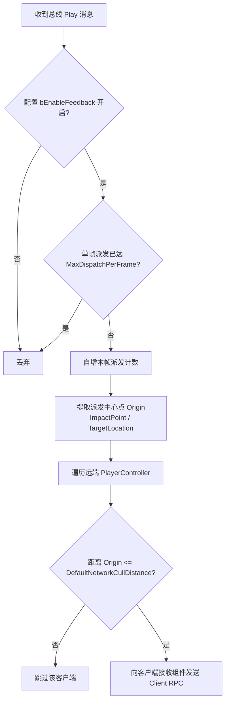

# GameFeedback 网络同步、视距裁剪与预测抑制架构

在高频动作与多人网络游戏中，受击表现事件具有**高频发生、多端扩散、偶发丢包不影响游戏逻辑**的典型特征。`GameFeedback` 设计了紧凑序列化载荷、服务端确定性资产仲裁、自适应空间裁剪以及本地预测去重体系。

---

## 1. 紧凑网络报文契约 (`FGameFeedbackEventNet`)

表现报文通过 `Unreliable` Client RPC 在权威端向客户端广播。为了极致节省网络带宽，报文采用自定义 `NetSerialize` 打包：

### 1.1 字段与字节预算
- **对象弱指针映射**：`Instigator`、`DamageCauser`、`Target`、`HitComponent` 由 `UPackageMap::SerializeObject` 进行紧凑网络 ID 映射；
- **量化空间向量**：
  - `ImpactLocation`：`FVector_NetQuantize`（厘米级精度）；
  - `ImpactNormal`、`ImpactDirection`、`TraceDirection`：`FVector_NetQuantizeNormal`（单位球面量化，仅 16 位）；
- **确定性资产身份**：`DefinitionId`（uint32）+ `DefinitionMappingVersion`（uint32）；
- **伤害数值半精度编码**：`SetDamage` / `GetDamage` 基于 IEEE 754 半精度浮点 `FFloat16`（uint16），经过 NaN 过滤并钳制至 `[0.0f, 65504.0f]`，既能满足常规伤害精度又节省 50% 浮点带宽；
- **状态标记与预测 ID**：`StateFlags`（uint8，含致死标记）、`PredictionEventId`（uint16，跨端预测去重）；
- **紧凑骨骼索引**：受击命中 `USkeletalMeshComponent` 时，自动提取 `GetBoneIndex` 压缩为 `uint16` 传输；客户端还原时由骨骼数二次校验后还原 `BoneName`，未命中或静态网格体则使用 `MAX_uint16` 哨兵。

> **带宽保证**：在正常 Gameplay 网络流（启用 PackageMap 缓存）下，单条报文典型尺寸 $\le 64$ 字节，极端全字段尺寸 $\le 96$ 字节。

---

## 2. 稳定网络身份与映射版本 (Definition Identity & Versioning)

客户端严禁在收到网络报文后重新执行全量 `UGameFeedbackRegistry` 复合标签匹配。服务端作为权威仲裁者解析出最终资产后，仅向客户端传递稳定 ID：

1. **确定性 CRC32 生成**：
   - ID 由资产完整软对象路径（`FSoftObjectPath::ToString()`）的确定性 CRC32 哈希计算生成（0 映射为 1）；
2. **冲突拒绝**：
   - 在 `RebuildDefinitionIndex` 阶段，遍历所有映射来源（默认资产、通道字典、反馈标签字典、复合规则条目）；若发现不同资产路径碰撞为同一 CRC32，自动加入 `ConflictedDefinitionIds` 冲突黑名单并在服务端打印 Warning；冲突 ID 严禁网络派发与远端解析；
3. **确定性版本指纹 (`DefinitionMappingVersion`)**：
   - 提取注册表全部条目的规范化字符串排序连接后生成 CRC32 版本哈希；
   - 客户端收到报文后比对本地与远端的 `DefinitionMappingVersion`；若因热更或资源不同步导致版本不一致，直接拒绝解析，杜绝跨版本资产错乱。

---

## 3. 空间裁剪与帧率平滑 (Culling & Rate Limiting)

`UGameFeedbackNetworkDispatcherComponent` 挂载于 GameState（仅在 Listen Server / Dedicated Server 激活）：

### 3.1 空间视距裁剪
- 优先以 `HitResult.ImpactPoint`（非零时）作为中心点，无端点时回退至 `Target->GetActorLocation()`；
- 遍历所有非本地玩家控制器：
  - 优先调用 `PC->GetPlayerViewPoint` 计算视点空间；
  - 若处于自由观战或视点为零，回退至 `Pawn->GetActorLocation()`；
  - 超过 `DefaultNetworkCullDistance`（平方距离比较）的客户端直接剪裁，避免全图广播无意义的受击特效。

### 3.2 单帧派发上限
- 配合 `MaxDispatchPerFrame`（项目配置），当大范围 AOE 或连环爆炸瞬时触发大量受击时，超过上限的报文在服务端平滑截断，保障服务器网络带宽与帧率稳定。

---

## 4. 客户端预测指纹去重 (Prediction Deduplication)

客户端本地发起攻击时，为了提供即时打击反馈，会在本地总线立即触发 `Play` 通道播放镜头震动、确认音等。随后服务端权威结算下发的 `Network` 通道回执若重复播放，会导致严重的“双重受击”异味。

框架采用 `FGameFeedbackPredictionHistory` 提供**轻量指纹去重机制**：

1. **预测指纹登记**：
   - 本地客户端在 `UGameFeedbackPlayerComponent::HandleSignal` 播放本地表现时，若信号包含非零 `PredictionEventId`，向内部队列添加记录 `(PredictionEventId, Attacker, Target, RealTime)`；
   - `PredictionEventId == 0` 表示非预测事件，不予记录；
2. **服务器回执消费**：
   - 客户端网络接收组件 `UGameFeedbackReceiverComponent` 收到服务端下发的报文后，调用 `PlayerComponent->ConsumePrediction(Signal)`；
   - 只有当 `PredictionEventId`、`Attacker` 弱引用与 `Target` 弱引用**三者完全匹配**且位于 `0.5s` 滑动窗口内时，才标记匹配成功；
   - 匹配成功的记录从队列中移除（`RemoveAtSwap`），并在回灌本地总线时标记 `bSuppressed = true`；
3. **抑制执行**：
   - 监听到 `bSuppressed == true` 的 `PlayerComponent`、`WorldComponent` 与 `HitStopService` 自动整段跳过执行，既保留了首击零延迟的丝滑手感，又确保了远端旁观者与其他客户端的表现完整性。
