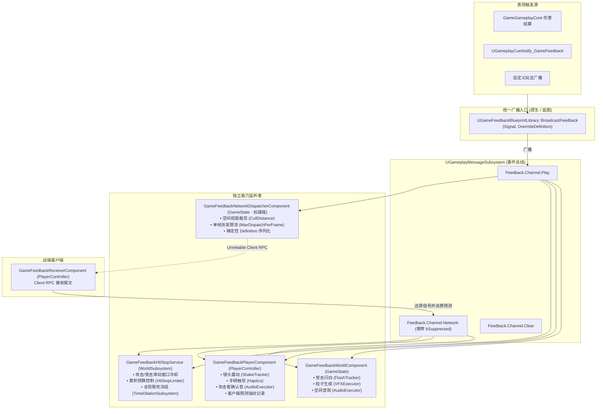

# GameFeedback 表现解耦中枢架构概览

`GameFeedback` 是专为高品质动作与射击游戏设计的**战斗视听表现解耦基础设施插件**。

传统游戏开发中，受击表现往往与伤害结算、GAS 或角色控制器深度杂糅，导致“上帝受击管理器”频繁改动、分屏震屏混乱、联机表现漏播或重复顿帧。`GameFeedback` 彻底打破这一反模式，采用 **消息总线（Message Bus）+ 独立能力监听者（Decoupled Capability Listeners）** 架构。

---

## 1. 架构设计哲学

1. **调用方与表现彻底解耦**：
   - 战斗结算（无论是 `GameGameplayCore` 伤害管线、GAS `GameplayCue`、还是独立玩法组件）只需广播一个纯表现数据结构 `FGameFeedbackSignal`；
   - 调用方完全无需关心是播放震屏、顿帧、音效还是粒子，也不知晓当前处于单机还是联机环境。
2. **零集中编排（No Monolithic Manager）**：
   - 镜头震动、手柄触觉、受击闪白、打击顿帧、粒子特效、空间音效及网络派发各自封装为独立的组件或世界子系统；
   - 各能力监听者独立订阅总线通道，按自身策略消费信号，任意新增或移除表现能力均不影响其他监听者。
3. **确定性无阻塞运行**：
   - 资产采用软引用与后台异步预热（StreamableManager），未就绪时安全跳过当前帧播放，主线程绝不执行同步卡顿加载；
   - 顿帧采用纯逻辑累积预算保护，闪白追踪采用绝对时间续期与原始材质强引用，杜绝状态滞留。

---

## 2. 消息流与订阅拓扑



---

## 3. 本地视角判定 (Perspective Resolution)

在本地分屏、多人联机以及第一/第三人称混合视角下，同一次打击对不同玩家呈现的表现完全不同（例如：攻击者需要手感顿帧、准星确认音与适度震屏；受击者需要大幅度镜头晃动与受击音效；旁观者只看到粒子和受击闪白）。

框架通过共享纯函数 `GameFeedback::ResolvePerspective` 进行无状态视角推导：

```cpp
namespace GameFeedback {
    EGameFeedbackPerspective ResolvePerspective(
        const APlayerController* LocalPC,
        const AActor* Instigator,
        const AActor* DamageCauser,
        const AActor* Target);
}
```

### 视角判定逻辑：
1. **安全校验**：`LocalPC` 为空时直接返回 `EGameFeedbackPerspective::Bystander`。
2. **所有权链追溯**：向上回溯实体的 `GetOwner()` 与 `GetInstigatorController()`（带最大深度 5 层环路保护），判定是否属于本地控制器或本地 Pawn。
3. **分流优先级**：
   - 目标 `Target` 为本地拥有 $\to$ `EGameFeedbackPerspective::LocalVictim`；
   - 发起者 `Instigator` 或伤害源 `DamageCauser` 为本地拥有 $\to$ `EGameFeedbackPerspective::LocalAttacker`；
   - 其余情况 $\to$ `EGameFeedbackPerspective::Bystander`。

各监听组件（如 `PlayerComponent` 与 `HitStopService`）根据视角精准分流执行参数，旁观者自动免除震屏与触觉开销。

---

## 4. 自动装配接线器 (UGameFeedbackRuntimeSubsystem)

为了让业务开发无需在每个 GameMode、GameState 或 PlayerController 手动挂载组件，`UGameFeedbackRuntimeSubsystem` 扮演了**纯接线器（Wiring Only）**角色：

- **只在游戏世界（GameWorld）运行**：根据 `ShouldCreateSubsystem` 过滤，排除非游戏世界（编辑器视口等）；
- **拓扑预装配**：
  - 在 `GameStateBase` 上装配 `UGameFeedbackWorldComponent`（非 Dedicated Server）与 `UGameFeedbackNetworkDispatcherComponent`（权威端）；
  - 在权威服务端为连接的 `PlayerController` 预装配 `UGameFeedbackReceiverComponent`（随网络复制同步至客户端）；
  - 在本地 `PlayerController` 上装配 `UGameFeedbackPlayerComponent`；
- **迟到玩家自愈补齐**：启动 `0.25s` 轻量定时器轮询新加入的玩家控制器，确保热连接玩家无缝获取表现组件；并在 `Deinitialize` 时安全释放。
