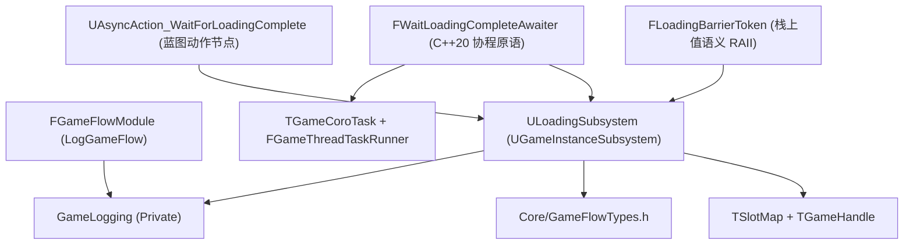

# GameFlow 架构概述与核心设计

## 1. 模块定位与依赖分层

`GameFlow` 归属全工程 **Level 2 领域调度层**：

- **Public 依赖**：`Core`、`CoreUObject`、`Engine`、`GameCore`
- **Private 依赖**：`GameLogging`（单向无环接入，在 [GameFlow.cpp](../../Source/GameFlow/Private/GameFlow.cpp) 注册统一日志分类 `LogGameFlow`）
- **最小依赖原则**：不依赖 `GamePool`、`UMG`、`Slate` 或任何 Level 3 Gameplay 业务插件，保持“即插即用”的轻量调度定位。

## 2. 核心架构机制

### 2.1 三态流转与多 PIE 严格隔离
- 采用显式 `ELoadingTransitionPhase` 枚举（`Idle` / `LoadingMap` / `WaitingBarriers`）取代离散布尔组合，确保状态转移不变式自解释。
- 挂钩 UE5 `FCoreUObjectDelegates::PreLoadMapWithContext(const FWorldContext&, const FString&)`，按 `WorldContext.OwningGameInstance == GetGameInstance()` 严格隔离多 PIE 实例（如 Listen Server + Client），杜绝某客户端切图导致其他实例假死卡屏；`LoadingMap` 阶段幂等保留原始 `TargetLevelName`，`WaitingBarriers` 阶段被强切新图时完整重置计时与遥测。
- `FinishLoadingTransition` 具备重入拉平守卫（`bIsFinishingTransition` + `PendingNextLevelName`）：在 `OnLoadingProgressChanged(1.0f)` / `OnLoadingStateChanged(false)` / `OnLoadingTelemetryReport` 回调内同步链式发起 `OpenLevelWithLoading` 时，延后至本轮全部广播收尾后启动下一轮，杜绝新旧状态事件交错与新关卡协程误唤醒；且完成瞬间严格仅广播一次 `1.0f` 进度。
- `OnPostLoadMap(UWorld*)` 按 `LoadedWorld != nullptr && LoadedWorld->GetGameInstance() != GetGameInstance()` 过滤异源实例与无 `GameInstance` 的编辑器预览/缩略图世界，同时保留 `LoadedWorld == nullptr`（UE 地图加载失败兜底广播）时的安全退出能力。

### 2.2 `TSlotMap` 代际屏障与 O(1) 进度计算
- 活跃屏障存储于 `TSlotMap<FActiveBarrierInfo, FLoadingBarrierTag>`：连续密集数组存储保证进度重算与看门狗巡检 100% 缓存友好，32 位索引 + 32 位代际号彻底防止过期句柄 ABA 碰撞。
- `FLoadingBarrierToken` 为零堆分配、仅可移动的值语义 RAII 令牌；`IsValid()` 以 $O(1)$ `noexcept` 直查子系统槽位表，即使屏障被看门狗强制熔断也能实时返回 `false`，无状态漂移。
- 蓝图接口以 `FLoadingBarrierHandle::PackUInt64()` / `FromPackedUInt64()` 桥接 `int64` 句柄，非法与重复释放均安全返回 `false`。
- 已完成屏障的权重通过 `FinishedBarriersTotalWeight` $O(1)$ 增量维护，加权进度重算仅遍历当前活跃屏障；非加载态释放屏障不写入 `FinishedBarriersTelemetry`，彻底根除无界内存增长。

### 2.3 自动联动双轨看门狗与完整遥测
- 同时支持全局总超时（`MaxLoadingTimeoutSeconds`）与单屏障独立超时（`InTimeoutSeconds`），由 `CustomTimeoutBarrierCount` $O(1)$ 计数器驱动 `SyncWatchdogTimer()`：即使全局超时关闭，只要存在带独立超时的活跃屏障，看门狗仍会自动启停巡检。
- 全局超时在 `LoadingMap` 阶段以 `LoadingStartTimestamp` 为基线，进入 `WaitingBarriers` 后切换为 `MapLoadFinishedTimestamp`，阻塞式 `LoadMap` 墙钟不会计入屏障等待预算。
- 单屏障巡检使用 `TInlineAllocator<8>` 栈内联数组零堆分配收集超时句柄；全局超时会在 `FLoadingTelemetryReport` 中置位 `bTimedOut = true` 并准确记录地图阶段耗时。

### 2.4 跨线程安全 C++20 协程与销毁中止语义隔离
- `ULoadingSubsystem::Deinitialize()` 严格区分正常完成与销毁中止：空闲态销毁静默清理零广播；加载期销毁仅派发 `OnLoadingAbortedNative` 并清空全部动态与原生委托，彻底杜绝将销毁误报为“加载成功”。
- `FWaitLoadingCompleteAwaiter` 构造期零堆分配，非加载态 / 预取消 / 空上下文经 `bReadyResult` 零分配同步直通；真正挂起时单次 `MakeShared<FWaitLoadingState, ESPMode::ThreadSafe>` 统一托管全部句柄与状态：
  - 挂钩 `InGuard->GetState()->AddCompletionCallback(...)`，在 `Task.Cancel()` 或宿主销毁时即时清理委托、定时器与取消令牌注册（零泄漏）；
  - 互斥锁同步 `AttachCancelRegistration` / `AttachGameThreadHandles` 消除注册与并发取消数据竞争；
  - 后台线程触发 `FCancellationTokenSource::Cancel()` 时，经 `FGameThreadTaskRunner::RunOnGameThread` 安全投递回主线程清理资源并恢复协程。

### 2.5 分级日志契约 (`LogGameFlow`)
- **`Log`**：模块启停里程碑、地图开始加载、等待屏障挂起、加载结束耗时摘要；
- **`Verbose`**：`ULoadingSubsystem` `Initialize` / `Deinitialize` 委托挂钩与注销；
- **`Warning`**：重复 `OpenLevelWithLoading`、空关卡名、无效上下文、非有限浮点参数回落、`PostLoadMap(nullptr)` 加载失败兜底；
- **`Error`**：看门狗全局超时或单屏障超时强制熔断；
- **`Display`**：微基准性能统计报告；
- **100% 静默热路径**：屏障申请/释放/进度上报、`Get()`、`await_ready()`、`SuspendWithGuard()` 全程零日志。
