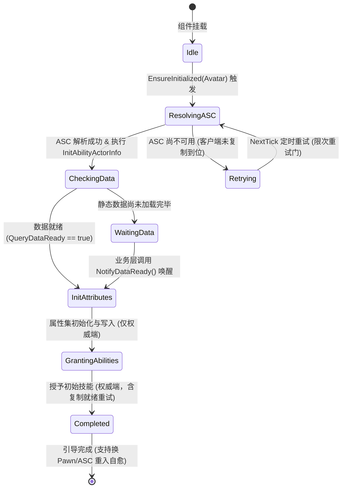

# GameGameplay GAS 引导与生命周期时序架构

GAS 最经典的难题之一是**网络端时序不确定性**：
- 在独立客户端（Client）上，`PlayerState` 的复制到达时间可能晚于 `Pawn` 的生成，导致 `InitAbilityActorInfo` 过早调用拿到空指针；
- 在监听服务器（Listen Server）或主机上，`PossessedBy` 与 `OnRep_PlayerState` 可能会被先后多次调用，导致重复初始化属性集和重复授予初始技能。

`UGameAbilitySystemBootstrap` 针对该问题设计了**全时序固化状态机与重试门**。

---

## 1. 引导状态机流转

---

## 2. 关键时序护栏设计

1. **Avatar 与 ASC 双轨短路闩（Idempotent Gate）**：
   记录当前已完成握手的 `CurrentAvatar` 与 `CurrentASC` 弱引用。如果同一个 Avatar 与同一个 ASC 再次触发握手（如多次收到网络 RPC 或生命周期事件），组件自动检测并立即短路跳过，彻底避免重复授予技能。
2. **多 Pawn 重生、ASC 变更自愈与技能泄漏防护（ASC Change Recovery & Ability Clean）**：
   在英雄重生、角色切换或网络重新附身导致 ASC 指针变更时，组件自动识别 `bAscChanged`，先调用 `ClearAbility` 清理旧 ASC 上授予的技能句柄（`GrantedAbilityHandles`），重置初值写入与能力授予标记，并对新化身完整执行新一轮握手与初始化；且在 `EndPlay` 期间自动回收本组件授予的全部技能，授予前通过 `FindAbilitySpecFromClass` 检查去重，杜绝重生多次叠加相同技能。
3. **复制就绪重试门（Replication Ready Retry）**：
   在权威端若 `AbilitySystemComponent->IsReadyForReplication()` 暂时未就绪，组件会以 NextTick 定时器进行有限次安全重试（`MaxReplicationRetries`），超限后强制授予，确保极高延迟与弱网环境下技能百分之百不丢失。
4. **数据就绪门（Data Readiness Gate）**：
   有些角色属性依赖全局静态数据（如配置表导出的等级属性表）。通过注入 `QueryDataReady` 委托，若数据尚未加载完毕，引导组件会暂缓写入初值，直至外部通过 `NotifyDataReady()` 驱动继续执行。
5. **兜底自愈机制（BeginPlay Fallback）**：
   在极端脱节、离线或测试环境下，`BeginPlay` 会通过 `TryInitializeFromOwner` 自动从 Owning Pawn 或 PlayerState 解析化身并驱动初始化。

