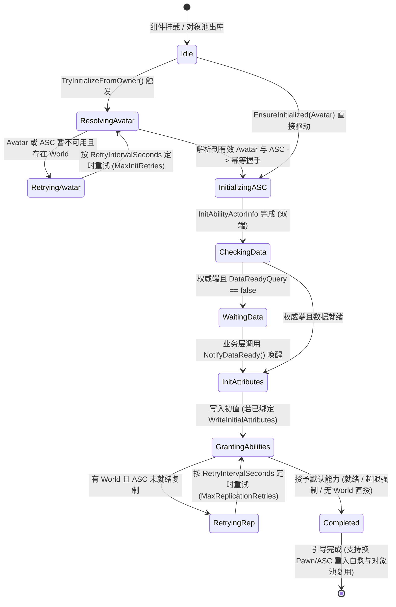

# GameGameplay GAS 引导与生命周期时序架构

GAS 最经典的难题之一是**网络端时序不确定性**：
- 在独立客户端（Client）上，`PlayerState` 的复制到达时间可能晚于 `Pawn` 的生成，导致 `InitAbilityActorInfo` 过早调用拿到空指针；
- 在监听服务器（Listen Server）或主机上，`PossessedBy` 与 `OnRep_PlayerState` 可能会被先后多次调用，导致重复初始化属性集和重复授予初始技能。

`UGameAbilitySystemBootstrap` 针对该问题设计了**全时序固化状态机、限次重试闸门与对象池复位闭环**。

---

## 1. 引导状态机流转

---

## 2. 关键时序护栏设计

1. **Avatar 与 ASC 双轨短路闩（Idempotent Gate）**：记录 `CurrentAvatar` 与 `CurrentASC` 弱引用，同一宿主重复握手短路跳过；更换 ASC 时自动清理旧 ASC 上由本组件授予的能力句柄并重置初始化状态。
2. **早于 `BeginPlay` 调用免疫**：构造期与 `TryInitializeFromOwner()` 入口自动同步重试门配置，确保宿主 `BeginPlay` 先于组件 `BeginPlay` 调用自愈时重试上限有效。
3. **复制就绪定时器重试与无 World 直授**：在有效 `UWorld` 下，若权威端 `ASC->IsReadyForReplication()` 暂未就绪，以 `RetryIntervalSeconds`（默认 0.05s，下限 0.01s）定时重试直至 `MaxReplicationRetries`（默认 8 次）超限后强制授予；离线/无 World 环境下直接完成授予不阻塞。
4. **数据就绪门（Data Readiness Gate）**：支持延迟等待静态配置加载完毕，通过 `NotifyDataReady()` 唤醒推进；权威阶段完成后自动短路，不再重复求值 `DataReadyQuery`。
5. **对象池完整重置**：实现 `IGamePoolable`，归还入池时统一清理定时器、撤销已授予能力并归零所有状态位与重试计数，出池时重新复位并同步重试配置。
