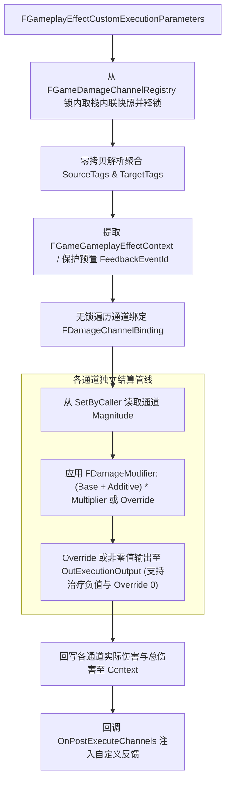

# GameGameplay ExecCalc 通道化伤害结算架构

在传统的 GAS 实现中，开发者通常在 `UGameplayEffectExecutionCalculation` 的子类中硬编码属性捕获定义，导致每新增一种伤害类型就必须重写一套 ExecCalc 或堆砌大量分支。

`UGameDamageExecution` 采用**动态通道绑定（Dynamic Channel Binding）+ 锁外快照防死锁 + Modifier 修饰器管线**设计。

---

## 1. 伤害结算流程拓扑

---

## 2. 核心机制优势

1. **单一权威动态通道注册表**：构造期 `RegisterChannelBinding` 与运行期 `FGameDamageChannelRegistry::Get().Register` 统一汇入注册表，按 ExecCalc 类隔离并沿继承链扁平化合并（派生类同名通道覆盖基类）。
2. **锁外执行 + 常用零堆分配**：`ForEachBinding` 在极短读写锁内将扁平化切片拷贝至栈内联缓冲（`TInlineAllocator<8>`）后立即释锁执行结算闭包，彻底杜绝业务钩子重入注册表或交叉锁引发的死锁。
3. **完整聚合标签与反馈闭环**：`ComputeChannelModifier` 同时可见 Actor 标签、GE AssetTags 与 Spec DynamicAssetTags；仅在预测 Key 有效时更新 `FeedbackEventId`，避免抹除外部预置事件指纹；支持 `Override(0.0f)` 锁零覆写与负值治疗通道。
