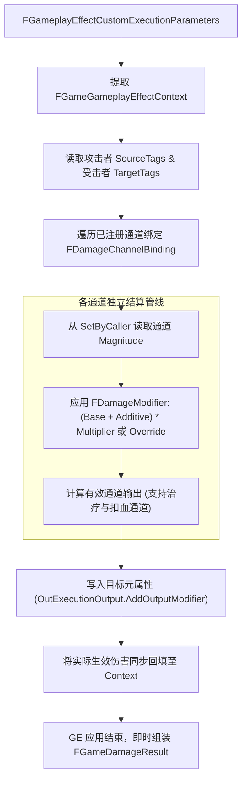

# GameGameplay ExecCalc 通道化伤害结算架构

在传统的 GAS 实现中，开发者通常在 `UGameplayEffectExecutionCalculation` 的子类中硬编码属性捕获定义（`DECLARE_ATTRIBUTE_CAPTUREDEF`），导致物理、魔法、真实伤害等每新增一种类型就必须重写一套 ExecCalc 或在函数体内写大量的 `if-else`。

`UGameDamageExecution` 采用**动态通道绑定（Dynamic Channel Binding）与 Modifier 修饰器管线**设计。

---

## 1. 伤害结算流程拓扑

---

## 2. 核心机制优势

1. **通道到元属性的动态路由**：
   通过 `RegisterChannelBinding(Tag, Attribute, ModOp)`，游戏可以在启动期或构造期灵活地将任意伤害标签（如 `Damage.Physical`、`Damage.Fire`、`Damage.Chaos`）映射到开发者自定义的输出元属性（如 `IncomingDamageAttribute`、`PhysicalDamageAttribute`），完全由开发者决定。
2. **运行时通道注册与继承合并**：
   通道绑定由 `FGameDamageChannelRegistry` 按 ExecCalc 类托管，构造函数声明与运行期 `RegisterRuntimeChannelBinding` 等价；注册表以 `FCriticalSection` 保护，查询时沿继承链合并、派生类同名通道覆盖基类，避免重复结算。`Execute_Implementation` 每次执行都从注册表取合并后的绑定快照，不再依赖 CDO 冻结。
3. **通道粒度回写与反馈注入钩子**：
   结算完成后，框架自动向 `FGameGameplayEffectContext` 回写总实际伤害与各通道实际结算数值（包含 100% 免疫/减免为 0.0f 的已执行通道，确保表现层可获取完整判定），并触发虚函数 `OnPostExecuteChannels`，使开发者能够基于 Source/Target 标签灵活注入暴击、格挡、削韧等自定义反馈。

