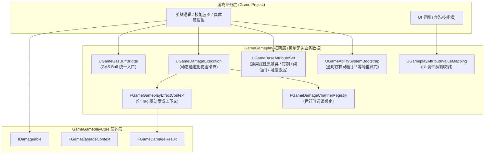

# GameGameplay 架构概览与分层定位

## 1. 架构定位

在传统的 UE 开发中，Gameplay Ability System (GAS) 往往因为初始化时序极其繁琐（`PossessedBy` / `OnRep_PlayerState` / `InitAbilityActorInfo`）、属性结算逻辑死板、UI 监听散落各处而让开发者望而生畏。

`GameGameplay` 模块定位于 **GAS 基础设施标准化与工程化赋能层**：

---

## 2. 核心设计原则

### 2.1 铁律：严格禁止依赖 `GameData`
- `GameGameplay` 属于纯战斗机制层（Rules & Mechanics），而 `GameData` 属于配置数据层（Tables & Numbers）。
- 技能机制代码绝不能硬编码 `FItemRow` 或 `FShopGoodsRow` 等数据表结构；一切初始数值由宿主业务层（Game Project）通过委托注入（Dependency Injection），保证机制层拥有绝对的通用性与可复用性。

### 2.2 契约打通：将 GAS 融入 `IDamageable` 管线
- 拥有 GAS 能力的 Actor 同时实现 `IDamageable` 接口；
- 当外部传入 `FGameDamageContext` 时，受击者将其包装为专用的 Damage GameplayEffect；
- 在 GE 应用的同步链路中，`UGameDamageExecution` 计算出实际伤害并写入 `FGameGameplayEffectContext`；
- 执行完毕后，上下文的数据被提取并构造成 `FGameDamageResult` 同步返回给攻击者，实现 GAS 与非 GAS 之间完全统一的打击反馈体验。

### 2.3 运行时通道注册与 Buff 桥接
- 伤害通道绑定由 `FGameDamageChannelRegistry` 按 ExecCalc 类托管，可在构造函数声明，也可在运行期动态增删；查询沿继承链合并，派生类同名通道优先。
- Buff 由 `GameplayEffect` 承载，`UGameGasBuffBridge` 只收敛施加 / 移除 / 查询样板代码，不定义任何具体 Buff 类型。
- 非 GAS 项目使用 `GameGameplayCore` 的 `UGameBuffComponent`；两条路径共享「框架只提供运行时契约」的原则。

