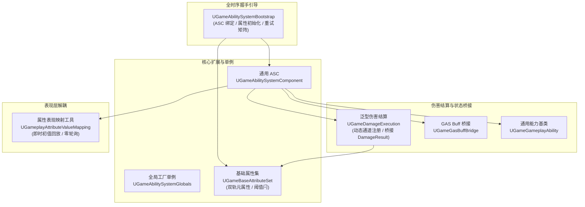

# GameGameplay 插件

**GameGameplay** 是基于 Unreal Engine 5 Gameplay Ability System (GAS) 构建的高性能业务绑定与赋能层。它承接底层战斗契约（`GameGameplayCore`），并提供了标准的 GAS 组件扩展、全时序自动握手组件、双轨元属性（Meta Attribute）基类、可动态注册伤害通道的 ExecCalc 结算基类，以及 UMG 表现层属性解耦映射工具。

> **架构红线**：严禁依赖 `GameData`（保持 GAS 纯粹机制库定位，业务数值由具体游戏层按契约注入）。

---

## 架构设计全景



---

## 核心特性一览

| 模块 / 机制 | 关键技术亮点 | 核心文件 / 类 |
| :--- | :--- | :--- |
| **能力系统组件基类** | 构造期强制开启复制（`SetIsReplicatedByDefault(true)`），提供网络安全基座 | `AbilitySystem/UGameAbilitySystemComponent.h` |
| **GAS 全局单例** | 继承 `UAbilitySystemGlobals`，挂载全局打击反馈上下文工厂 | `AbilitySystem/UGameAbilitySystemGlobals.h` |
| **打击反馈上下文** | 全 Tag 驱动扩展 `FGameplayEffectContext`，承载总伤害、各通道明细、反馈标签与动态参数，与 `FGameDamageResult` 1:1 无损桥接；NetSerialize 条目上限 255 | `AbilitySystem/FGameGameplayEffectContext.h` |
| **属性集基础框架** | 纯通用基类（零业务属性），提供上下限钳制、阈值状态幂等闩（`BroadcastThresholdOnce`）、元属性消费归位与增量搬运 | `AbilitySystem/UGameBaseAttributeSet.h` |
| **泛型伤害结算 ExecCalc** | 基于 GameplayTag 的动态通道绑定、运行时注册 / 注销（`FGameDamageChannelRegistry`）、修饰器管线 | `AbilitySystem/UGameDamageExecution.h`<br>`AbilitySystem/FGameDamageChannelRegistry.h` |
| **GAS Buff 桥接** | 以 `GameplayEffect` 承载 Buff，收敛上下文构建、施加、移除与状态/叠层/倒计时查询样板代码，不引入具体 Buff 类型 | `AbilitySystem/UGameGasBuffBridge.h` |
| **通用能力基类** | 统一激活入口、输入/效果/AI 触发源自动追踪、死亡/硬直状态标签短路否决 | `AbilitySystem/UGameGameplayAbility.h` |
| **全时序引导组件** | 把 ASC 绑定、属性集初始化、数据就绪门、复制就绪重试矩阵彻底收敛至框架层；Pawn 阵亡与重生时自动清理旧技能句柄去重 | `AbilitySystem/UGameAbilitySystemBootstrap.h` |
| **属性表现映射工具** | 将 ASC 原生复制委托收敛为蓝图友好的 `OnValueChanged(New, Old)`，支持 Outer 自适应防 GC 悬垂，消除 UI 轮询 | `AbilitySystem/UGameplayAttributeValueMapping.h` |

---

## 插件依赖

- **底层依赖**：`Core`, `CoreUObject`, `Engine`, `GameplayAbilities`, `GameplayTags`, `GameplayTasks`, `GameCore`, `GameGameplayCore`, `GameLogging`
- **禁止依赖**：`GameData`（杜绝配置数据与技能框架循环引用）
- **C++ 标准**：C++20

---

## 快速上手

### 1. 挂载引导组件与 ASC
在您的玩家角色（Character）或英雄 Pawn 中添加：
```cpp
// 在 AMyHeroCharacter 构造函数中
AbilitySystemComponent = CreateDefaultSubobject<UGameAbilitySystemComponent>(TEXT("AbilitySystemComponent"));
BootstrapComponent = CreateDefaultSubobject<UGameAbilitySystemBootstrap>(TEXT("BootstrapComponent"));
```

### 2. 注入握手委托并启动引导
```cpp
void AMyHeroCharacter::BeginPlay()
{
    Super::BeginPlay();

    // 注入取 ASC 委托
    BootstrapComponent->SetResolveAbilitySystemComponentDelegate(FResolveAbilitySystemComponent::CreateLambda([this]() {
        return this->AbilitySystemComponent;
    }));

    // 注入属性初始化委托
    BootstrapComponent->SetWriteInitialAttributesDelegate(FWriteInitialAttributes::CreateLambda([this](UAbilitySystemComponent* ASC) {
        // 创建属性集并设置初始血量、攻击力等
    }));

    // 驱动握手初始化（支持同 Avatar 幂等与换 Pawn 自动重置自愈）
    BootstrapComponent->EnsureInitialized(this);
}
```

### 3. UI 绑定血条显示
```cpp
// 在 UMG Widget 或 UI 控制器中，一行代码完成无感知监听与即时初值刷新
UGameplayAttributeValueMapping* Mapping = UGameplayAttributeValueMapping::CreateAttributeValueMapping(
    HeroASC,
    UMyAttributeSet::GetHealthAttribute(),
    true // 默认即时广播当前数值，杜绝 UI 初始空白
);

// 原生 C++ 推荐直接绑定 Lambda（零反射开销）
Mapping->OnValueChangedNative.AddLambda([this](float NewHealth, float OldHealth) {
    UpdateHealthBar(NewHealth);
});

// 蓝图或 UFunction 同样支持原生动态多播
// Mapping->OnValueChanged.AddDynamic(this, &UMyHealthWidget::OnHealthChanged);
```

---

## 目录结构

```text
Plugins/GameGameplay/
├── Source/
│   └── GameGameplay/
│       ├── Public/
│       │   ├── GameGameplay.h
│       │   └── AbilitySystem/
│       │       ├── FGameGameplayEffectContext.h     # 打击反馈 GE 上下文
│       │       ├── FGameDamageChannelRegistry.h     # 运行时通道绑定注册表
│       │       ├── UGameAbilitySystemBootstrap.h    # GAS 握手全时序引导组件
│       │       ├── UGameAbilitySystemComponent.h    # 通用 ASC 基类
│       │       ├── UGameAbilitySystemGlobals.h      # 全局上下文工厂单例
│       │       ├── UGameBaseAttributeSet.h          # 属性集与元属性基类
│       │       ├── UGameDamageExecution.h           # 动态通道 ExecCalc 基类
│       │       ├── UGameGameplayAbility.h           # 通用能力基类
│       │       ├── UGameGasBuffBridge.h             # GAS Buff 桥接
│       │       └── UGameplayAttributeValueMapping.h # UI 属性映射工具
│       ├── Private/
│       │   ├── GameGameplay.cpp
│       │   ├── AbilitySystem/
│       │   │   └── ... (各组件与计算类实现)
│       │   └── Tests/
│       │       └── UGameAbilitySystemGlobalsTest.cpp # 单元测试
│       └── GameGameplay.Build.cs
├── Docs/                                            # 详细架构与参考文档
│   ├── Architecture/                                # 核心架构设计
│   │   ├── Overview.md
│   │   ├── BootstrapAndLifecycle.md
│   │   └── DamageExecutionPipeline.md
│   ├── API/                                         # 接口详细参考
│   │   ├── AbilitySystemComponent.md
│   │   ├── AttributeSet.md
│   │   ├── DamageExecution.md
│   │   ├── GameplayAbility.md
│   │   ├── Bootstrap.md
│   │   ├── AttributeMapping.md
│   │   └── GasBuffBridge.md
│   └── Guides/                                      # 实战与集成指南
│       ├── QuickStart.md
│       ├── DamageExecutionGuide.md
│       └── UIBindingGuide.md
├── GameGameplay.uplugin
└── README.md
```

---

## 文档导航

所有完整文档已按职责分类收录于 `Docs/` 目录中：

- **架构设计 (Architecture)**
  - [架构概述与分层定位](Docs/Architecture/Overview.md)：阐述 GAS 绑定层的职责边界以及禁止依赖 GameData 的红线原因。
  - [GAS 引导生命周期时序](Docs/Architecture/BootstrapAndLifecycle.md)：剖析 `UGameAbilitySystemBootstrap` 的重试门、复制就绪检测与自愈机制。
  - [ExecCalc 通道化伤害计算管线](Docs/Architecture/DamageExecutionPipeline.md)：解析动态通道注册、计算修饰器与打击反馈上下文回传机制。
- **接口参考 (API Reference)**
  - [ASC 与 Globals API](Docs/API/AbilitySystemComponent.md)：`UGameAbilitySystemComponent` 与 `UGameAbilitySystemGlobals` 参考。
  - [属性集与元属性 API](Docs/API/AttributeSet.md)：`UGameBaseAttributeSet` 元属性、钳制与阈值幂等闩。
  - [伤害计算基类 API](Docs/API/DamageExecution.md)：`UGameDamageExecution`、`FDamageChannelBinding`、`FDamageModifier`、运行时通道注册。
  - [GAS Buff 桥接 API](Docs/API/GasBuffBridge.md)：`UGameGasBuffBridge` 施加 / 移除 / 查询 `GameplayEffect` Buff。
  - [能力基类 API](Docs/API/GameplayAbility.md)：`UGameGameplayAbility` 触发来源与否决标签。
  - [引导组件 API](Docs/API/Bootstrap.md)：`UGameAbilitySystemBootstrap` 委托签名与状态流转。
  - [UI 属性映射 API](Docs/API/AttributeMapping.md)：`UGameplayAttributeValueMapping` 监听与生命周期管理。
- **使用指南 (Guides)**
  - [快速上手指南](Docs/Guides/QuickStart.md)：为玩家英雄完整搭建 GAS 运行环境。
  - [自定义伤害通道与 ExecCalc 指南](Docs/Guides/DamageExecutionGuide.md)：配置元素相克、暴击与防御减免计算。
  - [UMG 界面绑定指南](Docs/Guides/UIBindingGuide.md)：优雅高效地驱动血条、法力值与 Buff 表现。

