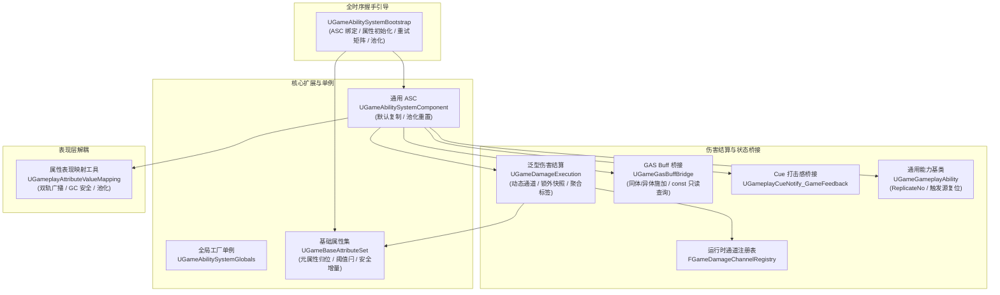

# GameGameplay

> **一句话**：把 `GameGameplayCore` 的战斗契约接入 GAS 的业务绑定层，提供 ASC、引导组件、属性集、ExecCalc、Buff / Cue 桥接与属性 UI 映射。
> **版本** v2.0.0 · **引擎** UE 5.1~5.8 · **层级** Level 3 · **直接依赖** GameGameplayCore、GameFeedback、GameCore、GameMessage、GamePool、GameLogging

## 30 秒速览

- **解决什么问题**：GAS 的原生接入需要大量样板（ASC 初始化时机、属性集注册、ExecCalc 通道映射、Cue 转发、UI 取值），本插件把这些收敛成可直接继承的基类与组件。
- **核心能力**
  - 全时序引导：`UGameAbilitySystemBootstrap` 统一处理 ASC 绑定、数据就绪与复制重试。
  - 属性与伤害：`UGameBaseAttributeSet` 提供元属性归位、阈值闩与安全增量；`UGameDamageExecution` 支持动态通道结算。
  - 表现桥接：`UGameGasBuffBridge` 承载 GAS Buff，`UGameplayCueNotify_GameFeedback` / `UGameFeedbackAdapter` 汇聚到 GameFeedback 总线。
  - UI 解耦：`UGameplayAttributeValueMapping` 将属性变更转为蓝图 / 原生双轨委托，支持对象池复用。
- **什么时候用**：项目已使用或计划使用 GameplayAbilitySystem，并希望复用统一的 Bootstrap、ExecCalc 与表现桥接。
- **什么时候不用**：不打算引入 GAS 时使用 [GameGameplayCore](../GameGameplayCore/README.md)；只需要打击表现时使用 [GameFeedback](../GameFeedback/README.md)。

## 快速开始

在角色构造函数中挂载 ASC 与引导组件：

```cpp
AbilitySystemComponent = CreateDefaultSubobject<UGameAbilitySystemComponent>(TEXT("AbilitySystemComponent"));
BootstrapComponent = CreateDefaultSubobject<UGameAbilitySystemBootstrap>(TEXT("BootstrapComponent"));
```

在 `PossessedBy` / `OnRep_PlayerState` 后注入委托并启动握手（节选自 [QuickStart](Docs/Guides/QuickStart.md)）：

```cpp
BootstrapComponent->SetResolveAbilitySystemComponentDelegate(
    FResolveAbilitySystemComponent::CreateUObject(this, &AHeroCharacter::GetAbilitySystemComponent));

BootstrapComponent->SetWriteInitialAttributesDelegate(FWriteInitialAttributes::CreateLambda(
    [this](UAbilitySystemComponent* ASC) {
        if (!this->AttributeSet) {
            this->AttributeSet = NewObject<UMyHeroAttributeSet>(this, TEXT("AttributeSet"));
            ASC->AddAttributeSetSubobject(this->AttributeSet);
        }
    }));

BootstrapComponent->EnsureInitialized(this);
```

UI 绑定血条：

```cpp
UGameplayAttributeValueMapping* Mapping = UGameplayAttributeValueMapping::CreateAttributeValueMapping(
    this, HeroASC, UMyAttributeSet::GetHealthAttribute());

Mapping->OnValueChangedNative.AddLambda([this](float NewHealth, float OldHealth) {
    UpdateHealthBar(NewHealth);
});

Mapping->QueryAndBroadcast();
```

## 核心能力

### 能力系统组件与全局单例

- `UGameAbilitySystemComponent` 构造期调用 `SetIsReplicatedByDefault(true)`；实现 `IGamePoolable`，归还对象池时取消/清理能力、权威端移除活跃效果并静默复位标签与宿主信息。
- `UGameAbilitySystemGlobals` 继承 `UAbilitySystemGlobals`，挂载全局打击反馈上下文工厂。
- `FGameGameplayEffectContext` 以 Tag 驱动扩展 `FGameplayEffectContext`，访问器 `FORCEINLINE`；`NetSerialize` 使用 5-bit 位掩码，零事件 ID 时省 2 字节，错误状态累积不覆盖，超限限频告警。

### 全时序引导组件

- `UGameAbilitySystemBootstrap` 收敛 ASC 绑定、数据就绪门与复制重试矩阵，包含无 World 直授与早于 `BeginPlay` 的自愈保护。
- `SetResolveAbilitySystemComponentDelegate` / `SetWriteInitialAttributesDelegate` 注入握手回调，`SetDefaultAbilities` / `ConfigureRetryPolicy` 配置默认能力与重试策略。
- 实现 `IGamePoolable`，入池时复位握手状态；`FBootstrapRetryGate` 提供限次重试闸门。

### 属性集与伤害执行

- `UGameBaseAttributeSet` 为纯通用基类（零业务属性）：`MoveMetaAttribute` 提取并归零元属性，`BroadcastThresholdOnce` / `ResetThreshold` 提供无效标签免疫的阈值幂等闩，`ApplyAttributeToLocal` 拦截 `NaN/Inf`。
- `FGameDamageChannelRegistry` 是唯一动态注册入口：锁内拷贝到栈内联快照，锁外执行结算，常用通道零堆分配且防重入死锁。
- `UGameDamageExecution` 零拷贝读取 GE / Spec 聚合标签，支持 `Override(0.0f)` 与预置 `FeedbackEventId` 保护。

### Buff 与 Cue 桥接

- `UGameGasBuffBridge` 以 `GameplayEffect` 承载 Buff，支持同体与异体（`InSourceASC -> TargetASC`）施加、层数扣减，以及 `const` 只读状态 / 叠层 / 时长查询。
- `UGameFeedbackAdapter` 将伤害契约转换为 `FGameFeedbackSignal`；`UGameplayCueNotify_GameFeedback` 复用 `ExtractEffectContext`，把 Cue 双轨汇聚到 GameFeedback 中枢。

### 能力基类

- `UGameGameplayAbility` 默认 `InstancedPerActor + ReplicateNo`，避免多余 Subobject 复制开销。
- `EndAbility` 自动复位触发源；收集阻断状态标签时不创建临时容器拷贝。

### 属性表现映射

- `UGameplayAttributeValueMapping` 将 ASC 属性变更收敛为蓝图 `OnValueChanged` 与原生 `OnValueChangedNative` 双轨委托。
- ASC 被 GC 回收后 `IsBound()` 返回 `false`，`QueryAndBroadcast()` 静默跳过而不向 UI 误播假 0。
- 支持 `IGamePoolable` 复用，入池解绑 ASC 并清空订阅者。

## 架构与依赖

| 项 | 内容 |
| :--- | :--- |
| 公开依赖 | `Core`、`CoreUObject`、`Engine`、`GameplayAbilities`、`GameplayTags`、`GameGameplayCore`、`GamePool`、`GameFeedback` |
| 私有依赖 | `GameplayTasks`、`GameCore`、`GameLogging`、`GameMessage` |
| 禁止依赖 | `GameData`（避免配置数据与技能框架循环引用） |
| C++ 标准 | C++20 |

- **`GameFeedback` 是公开依赖**：`UGameFeedbackAdapter` 与 `UGameplayCueNotify_GameFeedback` 直接位于 `Public/`，移除该依赖会破坏公开头文件契约。
- 分层定位 Level 3 业务实现层：向下依赖 `GameGameplayCore` 的战斗契约，向游戏层暴露可直接继承的 GAS 基类。
- 子域日志基于 `GameLogging` 与 `Game::Config::bEnableLog` 编译期门控，拆分为 `LogGameAbility` / `LogGameAttribute` / `LogGameDamage` / `LogGameGasBridge`，战斗热路径降级至 `Verbose`。

| 关键类 | 职责 |
| :--- | :--- |
| `UGameAbilitySystemBootstrap` | ASC 握手、属性初始化与重试编排 |
| `UGameAbilitySystemComponent` | 通用 ASC，默认复制并支持池化复位 |
| `UGameBaseAttributeSet` | 无业务属性集基类，元属性与阈值闩 |
| `UGameDamageExecution` | 动态通道 ExecCalc 基类 |
| `UGameGasBuffBridge` | GAS Buff 同体 / 异体施加与查询 |
| `UGameplayCueNotify_GameFeedback` | GameplayCue 到表现总线的桥接 |
| `UGameplayAttributeValueMapping` | 属性变更到 UI 的双轨映射 |

<details>
<summary><b>展开架构全景图</b></summary>



</details>

<details>
<summary><b>展开目录结构</b></summary>

```text
Plugins/GameGameplay/
├── Source/
│   └── GameGameplay/
│       ├── Public/
│       │   ├── GameGameplay.h
│       │   ├── Ability/
│       │   │   ├── FBootstrapRetryGate.h               # 限次重试闸门
│       │   │   ├── UGameAbilitySystemBootstrap.h       # GAS 握手全时序引导组件
│       │   │   ├── UGameAbilitySystemComponent.h       # 通用 ASC 基类（含 IGamePoolable）
│       │   │   ├── UGameAbilitySystemGlobals.h         # 全局上下文工厂单例
│       │   │   └── UGameGameplayAbility.h              # 通用能力基类
│       │   ├── Attribute/
│       │   │   ├── UGameBaseAttributeSet.h             # 通用属性集基类
│       │   │   └── UGameplayAttributeValueMapping.h    # UI 属性映射工具（含 IGamePoolable）
│       │   ├── Bridge/
│       │   │   ├── UGameFeedbackAdapter.h              # 伤害契约到 GameFeedback 信号适配器
│       │   │   ├── UGameGasBuffBridge.h                # GAS Buff 桥接
│       │   │   └── UGameplayCueNotify_GameFeedback.h   # GAS Cue 打击感桥接
│       │   └── Damage/
│       │       ├── FDamageChannelBinding.h             # 伤害通道输出映射契约
│       │       ├── FDamageModifier.h                   # 通道伤害修饰器
│       │       ├── FGameDamageChannelRegistry.h        # 运行时通道绑定注册表
│       │       ├── FGameGameplayEffectContext.h        # 打击反馈 GE 上下文
│       │       └── UGameDamageExecution.h              # 动态通道 ExecCalc 基类
│       ├── Private/
│       │   ├── GameGameplay.cpp
│       │   ├── GameGameplayLog.h                       # 四子域编译期直轨日志宏
│       │   ├── Ability/
│       │   ├── Attribute/
│       │   ├── Bridge/
│       │   ├── Damage/
│       │   └── Tests/                                  # 单测、测试桩与 12 项微基准套件
│       └── GameGameplay.Build.cs
├── Docs/
├── GameGameplay.uplugin
└── README.md
```

</details>

## 性能与边界

<details>
<summary><b>展开性能基准（历史 Development 构建参考值）</b></summary>

README 不收录实测数值，下表为 `Private/Tests/UGameGameplayPerformanceTest.cpp` 中的回归预算门限（Development 构建，多轮预热采样）。

| 用例 | 覆盖热路径 | 预算上限 (ns/op) |
| :--- | :--- | ---: |
| `ChannelRegistryLookup` | 运行时伤害通道注册表查找 | 500 |
| `ChannelRegistryConcurrentRead` | 通道注册表并发读 | 1500 |
| `DamageModifierEvaluation` | 通道伤害修饰器演算 | 50 |
| `EffectContextNetSerializeCompact` | 紧凑 GE 上下文序列化 | 10000 |
| `EffectContextNetSerializeFull` | 完整 GE 上下文序列化 | 20000 |
| `DamageExecutionPipeline` | ExecCalc 结算闭环 | 20000 |
| `AbilityCanActivate` | 阻断状态标签判定 | 3000 |
| `BaseAttributeSetOps` | 属性集元属性与阈值操作 | 4000 |
| `AttributeValueMappingBroadcast` | 属性映射广播 | 4000 |
| `GasBuffBridgeLifecycle` | GAS Buff 施加 / 查询生命周期 | 30000 |
| `FeedbackAdapterMakeSignal` | 伤害契约转表现信号 | 3000 |
| `PoolableComponentsReset` | ASC 与映射工具池化复位 | 10000 |

</details>

- **网络**：GE 结算遵循 GAS 的服务端权威模型；ASC 构造期默认开启复制，客户端以复制结果为准。
- **线程**：属性、GE 与能力操作须在游戏线程执行；通道注册表的锁内拷贝与锁外结算用于避免持锁重入。
- **生命周期**：ASC 与属性映射均支持 `IGamePoolable`，入池时取消能力、移除活跃效果并解绑委托。
- **依赖红线**：禁止依赖 `GameData`；`GameFeedback` 为公开依赖，公开头文件中直接引用其类型。
- **性能口径**：预算为 Development 回归门限，非 Shipping 性能承诺；实测值随硬件与构建配置变化。

## 文档导航

| 分类 | 文档 |
| :--- | :--- |
| 架构 | [架构概述与分层定位](Docs/Architecture/Overview.md) |
| 架构 | [GAS 引导生命周期时序](Docs/Architecture/BootstrapAndLifecycle.md) |
| 架构 | [ExecCalc 通道化伤害计算管线](Docs/Architecture/DamageExecutionPipeline.md) |
| API | [ASC 与 Globals API](Docs/API/AbilitySystemComponent.md) |
| API | [属性集基类 API](Docs/API/AttributeSet.md) |
| API | [伤害计算基类 API](Docs/API/DamageExecution.md) |
| API | [GAS Buff 桥接 API](Docs/API/GasBuffBridge.md) |
| API | [能力基类 API](Docs/API/GameplayAbility.md) |
| API | [引导组件 API](Docs/API/Bootstrap.md) |
| API | [UI 属性映射 API](Docs/API/AttributeMapping.md) |
| API | [GameplayCue 打击感桥接 API](Docs/API/GameplayCueFeedbackBridge.md) |
| 指南 | [快速上手指南](Docs/Guides/QuickStart.md) |
| 指南 | [自定义伤害通道与 ExecCalc 指南](Docs/Guides/DamageExecutionGuide.md) |
| 指南 | [UMG 界面绑定指南](Docs/Guides/UIBindingGuide.md) |
