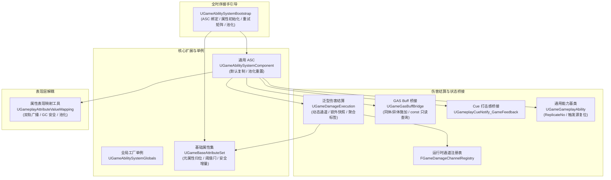

# GameGameplay 插件

**GameGameplay** 是基于 Unreal Engine 5 Gameplay Ability System (GAS) 构建的高性能业务绑定与赋能层。它承接底层战斗契约（`GameGameplayCore`），提供标准 GAS 组件扩展、全时序自动握手引导组件、通用属性集基类、动态通道化伤害结算 ExecCalc 基类、GAS Buff/GameplayCue 桥接，以及支持对象池复用的 UMG 属性解耦映射工具。

> **架构红线**：严禁依赖 `GameData`（保持 GAS 纯粹机制库定位，业务数值由具体游戏层按契约注入）。

---

## 架构设计全景



---

## 核心特性一览

| 模块 / 机制 | 关键技术亮点 | 核心文件 / 类 |
| :--- | :--- | :--- |
| **能力系统组件基类** | 构造期强制开启复制（`SetIsReplicatedByDefault(true)`）；实现 `IGamePoolable`，归还对象池时自动取消/清理能力、移除活跃效果并静默复位标签与宿主信息 | `Ability/UGameAbilitySystemComponent.h` |
| **GAS 全局单例** | 继承 `UAbilitySystemGlobals`，挂载全局打击反馈上下文工厂 | `Ability/UGameAbilitySystemGlobals.h` |
| **打击反馈上下文** | 全 Tag 驱动扩展 `FGameplayEffectContext`，单行访问器全面 `FORCEINLINE`；5-bit 位掩码紧凑 `NetSerialize`（零事件 ID 省 2 字节、全子项错误状态严格累积防覆盖、超限限频告警） | `Damage/FGameGameplayEffectContext.h` |
| **属性集基础框架** | 纯通用基类（零业务属性），提供元属性提取归零（`MoveMetaAttribute`）、无效标签免疫的阈值幂等闩（`BroadcastThresholdOnce` / `ResetThreshold`）与拦截 NaN/Inf 的增量落地（`ApplyAttributeToLocal`）；数值钳制统一使用引擎原生 `FMath::Clamp` | `Attribute/UGameBaseAttributeSet.h` |
| **泛型伤害结算 ExecCalc** | `FGameDamageChannelRegistry` 唯一权威动态注册入口，锁内拷贝至栈内联快照、锁外执行结算闭环（常用通道零堆分配且绝对防重入死锁）；零拷贝读取 GE/Spec 聚合标签；支持 `Override(0.0f)` 与预置 `FeedbackEventId` 保护 | `Damage/UGameDamageExecution.h`<br>`Damage/FGameDamageChannelRegistry.h`<br>`Damage/FDamageChannelBinding.h`<br>`Damage/FDamageModifier.h` |
| **GAS Buff 桥接** | 以 `GameplayEffect` 承载 Buff，支持同体与异体（`InSourceASC -> TargetASC`）施加、层数扣减与 `const` 只读状态/叠层/时长查询 | `Bridge/UGameGasBuffBridge.h` |
| **打击感 Cue 与适配器** | `UGameFeedbackAdapter` 将伤害契约转换为 `FGameFeedbackSignal`；`UGameplayCueNotify_GameFeedback` 复用 `ExtractEffectContext` 双轨汇聚 Cue 至 `GameFeedback` 中枢 | `Bridge/UGameFeedbackAdapter.h`<br>`Bridge/UGameplayCueNotify_GameFeedback.h` |
| **通用能力基类** | 默认 `InstancedPerActor + ReplicateNo`（零多余 Subobject 复制开销），`EndAbility` 自动复位触发源；阻断状态标签零临时容器拷贝收集 | `Ability/UGameGameplayAbility.h` |
| **全时序引导组件** | 收敛 ASC 绑定、数据就绪门、复制重试矩阵（含无 World 直授与早于 `BeginPlay` 自愈保护）与 `IGamePoolable` 对象池复位；提供 `SetDefaultAbilities` / `ConfigureRetryPolicy` 配置接口 | `Ability/UGameAbilitySystemBootstrap.h`<br>`Ability/FBootstrapRetryGate.h` |
| **属性表现映射工具** | 将 ASC 变更收敛为蓝图 `OnValueChanged` + 原生 `OnValueChangedNative` 双轨委托；ASC 被 GC 回收后 `IsBound()` 精准返 `false` 且 `QueryAndBroadcast()` 不误播假 0；支持 `IGamePoolable` 对象池复用 | `Attribute/UGameplayAttributeValueMapping.h` |
| **子域分级日志** | 基于 `GameLogging` 与 `Game::Config::bEnableLog` 编译期门控，拆分 `LogGameAbility` / `LogGameAttribute` / `LogGameDamage` / `LogGameGasBridge` 四大子域分类与限频通道，战斗热路径全面降级至 `Verbose` | `Private/GameGameplayLog.h` |

---

## 插件依赖

- **公开依赖 (Public)**：`Core`, `CoreUObject`, `Engine`, `GameplayAbilities`, `GameplayTags`, `GameGameplayCore`, `GamePool`, `GameFeedback`
- **私有依赖 (Private)**：`GameplayTasks`, `GameCore`, `GameLogging`, `GameMessage`
- **禁止依赖**：`GameData`（杜绝配置数据与技能框架循环引用）
- **C++ 标准**：C++20

---

## 快速上手

### 1. 挂载引导组件与 ASC
在您的玩家角色（Character）或英雄 Pawn 中添加：
```cpp
// 在 AMyHeroCharacter 构造函数中
AbilitySystemComponent = CreateDefaultSubobject<UGameAbilitySystemComponent>(TEXT("AbilitySystemComponent"));
BootstrapComponent = CreateDefaultSubobject<UGameAbilitySystemBootstrap>(TEXT("BootstrapComponent"));
```

### 2. 注入握手委托并启动引导
```cpp
void AMyHeroCharacter::BeginPlay() {
    Super::BeginPlay();

    BootstrapComponent->SetResolveAbilitySystemComponentDelegate(FResolveAbilitySystemComponent::CreateLambda([this]() {
        return this->AbilitySystemComponent.Get();
    }));

    BootstrapComponent->SetWriteInitialAttributesDelegate(FWriteInitialAttributes::CreateLambda([this](UAbilitySystemComponent* ASC) {
        // 创建属性集并设置初始血量、攻击力等
    }));

    BootstrapComponent->EnsureInitialized(this);
}
```

### 3. UI 绑定血条显示
```cpp
// 1. 创建属性映射（指定 UI 自身作为 Outer，使映射随 Widget 存活）
UGameplayAttributeValueMapping* Mapping = UGameplayAttributeValueMapping::CreateAttributeValueMapping(
    this,
    HeroASC,
    UMyAttributeSet::GetHealthAttribute()
);

// 2. 订阅原生 C++ 多播（零反射开销）或蓝图 OnValueChanged
Mapping->OnValueChangedNative.AddLambda([this](float NewHealth, float OldHealth) {
    UpdateHealthBar(NewHealth);
});

// 3. 订阅完成后主动拉取并广播一次初值，杜绝 UI 初始空白
Mapping->QueryAndBroadcast();
```

---

## 目录结构

```text
Plugins/GameGameplay/
├── Source/
│   └── GameGameplay/
│       ├── Public/
│       │   ├── GameGameplay.h
│       │   ├── Ability/
│       │   │   ├── FBootstrapRetryGate.h               # 限次重试闸门
│       │   │   ├── UGameAbilitySystemBootstrap.h       # GAS 握手全时序引导组件
│       │   │   ├── UGameAbilitySystemComponent.h       # 通用 ASC 基类（含 IGamePoolable）
│       │   │   ├── UGameAbilitySystemGlobals.h         # 全局上下文工厂单例
│       │   │   └── UGameGameplayAbility.h              # 通用能力基类
│       │   ├── Attribute/
│       │   │   ├── UGameBaseAttributeSet.h             # 通用属性集基类
│       │   │   └── UGameplayAttributeValueMapping.h    # UI 属性映射工具（含 IGamePoolable）
│       │   ├── Bridge/
│       │   │   ├── UGameFeedbackAdapter.h              # 伤害契约到 GameFeedback 信号适配器
│       │   │   ├── UGameGasBuffBridge.h                # GAS Buff 桥接
│       │   │   └── UGameplayCueNotify_GameFeedback.h   # GAS Cue 打击感桥接
│       │   └── Damage/
│       │       ├── FDamageChannelBinding.h             # 伤害通道输出映射契约
│       │       ├── FDamageModifier.h                   # 通道伤害修饰器
│       │       ├── FGameDamageChannelRegistry.h        # 运行时通道绑定注册表
│       │       ├── FGameGameplayEffectContext.h        # 打击反馈 GE 上下文
│       │       └── UGameDamageExecution.h              # 动态通道 ExecCalc 基类
│       ├── Private/
│       │   ├── GameGameplay.cpp
│       │   ├── GameGameplayLog.h                       # 四子域编译期直轨日志宏
│       │   ├── Ability/
│       │   ├── Attribute/
│       │   ├── Bridge/
│       │   ├── Damage/
│       │   └── Tests/
│       │       ├── AGameFeedbackTestActor.h            # 测试辅助：可配置速度 Actor
│       │       ├── UGameAttributeMappingTestReceiver.h # 测试辅助：动态多播接收器
│       │       ├── UGameDamageTestExecution.h/.cpp     # 测试辅助：自定义 ExecCalc 子类
│       │       ├── FBootstrapRetryGateTest.cpp         # 重试闸门单测
│       │       ├── FGameDamageChannelRegistryTest.cpp  # 通道注册表、防死锁与并发压力单测
│       │       ├── FGameGameplayEffectContextTest.cpp  # 打击上下文、紧凑位打包与损坏流单测
│       │       ├── GameFeedbackAdapterTest.cpp         # 伤害契约适配器单测
│       │       ├── GameFeedbackCueBridgeTest.cpp       # GameFeedback Cue 桥接单测
│       │       ├── UGameAbilitySystemBootstrapTest.cpp # GAS 引导组件全时序与重试闭环单测
│       │       ├── UGameAbilitySystemComponentTest.cpp # 通用 ASC 基类与池化单测
│       │       ├── UGameAbilitySystemGlobalsTest.cpp   # GAS 全局单例单测
│       │       ├── UGameBaseAttributeSetTest.cpp       # 属性集阈值闩与增量防御单测
│       │       ├── UGameDamageExecutionTest.cpp        # 动态通道伤害结算与钩子重入单测
│       │       ├── UGameGameplayAbilityTest.cpp        # 通用能力基类单测
│       │       ├── UGameGasBuffBridgeTest.cpp          # GAS Buff 桥接（同体/异体）单测
│       │       ├── UGameplayAttributeValueMappingTest.cpp # 属性映射（含 GC 失效与池化）单测
│       │       └── UGameGameplayPerformanceTest.cpp    # 12 项多轮预热采样微基准套件
│       └── GameGameplay.Build.cs
├── Docs/
├── GameGameplay.uplugin
└── README.md
```

---

## 文档导航

所有完整文档已按职责分类收录于 `Docs/` 目录中：

- **架构设计 (Architecture)**
  - [架构概述与分层定位](Docs/Architecture/Overview.md)
  - [GAS 引导生命周期时序](Docs/Architecture/BootstrapAndLifecycle.md)
  - [ExecCalc 通道化伤害计算管线](Docs/Architecture/DamageExecutionPipeline.md)
- **接口参考 (API Reference)**
  - [ASC 与 Globals API](Docs/API/AbilitySystemComponent.md)
  - [属性集基类 API](Docs/API/AttributeSet.md)
  - [伤害计算基类 API](Docs/API/DamageExecution.md)
  - [GAS Buff 桥接 API](Docs/API/GasBuffBridge.md)
  - [能力基类 API](Docs/API/GameplayAbility.md)
  - [引导组件 API](Docs/API/Bootstrap.md)
  - [UI 属性映射 API](Docs/API/AttributeMapping.md)
  - [GameplayCue 打击感桥接 API](Docs/API/GameplayCueFeedbackBridge.md)
- **使用指南 (Guides)**
  - [快速上手指南](Docs/Guides/QuickStart.md)
  - [自定义伤害通道与 ExecCalc 指南](Docs/Guides/DamageExecutionGuide.md)
  - [UMG 界面绑定指南](Docs/Guides/UIBindingGuide.md)
