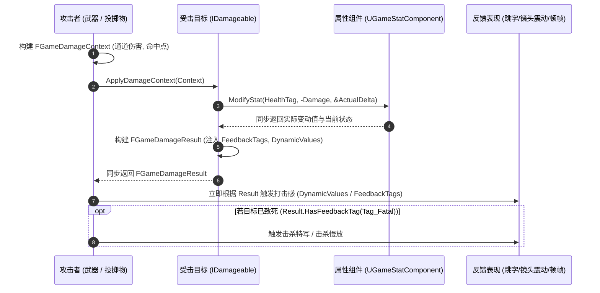

# GameGameplayCore 闭环伤害管线机制

## 1. 传统伤害管线痛点 vs 闭环同步管线

在许多游戏项目中，伤害处理流程往往是单向、断裂的：
- 攻击方调用 `TakeDamage` 或施加 GameplayEffect，调用完成即告结束；
- 攻击方无法同步知道这一击是否有效、造成了多少实际伤害、受击者是否因此死亡；
- 攻击方如果要产生打击顿挫（卡肉）、播放击中音效或弹出跳字，往往需要依赖全局消息广播或延迟反查受击方组件，极易产生时序错误和性能损耗；
- 传统管线在结构体中硬编码了暴击、卡肉时长等字段，无法满足复杂游戏（护盾吸收、架势削弱、弱点打击等）的自定义扩展。

`GameGameplayCore` 引入了**Tag 驱动的闭环同步打击反馈管线（Closed-Loop Damage Pipeline）**：



---

## 2. 通道化伤害与 GameplayTag 层级继承

战斗伤害通常包含多种类型（物理、火焰、冰霜、真实伤害等）。`FGameDamageContext` 与 `FGameDamageResult` 均采用 `FGameDamageChannel` 结构：

```cpp
USTRUCT(BlueprintType)
struct FGameDamageChannel {
    GENERATED_BODY()

    UPROPERTY(EditAnywhere, BlueprintReadWrite)
    FGameplayTag ChannelTag;

    UPROPERTY(EditAnywhere, BlueprintReadWrite)
    float Magnitude = 0.0f;
};
```

### 标签层级匹配优势
当攻击方施加带有 `Damage.Elemental.Fire` 的伤害时：
- 受击方如果只关心所有元素伤害，使用 `GetChannelDamage(FGameplayTag::RequestGameplayTag("Damage.Elemental"))` 即可自动累加所有火、冰、雷等子标签伤害；
- 受击方如果需要严格区分火焰并计算独立火抗，使用 `GetChannelDamageExact` 严格匹配标签。
这种设计赋予了护甲、抗性、护盾系统极大的扩展自由度。

---

## 3. 反馈标签与动态数值参数

打击反馈中不再硬编码具体字段，全部由开发者通过 Tag 驱动：

1. **状态标签容器（`FeedbackTags`）**：
   - 开发者可自由添加 `Damage.Feedback.Critical`（暴击）、`Damage.Feedback.Stagger`（硬直）、`Damage.Feedback.Blocked`（格挡）等。
   - 攻击端使用 `Result.HasFeedbackTag(Tag)` 即可直接驱动对应表现。
2. **动态数值容器（`DynamicValues`）**：
   - 开发者可自由设置任意标量参数，如 `Damage.Feedback.HitStop`（0.08 秒卡肉）、`Damage.Feedback.ShieldAbsorbed`（吸收了 40 点伤害）。
   - 攻击端使用 `Result.GetDynamicValue(Tag, DefaultVal)` 零开销获取数值。

---

## 4. 同步性与 GAS 的自洽契约

在 `GameGameplay` 模块（GAS 适配层）中，`ApplyGameplayEffectSpecToSelf` 在 Unreal 引擎底层是**严格同步的**：
- 在这一行代码执行期间，GAS 的 `ExecCalc`（执行计算）和 `PostGameplayEffectExecute` 会被同步驱动并执行完毕；
- 因此，GAS 属性计算的结果可以直接写入扩展的 `FGameGameplayEffectContext` 中，并在退出时打包进 `FGameDamageResult` 返回给调用者，保证整个管线百分之百闭环且同步完成。
