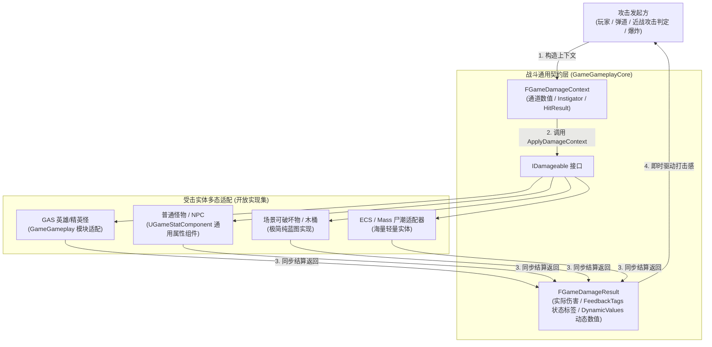
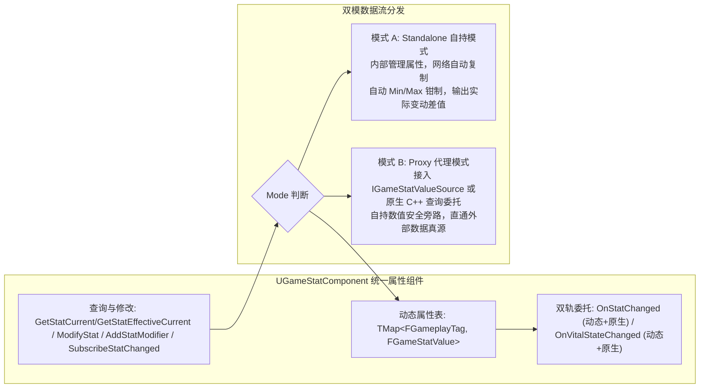

# GameGameplayCore 架构设计与解耦哲学

## 1. 为什么将战斗核心与属性系统从具体业务中剥离？

在传统的 Unreal Engine 动作与 RPG 项目中，开发者往往直接将所有的受击、生命与伤害逻辑全部绑定在 Gameplay Ability System (GAS) 或具体的特定玩法假设之上：
- 场景中一个普通的木桶、木箱或路灯，为了能被打碎，不得不挂载庞大的 `UAbilitySystemComponent` 和 `UAttributeSet`；
- 海量小怪同屏时，ASC 带来的组件内存占用和网络同步开销急剧飙升；
- 打击反馈中硬编码了暴击、硬直、卡肉等字段，当项目需要护盾吸收、架势槽、弱点爆头或格挡反击时，核心底层结构体无法扩展，只能改动框架源码；
- 攻击方发起伤害后，GAS 的 `ApplyGameplayEffectSpecToTarget` 往往没有直接返回“究竟造成了多少伤害”、“是否致死”，攻击端必须通过异步事件或二次反查目标属性，代码极其割裂。

**GameGameplayCore 的诞生**彻底解决了上述困境：
1. **轻量通用契约**：纯 C++ 接口 `IDamageable` + 结构体 `FGameDamageContext` / `FGameDamageResult`，让任何非 GAS 实体只需几行代码即可接入战斗网络。
2. **纯粹通用的 Tag 驱动架构**：彻底消除暴击、霸体、固定生命值等硬编码，所有属性与反馈状态由开发者在项目层自由通过 `GameplayTag` 注册与读写。
3. **零 GAS 依赖**：无论当前项目是否启用 GAS 插件，`GameGameplayCore` 均可独立编译和使用。
4. **上层向上兼容**：高级 GAS 插件（如 `GameGameplay`）可以作为 `IDamageable` 的一种实现者，将伤害管线无缝引入 GAS 的 GameplayEffect 与 ExecCalc 中。

---

## 2. 总体架构与实体适配拓扑

---

## 3. 通用数值管理组件 (`UGameStatComponent`)

为了兼顾“简单对象开箱即用”与“复杂实体对接外部属性”的需求，`UGameStatComponent` 采用了全 Tag 驱动的通用数值架构：

- **统一数值契约**：调用者无论在何种模式下调用 `GetStatCurrent(Tag)`、`GetStatMax(Tag)` 或 `GetStatPercent(Tag)`，均返回当前真实有效数值；`GetStatEffective*` 返回叠加修正器后的派生值。
- **代理读写契约**：代理模式默认只读，写入统一经 `FGameStatWriteDelegate` 转发外部真源；非权威端默认拒绝写入。
- **属性修正器**：Buff / 装备 / 天赋通过 `AddStatModifier` 叠加加算、乘算、覆写，句柄精确回滚，基础值不被改写。
- **按 Tag 订阅**：`SubscribeStatChanged` 只订阅关心的属性，并在订阅时立即回放当前值，UI 无初始空白。
- **解绑与切换安全**：代理源解绑瞬间重新评估属性与主生命状态，自动将外部真源当前值写回组件，平滑过渡。
- **原生与动态双轨委托**：同时暴露蓝图可分配动态委托与 C++ 原生多播委托（`OnStatChangedNative` / `OnVitalStateChangedNative`），完美支持 C++ 现代 Lambda 与零 UObject 额外开销的高性能监听。

---

## 4. 通用 Buff 运行时 (`UGameBuffComponent`)

框架层不定义任何具体 Buff，只提供与 GAS 无关的通用运行时：

- **由开发者描述**：`FGameBuffSpec` 包含身份 Tag、授予状态标签、持续时长、最大层数、叠层策略与属性修正器。
- **叠层策略**：`RefreshDuration` 刷新时长、`AddDuration` 累加时长、`Independent` 独立实例。
- **状态聚合**：`GetGrantedTags` 聚合全部激活 Buff 的状态标签，供状态机、动画与技能条件查询。
- **修正器挂接**：按层数缩放后挂接到 `UGameStatComponent`，到期或移除时按句柄精确回滚。
- **冷却即状态**：冷却不设独立类，用「限时 + 授予 `State.Cooldown`」的普通 Buff 表达。
- **权威与复制**：服务端权威施加 / 移除；`ActiveBuffs` 以 FastArray 增量复制，客户端在复制回调中重建修正器并按层数差分广播。
