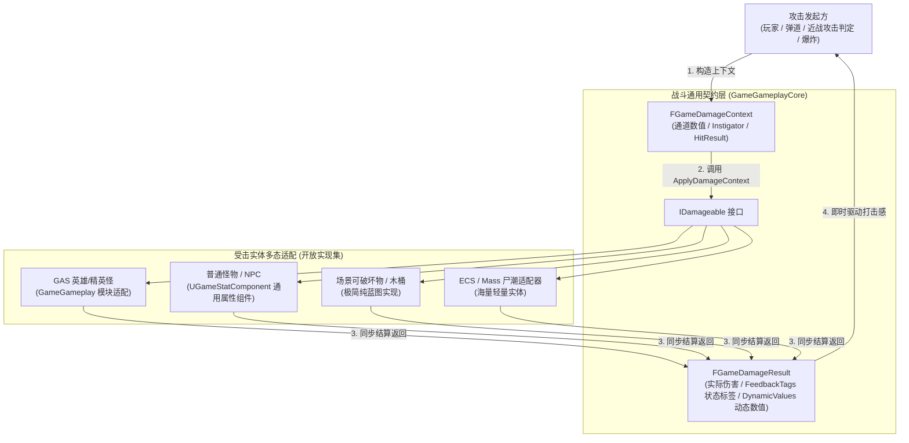
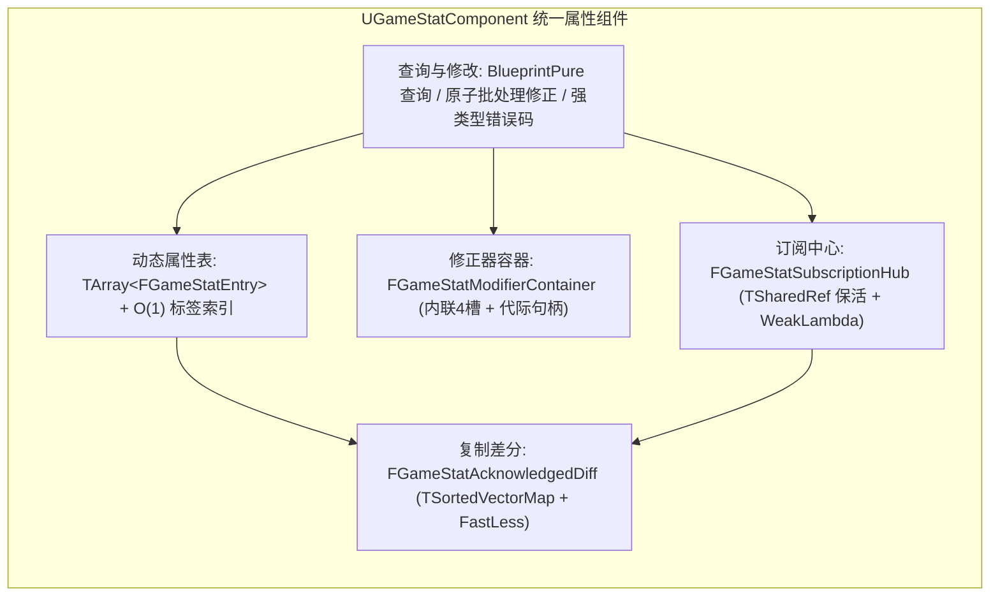

# GameGameplayCore 架构设计与解耦哲学

## 1. 为什么将战斗核心与属性系统从具体业务中剥离？

在传统的 Unreal Engine 动作与 RPG 项目中，开发者往往直接将所有的受击、生命与伤害逻辑全部绑定在 Gameplay Ability System (GAS) 或具体的特定玩法假设之上：
- 场景中一个普通的木桶、木箱或路灯，为了能被打碎，不得不挂载庞大的 `UAbilitySystemComponent` 和 `UAttributeSet`；
- 海量小怪同屏时，ASC 带来的组件内存占用和网络同步开销急剧飙升；
- 打击反馈中硬编码了暴击、硬直、卡肉等字段，当项目需要护盾吸收、架势槽、弱点爆头或格挡反击时，核心底层结构体无法扩展，只能改动框架源码；
- 攻击方发起伤害后，GAS 的 `ApplyGameplayEffectSpecToTarget` 往往没有直接返回“究竟造成了多少伤害”、“是否致死”，攻击端必须通过异步事件或二次反查目标属性，代码极其割裂。

**GameGameplayCore 的诞生**彻底解决了上述困境：
1. **轻量通用契约**：纯 C++ 接口 `IDamageable` + 结构体 `FGameDamageContext` / `FGameDamageResult`，让任何非 GAS 实体只需几行代码即可接入战斗网络。
2. **纯粹通用的 Tag 驱动架构**：彻底消除暴击、霸体、固定生命值等硬编码，所有属性与反馈状态由开发者在项目层自由通过 `GameplayTag` 注册与读写。
3. **零 GAS 依赖**：无论当前项目是否启用 GAS 插件，`GameGameplayCore` 均可独立编译和使用。
4. **上层向上兼容**：高级 GAS 插件（如 `GameGameplay`）可以作为 `IDamageable` 的一种实现者，将伤害管线无缝引入 GAS 的 GameplayEffect 与 ExecCalc 中。

---

## 2. 总体架构与实体适配拓扑

---

## 3. 通用数值管理组件 (`UGameStatComponent`)

`UGameStatComponent` 采用全 Tag 驱动的通用数值架构，把「数值存储 + 修正器演算 + 重入安全订阅通知」收敛为单一自洽模型：

- **单趟高效演算**：`FGameStatModifierContainer` 采用 `TInlineAllocator<4>` 内联存储与单趟双轴演算（`EvaluateEffectivePair`），消除多趟重复哈希查找与常规小集合堆分配。
- **代际句柄与原子批处理**：`FGameStatModifierHandle`（`GameCore::TGameHandle`）在 `Reset()` / 池化归还时递增代际彻底防 ABA；`UpdateStatModifier` 与 `FScopedModifierBatch` 保证修正器成组切换零中间态抖动。
- **重入安全订阅**：`FGameStatSubscriptionHub` 以 `TSharedRef` 在广播期保活多播对象，Owner 感知订阅直走 `CreateWeakLambda`，彻底免疫回调中自退订、扩容重排与中途销毁 Owner。
- **权威与数值安全**：默认拒绝非权威端写（`bAllowNonAuthoritativeWrites = false`），公开写入口统一拦截 `NaN/±Inf`，失败统一返回 `Game::ModuleId::Gameplay` + `Game::GameplayCoreErrorCodes`。

---

## 4. 实体生命与存活状态管理组件 (`UGameVitalComponent`)

依据单一职责原则（SRP），实体的主生命属性绑定、存活状态判定、网络致死同步与复活逻辑由 `UGameVitalComponent` 独立承载：

- **自动挂接与显式解绑隔离**：`BeginPlay` 自动补齐 CDO 预配置主生命标签或宿主 `UGameStatComponent` 的监听；`BindStatComponent(nullptr)` 置位显式解绑标记不再静默重绑。
- **网络去重机制**：`bLastBroadcastedAlive` 解决属性复制到达与布尔存活标志复制到达同帧的双重广播问题。
- **对象池静默契约**：`OnReleaseToPool` 遵循 SRP 仅静默重置自身存活状态，不越权改写 `UGameStatComponent`。

---

## 5. 通用 Buff 运行时 (`UGameBuffComponent`)

框架层不定义任何具体 Buff，只提供与 GAS 无关的通用运行时：

- **由开发者描述**：`FGameBuffSpec` 包含身份 Tag、授予状态标签、持续时长、最大层数、叠层策略与属性修正器；运行条目 `FGameBuffInstance` 独立头文件存放以解耦网络序列化依赖。
- **零抖动原子修正器挂接**：`FGameBuffModifierBridge` 与 `UGameStatComponent::FScopedModifierBatch` / `UpdateStatModifier` 联动，满层刷新免重建，叠层/扣层原地更新无瞬时掉血误杀。
- **零拷贝状态查询与批量清理**：`HasGrantedTag` 短路直查、`ClearAllBuffs` 单次批量清理并关停 Tick。
- **增量复制与零堆分配差分**：`ActiveBuffs` 以 FastArray 增量复制，`RemoveBuffStacks` 精准区分 `MarkItemDirty` 与 `MarkArrayDirty`，`PreReplicatedRemove` 当帧关停 Tick，客户端差分基于 `TSortedVectorMap<FGameFastTagKey, int32, 8>` 实现零堆分配与整型快速二分。

---

## 6. 基础设施协同与日志治理

- **统一错误码契约**：`Public/Core/GameplayCoreErrorCodes.h` 定义 `11001~11006` 强类型错误码，全部归属 `Game::ModuleId::Gameplay`。
- **子域分级日志 (`GameLogging`)**：模块级 `LogGameGameplayCore` 负责模块启停里程碑，内部按子域拆分为 `LogGameStat`、`LogGameVital`、`LogGameBuff` 编译期直轨分类；高频正常路径一律降级为 `Verbose`（抑制态零格式化开销），高频非权威拒绝采用限频 `Warning`。
- **对象池统一静默重置 (`GamePool`)**：`UGameStatComponent` / `UGameVitalComponent` / `UGameBuffComponent` 均实现 `IGamePoolable`，归还入池时一律静默重置内部状态而不误播游戏态业务事件。
- **零应用层网络依赖红线**：严格维持 Layer 1 边界，不依赖 `GameplayAbilities`、`GameGameplay`、`GameNetCore`、`GameNetService`。
