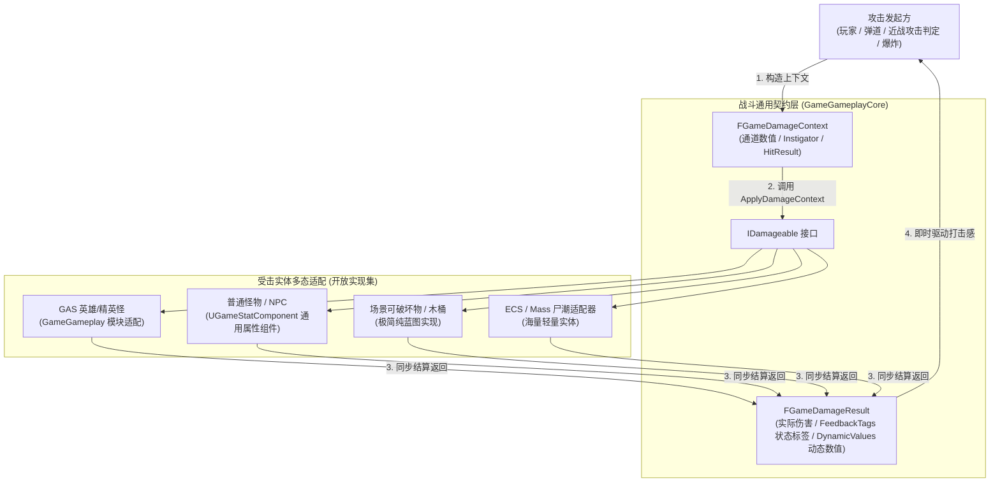
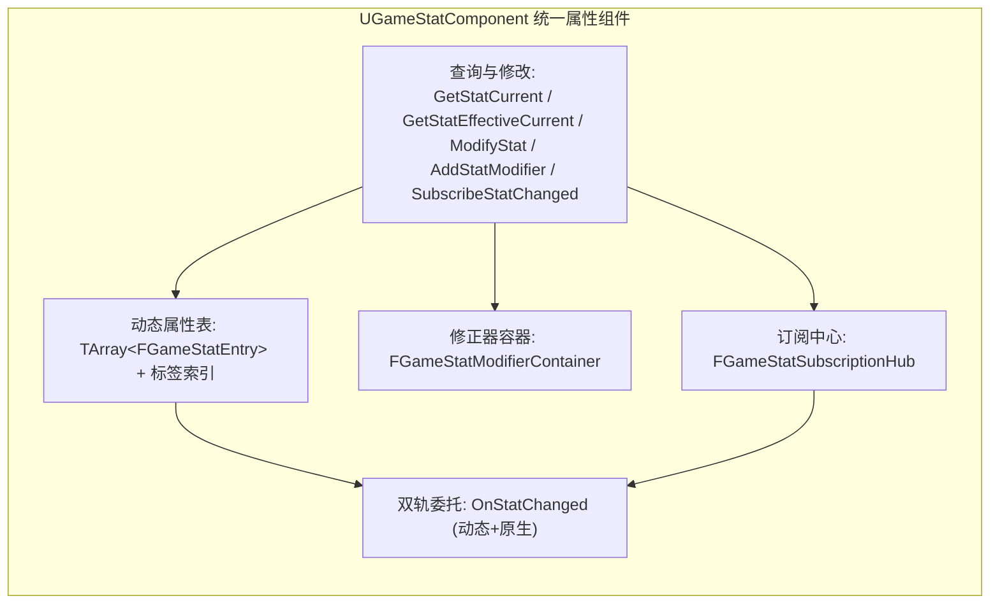
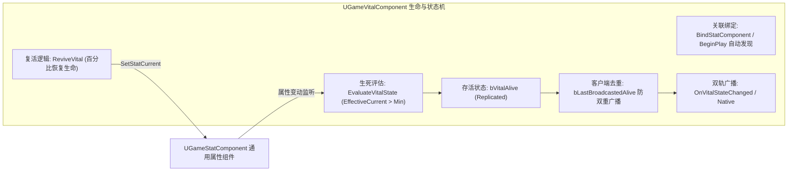
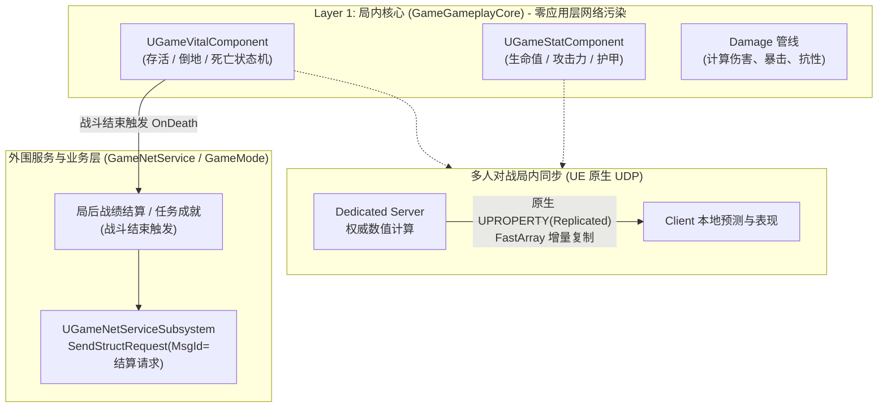

# GameGameplayCore 架构设计与解耦哲学

## 1. 为什么将战斗核心与属性系统从具体业务中剥离？

在传统的 Unreal Engine 动作与 RPG 项目中，开发者往往直接将所有的受击、生命与伤害逻辑全部绑定在 Gameplay Ability System (GAS) 或具体的特定玩法假设之上：
- 场景中一个普通的木桶、木箱或路灯，为了能被打碎，不得不挂载庞大的 `UAbilitySystemComponent` 和 `UAttributeSet`；
- 海量小怪同屏时，ASC 带来的组件内存占用和网络同步开销急剧飙升；
- 打击反馈中硬编码了暴击、硬直、卡肉等字段，当项目需要护盾吸收、架势槽、弱点爆头或格挡反击时，核心底层结构体无法扩展，只能改动框架源码；
- 攻击方发起伤害后，GAS 的 `ApplyGameplayEffectSpecToTarget` 往往没有直接返回“究竟造成了多少伤害”、“是否致死”，攻击端必须通过异步事件或二次反查目标属性，代码极其割裂。

**GameGameplayCore 的诞生**彻底解决了上述困境：
1. **轻量通用契约**：纯 C++ 接口 `IDamageable` + 结构体 `FGameDamageContext` / `FGameDamageResult`，让任何非 GAS 实体只需几行代码即可接入战斗网络。
2. **纯粹通用的 Tag 驱动架构**：彻底消除暴击、霸体、固定生命值等硬编码，所有属性与反馈状态由开发者在项目层自由通过 `GameplayTag` 注册与读写。
3. **零 GAS 依赖**：无论当前项目是否启用 GAS 插件，`GameGameplayCore` 均可独立编译和使用。
4. **上层向上兼容**：高级 GAS 插件（如 `GameGameplay`）可以作为 `IDamageable` 的一种实现者，将伤害管线无缝引入 GAS 的 GameplayEffect 与 ExecCalc 中。

---

## 2. 总体架构与实体适配拓扑

---

## 3. 通用数值管理组件 (`UGameStatComponent`)

`UGameStatComponent` 采用全 Tag 驱动的通用数值架构，把「数值存储 + 修正器演算 + 订阅通知」收敛为单一自洽模型：

- **统一数值契约**：`GetStatCurrent(Tag)`、`GetStatMax(Tag)` 与 `GetStatPercent(Tag)` 返回当前基础数值；`GetStatEffective*` 返回叠加修正器后的派生值。
- **属性修正器**：Buff / 装备 / 天赋通过 `AddStatModifier` 叠加加算、乘算、覆写，句柄精确回滚，基础值不被改写。
- **按 Tag 订阅**：`SubscribeStatChanged` 只订阅关心的属性，并在订阅时仅向本次新订阅者回放当前值，UI 无初始空白且既有订阅者不会收到重复初始广播。
- **权威与写入**：非权威端默认拒绝写入；`ModifyStat` / `SetStatCurrent` / `SetStatMax` 在 `Min/Max` 钳制后统一广播派生值变化。
- **原生与动态双轨委托**：同时暴露蓝图可分配动态委托与 C++ 原生多播委托（`OnStatChangedNative`；生命存活见 `UGameVitalComponent::OnVitalStateChangedNative`），支持 C++ Lambda 与零 UObject 开销监听。

---

## 4. 实体生命与存活状态管理组件 (`UGameVitalComponent`)

依据单一职责原则（SRP），实体的主生命属性绑定、存活状态判定、网络致死同步与复活逻辑从通用数值组件中彻底解耦，由 `UGameVitalComponent` 独立承载：

- **单一职责解耦**：`UGameStatComponent` 专心负责多属性存储、修正器与网络复制；`UGameVitalComponent` 专心负责生死状态机与复活。
- **自动挂接与解绑**：`BeginPlay` 自动搜寻宿主上的 `UGameStatComponent`，并在注销或销毁时清理委托句柄，杜绝悬挂回调。
- **网络去重机制**：解决属性复制到达与布尔存活标志复制到达同帧发生的双重广播问题，保证客户端表现层幂等。

---

## 5. 通用 Buff 运行时 (`UGameBuffComponent`)

框架层不定义任何具体 Buff，只提供与 GAS 无关的通用运行时：

- **由开发者描述**：`FGameBuffSpec` 包含身份 Tag、授予状态标签、持续时长、最大层数、叠层策略与属性修正器。
- **叠层策略**：`RefreshDuration` 刷新时长、`AddDuration` 累加时长、`Independent` 独立实例。
- **状态聚合**：`GetGrantedTags` 聚合全部激活 Buff 的状态标签，供状态机、动画与技能条件查询。
- **修正器挂接**：按层数缩放后挂接到 `UGameStatComponent`，到期、移除、解绑或组件结束时按原绑定组件与句柄精确回滚；晚绑定与跨 Stat 重绑会迁移全部活跃 Buff。
- **冷却即状态**：冷却不设独立类，用「限时 + 授予 `State.Cooldown`」的普通 Buff 表达。
- **权威与复制**：服务端权威施加 / 移除；`ActiveBuffs` 以 FastArray 增量复制，客户端在复制回调中重建修正器，按层数差分广播，并对同叠层的 Spec 变化补发一次变更通知。

---

## 6. 网络边界与分层解耦原则 (Networking & Decoupling Boundaries)

### 6.1 绝对零应用层网络依赖原则
`GameGameplayCore` 维持零应用层长连接网络依赖。其内部虽然实现了 `UGameStatComponent` 与 `UGameBuffComponent` 的属性复制（`GetLifetimeReplicatedProps` / `FastArray`），但完全基于虚幻引擎原生的 `Engine` / `NetCore` 底层网络机制，绝不依赖 `GameNetCore` 或 `GameNetService`。

### 6.2 协同模式架构拓扑

1. **局内高频战斗同步**：组件内部自带引擎原生属性复制，走 Dedicated Server 的毫秒级原生 UDP 通道，具备原生客户端预测与丢包容忍能力；
2. **局后战绩结算 / 掉落上传**：战斗结束或 BOSS 击杀时，由外围业务层（`AGameMode` 或 `APlayerController`）读取 `UGameVitalComponent` 存活状态与战果，调用 `UGameNetServiceSubsystem::SendStructRequest` 向大厅服务器上报；
3. **关键战斗事件遥测 / 埋点**：通过 `UGameplayMessageSubsystem` 广播事件，由旁路收集器统一外发，`GameGameplayCore` 自身零感知、零依赖。
