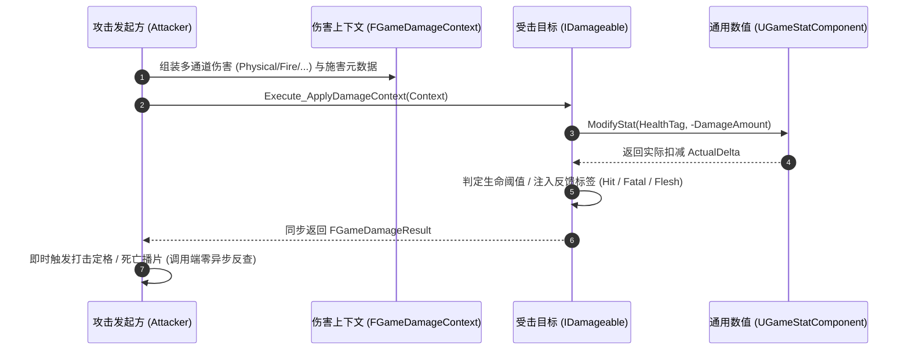

# GameGameplayCore

> **一句话**：零 GameplayAbilities 强依赖的通用战斗契约层，提供伤害管线、Tag 驱动数值、生命状态机与 Buff 运行时。
> **版本** v2.1.0 · **引擎** UE 5.1~5.8 · **层级** Level 1 · **直接依赖** GameCore、GamePool、GameLogging

## 30 秒速览

- **解决什么问题**：把「谁挨打、掉多少血、何时死亡、挂什么状态」从 GAS 和具体玩法中拆出来，供 GAS 角色、原生 Pawn、可破坏物与 ECS / MassEntity 共用同一套契约。
- **核心能力**
  - 同步闭环伤害：`FGameDamageContext` 多通道输入，`FGameDamageResult` 同步返回实际伤害、主导通道、反馈标签与动态参数。
  - 通用数值：`UGameStatComponent` 按 `GameplayTag` 注册任意属性，支持修正器、订阅回放与网络复制。
  - 生命状态机：`UGameVitalComponent` 独立管理存活判定、致死与复活。
  - Buff 运行时：`UGameBuffComponent` 用 `FGameBuffSpec` 描述叠层、时长与属性修正。
- **什么时候用**：需要不依赖 GAS 的战斗数值底座，或要让原生 Pawn、场景物件、ECS 单位接入统一受击契约。
- **什么时候不用**：需要 GAS 属性集、GameplayEffect、ExecCalc 或 GameplayCue 时，使用 [GameGameplay](../GameGameplay/README.md)；只需要打击表现时使用 [GameFeedback](../GameFeedback/README.md)。

## 快速开始

模块依赖（`MyGame.Build.cs`）：

```csharp
PublicDependencyModuleNames.AddRange(new string[] {
    "Core", "CoreUObject", "Engine", "GameplayTags", "GameCore", "GameGameplayCore",
});
```

受击方实现 `IDamageable`，在 `BeginPlay` 注册属性并绑定生命状态机（节选自 [QuickStart](Docs/Guides/QuickStart.md)）：

```cpp
void ADummyTarget::BeginPlay()
{
    Super::BeginPlay();

    const FGameplayTag HealthTag = FGameplayTag::RequestGameplayTag(TEXT("Attribute.Health"));
    StatComponent->RegisterStat(HealthTag, 100.0f, 100.0f, 0.0f);
    VitalComponent->BindStatComponent(StatComponent);
    VitalComponent->SetPrimaryVitalTag(HealthTag);
}
```

攻击方组装上下文并同步取回结果：

```cpp
FGameDamageContext Context;
Context.Instigator = GetInstigator();
Context.DamageCauser = this;
Context.AddChannelDamage(FGameplayTag::RequestGameplayTag(TEXT("Damage.Physical")), 35.0f);

const FGameDamageResult Result = IDamageable::Execute_ApplyDamageContext(TargetActor, Context);
const float HitStop = Result.GetDynamicValue(FGameplayTag::RequestGameplayTag(TEXT("Damage.Feedback.HitStop")));
```

## 核心能力

### 同步闭环伤害管线

- `FGameDamageContext` 承载 GameplayTag 多通道伤害，以及攻击者、施害者与命中点元信息。
- `FGameDamageResult` 即时返回各通道实际伤害、总通道伤害、主导通道、`FeedbackTags` 与 `DynamicValues`，调用端无需异步反查。
- `IDamageable` 蓝图可调用、C++ 可继承，攻击端不感知受击方的具体类型。
- 命中、致死等反馈标签由受击方就地判定并写入结果，攻击方直接据此驱动表现。

### 通用数值组件

- 自持属性表与 $O(1)$ 标签索引并自动网络复制；非权威端默认拒绝写入（`bAllowNonAuthoritativeWrites = false`），公开写入口防御 `NaN/±Inf`。
- `AddStatModifier` / `UpdateStatModifier` / `RemoveStatModifier` / `ClearStatModifiers` 提供完整 `K2_*` 蓝图门面，`FGameStatModifierHandle` 以 64 位强类型代际句柄防 ABA。
- `FScopedModifierBatch` 以 RAII 合并同一属性的多次增删改，退出作用域时按终态差分广播一次；演算为单趟双轴 + 4 槽内联零堆分配。
- `SubscribeStatChanged` 订阅即回放当前有效值，`TSharedRef` 保活配合 `CreateWeakLambda` 弱绑定，回调内退订或中途销毁不失效；入池静默清空修正器并回满基础值。

### 生命与存活状态机

- `UGameVitalComponent` 承载主生命标签绑定、`IsVitalAlive` 存活判定、致死判定与 `ReviveVital` 复活。
- `BeginPlay` 自动发现宿主数值组件；CDO 预配置的主生命标签会补齐订阅。
- `BindStatComponent(nullptr)` 可显式关闭自动重绑；网络复制幂等去重，入池静默重置。

### 通用 Buff 运行时

- 框架不预置具体 Buff，`FGameBuffSpec` 由 `GameplayTag` 自由描述；叠层策略包含刷新时长、累加时长与独立实例。
- `HasGrantedTag` 零拷贝查询状态，`ClearAllBuffs` 批量清理，属性修正器原子挂接：满层刷新免重建，叠层/扣层原地更新。
- 服务端权威，`ActiveBuffs` 以 FastArray 增量复制，`PreReplicatedRemove` 当帧关停 Tick。
- 客户端基于 `TSortedVectorMap<FGameFastTagKey, int32, 8>` 做零堆分配整型二分差分。

### 错误码与子域日志

- `Core/GameplayCoreErrorCodes.h` 统一归属 `Game::ModuleId::Gameplay`（`11001~11006`）。
- 模块主分类 `LogGameGameplayCore`，另有编译期直轨子域 `LogGameStat` / `LogGameVital` / `LogGameBuff`；高频操作降级 `Verbose`，权限拒绝使用限频 `Warning`。

## 架构与依赖

| 项 | 内容 |
| :--- | :--- |
| 公开依赖 | `Core`、`CoreUObject`、`Engine`、`GameplayTags`、`GameCore`、`GamePool`、`NetCore` |
| 私有依赖 | `GameLogging` |
| 禁止依赖 | `GameplayAbilities`、`GameGameplay`、`GameData`、`GameNetCore`、`GameNetService` |
| C++ 标准 | C++20 |

- 定位为 Level 1 战斗契约层：向上被 `GameGameplay` 绑定，向下只依赖 `GameCore` / `GamePool`，可离线独立运行。
- 三个核心组件均实现 `IGamePoolable`，可随宿主 Actor 一起进出对象池。
- 数值写入集中在 `UGameStatComponent`，生命状态集中在 `UGameVitalComponent`，Buff 状态集中在 `UGameBuffComponent`，三者通过标签与委托协作而非互相持有业务知识。

<details>
<summary><b>展开伤害管线时序图</b></summary>



</details>

<details>
<summary><b>展开目录结构</b></summary>

```text
Plugins/GameGameplayCore/
├── Source/
│   └── GameGameplayCore/
│       ├── Public/
│       │   ├── GameGameplayCore.h
│       │   ├── Core/
│       │   │   ├── GameplayCoreErrorCodes.h        # 强类型模块错误码契约 (ModuleId::Gameplay)
│       │   │   └── FGameFastTagKey.h               # 进程内 FastLess 整型排序 Tag 键
│       │   ├── Damage/
│       │   │   ├── FGameDamageChannel.h            # 伤害通道定义与切片辅助算法
│       │   │   ├── FGameDamageContext.h            # 伤害分发输入上下文
│       │   │   ├── FGameDamageResult.h             # 打击反馈同步契约（Tag驱动）
│       │   │   └── IDamageable.h                   # 可受击泛型接口
│       │   ├── Stat/
│       │   │   ├── FGameStatTypes.h                # 数值数据契约、FGameStatModifierHandle 与委托
│       │   │   ├── FGameStatModifierContainer.h    # 内联修正器容器、单趟双轴演算与代际防 ABA
│       │   │   ├── FGameStatSubscriptionHub.h      # 重入安全按 Tag 订阅中心
│       │   │   ├── FGameStatAcknowledgedDiff.h     # 复制差分去重器 (TSortedVectorMap + FastLess)
│       │   │   ├── UGameStatComponent.h            # 通用数值管理组件 (IGamePoolable)
│       │   │   └── UGameVitalComponent.h           # 生命与生死状态组件 (IGamePoolable)
│       │   └── Buff/
│       │       ├── FGameBuffTypes.h                # Buff 数据契约与委托
│       │       ├── FGameBuffInstance.h             # FastArray 独立 Buff 实例条目
│       │       ├── FGameActiveBuffArray.h          # FastArray 增量复制容器
│       │       ├── FGameBuffModifierBridge.h       # 原子修正器挂接与回滚桥接器
│       │       └── UGameBuffComponent.h            # 通用 Buff / 状态核心组件 (IGamePoolable)
│       ├── Private/
│       │   ├── GameGameplayCore.cpp
│       │   ├── GameGameplayCoreLog.h               # 子域日志分类 (LogGameStat/Vital/Buff) 与直轨宏
│       │   ├── Stat/                               # 数值组件、修正器容器、订阅中心与差分实现
│       │   ├── Buff/                               # Buff 组件、FastArray 与修正器桥接实现
│       │   └── Tests/                              # 单测、测试桩与 12 项微基准套件
│       └── GameGameplayCore.Build.cs
├── Docs/                                     # 详细技术文档库
├── GameGameplayCore.uplugin
└── README.md
```

</details>

## 性能与边界

<details>
<summary><b>展开性能基准（历史 Development 构建参考值）</b></summary>

实测基线：Apple Silicon macOS / UE 5.8 Development，2 轮预热 + 7 轮正式采样。

| 微基准用例 | 覆盖热路径 | 实测中位数 (ns/op) | 吞吐 (Mops/s) | CV% |
|---|---|---:|---:|---:|
| `StatLookup` | 64 属性基础查询 | 2.1 | 473.85 | 8.99% |
| `StatModifierEvaluation` | 内联 4 槽复合修正器链钳制演算 | 3.2 | 309.08 | 0.06% |
| `StatEffectivePercent` | 单次查表 + 单趟双轴派生百分比 | 4.8 | 209.51 | 1.80% |
| `BuffGrantedTagsQuery` | 6 活跃 Buff 零拷贝 `HasGrantedTag` | 9.4 | 106.48 | 0.50% |
| `AcknowledgedDiff` | 8 键 `TSortedVectorMap + FastLess` 复制差分 | 91.8 | 10.90 | 3.26% |
| `BuffRefreshWithStat` | 满层 Buff 刷新免重建 + 有效值读取 | 96.9 | 10.32 | 1.45% |
| `StatModifyAndBroadcast` | `ModifyStat` + 按 Tag 弱绑定广播 | 119.5 | 8.37 | 0.66% |
| `BuffReplicatedDiff` | 6 条目客户端 FastArray 零堆分配差分 | 132.8 | 7.53 | 0.37% |
| `BuffStackAndTick` | Buff 施加 + 推进 + 自然过期 | 264.6 | 3.78 | 2.57% |
| `DamageDispatch` | `IDamageable::Execute_ApplyDamageContext` 同步派发 | 265.4 | 3.77 | 1.29% |
| `VitalStateTransition` | 扣血致死 + `ReviveVital` 状态机闭环 | 364.9 | 2.74 | 2.69% |
| `PoolableReset` | `Stat + Buff + Vital` 三组件静默入池与出库 | 1050.1 | 0.95 | 0.53% |

</details>

- **网络**：属性写入受权威校验，非权威端默认拒绝；修正器是本地派生层，不参与复制，客户端由 Buff / 装备状态重建。
- **线程**：伤害派发、数值修改与订阅回调均按游戏线程调用约定使用。
- **生命周期**：入池时静默清空修正器并回满基础值，不广播业务事件；`PreReplicatedRemove` 当帧关停对应 Buff 的 Tick。
- **依赖边界**：不依赖 `GameplayAbilities` 与网络应用层，可作为纯逻辑层在无 GAS、无长连接的环境使用。
- **性能口径**：以上指标为历史 Development 构建参考值，未纳入 CI 自动复测，不构成 Shipping 性能承诺。

<details>
<summary><b>展开自动化测试清单（54 项）</b></summary>

命令：`UnrealEditor-Cmd <Project.uproject> -ExecCmds="Automation RunTests Game.GameplayCore; Quit" -nullrhi -unattended`

- **伤害管线 (4)**：`ChannelOperations`、`ContextOperations`、`IDamageableContract`、`ResultFeedback`
- **通用数值 (15)**：`RegistrationAndClamping`、`BoundaryClamping`、`SetMaxClamping`、`TaggedSubscription`、`RegisterReplay`、`OwnerBoundSubscription`、`OwnerSubscriptionTargetedReplay`、`UnregisterSubscriptionCleanup`、`SubscriptionReentrancy`、`ModifierContainerDirect`、`ModifierStack`、`AcknowledgedDiff`、`Replication`、`DefensiveBranches`、`FullApiCoverage`
- **生命与存活 (6)**：`LifecycleAndRevive`、`RepAliveDeduplication`、`RepAliveForwardBroadcast`、`ActorLifecycle`、`CdoTagSubscription`、`TagSwitchAndBoundary`
- **Buff (16)**：`StackAndExpire`、`CooldownAsStatus`、`IndependentInstances`、`RemoveStacks`、`InstanceAndQueryCoverage`、`PermanentDurationTransition`、`DefensiveBranches`、`ReentrancyAndUnbind`、`ReplicationCallbacks`、`ReplicatedSpecChange`、`ReplicationEmptyTick`、`ModifierBridge`、`AtomicRefreshNoDeath`、`ModifierLateBinding`、`ModifierRebinding`、`ModifierDestroyRollback`
- **对象池 (1)**：`ComponentLifecycleReset`
- **微基准 (12)**：见上方性能基准表

</details>

## 文档导航

| 分类 | 文档 |
| :--- | :--- |
| 架构 | [架构概述与零业务假设设计](Docs/Architecture/Overview.md) |
| 架构 | [闭环伤害管线机制](Docs/Architecture/DamagePipeline.md) |
| API | [伤害数据类型参考](Docs/API/DamageTypes.md) |
| API | [可受击接口参考](Docs/API/IDamageable.md) |
| API | [通用数值组件 API](Docs/API/GameStatComponent.md) |
| API | [生命与存活状态组件 API](Docs/API/GameVitalComponent.md) |
| API | [通用 Buff 组件 API](Docs/API/BuffComponent.md) |
| 指南 | [快速上手指南](Docs/Guides/QuickStart.md) |
| 指南 | [数值组件实战指南 (Standalone)](Docs/Guides/StandaloneStatGuide.md) |
| 指南 | [Buff 与冷却指南](Docs/Guides/BuffGuide.md) |
