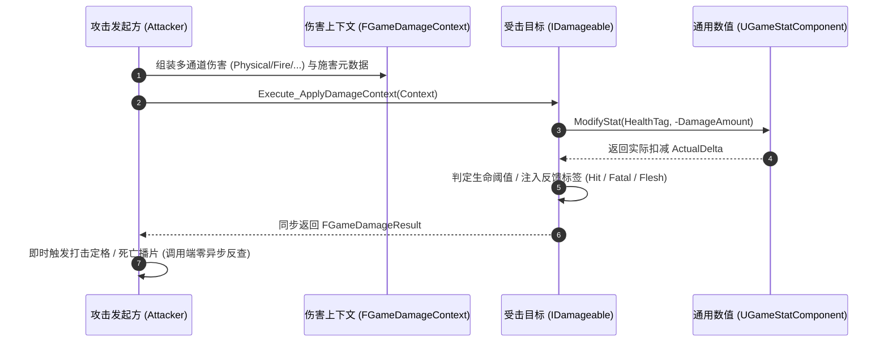

# GameGameplayCore 插件

**GameGameplayCore** 是全项目的通用战斗框架与数值核心层。它实现了**零 GameplayAbilities 强依赖、零具体游戏业务假设**的通用伤害管线契约与通用数值状态管理组件，将攻击发起方、受击处理方与属性系统彻底解耦。无论是传统 GAS 角色、原生 C++ Pawn、蓝图角色、可破坏场景物件，还是基于 ECS / MassEntity 的海量同屏怪物，均能无缝接入统一的战斗分发与属性管理网络。

---

## 战斗管线架构



---

## 核心特性

- **零 GAS 强依赖契约（Zero GameplayAbilities Dependency）**：核心伤害与数值系统不绑定 GAS，保证轻量、极致性能与超强跨项目复用能力。
- **纯粹通用的 Tag 驱动架构（Tag-Driven Architecture）**：
  - 彻底移除命中、致死、暴击、霸体、卡肉等任何具体玩法硬编码；
  - 开发者通过 `GameplayTag` 自由注册与驱动属性（生命、护盾、体力、法力、躯干值等）；
  - 统一通过 `FeedbackTags`（状态标签容器）与 `DynamicValues`（动态参数容器）完成打击反馈。
- **闭环同步打击反馈（Closed-Loop Damage Pipeline）**：
  - 输入上下文 `FGameDamageContext`（支持 GameplayTag 多通道伤害、攻击者/施害者/命中点元信息）。
  - 同步打击反馈 `FGameDamageResult`（即时返回各通道实际伤害、总通道伤害、主导通道、反馈标签与动态参数，调用端零异步反查）。
- **开放的可受击契约 `IDamageable`**：蓝图可调、C++ 可继承的泛型接口，攻击端对受击方具体类型保持完全无知。
- **通用数值管理组件 `UGameStatComponent`**（实现 `IGamePoolable`）：
  - **自持数值模型**：内部维护属性表与 $O(1)$ 标签索引，网络自动同步复制；非权威端默认拒绝写入（`bAllowNonAuthoritativeWrites = false`），公开写入口统一防御 `NaN/±Inf`。
  - **属性修正器与代际句柄**：`AddStatModifier` / `UpdateStatModifier` / `RemoveStatModifier` / `ClearStatModifiers`（提供完整 `K2_*` 蓝图门面与 `FGameStatModifierHandle` 64 位强类型代际句柄防 ABA）；支持 `FScopedModifierBatch` RAII 原子批处理；单趟双轴演算 + 4 槽内联零堆分配。
  - **重入安全按 Tag 订阅**：`SubscribeStatChanged` 订阅即回放当前有效值，底层采用 `TSharedRef` 保活 + `CreateWeakLambda` 弱绑定，免疫回调重入退订/扩容/中途销毁。
  - **纯只读 `BlueprintPure` 查询与静默对象池重置**：查询节点零执行引脚，入池静默清空修正器并回满基础值，杜绝误播业务事件。
- **生命与存活状态机 `UGameVitalComponent`**（实现 `IGamePoolable`）：
  - 遵循 SRP 职责解耦，独立承载主生命标签绑定、存活判定（`IsVitalAlive`）、致死判定与复活（`ReviveVital`）；
  - 支持 `BeginPlay` 自动发现宿主数值组件与 CDO 预配置主生命标签补齐订阅、显式 `BindStatComponent(nullptr)` 防自动重绑、网络复制幂等去重与静默入池重置。
- **通用 Buff / 状态组件 `UGameBuffComponent`**（实现 `IGamePoolable`）：
  - 框架不预置任何具体 Buff，`FGameBuffSpec` 由开发者用 `GameplayTag` 自由描述；
  - 叠层策略（刷新时长 / 累加时长 / 独立实例）、持续时长、零拷贝 `HasGrantedTag` 状态查询、`ClearAllBuffs` 批量清理与原子属性修正器挂接（满层刷新免重建，叠层/扣层原地更新零掉血误杀）；
  - 服务端权威，`ActiveBuffs` 以 FastArray 增量复制，`PreReplicatedRemove` 当帧关停 Tick，客户端基于 `GameCore::TSortedVectorMap<FGameFastTagKey, int32, 8>` 实现零堆分配整型快速二分差分。
- **统一强类型错误码与子域分级日志**：
  - `Core/GameplayCoreErrorCodes.h` 统一归属 `Game::ModuleId::Gameplay`（`11001~11006`）；
  - 接入 `GameLogging`，模块主分类 `LogGameGameplayCore` + 编译期直轨子域分类 `LogGameStat` / `LogGameVital` / `LogGameBuff`，高频操作降级 `Verbose`，高频权限拒绝采用限频 `Warning`。

---

## 插件依赖

- **公开依赖 (Public)**：`Core`, `CoreUObject`, `Engine`, `GameplayTags`, `GameCore`, `GamePool`, `NetCore`
- **私有依赖 (Private)**：`GameLogging`
- **外部依赖限制**：严格禁止依赖 `GameplayAbilities`、`GameGameplay`、`GameData`，以及应用层长连接网络库（`GameNetCore`、`GameNetService`），保持其作为战斗底层契约层的独立性与 100% 离线立即可用性。
- **C++ 标准**：C++20

---

## 目录结构

```text
Plugins/GameGameplayCore/
├── Source/
│   └── GameGameplayCore/
│       ├── Public/
│       │   ├── GameGameplayCore.h
│       │   ├── Core/
│       │   │   ├── GameplayCoreErrorCodes.h        # 强类型模块错误码契约 (ModuleId::Gameplay)
│       │   │   └── FGameFastTagKey.h               # 进程内 FastLess 整型排序 Tag 键
│       │   ├── Damage/
│       │   │   ├── FGameDamageChannel.h            # 伤害通道定义与切片辅助算法
│       │   │   ├── FGameDamageContext.h            # 伤害分发输入上下文
│       │   │   ├── FGameDamageResult.h             # 打击反馈同步契约（Tag驱动）
│       │   │   └── IDamageable.h                   # 可受击泛型接口
│       │   ├── Stat/
│       │   │   ├── FGameStatTypes.h                # 数值数据契约、FGameStatModifierHandle 与委托
│       │   │   ├── FGameStatModifierContainer.h    # 内联修正器容器、单趟双轴演算与代际防 ABA
│       │   │   ├── FGameStatSubscriptionHub.h      # 重入安全按 Tag 订阅中心
│       │   │   ├── FGameStatAcknowledgedDiff.h     # 复制差分去重器 (TSortedVectorMap + FastLess)
│       │   │   ├── UGameStatComponent.h            # 通用数值管理组件 (IGamePoolable)
│       │   │   └── UGameVitalComponent.h           # 生命与生死状态组件 (IGamePoolable)
│       │   └── Buff/
│       │       ├── FGameBuffTypes.h                # Buff 数据契约与委托
│       │       ├── FGameBuffInstance.h             # FastArray 独立 Buff 实例条目
│       │       ├── FGameActiveBuffArray.h          # FastArray 增量复制容器
│       │       ├── FGameBuffModifierBridge.h       # 原子修正器挂接与回滚桥接器
│       │       └── UGameBuffComponent.h            # 通用 Buff / 状态核心组件 (IGamePoolable)
│       ├── Private/
│       │   ├── GameGameplayCore.cpp
│       │   ├── GameGameplayCoreLog.h               # 子域日志分类 (LogGameStat/Vital/Buff) 与直轨宏
│       │   ├── Stat/
│       │   │   ├── FGameStatAcknowledgedDiff.cpp
│       │   │   ├── FGameStatModifierContainer.cpp
│       │   │   ├── FGameStatSubscriptionHub.cpp
│       │   │   ├── UGameStatComponent.cpp
│       │   │   └── UGameVitalComponent.cpp
│       │   ├── Buff/
│       │   │   ├── FGameActiveBuffArray.cpp
│       │   │   ├── FGameBuffModifierBridge.cpp
│       │   │   └── UGameBuffComponent.cpp
│       │   └── Tests/
│       │       ├── GameGameplayCoreTestUtils.h         # 共享测试世界与 RAII 宿主守卫
│       │       ├── UGameGameplayCoreTestReceiver.h     # 蓝图动态多播委托私有测试接收器
│       │       ├── UGameDamageTestTarget.h/.cpp        # 私有 IDamageable 测试受击桩
│       │       ├── UGameDamageDefaultTestTarget.h      # 私有 IDamageable 默认实现测试桩
│       │       ├── FGameDamageChannelTest.cpp
│       │       ├── FGameDamageContextTest.cpp
│       │       ├── FGameDamageResultTest.cpp
│       │       ├── FIDamageableTest.cpp
│       │       ├── FGameStatAcknowledgedDiffTest.cpp
│       │       ├── FGameStatModifierContainerTest.cpp
│       │       ├── FGameStatSubscriptionHubTest.cpp
│       │       ├── UGameStatComponentTest.cpp
│       │       ├── UGameVitalComponentTest.cpp
│       │       ├── FGameActiveBuffArrayTest.cpp
│       │       ├── FGameBuffModifierBridgeTest.cpp
│       │       ├── UGameBuffComponentTest.cpp
│       │       ├── FGamePoolableComponentsTest.cpp
│       │       └── GameGameplayCorePerformanceTest.cpp # 全组件 12 项热路径微基准套件
│       └── GameGameplayCore.Build.cs
├── Docs/                                     # 详细技术文档库
├── GameGameplayCore.uplugin
└── README.md
```

---

## 自动化测试与微基准性能套件

插件包含完整的自动化测试集（**共 54 项**，其中功能与回归单测 42 项 + 全组件微基准 12 项），可在虚幻编辑器 Test Automation 窗口过滤 `Game.GameplayCore` 执行，或通过命令行运行：

```bash
UnrealEditor-Cmd <Project.uproject> -ExecCmds="Automation RunTests Game.GameplayCore; Quit" -nullrhi -unattended
```

### 功能与回归测试（42 项）
- **伤害管线 (`Damage`，4 项)**：`ChannelOperations`、`ContextOperations`、`IDamageableContract`、`ResultFeedback`
- **通用数值 (`Stat`，15 项)**：`RegistrationAndClamping`、`BoundaryClamping`、`SetMaxClamping`、`TaggedSubscription`、`RegisterReplay`、`OwnerBoundSubscription`、`OwnerSubscriptionTargetedReplay`、`UnregisterSubscriptionCleanup`、`SubscriptionReentrancy`、`ModifierContainerDirect`、`ModifierStack`、`AcknowledgedDiff`、`Replication`、`DefensiveBranches`、`FullApiCoverage`（注：`EffectiveEvaluator` 已合并归位至 `ModifierContainerDirect`）
- **生命与存活状态机 (`Vital`，6 项)**：`LifecycleAndRevive`、`RepAliveDeduplication`、`RepAliveForwardBroadcast`、`ActorLifecycle`、`CdoTagSubscription`、`TagSwitchAndBoundary`
- **通用状态与 Buff (`Buff`，16 项)**：`StackAndExpire`、`CooldownAsStatus`、`IndependentInstances`、`RemoveStacks`、`InstanceAndQueryCoverage`、`PermanentDurationTransition`、`DefensiveBranches`、`ReentrancyAndUnbind`、`ReplicationCallbacks`、`ReplicatedSpecChange`、`ReplicationEmptyTick`、`ModifierBridge`、`AtomicRefreshNoDeath`、`ModifierLateBinding`、`ModifierRebinding`、`ModifierDestroyRollback`
- **对象池生命周期 (`Poolable`，1 项)**：`ComponentLifecycleReset`

### 热路径微基准性能套件（`Game.GameplayCore.Perf.*`，12 项）

实测基线（Apple Silicon macOS / UE 5.8 Development，2 轮预热 + 7 轮正式采样）：

| 微基准用例 | 覆盖热路径 | 实测中位数 (ns/op) | 吞吐 (Mops/s) | CV% |
|---|---|---:|---:|---:|
| `StatLookup` | 64 属性基础查询 | 2.1 | 473.85 | 8.99% |
| `StatModifierEvaluation` | 内联 4 槽复合修正器链钳制演算 | 3.2 | 309.08 | 0.06% |
| `StatEffectivePercent` | 单次查表 + 单趟双轴派生百分比 | 4.8 | 209.51 | 1.80% |
| `BuffGrantedTagsQuery` | 6 活跃 Buff 零拷贝 `HasGrantedTag` | 9.4 | 106.48 | 0.50% |
| `AcknowledgedDiff` | 8 键 `TSortedVectorMap + FastLess` 复制差分 | 91.8 | 10.90 | 3.26% |
| `BuffRefreshWithStat` | 满层 Buff 刷新免重建 + 有效值读取 | 96.9 | 10.32 | 1.45% |
| `StatModifyAndBroadcast` | `ModifyStat` + 按 Tag 弱绑定广播 | 119.5 | 8.37 | 0.66% |
| `BuffReplicatedDiff` | 6 条目客户端 FastArray 零堆分配差分 | 132.8 | 7.53 | 0.37% |
| `BuffStackAndTick` | Buff 施加 + 推进 + 自然过期 | 264.6 | 3.78 | 2.57% |
| `DamageDispatch` | `IDamageable::Execute_ApplyDamageContext` 同步派发 | 265.4 | 3.77 | 1.29% |
| `VitalStateTransition` | 扣血致死 + `ReviveVital` 状态机闭环 | 364.9 | 2.74 | 2.69% |
| `PoolableReset` | `Stat + Buff + Vital` 三组件静默入池与出库 | 1050.1 | 0.95 | 0.53% |

---

## 文档导航

- **架构设计 (Architecture)**
  - [架构概述与零业务假设设计哲学](Docs/Architecture/Overview.md)
  - [闭环伤害管线机制](Docs/Architecture/DamagePipeline.md)
- **接口参考 (API Reference)**
  - [伤害数据类型参考](Docs/API/DamageTypes.md)
  - [可受击接口参考](Docs/API/IDamageable.md)
  - [通用数值组件 API](Docs/API/GameStatComponent.md)
  - [生命与存活状态组件 API](Docs/API/GameVitalComponent.md)
  - [通用 Buff 组件 API](Docs/API/BuffComponent.md)
- **使用指南 (Guides)**
  - [快速上手指南](Docs/Guides/QuickStart.md)
  - [数值组件实战指南 (Standalone)](Docs/Guides/StandaloneStatGuide.md)
  - [Buff 与冷却指南](Docs/Guides/BuffGuide.md)
