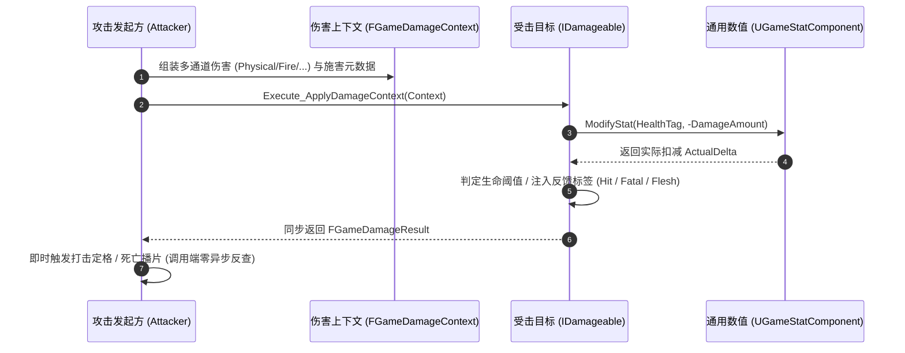

# GameGameplayCore 插件

**GameGameplayCore** 是全项目的通用战斗框架与数值核心层。它实现了**零 GameplayAbilities 强依赖、零具体游戏业务假设**的通用伤害管线契约与通用数值状态管理组件，将攻击发起方、受击处理方与属性系统彻底解耦。无论是传统 GAS 角色、原生 C++ Pawn、蓝图角色、可破坏场景物件，还是基于 ECS / MassEntity 的海量同屏怪物，均能无缝接入统一的战斗分发与属性管理网络。

---

## 战斗管线架构



---

## 核心特性

- **零 GAS 强依赖契约（Zero GameplayAbilities Dependency）**：核心伤害与数值系统不绑定 GAS，保证轻量、极致性能与超强跨项目复用能力。
- **纯粹通用的 Tag 驱动架构（Tag-Driven Architecture）**：
  - 彻底移除命中、致死、暴击、霸体、卡肉等任何具体玩法硬编码；
  - 开发者通过 `GameplayTag` 自由注册与驱动属性（生命、护盾、体力、法力、躯干值等）；
  - 统一通过 `FeedbackTags`（状态标签容器）与 `DynamicValues`（动态参数容器）完成打击反馈。
- **闭环同步打击反馈（Closed-Loop Damage Pipeline）**：
  - 输入上下文 `FGameDamageContext`（支持 GameplayTag 多通道伤害、攻击者/施害者/命中点元信息）。
  - 同步打击反馈 `FGameDamageResult`（即时返回各通道实际伤害、反馈标签与动态参数，调用端零异步反查）。
- **开放的可受击契约 `IDamageable`**：蓝图可调、C++ 可继承的泛型接口，攻击端对受击方具体类型保持完全无知。
- **通用数值管理组件 `UGameStatComponent`**：
  - **自持数值模型**：内部维护属性字典，网络自动同步复制，开箱即用；非权威端默认拒绝写入。
  - **属性修正器与派生数值**：`AddStatModifier` / `RemoveStatModifier` / `ClearStatModifiers`，支持加算、乘算、覆写；`GetStatEffectiveCurrent/Max/Percent` 读取叠加后的派生值。
  - **按 Tag 订阅**：`SubscribeStatChanged` 订阅时立即回放当前值，UI 无初始空白。
  - **动静双轨多播委托**：同时支持蓝图动态委托与 C++ 原生弱引用 Lambda 委托。
- **生命与存活状态机 `UGameVitalComponent`**：
  - 遵循 SRP 职责解耦，独立承载主生命标签绑定、存活判定（`IsVitalAlive`）、致死判定与复活（`ReviveVital`）；
  - 自动与 `UGameStatComponent` 协同，网络复制支持幂等去重，提供双轨生死状态变更广播。
- **通用 Buff / 状态组件 `UGameBuffComponent`**：
  - 框架不预置任何具体 Buff，`FGameBuffSpec` 由开发者用 `GameplayTag` 自由描述；
  - 叠层策略（刷新时长 / 累加时长 / 独立实例）、持续时长、状态标签聚合与属性修正器挂接；
  - 冷却即「带状态标签与持续时长的 Buff」，无需独立硬编码类；
  - 服务端权威，`ActiveBuffs` 以 FastArray 增量复制，客户端在复制回调中重建修正器映射；非 GAS 项目直接使用。

---

## 插件依赖

- **依赖项**：`Core`, `CoreUObject`, `Engine`, `GameplayTags`, `GameCore`, `NetCore`, `GameLogging`
- **外部依赖限制**：严格禁止依赖 `GameplayAbilities`、`GameGameplay`、`GameData`，保持其作为战斗底层契约层的独立性。
- **C++ 标准**：C++20

---

## 快速上手

### 1. 为目标 Actor 添加 `UGameStatComponent`、`UGameVitalComponent` 并实现 `IDamageable`

```cpp
#include "Damage/IDamageable.h"
#include "Stat/UGameStatComponent.h"
#include "Stat/UGameVitalComponent.h"
#include "GameplayTagsManager.h"

UCLASS()
class ACombatDummy : public AActor, public IDamageable {
    GENERATED_BODY()

public:
    ACombatDummy() {
        StatComp = CreateDefaultSubobject<UGameStatComponent>(TEXT("StatComp"));
        VitalComp = CreateDefaultSubobject<UGameVitalComponent>(TEXT("VitalComp"));
        VitalComp->BindStatComponent(StatComp);

        // 开发者自由注册所需属性（如生命、护盾）
        const FGameplayTag HealthTag = FGameplayTag::RequestGameplayTag(TEXT("Attribute.Health"));
        StatComp->RegisterStat(HealthTag, 200.0f, 200.0f, 0.0f);
        VitalComp->SetPrimaryVitalTag(HealthTag);
    }

    FGameDamageResult ApplyDamageContext_Implementation(const FGameDamageContext& Context) override {
        const FGameplayTag HealthTag = FGameplayTag::RequestGameplayTag(TEXT("Attribute.Health"));
        const float DamageAmount = Context.GetChannelDamage(FGameplayTag::RequestGameplayTag(TEXT("Damage")));
        
        float ActualDelta = 0.0f;
        StatComp->ModifyStat(HealthTag, -DamageAmount, ActualDelta);

        FGameDamageResult Result;
        Result.SetActualDamage(FMath::Abs(ActualDelta));
        
        // 开发者自由注入反馈标签与动态数值（命中、致死、材质表现等全 Tag 驱动）
        Result.AddFeedbackTag(FGameplayTag::RequestGameplayTag(TEXT("Damage.Feedback.Hit")));
        if (!VitalComp->IsVitalAlive()) {
            Result.AddFeedbackTag(FGameplayTag::RequestGameplayTag(TEXT("Damage.Feedback.Fatal")));
        }
        Result.AddFeedbackTag(FGameplayTag::RequestGameplayTag(TEXT("Damage.Feedback.HitReaction.Flesh")));
        Result.SetDynamicValue(FGameplayTag::RequestGameplayTag(TEXT("Damage.Feedback.HitStop")), 0.05f);
        return Result;
    }

private:
    UPROPERTY(VisibleAnywhere)
    TObjectPtr<UGameStatComponent> StatComp;

    UPROPERTY(VisibleAnywhere)
    TObjectPtr<UGameVitalComponent> VitalComp;
};
```

### 2. 攻击者发起伤害分发并同步获取反馈
```cpp
// 构造伤害上下文
FGameDamageContext Context;
Context.Instigator = AttackerActor;
Context.DamageCauser = WeaponActor;
Context.AddChannelDamage(FGameplayTag::RequestGameplayTag(TEXT("Damage.Physical")), 50.0f);

// 只要目标实现了 IDamageable，即可一行代码分发并同步获得反馈
if (TargetActor && TargetActor->Implements<UDamageable>()) {
    FGameDamageResult Result = IDamageable::Execute_ApplyDamageContext(TargetActor, Context);

    if (Result.HasFeedbackTag(FGameplayTag::RequestGameplayTag(TEXT("Damage.Feedback.Fatal")))) {
        GAME_LOG(Log, TEXT("Target killed! Trigger kill camera."));
    }
}
```

---

## 目录结构

```text
Plugins/GameGameplayCore/
├── Source/
│   └── GameGameplayCore/
│       ├── Public/
│       │   ├── GameGameplayCore.h
│       │   ├── Damage/
│       │   │   ├── FGameDamageContext.h      # 伤害分发输入上下文
│       │   │   ├── FGameDamageResult.h       # 打击反馈同步契约（Tag驱动）
│       │   │   ├── FGameDamageChannel.h      # 伤害通道定义
│       │   │   └── IDamageable.h             # 可受击泛型接口
│       │   ├── Stat/
│       │   │   ├── FGameStatTypes.h                  # 数值数据契约与枚举
│       │   │   ├── FGameStatModifierContainer.h      # 修正器容器与演算
│       │   │   ├── FGameStatSubscriptionHub.h        # 按 Tag 订阅中心
│       │   │   ├── FGameStatEffectiveEvaluator.h     # 有效值演算统一入口
│       │   │   ├── FGameStatAcknowledgedDiff.h       # 复制差分去重
│       │   │   ├── UGameStatComponent.h              # 通用数值管理组件
│       │   │   └── UGameVitalComponent.h             # 生命与生死状态组件
│       │   ├── Buff/
│       │   │   ├── FGameBuffTypes.h                  # Buff 数据契约
│       │   │   ├── FGameActiveBuffArray.h            # FastArray 增量复制容器
│       │   │   ├── FGameBuffModifierBridge.h         # 修正器挂接与回滚桥接
│       │   │   └── UGameBuffComponent.h              # 通用 Buff / 状态核心组件
│       │   └── Tests/
│       │       └── GameDamageTestTarget.h            # 测试用受击目标
│       ├── Private/
│       │   ├── GameGameplayCore.cpp
│       │   ├── Stat/
│       │   │   ├── FGameStatEffectiveEvaluator.cpp
│       │   │   ├── FGameStatAcknowledgedDiff.cpp
│       │   │   ├── FGameStatModifierContainer.cpp
│       │   │   ├── FGameStatSubscriptionHub.cpp
│       │   │   ├── UGameStatComponent.cpp
│       │   │   └── UGameVitalComponent.cpp
│       │   ├── Buff/
│       │   │   ├── FGameActiveBuffArray.cpp
│       │   │   ├── FGameBuffModifierBridge.cpp
│       │   │   └── UGameBuffComponent.cpp
│       │   └── Tests/
│       │       ├── FGameDamageChannelTest.cpp
│       │       ├── FGameDamageContextTest.cpp
│       │       ├── FGameDamageResultTest.cpp
│       │       ├── FIDamageableTest.cpp
│       │       ├── GameDamageTestTarget.cpp
│       │       ├── FGameStatEffectiveEvaluatorTest.cpp
│       │       ├── FGameStatAcknowledgedDiffTest.cpp
│       │       ├── FGameStatModifierContainerTest.cpp
│       │       ├── FGameStatSubscriptionHubTest.cpp
│       │       ├── UGameStatComponentTest.cpp
│       │       ├── UGameVitalComponentTest.cpp
│       │       ├── UGameStatPerformanceTest.cpp
│       │       ├── FGameBuffModifierBridgeTest.cpp
│       │       ├── FGameActiveBuffArrayTest.cpp
│       │       └── UGameBuffComponentTest.cpp
│       └── GameGameplayCore.Build.cs
├── Docs/                                     # 详细技术文档库
│   ├── Architecture/                         # 核心架构设计
│   │   ├── Overview.md
│   │   └── DamagePipeline.md
│   ├── API/                                  # 核心类与接口 API
│   │   ├── DamageTypes.md
│   │   ├── IDamageable.md
│   │   ├── GameStatComponent.md
│   │   ├── GameVitalComponent.md
│   │   └── BuffComponent.md
│   └── Guides/                               # 实践指南
│       ├── QuickStart.md
│       ├── StandaloneStatGuide.md
│       └── BuffGuide.md
├── GameGameplayCore.uplugin
└── README.md
```

---

## 自动化测试

插件包含完整的自动化测试集（Automation Tests，共 37 项），可在虚幻编辑器 Test Automation 窗口中过滤 `Game.GameplayCore` 执行，或通过命令行运行：

```bash
UnrealEditor-Cmd <Project.uproject> -ExecCmds="Automation RunTests Game.GameplayCore; Quit" -nullrhi -unattended
```

测试集涵盖：
- **伤害管线 (Damage，共 4 项)**：
  - `Game.GameplayCore.Damage.ChannelOperations`：伤害通道增删查、精确匹配、GameplayTag 层级继承求和与可变指针修改
  - `Game.GameplayCore.Damage.ContextOperations`：伤害上下文通道设置、通道累加、总基础伤害汇总与特质标签注入
  - `Game.GameplayCore.Damage.IDamageableContract`：受击接口 C++ 反射契约调用、同步反馈回传与默认空实现回退
  - `Game.GameplayCore.Damage.ResultFeedback`：反馈标签增删查、动态数值参数注入、实际通道数值读取与主通道推断（正/负值通道）
- **通用数值 (Stat，共 13 项)**：
  - `Game.GameplayCore.Stat.RegistrationAndClamping`：多属性动态注册、加减数值 Min/Max 自动钳制与实际变动差值验证
  - `Game.GameplayCore.Stat.BoundaryClamping`：极值越界防御与 Clamp 边界一致性
  - `Game.GameplayCore.Stat.SetMaxClamping`：上限调整（等比缩放 / 绝对截断）时当前值与下限钳制不变式
  - `Game.GameplayCore.Stat.TaggedSubscription`：按 Tag 订阅、订阅即回放当前值、退订后不再回调
  - `Game.GameplayCore.Stat.RegisterReplay`：未注册属性先订阅，注册时立即以初始值回放，修正器变化继续触发
  - `Game.GameplayCore.Stat.OwnerBoundSubscription`：绑定 UObject Owner 生命周期的弱引用订阅与失效自动回收
  - `Game.GameplayCore.Stat.OwnerSubscriptionTargetedReplay`：新订阅者专属初始值回放，不扰动既有订阅者
  - `Game.GameplayCore.Stat.ModifierStack`：加算 / 乘算 / 覆写叠加、句柄精确移除与派生值计算
  - `Game.GameplayCore.Stat.EffectiveEvaluator`：底层有效值纯函数演算器测试
  - `Game.GameplayCore.Stat.AcknowledgedDiff`：网络复制差分计算与客户端变更去重
  - `Game.GameplayCore.Stat.Replication`：OnRep 属性全量重构、索引映射表同步、委托差分分发与去重
  - `Game.GameplayCore.Stat.DefensiveBranches`：无效 Tag 拒绝、零增量忽略、未注册属性防御及非权威端写门禁拦截
  - `Game.GameplayCore.Stat.FullApiCoverage`：组件全 API 边界覆盖
- **生命与存活状态机 (Vital，共 5 项)**：
  - `Game.GameplayCore.Vital.LifecycleAndRevive`：主生命属性绑定、存活判定、致死跃迁、动态广播与百分比复活
  - `Game.GameplayCore.Vital.RepAliveDeduplication`：网络复制存活状态到达与属性复制到达客户端的幂等去重验证
  - `Game.GameplayCore.Vital.RepAliveForwardBroadcast`：客户端仅网络复制布尔到达时的纯转发广播触发与重复去重
  - `Game.GameplayCore.Vital.ActorLifecycle`：真实 Actor 挂接生命周期、BeginPlay 自动解析数值组件与 EndPlay 安全解绑
  - `Game.GameplayCore.Vital.TagSwitchAndBoundary`：动态切换主生命标签、清除主生命标签恢复默认态与复活极值边界校验
- **通用状态与 Buff (Buff，共 14 项)**：
  - `Game.GameplayCore.Buff.StackAndExpire`：叠层策略、持续时长到期移除与授予标签回收
  - `Game.GameplayCore.Buff.IndependentInstances`：独立实例策略生命周期与 MaxStacks 堆叠上限拒绝校验
  - `Game.GameplayCore.Buff.RemoveStacks`：逐层削减 Buff 层数与归零自动清理
  - `Game.GameplayCore.Buff.CooldownAsStatus`：冷却以 Buff 承载，激活期间授予状态标签并挂接属性修正
  - `Game.GameplayCore.Buff.ReplicationCallbacks`：FastArray 真实网络复制容器的增 / 改 / 删回调、修正器重建与事件分发
  - `Game.GameplayCore.Buff.DefensiveBranches`：无效标签拦截、非法层数截断、非权威端写操作拦截与模拟端本地计时器自适应停用
  - `Game.GameplayCore.Buff.InstanceAndQueryCoverage`：实例查询与标签覆盖
  - `Game.GameplayCore.Buff.PermanentDurationTransition`：永久 Buff 持续时间转换
  - `Game.GameplayCore.Buff.ReplicatedSpecChange`：网络复制规格同步
  - `Game.GameplayCore.Buff.ReplicationEmptyTick`：空 FastArray 复制防抖 Tick
  - `Game.GameplayCore.Buff.ModifierBridge`：修正器桥接容器、多层加算/乘算/覆写缩放与 ClearAll 批量回滚
  - `Game.GameplayCore.Buff.ModifierLateBinding`：晚绑定修正器挂接
  - `Game.GameplayCore.Buff.ModifierRebinding`：重绑定修正器挂接
  - `Game.GameplayCore.Buff.ModifierDestroyRollback`：销毁时修正器精确回滚
- **性能基准 (Perf，共 1 项)**：
  - `Game.GameplayCore.Perf.StatLookup`：高频属性查询与内存开销性能基准

---

## 文档导航

所有完整文档已按职责分类收录于 `Docs/` 目录中：

- **架构设计 (Architecture)**
  - [架构概述与零业务假设设计哲学](Docs/Architecture/Overview.md)：阐述为何将战斗核心从具体玩法中剥离，以及 Tag 驱动的多实体适配模式。
  - [闭环伤害管线机制](Docs/Architecture/DamagePipeline.md)：解析从发起伤害、标签继承匹配到同步打击反馈的完整闭环流程。
- **接口参考 (API Reference)**
  - [伤害数据类型参考](Docs/API/DamageTypes.md)：`FGameDamageContext`、`FGameDamageResult`、`FGameDamageChannel` 详解。
  - [可受击接口参考](Docs/API/IDamageable.md)：`IDamageable` / `UDamageable` 蓝图与 C++ 调用契约。
  - [通用数值组件 API](Docs/API/GameStatComponent.md)：`UGameStatComponent` 属性注册、网络复制、修正器与按 Tag 订阅。
  - [生命与存活状态组件 API](Docs/API/GameVitalComponent.md)：`UGameVitalComponent` 主生命绑定、存活判定、双轨事件广播与复活机制。
  - [通用 Buff 组件 API](Docs/API/BuffComponent.md)：`UGameBuffComponent`、`FGameBuffSpec`、叠层策略与修正器挂接。
- **使用指南 (Guides)**
  - [快速上手指南](Docs/Guides/QuickStart.md)：为场景角色添加属性与受击支持。
  - [数值组件实战指南 (Standalone)](Docs/Guides/StandaloneStatGuide.md)：用于普通怪物、机关、木桩的纯组件方案。
  - [Buff 与冷却指南](Docs/Guides/BuffGuide.md)：任意 Buff 注册、叠层、持续时长与冷却即状态。
