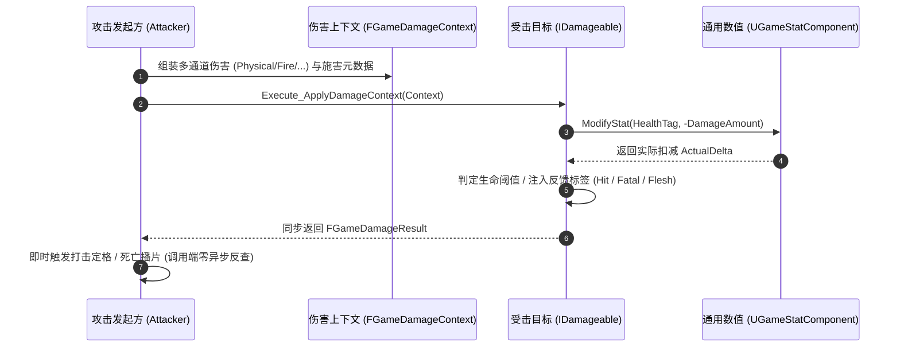

# GameGameplayCore 插件

**GameGameplayCore** 是全项目的通用战斗框架与数值核心层。它实现了**零 GameplayAbilities 强依赖、零具体游戏业务假设**的通用伤害管线契约与通用数值状态管理组件，将攻击发起方、受击处理方与属性系统彻底解耦。无论是传统 GAS 角色、原生 C++ Pawn、蓝图角色、可破坏场景物件，还是基于 ECS / MassEntity 的海量同屏怪物，均能无缝接入统一的战斗分发与属性管理网络。

---

## 战斗管线架构



---

## 核心特性

- **零 GAS 强依赖契约（Zero GameplayAbilities Dependency）**：核心伤害与数值系统不绑定 GAS，保证轻量、极致性能与超强跨项目复用能力。
- **纯粹通用的 Tag 驱动架构（Tag-Driven Architecture）**：
  - 彻底移除命中、致死、暴击、霸体、卡肉等任何具体玩法硬编码；
  - 开发者通过 `GameplayTag` 自由注册与驱动属性（生命、护盾、体力、法力、躯干值等）；
  - 统一通过 `FeedbackTags`（状态标签容器）与 `DynamicValues`（动态参数容器）完成打击反馈。
- **闭环同步打击反馈（Closed-Loop Damage Pipeline）**：
  - 输入上下文 `FGameDamageContext`（支持 GameplayTag 多通道伤害、攻击者/施害者/命中点元信息）。
  - 同步打击反馈 `FGameDamageResult`（即时返回各通道实际伤害、反馈标签与动态参数，调用端零异步反查）。
- **开放的可受击契约 `IDamageable`**：蓝图可调、C++ 可继承的泛型接口，攻击端对受击方具体类型保持完全无知。
- **通用数值管理组件 `UGameStatComponent`**：
  - **Standalone 自持模式**：内部维护属性字典，网络自动同步复制，开箱即用。
  - **Proxy 代理模式**：无缝接入 `IGameStatValueSource`（蓝图接口）或 `FGameStatQueryDelegate`（高性能 C++ 原生委托），桥接 GAS AttributeSet 或外部数值系统；写入必须显式绑定 `FGameStatWriteDelegate`，杜绝本地缓存与外部源读写撕裂。
  - **属性修正器与派生数值**：`AddStatModifier` / `RemoveStatModifier` / `ClearStatModifiers`，支持加算、乘算、覆写；`GetStatEffectiveCurrent/Max/Percent` 读取叠加后的派生值。
  - **按 Tag 订阅**：`SubscribeStatChanged` 订阅时立即回放当前值，UI 无初始空白。
  - **动静双轨多播委托**：同时支持蓝图动态委托与 C++ 原生弱引用 Lambda 委托。
- **通用 Buff / 状态组件 `UGameBuffComponent`**：
  - 框架不预置任何具体 Buff，`FGameBuffSpec` 由开发者用 `GameplayTag` 自由描述；
  - 叠层策略（刷新时长 / 累加时长 / 独立实例）、持续时长、状态标签聚合与属性修正器挂接；
  - 冷却即「带状态标签与持续时长的 Buff」，无需独立硬编码类；
  - 服务端权威，`ActiveBuffs` 以 FastArray 增量复制，客户端在复制回调中重建修正器映射；非 GAS 项目直接使用。

---

## 插件依赖

- **依赖项**：`Core`, `CoreUObject`, `Engine`, `GameplayTags`, `GameCore`, `NetCore`, `GameLogging`
- **外部依赖限制**：严格禁止依赖 `GameplayAbilities`、`GameGameplay`、`GameData`，保持其作为战斗底层契约层的独立性。
- **C++ 标准**：C++20

---

## 快速上手

### 1. 为目标 Actor 添加 `UGameStatComponent` 并实现 `IDamageable`

```cpp
#include "Damage/IDamageable.h"
#include "Stat/UGameStatComponent.h"
#include "GameplayTagsManager.h"

UCLASS()
class ACombatDummy : public AActor, public IDamageable {
    GENERATED_BODY()

public:
    ACombatDummy() {
        StatComp = CreateDefaultSubobject<UGameStatComponent>(TEXT("StatComp"));

        // 开发者自由注册所需属性（如生命、护盾）
        const FGameplayTag HealthTag = FGameplayTag::RequestGameplayTag(TEXT("Attribute.Health"));
        StatComp->RegisterStat(HealthTag, 200.0f, 200.0f, 0.0f);
        StatComp->SetPrimaryVitalTag(HealthTag);
    }

    FGameDamageResult ApplyDamageContext_Implementation(const FGameDamageContext& Context) override {
        const FGameplayTag HealthTag = FGameplayTag::RequestGameplayTag(TEXT("Attribute.Health"));
        const float DamageAmount = Context.GetChannelDamage(FGameplayTag::RequestGameplayTag(TEXT("Damage")));
        
        float ActualDelta = 0.0f;
        StatComp->ModifyStat(HealthTag, -DamageAmount, ActualDelta);

        FGameDamageResult Result;
        Result.SetActualDamage(FMath::Abs(ActualDelta));
        
        // 开发者自由注入反馈标签与动态数值（命中、致死、材质表现等全 Tag 驱动）
        Result.AddFeedbackTag(FGameplayTag::RequestGameplayTag(TEXT("Damage.Feedback.Hit")));
        if (!StatComp->IsVitalAlive()) {
            Result.AddFeedbackTag(FGameplayTag::RequestGameplayTag(TEXT("Damage.Feedback.Fatal")));
        }
        Result.AddFeedbackTag(FGameplayTag::RequestGameplayTag(TEXT("Damage.Feedback.HitReaction.Flesh")));
        Result.SetDynamicValue(FGameplayTag::RequestGameplayTag(TEXT("Damage.Feedback.HitStop")), 0.05f);
        return Result;
    }

private:
    UPROPERTY(VisibleAnywhere)
    TObjectPtr<UGameStatComponent> StatComp;
};
```

### 2. 攻击者发起伤害分发并同步获取反馈
```cpp
// 构造伤害上下文
FGameDamageContext Context;
Context.Instigator = AttackerActor;
Context.DamageCauser = WeaponActor;
Context.AddChannelDamage(FGameplayTag::RequestGameplayTag(TEXT("Damage.Physical")), 50.0f);

// 只要目标实现了 IDamageable，即可一行代码分发并同步获得反馈
if (TargetActor && TargetActor->Implements<UDamageable>()) {
    FGameDamageResult Result = IDamageable::Execute_ApplyDamageContext(TargetActor, Context);

    if (Result.HasFeedbackTag(FGameplayTag::RequestGameplayTag(TEXT("Damage.Feedback.Fatal")))) {
        GAME_LOG(Log, TEXT("Target killed! Trigger kill camera."));
    }
}
```

---

## 目录结构

```text
Plugins/GameGameplayCore/
├── Source/
│   └── GameGameplayCore/
│       ├── Public/
│       │   ├── GameGameplayCore.h
│       │   └── Combat/
│       │       ├── FGameDamageContext.h      # 伤害分发输入上下文
│       │       ├── FGameDamageResult.h       # 打击反馈同步契约（Tag驱动）
│       │       ├── IDamageable.h             # 可受击泛型接口
│       │       ├── IGameStatValueSource.h    # 泛型数值源代理契约
│       │       ├── UGameBuffComponent.h      # 通用 Buff / 状态核心组件
│       │       └── UGameStatComponent.h      # 通用数值管理组件
│       ├── Private/
│       │   ├── GameGameplayCore.cpp
│       │   ├── Combat/
│       │   │   ├── UGameBuffComponent.cpp
│       │   │   └── UGameStatComponent.cpp
│       │   └── Tests/
│       │       ├── UGameBuffComponentTest.cpp
│       │       └── UGameStatComponentTest.cpp
│       └── GameGameplayCore.Build.cs
├── Docs/                                     # 详细技术文档库
│   ├── Architecture/                         # 核心架构设计
│   │   ├── Overview.md
│   │   └── DamagePipeline.md
│   ├── API/                                  # 核心类与接口 API
│   │   ├── DamageTypes.md
│   │   ├── IDamageable.md
│   │   ├── GameStatComponent.md
│   │   └── BuffComponent.md
│   └── Guides/                               # 实践指南
│       ├── QuickStart.md
│       ├── StandaloneStatGuide.md
│       ├── ProxyStatGuide.md
│       └── BuffGuide.md
├── GameGameplayCore.uplugin
└── README.md
```

---

## 自动化测试

插件包含完整的自动化测试集（Automation Tests），可在虚幻编辑器 Test Automation 窗口中过滤 `Game.GameplayCore` 执行，或通过命令行运行：

```bash
UnrealEditor-Cmd <Project.uproject> -ExecCmds="Automation RunTests Game.GameplayCore; Quit" -nullrhi -unattended
```

测试集涵盖：
- `Game.GameplayCore.Damage.ResultFeedback`：反馈标签增删查、动态数值参数注入与默认值测试
- `Game.GameplayCore.Stat.RegistrationAndClamping`：多属性动态注册、加减数值 Min/Max 自动钳制与实际变动差值验证
- `Game.GameplayCore.Stat.PrimaryVital`：主生命属性耗尽致死判定、委托广播与显式恢复
- `Game.GameplayCore.Stat.ProxyReviveAndVital`：未本地注册属性的代理写、死亡广播与比例复活验证
- `Game.GameplayCore.Stat.ProxyMode`：外部数据源代理旁路、原生委托透明查询、解绑自持安全回退与数值缓存
- `Game.GameplayCore.Stat.ProxyWriteContract`：代理写委托转发、未绑定写委托时拒绝写入、写入后回读一致
- `Game.GameplayCore.Stat.TaggedSubscription`：按 Tag 订阅、订阅即回放当前值、退订后不再回调
- `Game.GameplayCore.Stat.RegisterReplay`：未注册属性先订阅，注册时立即以初始值回放，修正器变化继续触发
- `Game.GameplayCore.Stat.ModifierStack`：加算 / 乘算 / 覆写叠加、句柄精确移除与派生值计算
- `Game.GameplayCore.Buff.StackAndExpire`：叠层策略、持续时长到期移除与授予标签回收
- `Game.GameplayCore.Buff.IndependentInstances`：独立实例策略生命周期与 MaxStacks 堆叠上限拒绝校验
- `Game.GameplayCore.Buff.RemoveStacks`：逐层削减 Buff 层数与归零自动清理
- `Game.GameplayCore.Buff.CooldownAsStatus`：冷却以 Buff 承载，激活期间授予状态标签并挂接属性修正
- `Game.GameplayCore.Buff.ReplicationCallbacks`：FastArray 增 / 改 / 删回调重建修正器并分发事件

---

## 文档导航

所有完整文档已按职责分类收录于 `Docs/` 目录中：

- **架构设计 (Architecture)**
  - [架构概述与零业务假设设计哲学](Docs/Architecture/Overview.md)：阐述为何将战斗核心从具体玩法中剥离，以及 Tag 驱动的多实体适配模式。
  - [闭环伤害管线机制](Docs/Architecture/DamagePipeline.md)：解析从发起伤害、标签继承匹配到同步打击反馈的完整闭环流程。
- **接口参考 (API Reference)**
  - [伤害数据类型参考](Docs/API/DamageTypes.md)：`FGameDamageContext`、`FGameDamageResult`、`FGameDamageChannel` 详解。
  - [可受击接口参考](Docs/API/IDamageable.md)：`IDamageable` / `UDamageable` 蓝图与 C++ 调用契约。
  - [通用数值组件 API](Docs/API/GameStatComponent.md)：`UGameStatComponent` 属性注册、网络复制、数值代理、修正器与按 Tag 订阅。
  - [通用 Buff 组件 API](Docs/API/BuffComponent.md)：`UGameBuffComponent`、`FGameBuffSpec`、叠层策略与修正器挂接。
- **使用指南 (Guides)**
  - [快速上手指南](Docs/Guides/QuickStart.md)：为场景角色添加属性与受击支持。
  - [自持模式实战指南 (Standalone)](Docs/Guides/StandaloneStatGuide.md)：用于普通怪物、机关、木桩的纯组件方案。
  - [代理模式接入指南 (Proxy)](Docs/Guides/ProxyStatGuide.md)：用于桥接 GAS 或外部属性数据源。
  - [Buff 与冷却指南](Docs/Guides/BuffGuide.md)：任意 Buff 注册、叠层、持续时长与冷却即状态。
