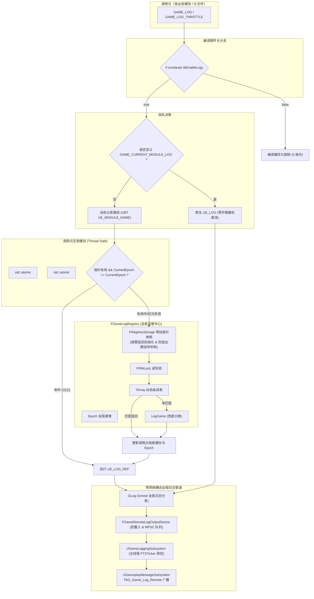

# GameLogging 架构设计与分发机制

## 1. 概述与核心目标

在大型 Unreal Engine 项目中，传统的日志管理面临几个显著痛点：
1. **模块日志分散定义**：每个模块需要重复声明 `DECLARE_LOG_CATEGORY_EXTERN` 和 `DEFINE_LOG_CATEGORY`，并在各头文件中重复引入。
2. **缺乏统一调用门面**：业务代码在各处直接调用 `UE_LOG(LogX, ...)`，导致难以集中做日志开关控制、频率限制和日志统计。
3. **静态初始化时序依赖**：在引擎启动或模块加载初期，静态变量初始化顺序无法严格保证，过早打印日志可能访问未初始化的分类指针导致 Crash 或 Fallback 分类被永久缓存。
4. **高频 Tick 刷屏**：在复杂物理、AI 或网络同步的 Tick 中打印日志易造成控制台/磁盘 I/O 阻塞，拖垮帧率。
5. **跨网络集中上报困难**：传统日志直接流入控制台和磁盘，若需要将日志上报到远端分析集群，若日志模块直接依赖网络库则造成严重的模块双向循环依赖。

**GameLogging** 设计了**双轨分发架构**、**纪元安全（Epoch-Safe）局部缓存机制**与**零耦合远程日志管道**，在保障绝对线程安全的同时达成极限性能。

---

## 2. 总体架构图



---

## 3. 核心机制详解

### 3.1 零开销编译期开关 (`constexpr` 编译分支)
所有日志宏最外层均被包裹在：
```cpp
if constexpr (::Game::Config::bEnableLog)
{
    // 日志展开体
}
```
当项目构建为 Shipping 模式且 `GAME_ENABLE_LOG == 0` 时，`bEnableLog` 在编译期为 `false`。C++20 的 `if constexpr` 保证编译器直接死代码消除（Dead Code Elimination），不仅不生成任何函数调用和跳转指令，连日志内的格式化字符串也完全不会被编入二进制中，有效节省包体和内存。

### 3.2 编译期优先与动态分发双轨制
1. **静态硬直连**：若头文件或源文件显式声明了 `#define GAME_CURRENT_MODULE_LOG LogMyModule`，宏直接调用 `UE_LOG(GAME_CURRENT_MODULE_LOG, ...)`。
2. **动态按模块分发**：在未定义该宏的大部分代码中，系统通过 Unreal Build Tool 自动注入的 `UE_MODULE_NAME`（当前模块名常量字符串）进行定位。

### 3.3 局部原子指针与纪元轮转缓存 (Epoch-safe Cache)
为了避免每次 `GAME_LOG` 调用都去查哈希表或加全局读写锁，宏在每个调用点（即每一行宏展开处）声明了两个 `static std::atomic`：
```cpp
static std::atomic<::FLogCategoryBase*> UEPrivateCachedLogCat{nullptr};
static std::atomic<int32> UEPrivateCachedEpoch{-1};
```
- **热路径（Fast Path）**：局部指针非空且纪元未变时无需加锁；全局 Epoch 与缓存 Epoch 各执行一次 `memory_order_acquire` 读，再执行一次分类指针 `memory_order_relaxed` 读。
- **纪元失效（Epoch Invalidation）**：若在某个模块静态初始化期间调用了日志，此时该模块的专属分类尚未完成注册，该调用点会暂时获得 `GetFallbackCategory()`（即 `LogGame`）。
  当任意模块后续执行 `RegisterCategory`（产生实际分类变更）或 `UnregisterCategory` 时，全局 `Epoch` 原子自增；若重复注册完全相同的分类则幂等短路返回，不推进 `Epoch`，杜绝无谓的全局缓存击穿。
  调用点检测到 `LogCatPtr == nullptr || CachedEpoch != CurrentEpoch` 时，会重新向注册表解析当前模块分类并刷新缓存，彻底根除早期调用导致的“永久降级”与模块卸载后悬挂指针两类缺陷。

### 3.4 常驻单例根除启动 SIOF 与退出期逆序析构
- 注册表状态由内部私有结构体 `FRegistryStorage` 统一收拢，通过 `FRegistryStorage::Get()`（常驻指针单例按需延迟初始化）管理；
- 彻底解决跨编译单元全局静态对象构造时序不确定（Static Initialization Order Fiasco）导致的死锁或崩溃：即便外部模块的静态变量在 `GameLogCategories.cpp` 全局数据段之前执行构造并注册分类或打日志，内部读写锁与存储容器也能在首次调用瞬间安全初始化；
- **全生命周期存活**：常驻单例避免了进程退出阶段 C++ 运行时逆序析构导致的 Use-After-Destruction 崩溃，确保晚期析构与退出回调日志 100% 安全；
- 注册表采用 `TArray<FModuleLogEntry>` 动态容量，模块名深拷贝持有；不再有固定 128 条目上限与触顶报错，新增模块直接扩容。

### 3.5 负哨兵时间戳实现限频日志首触即打
- `GAME_LOG_THROTTLE` 调用点局部静态时间戳赋初值为负哨兵 `-1.0e9`：
  ```cpp
  static std::atomic<double> UEPrivateLastLogTime{-1.0e9};
  ```
- 确保无论启动初期系统时钟多小，首次触达时必定满足 `CurrentSeconds - LastSeconds >= SecondsInterval`，实现 100% 首触即打；同时通过 CAS 原子竞争保证多线程无锁并发更新。

### 3.6 零耦合远程日志管道 (Remote Logging Pipeline)
- **零网络依赖架构**：`GameLogging` 不引入任何网络传输依赖，纯净依靠 `GameplayMessageSubsystem` 事件总线解耦；
- **重入防范**：`FGameRemoteLogOutputDevice` 使用 `thread_local bool bTlsIsLogging` 守卫，避免捕获设备在序列化日志时触发间接日志输出造成无限递归死锁；
- **级别与黑名单动态过滤**：入口处通过原子读取 `MinVerbosity` 快速跳过低等级日志（默认仅捕获 `Warning` 及以上），并通过 `IgnoredCategories` 读写锁黑名单过滤噪音分类；
- **MPSC 无锁队列缓冲**：采用 `TQueue<FGameRemoteLogEntry, EQueueMode::Mpsc>`，支持多个工作线程安全无锁并发入队；队列设有最大安全容量上限（默认 2048），满队时安全截断并原子统计 `DroppedCount`，避免网络阻塞时内存无限制膨胀；
- **主线程周期排空与广播**：`UGameLoggingSubsystem` 通过 `FTSTicker` 在游戏主线程定时批量排空日志（默认单次最多排空 50 条）并转换为结构化 `FGameRemoteLogEntry`，向 `TAG_Game_Log_Remote`（`"Game.Log.Remote"`）广播，供外部插件（如 `GameNetService`）或自建网关消费。

---

## 4. 线程安全保证

| 操作 | 锁机制 / 并发级别 | 说明 |
| :--- | :--- | :--- |
| **`GAME_LOG` 缓存命中** | 无锁（Epoch 使用 `acquire`，分类指针使用 `relaxed`） | 各线程读取调用点共享原子缓存，无注册表锁竞争 |
| **`FGameLogRegistry::GetCategory`** | 读锁 (`SLT_ReadOnly`) | 仅在缓存未命中或纪元失效时触发，保护存储容器 |
| **`FGameLogRegistry::RegisterCategory`** | 写锁 (`SLT_Write`) | 独占写锁，更新条目并在分类产生实质变更时自增 `Epoch`（幂等重复不推进），触发全局缓存失效 |
| **`GAME_LOG_ONCE` / `CLOG_ONCE`** | TTAS 双重检测无锁 (`relaxed load` + `exchange`) | 触发后只读短路跳过求值与写操作，杜绝多核 CPU 缓存行（Cache Line）写颠簸 |
| **`GAME_LOG_THROTTLE`** | 无锁 (`compare_exchange_strong`) | `std::atomic<double>` 负哨兵初值，CAS 保证并发安全、零锁且首触即打 |
| **`FGameRemoteLogOutputDevice::Serialize`** | MPSC 无锁队列入队 + TLS 重入守卫 | 多线程无锁并发入队，TLS 守卫拦截重入死锁 |
| **`FGameRemoteLogOutputDevice::DrainBatch`** | 单消费者无锁出队（限主线程） | 主线程批量消费取走日志条目，清空耗时近乎瞬时 |
