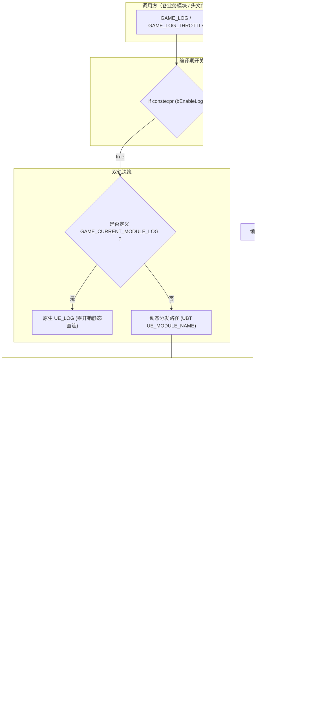

# GameLogging 架构设计与分发机制

## 1. 概述与核心目标

在大型 Unreal Engine 项目中，传统的日志管理面临几个显著痛点：
1. **模块日志分散定义**：每个模块需要重复声明 `DECLARE_LOG_CATEGORY_EXTERN` 和 `DEFINE_LOG_CATEGORY`，并在各头文件中重复引入。
2. **缺乏统一调用门面**：业务代码在各处直接调用 `UE_LOG(LogX, ...)`，导致难以集中做日志开关控制、频率限制和日志统计。
3. **静态初始化时序依赖**：在引擎启动或模块加载初期，静态变量初始化顺序无法严格保证，过早打印日志可能访问未初始化的分类指针导致 Crash 或 Fallback 分类被永久缓存。
4. **高频 Tick 刷屏**：在复杂物理、AI 或网络同步的 Tick 中打印日志易造成控制台/磁盘 I/O 阻塞，拖垮帧率。

**GameLogging** 设计了**双轨分发架构**与**纪元安全（Epoch-Safe）局部缓存机制**，在保障线程安全的同时达成极限性能。

---

## 2. 总体架构图



---

## 3. 核心机制详解

### 3.1 零开销编译期开关 (`constexpr` 编译分支)
所有日志宏最外层均被包裹在：
```cpp
if constexpr (::Game::Config::bEnableLog)
{
    // 日志展开体
}
```
当项目构建为 Shipping 模式且 `GAME_ENABLE_LOG == 0` 时，`bEnableLog` 在编译期为 `false`。C++20 的 `if constexpr` 保证编译器直接死代码消除（Dead Code Elimination），不仅不生成任何函数调用和跳转指令，连日志内的格式化字符串也完全不会被编入二进制中，有效节省包体和内存。

### 3.2 编译期优先与动态分发双轨制
1. **静态硬直连**：若头文件或源文件显式声明了 `#define GAME_CURRENT_MODULE_LOG LogMyModule`，宏直接调用 `UE_LOG(GAME_CURRENT_MODULE_LOG, ...)`。
2. **动态按模块分发**：在未定义该宏的大部分代码中，系统通过 Unreal Build Tool 自动注入的 `UE_MODULE_NAME`（当前模块名常量字符串）进行定位。

### 3.3 局部原子指针与纪元轮转缓存 (Epoch-safe Cache)
为了避免每次 `GAME_LOG` 调用都去查哈希表或加全局读写锁，宏在每个调用点（即每一行宏展开处）声明了两个 `static std::atomic`：
```cpp
static std::atomic<::FLogCategoryBase*> UE_PRIVATE_CachedLogCat{nullptr};
static std::atomic<int32> UE_PRIVATE_CachedEpoch{-1};
```
- **热路径（Fast Path）**：在绝大多数情况下，局部指针已非空且纪元未变，读取仅需两条 `memory_order_relaxed` 的原子加载与比较指令，耗时约为 1~2ns，零锁竞争。
- **纪元失效（Epoch Invalidation）**：若在某个模块静态初始化期间调用了日志，此时该模块的专属分类尚未完成注册，该调用点会暂时获得 `GetFallbackCategory()`（即 `LogGame`）。
  当任意模块后续执行 `RegisterCategory`（含覆写）或 `UnregisterCategory` 时，全局 `Epoch` 原子自增。
  调用点检测到 `LogCatPtr == nullptr || CachedEpoch != CurrentEpoch` 时，会重新向注册表解析当前模块分类并刷新缓存，彻底根除早期调用导致的“永久降级”与模块卸载后悬挂指针两类缺陷。

### 3.4 Meyers' Singleton 根除静态初始化死锁 (SIOF Elimination)
- 注册表状态由内部私有结构体 `FRegistryStorage` 统一收拢，通过 `FRegistryStorage::Get()`（Meyers' Singleton 局部静态对象）按需延迟初始化。
- 彻底解决跨编译单元全局静态对象构造时序不确定（Static Initialization Order Fiasco）导致的死锁或崩溃：即便外部模块的静态变量在 `GameLogCategories.cpp` 全局数据段之前执行构造并注册分类或打日志，内部读写锁与存储容器也能在首次调用瞬间安全初始化。
- 注册表采用 `TArray<FModuleLogEntry>` 动态容量，模块名深拷贝持有；不再有固定 128 条目上限与触顶报错，新增模块直接扩容。

### 3.5 负哨兵时间戳实现限频日志首触即打
- `GAME_LOG_THROTTLE` 调用点局部静态时间戳赋初值为负哨兵 `-1.0e9`：
  ```cpp
  static std::atomic<double> UE_PRIVATE_LastLogTime_{-1.0e9};
  ```
- 确保无论启动初期系统时钟多小，首次触达时必定满足 `CurrentSeconds - LastSeconds >= SecondsInterval`，实现 100% 首触即打；同时通过 CAS 原子竞争保证多线程无锁并发更新。

---

## 4. 线程安全保证

| 操作 | 锁机制 / 并发级别 | 说明 |
| :--- | :--- | :--- |
| **`GAME_LOG` 缓存命中** | 无锁 (`std::memory_order_relaxed`) | 各线程独立读取局部原子变量，零锁竞争 |
| **`FGameLogRegistry::GetCategory`** | 读锁 (`SLT_ReadOnly`) | 仅在缓存未命中或纪元失效时触发，保护存储容器 |
| **`FGameLogRegistry::RegisterCategory`** | 写锁 (`SLT_Write`) | 独占写锁，更新条目并自增 `Epoch`，触发全局缓存失效 |
| **`GAME_LOG_ONCE`** | 无锁 (`exchange`) | `std::atomic<bool>` 确保多线程并发下严格只打印一次 |
| **`GAME_LOG_THROTTLE`** | 无锁 (`compare_exchange_strong`) | `std::atomic<double>` 负哨兵初值，CAS 保证并发安全、零锁且首触即打 |

