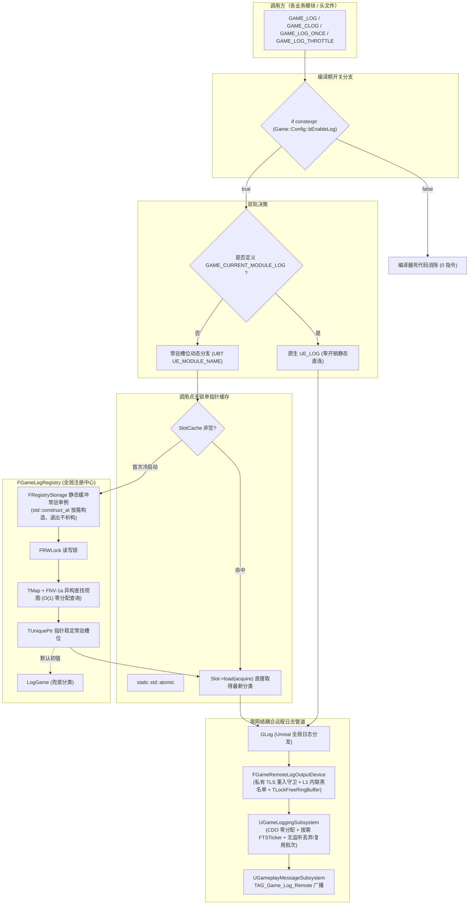

# GameLogging 架构设计与分发机制

## 1. 概述与核心目标

在大型 Unreal Engine 项目中，传统日志方案常见五大痛点：
1. **模块日志分散定义**：每个模块需重复维护 `DECLARE_LOG_CATEGORY_EXTERN` / `DEFINE_LOG_CATEGORY` 并跨头传递。
2. **缺乏统一调用门面**：业务代码直调 `UE_LOG`，难以统一做编译期开关、去重、限频与诊断。
3. **静态初始化时序依赖（SIOF）**：模块加载早期打日志可能遭遇未初始化静态对象或永久缓存 Fallback。
4. **高频 Tick 刷屏与时钟损耗**：高频循环中反复格式化、查时钟或刷盘会直接拖垮帧率。
5. **跨网络集中上报耦合**：日志模块直接引用网络库会引发严重循环依赖。

**GameLogging** 采用**编译期直轨 + 常驻原子槽位动态分发**双轨架构，并配合基于 `GameCore::TLockFreeRingBuffer` 与 `UGameplayMessageSubsystem` 的**零网络耦合远程日志管道**，同时兼顾极致热路径性能与绝对并发安全。

---

## 2. 总体架构图

---

## 3. 核心机制详解

### 3.1 零开销编译期开关 (`if constexpr`)
所有日志宏最外层均包裹 `if constexpr (::Game::Config::bEnableLog)`。关闭日志（如 Shipping 构建 `NO_LOGGING == 1` 且 `GAME_ENABLE_LOG == 0`）时，编译器在保留语法与变量使用检查的前提下彻底剔除日志指令与字面量。

### 3.2 常驻原子槽位无锁动态分发 (Slot-based Lock-free Dispatch)
每个模块在 `FGameLogRegistry` 中对应一个生命周期与进程一致、地址永不移动的 `FModuleLogSlotRecord`（内部持有 `FLogCategorySlot = std::atomic<FLogCategoryBase*>`）。
- **调用点单指针缓存**：每个 `GAME_LOG` 调用点仅需一个 `static std::atomic<const FLogCategorySlot*>`。首次执行时通过 `ResolveCategorySlot(UE_MODULE_NAME)` 取得模块常驻槽位指针并永久缓存（即使多线程并发首次解析，所有线程得到的指针完全相同，零竞态）。
- **热路径零跨 DLL 调用、零撕裂写**：后续每次调用只需 2 次内联原子读（读本地槽位指针 -> 读槽位当前 `FLogCategoryBase*`），无需调用任何外部函数或读写锁，彻底根除双原子缓存的撕裂写隐患。
- **零跨模块误失效**：模块 A 注册、覆写或注销仅原子更新模块 A 的槽位，绝不影响模块 B/C/D 的调用点缓存；同时模块 A 自身的新分类即时生效。

### 3.3 SIOF 免疫常驻单例与 $O(1)$ 零分配哈希检索
- `FRegistryStorage::Get()` 使用静态 `TTypeCompatibleBytes<FRegistryStorage>` + C++20 `std::construct_at` 按需就地初始化且进程退出时不析构，零裸 `new`/`delete`，根除 SIOF 与退出期逆序析构崩溃；
- 映射表使用自定义 `FAnsiNameKeyFuncs` 与单趟 FNV-1a 只读视图 `FAnsiLookupView`，通过 `TMap::FindByHash` 实现区分大小写的 $O(1)$ 零堆分配查询，全程不触碰 `FName`/`GNamePool`（保障静态初始化早期安全）。

### 3.4 抑制前置短路的限频宏 (`GAME_LOG_THROTTLE`)
- 先判定目标分类在给定 `Verbosity` 下是否被抑制；被抑制时直接返回，不调用 `FPlatformTime::Seconds()` 且不修改 `LastLogTime`，消除 Tick 监控日志的时钟损耗并保证运行期开启该级别后立刻首触即打；
- 未抑制时以负哨兵 `-1.0e9` 保证首次输出，并以 CAS 无锁保证多线程并发仅单胜出者输出。

### 3.5 零耦合远程日志管道
- **依赖边界洁净**：`GameMessage` 仅位于 `PrivateDependencyModuleNames`，不向 `GameLogging` 的下游模块传递暴露；零网络插件、零 `GamePool` 依赖。
- **MPMC 零节点分配环形队列**：`FGameRemoteLogOutputDevice` 堆上单次持有 `GameCore::TLockFreeRingBuffer<FGameRemoteLogEntry, 2048>`，逐条入队/出队零节点 `new`/`delete`；入队前经 CAS 预留严格满足软上限 `MaxCapacity`。
- **过滤与防重入**：先执行无锁纯算术 `NoLogging`/`SetColor` 与 `MinVerbosity` 快速拦截（99% 常规日志零 TLS 访问直接返回）；通过阈值后再进入模块私有 `FRemoteLogReentrancyScope` 防重入守卫 -> `FRWLock` 保护的 L1 内联黑名单 -> `acquire`/`release` 内存序配对的 CAS 容量预留 -> 延迟读取 `FPlatformTime::Seconds()`。`Clear()` 同样按 `MAX_CAPACITY` 设界防止持续并发生产下无限自旋。
- **生命周期与卸载安全**：`UGameLoggingSubsystem` 默认构造零堆分配；`Initialize()` 显式调用 `Collection.InitializeDependency<UGameplayMessageSubsystem>()` 保障初始化期消息总线就绪；`Deinitialize()` 停止 `FTSTicker` 与 `GLog` 捕获后调用 `FlushQueue()`（总线仍活跃时自动刷新至监听器，总线先于其卸载时安全丢弃零崩溃）；禁用态自动卸载 `FTSTicker` 零空转。

---

## 4. 线程安全保证

| 操作 | 锁机制 / 并发级别 | 说明 |
| :--- | :--- | :--- |
| **`GAME_LOG` 缓存命中** | 无锁（2 次内联 `acquire` 读） | 零跨 DLL 调用、零锁竞争、零双原子撕裂 |
| **`FGameLogRegistry::GetCategory` / 首次 `ResolveCategorySlot`** | 读锁 (`SLT_ReadOnly`) / 冷启动写锁 (`SLT_Write`) | 仅冷启动单次解析或显式查询触发，$O(1)$ 零分配检索 |
| **`FGameLogRegistry::RegisterCategory` / `UnregisterCategory`** | 写锁 (`SLT_Write`) + 槽位 `release` 存储 | 原子更新目标模块槽位，零跨模块失效 |
| **`GAME_LOG_ONCE` / `GAME_CLOG_ONCE`** | TTAS 无锁（`relaxed load` + `exchange`） | 触发后只读短路跳过条件求值与写操作 |
| **`GAME_LOG_THROTTLE`** | 抑制前置无锁读 + CAS (`compare_exchange_strong`) | 抑制态零时钟/零 CAS，活跃态无锁并发限频 |
| **`FGameRemoteLogOutputDevice::Serialize`** | 私有 TLS 重入守卫 + 原子阈值 + 读锁内联黑名单 + CAS 容量预留 + MPMC 无锁环形缓冲 | 零节点堆分配、严格有界、并发安全 |
| **`FGameRemoteLogOutputDevice::DrainBatch` / `DiscardBatch` / `Clear`** | MPMC 无锁出队 + 合并单次原子扣减 | 均并发安全，无单消费者 UB 风险 |
