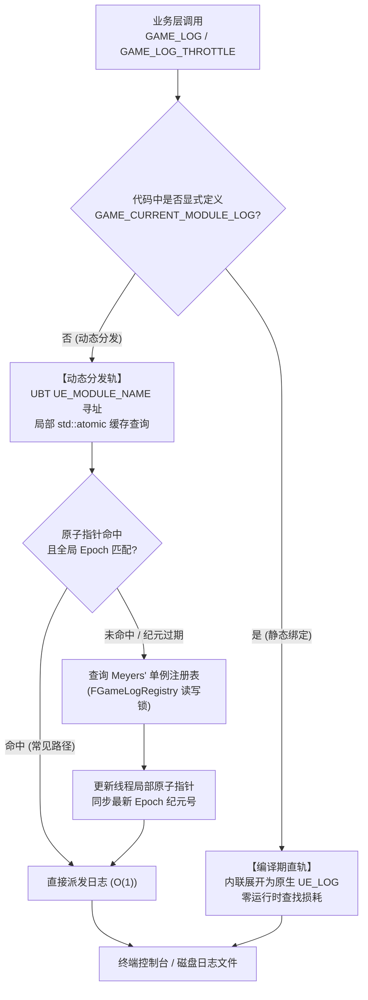

# GameLogging 插件

**GameLogging** 是基于 Unreal Engine 5 的高性能、线程安全全局日志基础设施。它提供了模块级日志分类自动注册、双轨分发架构、无锁缓存访问、单次去重与限频输出机制，并且通过编译期 constexpr 开关实现 Shipping 版本的零运行时开销。

---

## 架构与分发机制



---

## 核心特性

- **模块级日志自动注册**：通过 RAII 与宏体系（`GAME_REGISTER_MODULE_LOG`），模块可在其主源文件中一行代码完成专属日志分类声明与全局登记。
- **SIOF 免疫单例架构（Meyers' Singleton）**：内部存储结构采用局部静态单例按需延迟初始化，彻底根除跨编译单元静态初始化顺序惨案（SIOF），外部全局静态对象早期日志与注册零死锁风险。
- **双轨分发架构（Dual-Track Dispatch）**：
  - **编译期优先（Compile-Time Track）**：显式指定 `GAME_CURRENT_MODULE_LOG` 时，直接内联为原生 `UE_LOG`，零查找开销。
  - **纪元安全动态分发（Epoch-Safe Dynamic Dispatch）**：自动基于 UBT `UE_MODULE_NAME` 与局部 `std::atomic` 指针实现 $O(1)$ 查找，并通过全局纪元号（Epoch）解决静态初始化早期调用导致的 Fallback 永久污染问题。
- **丰富的高级日志宏**：
  - `GAME_LOG`：基础日志输出
  - `GAME_CLOG`：条件日志输出
  - `GAME_LOG_ONCE` / `GAME_CLOG_ONCE`：应用生命周期单次日志（防止循环死循环刷屏）
  - `GAME_LOG_THROTTLE`：毫秒/秒级限频日志（负哨兵初值保证首触即打，CAS 无锁并发更新）
- **零开销编译开关**：联动 `GameCore` 的 `Game::Config::bEnableLog`，在关闭日志（如 Release/Shipping）时直接经 `if constexpr` 分支剔除，不产生任何分支跳转与字符串指令。
- **完备的自动化测试覆盖**：内建自动化测试套件，全面覆盖生命周期、RAII 登记、多线程高并发及动态分发自愈。

---

## 插件依赖

- **底层依赖**：`Core`, `CoreUObject`, `GameCore`
- **引擎版本**：Unreal Engine 5.1 ~ 5.8
- **C++ 标准**：C++20

---

## 快速上手

### 1. 在模块主 cpp 中注册专属日志分类

```cpp
#include "Logging/GameLogCategories.h"

// 声明并注册 LogMyModule 分类
GAME_REGISTER_MODULE_LOG(LogMyModule);
```

### 2. 在业务代码中使用日志

```cpp
#include "Logging/GameLogCategories.h"

void AMyActor::BeginPlay()
{
    Super::BeginPlay();

    // 基础输出（自动分发到 LogMyModule，若未注册则回退至 LogGame）
    GAME_LOG(Log, TEXT("AMyActor initialized."));

    // 单次日志，无论调用多少次只输出首次
    GAME_LOG_ONCE(Warning, TEXT("Resource initialized once."));
}

void AMyActor::Tick(float DeltaTime)
{
    Super::Tick(DeltaTime);

    // 限频输出：首帧立即触发，后续最多每 2.0 秒输出一次，防止 Tick 刷屏
    GAME_LOG_THROTTLE(2.0, Verbose, TEXT("Actor current location: %s"), *GetActorLocation().ToString());
}
```

---

## 目录结构

```text
Plugins/GameLogging/
├── Source/
│   └── GameLogging/
│       ├── Public/
│       │   ├── GameLogging.h
│       │   └── Logging/
│       │       └── GameLogCategories.h   # 核心宏与注册中心声明
│       ├── Private/
│       │   ├── GameLogging.cpp
│       │   ├── Logging/
│       │   │   └── GameLogCategories.cpp # 注册表与 Meyers' 单例实现
│       │   └── Tests/
│       │       └── GameLoggingTest.cpp   # 自动化测试用例（并发/生命周期/纪元）
│       └── GameLogging.Build.cs
├── Docs/                                 # 详细文档库
│   ├── Architecture/                     # 架构设计
│   │   └── Overview.md
│   ├── API/                              # 接口与宏参考
│   │   ├── Macros.md
│   │   └── Registry.md
│   └── Guides/                           # 使用与集成指南
│       ├── QuickStart.md
│       └── BestPractices.md
├── GameLogging.uplugin
└── README.md
```

---

## 自动化测试

插件包含完整的自动化测试集（Automation Tests），可在虚幻编辑器 Test Automation 窗口中过滤 `Game.Logging` 执行，或通过命令行运行：

```bash
UnrealEditor-Cmd <Project.uproject> -ExecCmds="Automation RunTests Game.Logging; Quit" -nullrhi -unattended
```

测试集涵盖：
- `Game.Logging.Registry.Lifecycle`：模块注册、查询、覆写、注销与纪元自增验证
- `Game.Logging.Registry.RegistrarRAII`：RAII 作用域自动登记与析构注销生命周期验证
- `Game.Logging.Macros.Concurrency`：多线程高并发下的 `GAME_LOG`、`GAME_LOG_ONCE` 与 `GAME_LOG_THROTTLE` 竞争安全
- `Game.Logging.Macros.EpochDispatch`：动态分发在模块晚于调用点注册时通过 Epoch 纪元实现缓存自愈
- `Game.Logging.Registry.DynamicCapacity`：注册表动态扩容（超过原固定上限）且模块名深拷贝后临时缓冲区失效仍可查询

---

## 文档导航

所有完整文档已按职责分类收录于 `Docs/` 目录中：

- **架构设计 (Architecture)**
  - [架构概述与分发机制](Docs/Architecture/Overview.md)：深入解析双轨分发、Meyers' Singleton 内存模型、Epoch 纪元轮转缓存以及多线程读写锁模型。
- **接口参考 (API Reference)**
  - [日志宏参考](Docs/API/Macros.md)：`GAME_LOG`、`GAME_CLOG`、`GAME_LOG_ONCE`、`GAME_LOG_THROTTLE` 等所有宏的详细签名与展开逻辑。
  - [注册表 API](Docs/API/Registry.md)：`FGameLogRegistry` 与 `FModuleLogRegistrar` C++ 接口手册。
- **使用指南 (Guides)**
  - [快速上手指南](Docs/Guides/QuickStart.md)：新模块集成与常见日志模式落地步骤。
  - [最佳实践与性能指南](Docs/Guides/BestPractices.md)：防刷屏规范、Tick 日志控制及 Shipping 打包优化。

