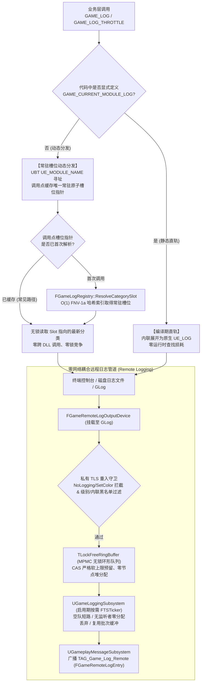

# GameLogging

> **一句话**：模块级日志分类自动注册、编译期直轨与原子槽位双轨分发、单次 / 限频输出，外加一条不耦合网络模块的远程结构化日志管道。
> **版本** v2.1.0 · **引擎** UE 5.1~5.8 · **层级** Level 1 · **直接依赖** GameCore, GameMessage（私有）

## 30 秒速览

- **解决什么问题**：多模块工程的日志分类难统一、每次输出都要查分类的开销、缺少跨调用点的去重与限频、远程日志上报容易与网络模块耦合。
- **核心能力**：
  - `GAME_REGISTER_MODULE_LOG` 一行完成模块专属分类声明与登记；
  - 编译期直轨与常驻原子槽位动态分发两条路径，热路径无跨 DLL 查找；
  - `GAME_LOG` / `GAME_CLOG` / `GAME_LOG_ONCE` / `GAME_CLOG_ONCE` / `GAME_LOG_THROTTLE` 宏族；
  - 关闭日志时经 `if constexpr` 编译期剔除；
  - `FGameRemoteLogOutputDevice` + `UGameLoggingSubsystem` 将日志结构化广播到消息总线。
- **什么时候用**：多模块工程需要统一分类与级别控制、需要单次 / 限频输出、需要把错误日志上报到运维或诊断模块。
- **什么时候不用**：只需本地日志时不订阅 `TAG_Game_Log_Remote` 即可（无监听者时远程管道零分配丢弃）；项目未依赖 GameMessage 的模块无法订阅远程日志事件。

## 快速开始

```csharp
// MyModule.Build.cs
PublicDependencyModuleNames.AddRange(new string[] {
    "Core", "CoreUObject", "GameCore", "GameLogging",
});
```

```cpp
// Private/MyModule.cpp：在模块主源文件顶层注册专属分类
#include "MyModule.h"
#include "Logging/GameLogMacros.h"

GAME_REGISTER_MODULE_LOG(LogMyModule);

void FMyModule::StartupModule() {
    GAME_LOG(Log, TEXT("MyModule started successfully!"));
}

void AMyActor::Tick(float DeltaTime) {
    Super::Tick(DeltaTime);
    GAME_LOG_THROTTLE(2.0, Verbose, TEXT("Actor location: %s"), *GetActorLocation().ToString());
}
```

```text
Log LogMyModule Verbose        # 控制台动态调整分类级别
```

- 头文件选择：仅用宏时包含 `Logging/GameLogMacros.h` 最轻量；需要 `LogGame` 兜底分类时包含 `Logging/GameLogCategories.h`；需要聚合全部日志与远程管道设施时包含 `GameLogging.h`。

## 核心能力

### 模块分类注册
- `FModuleLogRegistrar` 为 RAII 守卫，`GAME_REGISTER_MODULE_LOG` 展开为 `DEFINE_LOG_CATEGORY_STATIC` + 静态登记对象。
- 宏用 `__COUNTER__` 生成唯一符号，避免 Unity Build 下重复定义。
- 注册与析构恢复均为 $O(1)$，且无需拷贝模块名。

### 双轨分发
- 代码中显式定义 `GAME_CURRENT_MODULE_LOG` 时走编译期直轨，内联展开为原生 `UE_LOG`，零运行时查找。
- 否则走常驻槽位动态分发：调用点首次经 `FGameLogRegistry::ResolveCategorySlot` 以 FNV-1a 哈希 $O(1)$ 取得槽位，之后缓存槽位指针直接读取。
- 槽位为进程期地址恒定的原子对象；静态初始化早调用、运行期注册、覆写与注销均原子即时可见。

### 宏族与热路径
- `GAME_LOG` / `GAME_CLOG`：通用与条件模块感知输出。
- `GAME_LOG_ONCE` / `GAME_CLOG_ONCE`：TTAS 无锁单次输出，触发后只读短路；`GAME_CLOG_ONCE` 同时跳过 `Condition` 求值。
- `GAME_LOG_THROTTLE`：抑制级别前置短路，被抑制时不读时钟；未抑制时负哨兵保证首次必打，CAS 并发无锁更新。
- 宏内只保留最小控制流，可复用逻辑收拢为 `Game::Log::Private` 的 `FORCEINLINE` 辅助函数。

### 常驻单例与构建开关
- 内部存储体在静态缓冲区以 C++20 `std::construct_at` 线程安全就地构造、退出期不析构，零裸 `new` / `delete`，规避静态初始化顺序（SIOF）与退出期逆序析构。
- 联动 GameCore 的 `Game::Config::bEnableLog`；关闭时所有 `GAME_LOG*` 分支由 `if constexpr` 编译期剔除。
- `NO_LOGGING` 下 `GAME_REGISTER_MODULE_LOG` 为空实现，宏整体编译移除。

### 远程日志管道
- `FGameRemoteLogOutputDevice` 挂载至 `GLog`，用 `TLockFreeRingBuffer<FGameRemoteLogEntry, 2048>` 做 MPMC 零节点堆分配缓冲。
- 私有 `FRemoteLogReentrancyScope` 阻断重入风暴；拦截 `SetColor` / `NoLogging` 控制消息；延迟读取 `FPlatformTime::Seconds()`；`FRWLock` + `TArray<FName, TInlineAllocator<8>>` 维护黑名单。
- `UGameLoggingSubsystem` 为 `UGameInstanceSubsystem`，CDO 零堆分配；`Initialize` 显式 `InitializeDependency<UGameplayMessageSubsystem>()`，`Deinitialize` 停止采集并刷新或丢弃残留队列。
- 禁用态注销 `FTSTicker` 零空转；无监听者 `DiscardBatch` 零分配丢弃，有监听者复用 `ReusableBatch` 稳态零分配广播 `TAG_Game_Log_Remote`。

## 架构与依赖

- **公开依赖**：`Core`, `CoreUObject`, `Engine`, `GameplayTags`, `GameCore`
- **私有依赖**：`GameMessage`（不向调用方暴露消息总线头文件）
- **网络与对象池依赖**：0（不依赖 `GameNetCore`、`GameNetService`、`GamePool`）
- **关键类**：
  - `FGameLogRegistry` / `FLogCategorySlot`：分类注册表与常驻原子槽位
  - `FModuleLogRegistrar`：RAII 注册与恢复
  - `FGameRemoteLogOutputDevice`：`GLog` 旁路采集、过滤与无锁环形队列
  - `UGameLoggingSubsystem`：远程管道生命周期、按需 Ticker 与广播门面

<details>
<summary><b>展开分发与远程管道流程图</b></summary>



</details>

<details>
<summary><b>展开远程日志订阅示例</b></summary>

```cpp
#include "Message/GameplayMessageSubsystem.h"
#include "Remote/GameRemoteLogTypes.h"

UGameplayMessageSubsystem& MessageSubsystem = UGameplayMessageSubsystem::Get(this);
FGameplayMessageListenerHandle Handle = MessageSubsystem.RegisterListener<FGameRemoteLogEntry>(
    TAG_Game_Log_Remote,
    [](const FGameRemoteLogEntry& Entry) {
        if (Entry.GetVerbosity() <= ELogVerbosity::Error) {
            // 业务处理或转发至网络监控服务
        }
    }
);
```

- 订阅方所在模块需要具备 `GameMessage` 依赖。

</details>

## 性能与边界

- 日志宏与注册表线程安全：槽位原子读取、单次 TTAS、限频 CAS，可从任意线程调用。
- 远程管道默认开启，默认最低级别 `Warning`；每帧排空上限 `DEFAULT_DRAIN_PER_TICK = 50`，队列容量受 `MAX_CAPACITY` 钳制。
- `GLog` 挂载、`FTSTicker` 注册与队列排空在 GameThread 执行；禁用时 Ticker 注销，零空转。
- Shipping 构建 `NO_LOGGING` 默认为 `1`、`Game::Config::bEnableLog` 为 `false`，日志分支被静态裁剪。
- 环形队列按软上限预留，满时写入侧预留失败、不阻塞调用线程；`NoLogging` / `SetColor` 与黑名单分类在入队前拦截。

<details>
<summary>展开性能基准（历史 Development 构建参考值）</summary>

- 性能回归含 6 组基准（`DynamicDispatchVsStaticDirect`、`OnceAndThrottleHotPath`、`RegistryLookupScaling`、`RemoteDeviceFilterAndRingQueue`、`RemoteDeviceMultiThreadThroughput`、`SubsystemEndToEndBroadcast`），以中位数 ns/op 对预算阈值断言。
- 预算阈值：动态分发抑制态 `30 ns/op`、`GAME_CLOG_ONCE` 短路 `20 ns/op`、限频抑制态 `30 ns/op`、200 分类注册表查找 `150 ns/op`、远程过滤 `40 ns/op`、环形队列往返 `600 ns/op`、多线程远程写入 `1500 ns/op`、子系统端到端广播 `2000 ns/op`。
- 上述数值为 CI 断言预算，不是固定实测中位数。

</details>

<details>
<summary><b>展开自动化测试清单（20 组）</b></summary>

```bash
UnrealEditor-Cmd <Project.uproject> -ExecCmds="Automation RunTests Game.Logging; Quit" -nullrhi -unattended
```

- **Registry (3)**：`Game.Logging.Registry.Lifecycle` · `RegistrarRAII` · `DynamicCapacityAndConcurrency`
- **Macros (3)**：`Game.Logging.Macros.Concurrency` · `SemanticsAndSafety` · `SlotDispatch`
- **RemoteTypes (1)**：`Game.Logging.RemoteTypes.EntryContractAndTag`
- **RemoteOutputDevice (3)**：`Game.Logging.RemoteOutputDevice.FilteringAndCapacity` · `ConcurrencyAndReentrancy` · `BatchAtomicDrain`
- **Subsystem (4)**：`Game.Logging.Subsystem.LifecycleAndFacade` · `NoListenerAndDeinitializeFlush` · `FeedbackLoopAndReentrantFlushGuard` · `TickerDrainAndDisableZeroSpin`
- **Performance Benchmarks (6)**：`Game.Logging.Perf.DynamicDispatchVsStaticDirect` · `OnceAndThrottleHotPath` · `RegistryLookupScaling` · `RemoteDeviceFilterAndRingQueue` · `RemoteDeviceMultiThreadThroughput` · `SubsystemEndToEndBroadcast`

</details>

## 文档导航

| 文档 | 内容 |
| :--- | :--- |
| [架构概述与分发机制](Docs/Architecture/Overview.md) | 双轨分发、槽位注册与远程管道时序 |
| [日志宏参考](Docs/API/Macros.md) | `GAME_LOG*` 宏语义、去重与限频行为 |
| [注册表 API](Docs/API/Registry.md) | 分类注册、RAII 守卫与槽位解析 |
| [远程日志管道 API](Docs/API/RemoteLogging.md) | 输出设备、子系统门面与日志条目契约 |
| [快速上手指南](Docs/Guides/QuickStart.md) | 依赖配置到远程订阅的五步接入 |
| [最佳实践与性能指南](Docs/Guides/BestPractices.md) | Shipping 零开销控制与调优建议 |

<details>
<summary><b>展开源码目录</b></summary>

```text
Plugins/GameLogging/
├── Source/
│   └── GameLogging/
│       ├── Public/
│       │   ├── GameLogging.h                      # 全量公共接口聚合门面头
│       │   ├── Logging/
│       │   │   ├── FGameLogRegistry.h             # 全局日志注册中心与常驻原子槽位声明
│       │   │   ├── FModuleLogRegistrar.h          # RAII 模块日志自动注册守卫声明
│       │   │   ├── GameLogCategories.h            # LogGame 兜底分类声明与宏透传
│       │   │   └── GameLogMacros.h                # 核心日志宏与内联分发/去重/限频辅助
│       │   └── Remote/
│       │       ├── GameRemoteLogTypes.h           # FGameRemoteLogEntry 与 TAG_Game_Log_Remote
│       │       ├── GameRemoteLogOutputDevice.h    # 基于 TLockFreeRingBuffer 的远程输出设备
│       │       └── GameLoggingSubsystem.h         # GameInstance 常驻子系统与统一门面
│       ├── Private/
│       │   ├── GameLogging.cpp
│       │   ├── Logging/
│       │   │   ├── FModuleLogSlotRecord.h         # 私有常驻槽位内部记录结构
│       │   │   ├── FGameLogRegistry.cpp           # FNV-1a 哈希索引与常驻单例实现
│       │   │   ├── FModuleLogRegistrar.cpp        # RAII O(1) 注册/恢复实现
│       │   │   └── GameLogCategories.cpp          # LogGame 分类定义
│       │   ├── Remote/
│       │   │   ├── FRemoteLogReentrancyScope.h    # 私有线程局部重入守卫声明
│       │   │   ├── FRemoteLogReentrancyScope.cpp  # 私有线程局部重入守卫实现
│       │   │   ├── GameRemoteLogTypes.cpp
│       │   │   ├── GameRemoteLogOutputDevice.cpp  # 过滤、CAS 容量预留与环形队列实现
│       │   │   └── GameLoggingSubsystem.cpp       # 生命周期、按需 Ticker 与零分配广播
│       │   └── Tests/
│       │       ├── GameLogTestCaptureDevice.h     # 线程安全日志捕获器
│       │       ├── GameLogRegistryTest.cpp        # 注册表、RAII、动态扩容与并发测试
│       │       ├── GameLogMacrosTest.cpp          # 并发、条件短路、限频、防遮蔽与槽位分发测试
│       │       ├── GameRemoteLogTypesTest.cpp     # 数据契约与标签测试
│       │       ├── GameRemoteLogOutputDeviceTest.cpp # 过滤、SetColor 拦截、重入与并发测试
│       │       ├── GameLoggingSubsystemTest.cpp   # 子系统门面、无监听快路径、退出刷新与重入测试
│       │       └── GameLoggingPerformanceTest.cpp # 全热路径微基准性能回归套件
│       └── GameLogging.Build.cs
├── Docs/
│   ├── Architecture/Overview.md
│   ├── API/{Macros,Registry,RemoteLogging}.md
│   └── Guides/{QuickStart,BestPractices}.md
├── GameLogging.uplugin
└── README.md
```

</details>
