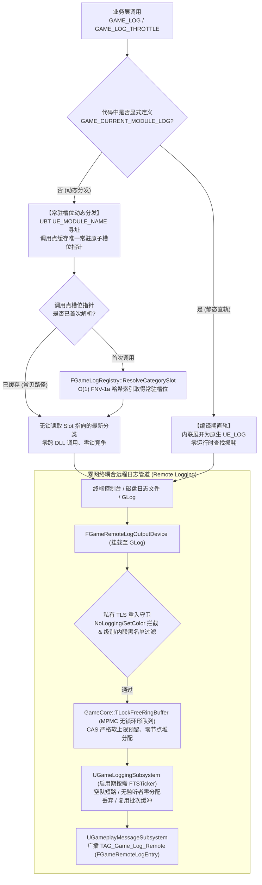

# GameLogging 插件

**GameLogging** 是基于 Unreal Engine 5 的高性能、线程安全全局日志基础设施。它提供模块级日志分类自动注册、双轨分发架构（编译期直轨 + 常驻原子槽位无锁动态分发）、单次去重与抑制前置限频输出机制，并通过 `GameCore` 编译期 `if constexpr` 开关在 Shipping 构建中实现零运行时开销。同时，本插件提供**零网络耦合的远程日志管道**（`FGameRemoteLogOutputDevice` 与 `UGameLoggingSubsystem`），基于 `GameCore::TLockFreeRingBuffer` 无锁环形队列与 `UGameplayMessageSubsystem` 消息总线，将结构化日志安全流转至外部网络或诊断模块。

---

## 架构与分发机制



---

## 核心特性

- **模块级日志自动注册**：通过 RAII 守卫（`FModuleLogRegistrar`）与 `__COUNTER__` 防 Unity Build 碰撞宏（`GAME_REGISTER_MODULE_LOG`），模块主源文件一行完成专属分类声明与登记。
- **常驻不可移动原子槽位（Slot-based Lock-free Dispatch）**：
  - 每个模块在 `FGameLogRegistry` 中拥有一个进程期地址恒定的原子槽位 `FLogCategorySlot`，由 `TMap` + FNV-1a 异构查找视图实现 $O(1)$ 零分配索引；
  - 调用点首次解析后永久缓存该槽位指针，热路径零跨 DLL 调用、零双原子撕裂写、零跨模块误失效；
  - 静态初始化早调用、运行期注册、覆写与注销均原子即时可见，且 `FModuleLogRegistrar` 无需拷贝模块名并在析构期 $O(1)$ 恢复。
- **SIOF 免疫常驻单例**：内部存储体在静态缓冲区内以 C++20 `std::construct_at` 线程安全就地构造、退出期不析构，零裸 `new`/`delete`，彻底免疫跨编译单元静态初始化顺序问题与退出期逆序析构崩溃。
- **丰富且防遮蔽的日志宏**：
  - `GAME_LOG` / `GAME_CLOG`：通用与条件模块感知输出；
  - `GAME_LOG_ONCE` / `GAME_CLOG_ONCE`：TTAS 无锁单次输出，触发后只读短路跳过条件求值；
  - `GAME_LOG_THROTTLE`：抑制级别前置短路（被抑制时不查时钟、不触发 CAS、不浪费节流窗口），未抑制时负哨兵保证首触即打、CAS 并发无锁更新；
  - 所有宏内部逻辑收拢至 `Game::Log::Private` `FORCEINLINE` 辅助函数，杜绝局部变量遮蔽与深层嵌套。
- **零开销编译开关**：联动 `GameCore` 的 `Game::Config::bEnableLog`，关闭日志时经 `if constexpr` 编译期剔除。
- **零耦合远程日志管道 (Remote Logging Pipeline)**：
  - `FGameRemoteLogOutputDevice`：复用 `GameCore::TLockFreeRingBuffer<FGameRemoteLogEntry, 2048>` 实现 MPMC 零节点堆分配环形缓冲；通过私有 `FRemoteLogReentrancyScope` 阻断重入风暴；拦截 `SetColor`/`NoLogging` 控制消息；延迟读取 `FPlatformTime::Seconds()`；通过 `FRWLock` + `TArray<FName, TInlineAllocator<8>>` 实现 L1 亲和、零泄漏黑名单；
  - `UGameLoggingSubsystem`：CDO 零堆分配，`Initialize` 显式声明 `Collection.InitializeDependency<UGameplayMessageSubsystem>()` 确保总线初始化就绪，`Deinitialize` 自动停止采集并安全刷新或丢弃残留队列；禁用态注销 `FTSTicker` 零空转；提供 `Get()`/`GetPtr()` 与统一远程配置门面；无监听者直接 `DiscardBatch` 零分配丢弃，有监听者复用 `ReusableBatch` 稳态零分配广播。

---

## 插件依赖

- **公开依赖 (`PublicDependencyModuleNames`)**：`Core`, `CoreUObject`, `Engine`, `GameplayTags`, `GameCore`
- **私有依赖 (`PrivateDependencyModuleNames`)**：`GameMessage`（不对下游传递暴露）
- **网络与对象池依赖**：**0**（不依赖 `GameNetCore`、`GameNetService`、`GamePool`）
- **引擎版本**：Unreal Engine 5.1 ~ 5.8
- **C++ 标准**：C++20

---

## 快速上手

### 1. 在模块主 cpp 中注册专属日志分类

```cpp
#include "Logging/GameLogCategories.h"

GAME_REGISTER_MODULE_LOG(LogMyModule);
```

### 2. 在业务代码中使用日志

```cpp
#include "Logging/GameLogCategories.h"

void AMyActor::BeginPlay() {
    Super::BeginPlay();
    GAME_LOG(Log, TEXT("AMyActor initialized."));
    GAME_LOG_ONCE(Warning, TEXT("Resource initialized once."));
}

void AMyActor::Tick(float DeltaTime) {
    Super::Tick(DeltaTime);
    GAME_LOG_THROTTLE(2.0, Verbose, TEXT("Actor location: %s"), *GetActorLocation().ToString());
}
```

### 3. 监听远程结构化日志事件（消息总线）

```cpp
#include "Message/GameplayMessageSubsystem.h"
#include "Remote/GameRemoteLogTypes.h"

UGameplayMessageSubsystem& MessageSubsystem = UGameplayMessageSubsystem::Get(this);
FGameplayMessageListenerHandle Handle = MessageSubsystem.RegisterListener<FGameRemoteLogEntry>(
    TAG_Game_Log_Remote,
    [](const FGameRemoteLogEntry& Entry) {
        if (Entry.GetVerbosity() <= ELogVerbosity::Error) {
            // 业务处理或转发至网络监控服务
        }
    }
);
```

---

## 目录结构

```text
Plugins/GameLogging/
├── Source/
│   └── GameLogging/
│       ├── Public/
│       │   ├── GameLogging.h                      # 全量公共接口聚合门面头
│       │   ├── Logging/
│       │   │   ├── FGameLogRegistry.h             # 全局日志注册中心与常驻原子槽位声明
│       │   │   ├── FModuleLogRegistrar.h          # RAII 模块日志自动注册守卫声明
│       │   │   ├── GameLogCategories.h            # LogGame 兜底分类声明与宏透传
│       │   │   └── GameLogMacros.h                # 核心日志宏与内联分发/去重/限频辅助
│       │   └── Remote/
│       │       ├── GameRemoteLogTypes.h           # FGameRemoteLogEntry 与 TAG_Game_Log_Remote
│       │       ├── GameRemoteLogOutputDevice.h    # 基于 TLockFreeRingBuffer 的远程输出设备
│       │       └── GameLoggingSubsystem.h         # GameInstance 常驻子系统与统一门面
│       ├── Private/
│       │   ├── GameLogging.cpp
│       │   ├── Logging/
│       │   │   ├── FModuleLogSlotRecord.h         # 私有常驻槽位内部记录结构
│       │   │   ├── FGameLogRegistry.cpp           # FNV-1a 哈希索引与常驻单例实现
│       │   │   ├── FModuleLogRegistrar.cpp        # RAII O(1) 注册/恢复实现
│       │   │   └── GameLogCategories.cpp          # LogGame 分类定义
│       │   ├── Remote/
│       │   │   ├── FRemoteLogReentrancyScope.h    # 私有线程局部重入守卫声明
│       │   │   ├── FRemoteLogReentrancyScope.cpp  # 私有线程局部重入守卫实现
│       │   │   ├── GameRemoteLogTypes.cpp
│       │   │   ├── GameRemoteLogOutputDevice.cpp  # 过滤、CAS 容量预留与环形队列实现
│       │   │   └── GameLoggingSubsystem.cpp       # 生命周期、按需 Ticker 与零分配广播
│       │   └── Tests/
│       │       ├── GameLogTestCaptureDevice.h     # 线程安全日志捕获器
│       │       ├── GameLogRegistryTest.cpp        # 注册表、RAII、动态扩容与并发测试
│       │       ├── GameLogMacrosTest.cpp          # 并发、条件短路、限频、防遮蔽与槽位分发测试
│       │       ├── GameRemoteLogTypesTest.cpp     # 数据契约与标签测试
│       │       ├── GameRemoteLogOutputDeviceTest.cpp # 过滤、SetColor 拦截、重入与并发测试
│       │       ├── GameLoggingSubsystemTest.cpp   # 子系统门面、无监听快路径、退出刷新与重入测试
│       │       └── GameLoggingPerformanceTest.cpp # 全热路径微基准性能回归套件
│       └── GameLogging.Build.cs
├── Docs/
│   ├── Architecture/Overview.md
│   ├── API/{Macros,Registry,RemoteLogging}.md
│   └── Guides/{QuickStart,BestPractices}.md
├── GameLogging.uplugin
└── README.md
```

---

## 自动化测试与性能基准

插件内置 **20 组**自动化测试（14 组功能/并发/边界回归 + 6 组多轮微基准性能回归），可在编辑器 Automation 面板过滤 `Game.Logging` 或通过命令行运行：

```bash
UnrealEditor-Cmd <Project.uproject> -ExecCmds="Automation RunTests Game.Logging; Quit" -nullrhi -unattended
```

- **Registry (3)**：`Game.Logging.Registry.Lifecycle` · `RegistrarRAII` · `DynamicCapacityAndConcurrency`
- **Macros (3)**：`Game.Logging.Macros.Concurrency` · `SemanticsAndSafety` · `SlotDispatch`
- **RemoteTypes (1)**：`Game.Logging.RemoteTypes.EntryContractAndTag`
- **RemoteOutputDevice (3)**：`Game.Logging.RemoteOutputDevice.FilteringAndCapacity` · `ConcurrencyAndReentrancy` · `BatchAtomicDrain`
- **Subsystem (4)**：`Game.Logging.Subsystem.LifecycleAndFacade` · `NoListenerAndDeinitializeFlush` · `FeedbackLoopAndReentrantFlushGuard` · `TickerDrainAndDisableZeroSpin`
- **Performance Benchmarks (6)**：`Game.Logging.Perf.DynamicDispatchVsStaticDirect` · `OnceAndThrottleHotPath` · `RegistryLookupScaling` · `RemoteDeviceFilterAndRingQueue` · `RemoteDeviceMultiThreadThroughput` · `SubsystemEndToEndBroadcast`

---

## 文档导航

- [架构概述与分发机制](Docs/Architecture/Overview.md)
- [日志宏参考](Docs/API/Macros.md) · [注册表 API](Docs/API/Registry.md) · [远程日志管道 API](Docs/API/RemoteLogging.md)
- [快速上手指南](Docs/Guides/QuickStart.md) · [最佳实践与性能指南](Docs/Guides/BestPractices.md)
