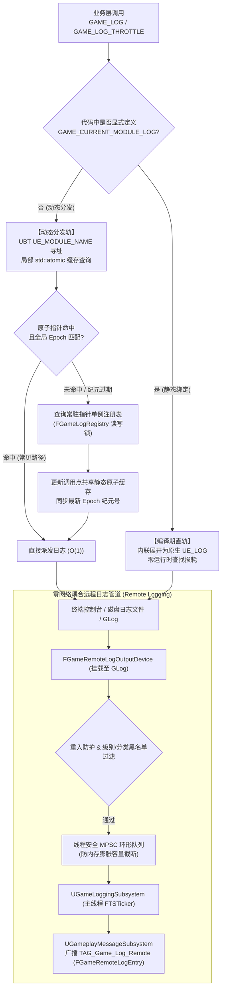

# GameLogging 插件

**GameLogging** 是基于 Unreal Engine 5 的高性能、线程安全全局日志基础设施。它提供了模块级日志分类自动注册、双轨分发架构、无锁缓存访问、单次去重与限频输出机制，并且通过编译期 constexpr 开关实现 Shipping 版本的零运行时开销。同时，本插件提供**零网络耦合的远程日志管道**（`FGameRemoteLogOutputDevice` 与 `UGameLoggingSubsystem`），通过异步 MPSC 无锁队列与 `GameplayMessageSubsystem` 消息总线，将结构化日志无感流转至网络层。

---

## 架构与分发机制



---

## 核心特性

- **模块级日志自动注册**：通过 RAII 与宏体系（`GAME_REGISTER_MODULE_LOG`），模块可在其主源文件中一行代码完成专属日志分类声明与全局登记。
- **注册幂等与全局缓存保护**：同名模块重复绑定相同分类指针时自动短路，避免无谓推进全局 Epoch 造成全应用局部原子缓存击穿与重新解析。
- **单文件单类与接口解耦 (R-ARCH-CLASS)**：注册中心 `FGameLogRegistry`、RAII 守卫 `FModuleLogRegistrar`、分类声明 `GameLogCategories` 与宏通道 `GameLogMacros` 物理完全解耦，职责单一且声明与实现严格对齐。
- **SIOF 免疫单例架构（常驻指针单例 Resident Singleton）**：内部存储结构采用常驻指针单例按需延迟初始化且退出期不析构，彻底根除跨编译单元静态初始化顺序惨案（SIOF）与应用退出期逆序析构悬垂野指针崩溃，外部全局静态对象早期日志与注销零死锁风险。
- **双轨分发架构（Dual-Track Dispatch）**：
  - **编译期优先（Compile-Time Track）**：显式指定 `GAME_CURRENT_MODULE_LOG` 时，直接内联为原生 `UE_LOG`，零查找开销。
  - **纪元安全动态分发（Epoch-Safe Dynamic Dispatch）**：自动基于 UBT `UE_MODULE_NAME` 与局部 `std::atomic` 指针实现 $O(1)$ 查找，并通过全局纪元号（Epoch）解决静态初始化早期调用导致的 Fallback 永久污染问题。
- **丰富的高级日志宏**：
  - `GAME_LOG`：基础日志输出
  - `GAME_CLOG`：条件日志输出
  - `GAME_LOG_ONCE` / `GAME_CLOG_ONCE`：应用生命周期单次日志（防止死循环刷屏，基于 TTAS 无锁检测）
  - `GAME_LOG_THROTTLE`：毫秒/秒级限频日志（负哨兵初值保证首触即打，CAS 无锁并发更新）
- **零开销编译开关**：联动 `GameCore` 的 `Game::Config::bEnableLog`，在关闭日志（如 Release/Shipping）时直接经 `if constexpr` 分支剔除，不产生任何分支跳转与字符串指令。
- **零耦合远程日志管道 (Remote Logging Pipeline)**：
  - `FGameRemoteLogOutputDevice`：跨线程安全 `FOutputDevice`，采用 `thread_local` 递归重入拦截、最低冗余级别过滤与分类黑名单过滤、固定上限 MPSC 队列（满队丢弃计数自增防 OOM）；
  - `UGameLoggingSubsystem`：`UGameInstanceSubsystem` 随游戏实例自启动，挂载设备并以 `FTSTicker` 每帧排空队列，转换为结构化 `FGameRemoteLogEntry`，向 `TAG_Game_Log_Remote` 消息总线广播，**模块本身零网络依赖**。
- **完备的自动化测试覆盖**：内建 7 组独立自动化测试，全面覆盖生命周期、RAII 登记、多线程高并发、动态分发自愈、远程输出设备并发排空及总线广播端到端回归。

---

## 插件依赖

- **底层依赖**：`Core`, `CoreUObject`, `Engine`, `GameplayTags`, `GameplayMessageRuntime`, `GameCore`
- **网络依赖**：**0**（不依赖 `GameNetCore`、`GameNetService`，纯净依靠总线事件解耦）
- **引擎版本**：Unreal Engine 5.1 ~ 5.8
- **C++ 标准**：C++20

---

## 快速上手

### 1. 在模块主 cpp 中注册专属日志分类

```cpp
#include "Logging/GameLogCategories.h"

// 声明并注册 LogMyModule 分类
GAME_REGISTER_MODULE_LOG(LogMyModule);
```

### 2. 在业务代码中使用日志

```cpp
#include "Logging/GameLogCategories.h"

void AMyActor::BeginPlay()
{
    Super::BeginPlay();

    // 基础输出（自动分发到 LogMyModule，若未注册则回退至 LogGame）
    GAME_LOG(Log, TEXT("AMyActor initialized."));

    // 单次日志，无论调用多少次只输出首次
    GAME_LOG_ONCE(Warning, TEXT("Resource initialized once."));
}

void AMyActor::Tick(float DeltaTime)
{
    Super::Tick(DeltaTime);

    // 限频输出：首帧立即触发，后续最多每 2.0 秒输出一次，防止 Tick 刷屏
    GAME_LOG_THROTTLE(2.0, Verbose, TEXT("Actor current location: %s"), *GetActorLocation().ToString());
}
```

### 3. 监听远程结构化日志事件（消息总线）

任意外部插件（如 `GameNetService`）或业务系统仅需监听 `TAG_Game_Log_Remote` 即可接收格式化日志条目：

```cpp
#include "Message/GameplayMessageSubsystem.h"
#include "Remote/GameRemoteLogTypes.h"

UGameplayMessageSubsystem& MessageSubsystem = UGameplayMessageSubsystem::Get(this);
FGameplayMessageListenerHandle Handle = MessageSubsystem.RegisterListener<FGameRemoteLogEntry>(
    TAG_Game_Log_Remote,
    [](FGameplayTag Channel, const FGameRemoteLogEntry& Entry) {
        // Entry 包含 Category, Verbosity (GetVerbosity()), Message, Timestamp (double), FrameNumber
        if (Entry.GetVerbosity() <= ELogVerbosity::Error) {
            // 业务处理或转发至网络监控服务
        }
    }
);
```

---

## 目录结构

```text
Plugins/GameLogging/
├── Source/
│   └── GameLogging/
│       ├── Public/
│       │   ├── GameLogging.h
│       │   ├── Logging/
│       │   │   ├── FGameLogRegistry.h             # 全局日志注册中心声明
│       │   │   ├── FModuleLogRegistrar.h          # RAII 模块日志自动注册守卫声明
│       │   │   ├── GameLogCategories.h            # 游戏全局通用与兜底日志分类声明
│       │   │   └── GameLogMacros.h                # 核心日志宏通道（分发/去重/限频）
│       │   └── Remote/
│       │       ├── GameRemoteLogTypes.h           # 远程日志条目与 TAG_Game_Log_Remote 声明
│       │       ├── GameRemoteLogOutputDevice.h    # 线程安全 FOutputDevice 与 MPSC 队列
│       │       └── GameLoggingSubsystem.h         # GameInstance 常驻子系统与主线程排空器
│       ├── Private/
│       │   ├── GameLogging.cpp
│       │   ├── Logging/
│       │   │   ├── FGameLogRegistry.cpp           # 注册表与常驻指针单例实现
│       │   │   ├── FModuleLogRegistrar.cpp        # RAII 自动注册守卫实现
│       │   │   └── GameLogCategories.cpp          # LogGame 分类定义
│       │   ├── Remote/
│       │   │   ├── GameRemoteLogTypes.cpp
│       │   │   ├── GameRemoteLogOutputDevice.cpp  # 重入防护与跨线程队列写入
│       │   │   └── GameLoggingSubsystem.cpp       # 挂载/卸载设备、Tick 排空与总线广播
│       │   └── Tests/
│       │       ├── GameLogTestCaptureDevice.h     # 线程安全日志捕获器
│       │       ├── GameLogRegistryTest.cpp         # 注册表、RAII 与动态容量测试
│       │       ├── GameLogMacrosTest.cpp           # 并发、动态分发自愈与限频测试
│       │       ├── GameRemoteLogOutputDeviceTest.cpp # 输出设备并发与过滤测试
│       │       └── GameLoggingSubsystemTest.cpp    # 子系统总线广播与生命周期测试
│       └── GameLogging.Build.cs
├── Docs/                                          # 详细文档库
│   ├── Architecture/                              # 架构设计
│   │   └── Overview.md
│   ├── API/                                       # 接口与宏参考
│   │   ├── Macros.md
│   │   ├── Registry.md
│   │   └── RemoteLogging.md
│   └── Guides/                                    # 使用与集成指南
│       ├── QuickStart.md
│       └── BestPractices.md
├── GameLogging.uplugin
└── README.md
```

---

## 自动化测试

插件包含完整的自动化测试集（Automation Tests），可在虚幻编辑器 Test Automation 窗口中过滤 `Game.Logging` 执行，或通过命令行运行：

```bash
UnrealEditor-Cmd <Project.uproject> -ExecCmds="Automation RunTests Game.Logging; Quit" -nullrhi -unattended
```

测试集涵盖：
- `Game.Logging.Registry.Lifecycle`：模块注册、查询、覆写、注销与纪元自增验证
- `Game.Logging.Registry.RegistrarRAII`：RAII 作用域自动登记与析构注销生命周期验证
- `Game.Logging.Macros.Concurrency`：多线程高并发下的 `GAME_LOG`、`GAME_LOG_ONCE` 与 `GAME_LOG_THROTTLE` 竞争安全
- `Game.Logging.Macros.EpochDispatch`：动态分发在模块晚于调用点注册时通过 Epoch 纪元实现缓存自愈
- `Game.Logging.Registry.DynamicCapacity`：注册表动态扩容（超过原固定上限）且模块名深拷贝后临时缓冲区失效仍可查询
- `Game.Logging.RemoteOutputDevice`：多线程并发写入、重入防范、容量满截断丢包计数与最低级别/黑名单过滤
- `Game.Logging.Subsystem`：`UGameLoggingSubsystem` 生命周期管理、队列排空与 `TAG_Game_Log_Remote` 结构化总线广播

---

## 文档导航

- **架构设计 (Architecture)**
  - [架构概述与分发机制](Docs/Architecture/Overview.md)：深入解析双轨分发、常驻指针单例内存模型、Epoch 纪元轮转缓存以及远程日志管道设计。
- **接口参考 (API Reference)**
  - [日志宏参考](Docs/API/Macros.md)：`GAME_LOG`、`GAME_CLOG`、`GAME_LOG_ONCE`、`GAME_LOG_THROTTLE` 等所有宏的详细签名与展开逻辑。
  - [注册表 API](Docs/API/Registry.md)：`FGameLogRegistry` 与 `FModuleLogRegistrar` C++ 接口手册。
  - [远程日志管道 API](Docs/API/RemoteLogging.md)：`FGameRemoteLogOutputDevice` 与 `UGameLoggingSubsystem` 接口手册。
- **使用指南 (Guides)**
  - [快速上手指南](Docs/Guides/QuickStart.md)：新模块集成与常见日志模式落地步骤。
  - [最佳实践与性能指南](Docs/Guides/BestPractices.md)：防刷屏规范、Tick 日志控制及 Shipping 打包优化。
