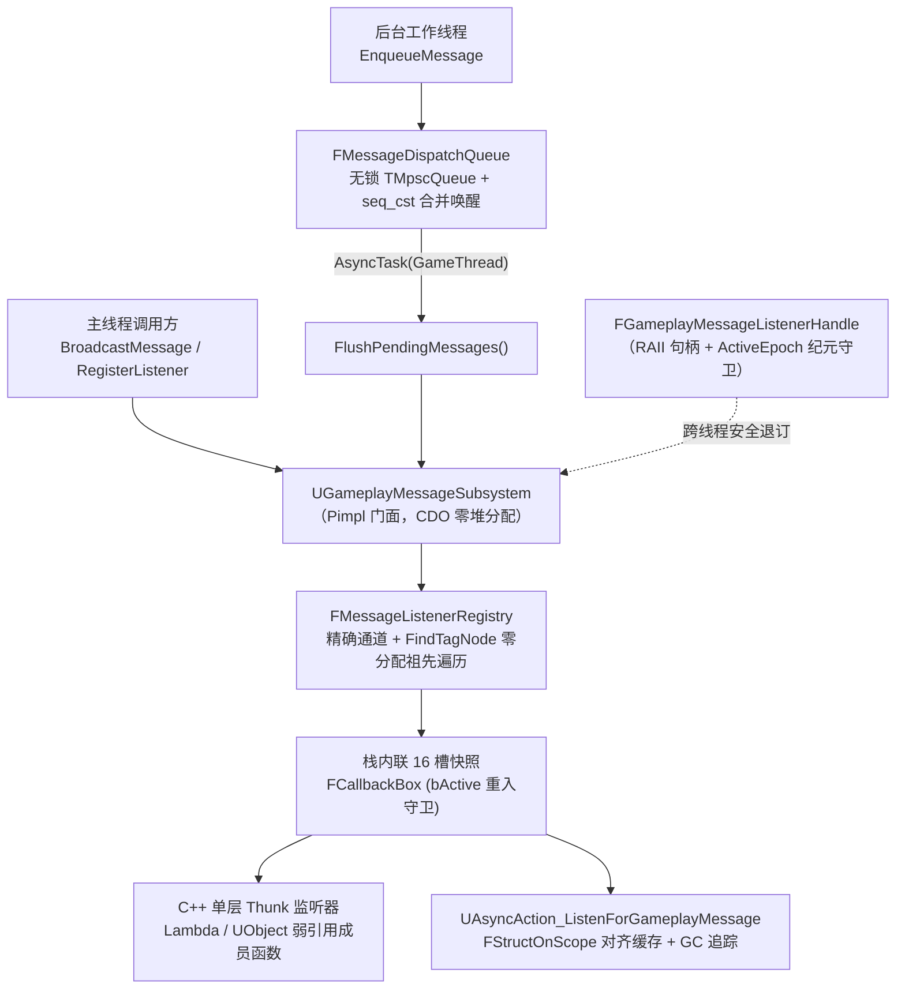

# GameMessage 插件

**GameMessage** 是基于 Unreal Engine 5 的轻量级、类型安全、支持跨线程入队的全局解耦消息总线基础设施（Layer 1）。它基于 `GameplayTag` 树形层级寻址与 `UScriptStruct` 反射类型校验，在不引入模块间直接头文件耦合的前提下，为 `GameLogging`、`GameFeedback`、`GameNetService`、`GameGameplay` 及业务模块提供纳秒级同步广播与无锁跨线程异步派发能力。

---

## 架构与数据流



---

## 核心特性

- **Pimpl 薄门面与零 CDO 堆分配**：`UGameplayMessageSubsystem` 仅在首次运行或 `Initialize()` 时创建内部 `FMessageListenerRegistry` 与 `FMessageDispatchQueue`，公共头文件不暴露 `<atomic>` 与 `TMpscQueue`，CDO 零堆分配。
- **零堆分配父子层级路由**：精确匹配直查 `TMap`（~16–22 ns/op）；`PartialMatch` 通过 `UGameplayTagsManager::FindTagNode` + `GetParentTagNode()` 指针链零堆分配遍历严格祖先通道；`HasListener(Channel)` 与 `BroadcastMessage(Channel)` 保持 100% 路由一致。
- **重入安全与零闭包深拷贝快照**：广播热路径使用栈内联 `TInlineAllocator<16>` 快照 `TSharedPtr<FCallbackBox>`，支持回调内自退订、注销他方监听器（`bActive` 即时拦截防 UAF）、动态注册与嵌套广播，且保证回调闭包仅在主线程析构。
- **单层 Thunk 与编译期概念约束**：全部 4 个 `RegisterListener` 重载（双参/单参 Lambda、双参/单参 `UObject` 弱引用成员函数）直达单层 Thunk 消除冗余堆分配与间接跳转，并由 C++20 `CGameplayMessageStruct` 概念在编译期拦截非反射类型。
- **无数据竞争 RAII 句柄与纪元防护**：`FGameplayMessageListenerHandle` 内部状态构造期只读（仅原子 `ListenerId` 可变），支持任意线程 `IsValid()` / `Unregister()`；绑定子系统 `ActiveEpoch` 弱引用，`Deinitialize()` 后存量句柄即刻失效且防止跨纪元 ABA 误退订。
- **ARM64 强一致跨线程 MPSC 入队**：`EnqueueMessage` 使用 `TMpscQueue` + `std::memory_order_seq_cst` 合并唤醒与主线程预缓存 `CachedOwnerWeak`，消除弱内存序丢唤醒与工作线程触碰 `GUObjectArray` 隐患。
- **蓝图异步节点 GC 与对齐安全**：`UAsyncAction_ListenForGameplayMessage` 采用引擎原生 `FStructOnScope` 按 `GetMinAlignment()` 对齐缓存载荷，覆写 `AddReferencedObjects` 与 `BeginDestroy`，保障载荷内 `UPROPERTY() UObject*` 在 GC 期间不悬垂、未显式 `Cancel` 回收时零内存泄漏。
- **标准化强类型错误契约**：统一通过 `Game::ModuleId::Message (7)` 与 `Game::MessageErrorCodes (7001~7004)` 返回结构化 `TGameStatusResult<void>`。

---

## 插件依赖

- **引擎模块**：`Core`, `CoreUObject`, `Engine`, `GameplayTags`
- **内部插件**：`GameCore`（Layer 0，零循环依赖；本插件位于 `GameLogging` 与各领域插件之下）
- **引擎版本**：Unreal Engine 5.1 ~ 5.8
- **C++ 标准**：C++20

---

## 目录结构

```text
Plugins/GameMessage/
├── README.md                                                 # 插件总览与导航
├── GameMessage.uplugin                                       # 插件清单（v2.0.0）
├── Docs/
│   ├── API/GameplayMessageSubsystem.md                       # 完整 API 与错误码手册
│   └── Guides/MessagingGuide.md                              # 选型与解耦通信实战指南
└── Source/GameMessage/
    ├── GameMessage.Build.cs                                  # 模块构建配置
    ├── Public/
    │   ├── GameMessage.h                                     # 模块入口与 LogGameMessage 导出
    │   └── Message/
    │       ├── GameplayMessageTypes.h                        # EGameplayMessageMatch 与 CGameplayMessageStruct
    │       ├── FGameplayMessageListenerHandle.h              # RAII 监听句柄声明
    │       ├── MessageErrorCodes.h                           # Game::MessageErrorCodes (7001~7004)
    │       ├── GameplayMessageSubsystem.h                    # 消息总线子系统门面
    │       └── AsyncAction_ListenForGameplayMessage.h        # 蓝图异步监听节点
    └── Private/
        ├── GameMessage.cpp                                   # 模块实现与日志分类定义
        ├── Message/
        │   ├── FGameplayMessageListenerHandle.cpp            # 零竞态句柄与跨线程退订实现
        │   ├── FMessageListenerRegistry.h / .cpp             # 通道注册表、重入守卫与零分配祖先遍历
        │   ├── FMessageDispatchQueue.h / .cpp                # MPSC 跨线程队列与 seq_cst 唤醒调度
        │   ├── GameplayMessageSubsystem.cpp                  # Pimpl 门面实现
        │   └── AsyncAction_ListenForGameplayMessage.cpp      # FStructOnScope 缓存与 CustomThunk
        └── Tests/
            ├── FTestGameplayMessage.h                        # 测试载荷反射结构体
            ├── UGameMessageTestReceiver.h                    # 测试接收器 UObject
            ├── GameplayMessageTypesTest.cpp                  # 句柄生命周期、纪元与并发竞态测试
            ├── GameplayMessageSubsystemTest.cpp              # 路由、重入、多态、生命周期与跨线程测试
            ├── AsyncAction_ListenForGameplayMessageTest.cpp  # 蓝图节点、CustomThunk 与 GC 保活测试
            └── GameplayMessagePerformanceTest.cpp            # 8 组全热路径微基准套件
```

---

## 自动化测试与微基准

在工程根目录执行：

```bash
python3 .scripts/run_automation_tests.py --case Game.Message
```

包含 **14 组功能与并发/GC 回归测试** 与 **8 组微基准测试**（`ExactMatchBroadcast`、`FanOutScalability`、`PartialMatchVsExactMatch`、`CrossThreadEnqueueAndDrain`、`RegisterUnregisterChurn`、`NoListenerFastPath`、`MultiChannelPartialMatch`、`MemberAndPayloadOnlyDispatch`）。

---

## 文档导航

- [API 参考手册](Docs/API/GameplayMessageSubsystem.md)：枚举、概念、错误码、句柄、`UGameplayMessageSubsystem` 与 `UAsyncAction_ListenForGameplayMessage` 完整签名与示例。
- [消息通信与选型实战指南](Docs/Guides/MessagingGuide.md)：`UGameplayMessageSubsystem`、`FListenerHub` 与 `FValueObserver` 选型决策树与业务解耦案例。
