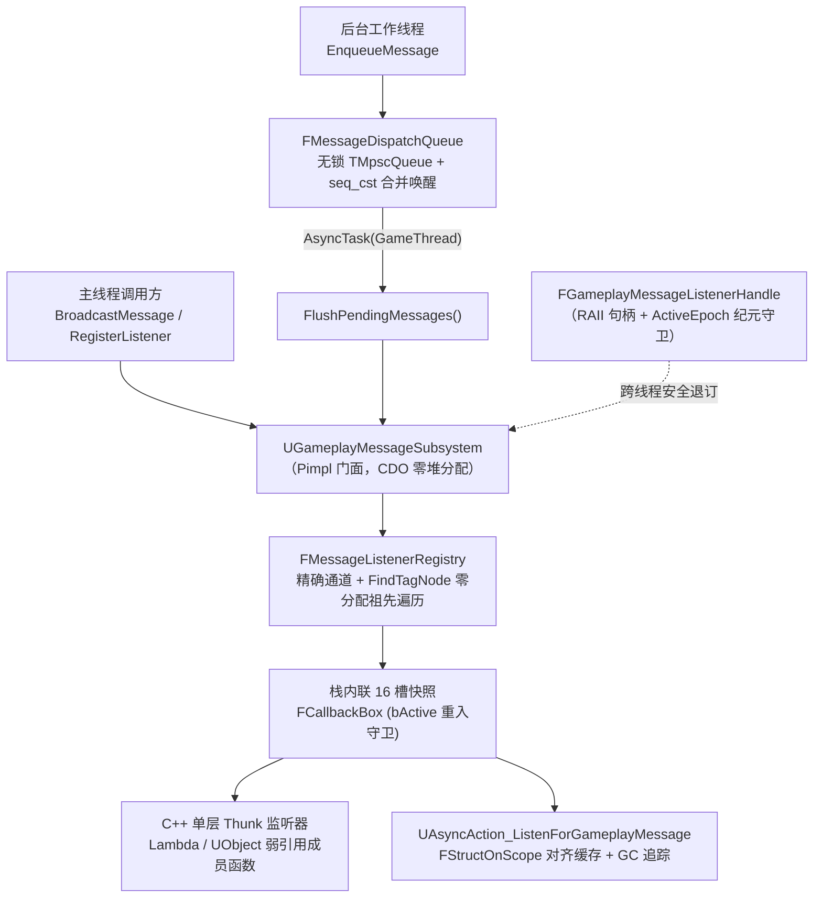

# GameMessage

> **一句话**：基于 `GameplayTag` 层级寻址与 `UScriptStruct` 类型校验的全局解耦消息总线，提供主线程同步广播、跨线程无锁入队与蓝图异步监听。
> **版本** v2.0.0 · **引擎** UE 5.1~5.8 · **层级** Level 1 · **直接依赖** GameCore

## 30 秒速览

- **解决什么问题**：模块之间需要通信，但不希望互相 `#include` 头文件；消息按业务域分组、需要载荷类型校验、需要从工作线程安全投递到主线程。
- **核心能力**：
  - `GameplayTag` 精确匹配与祖先通道 `PartialMatch` 路由，`HasListener` 与广播共用同一套判定；
  - 载荷由 C++20 `CGameplayMessageStruct` 概念约束为 `USTRUCT` 或已特化 `TBaseStructure` 的类型；
  - 广播热路径使用栈内联快照，支持回调内退订、注销他人、动态注册与嵌套广播；
  - `EnqueueMessage` 经无锁 MPSC 队列投递，在 GameThread 统一派发；
  - 蓝图异步节点处理 GC 引用与载荷内存对齐。
- **什么时候用**：跨模块业务事件、UI 与玩法解耦、日志 / 网络等基础设施向上层广播、工作线程向主线程投递事件。
- **什么时候不用**：单个变量或状态的响应式监听用 GameCore 的 `FValueObserver<T>`；纯 C++ 非反射结构体的底层内部分发用 GameCore 的 `FListenerHub`。

## 快速开始

```cpp
// EnemyKilledMessage.h
#pragma once
#include "CoreMinimal.h"
#include "EnemyKilledMessage.generated.h"

USTRUCT(BlueprintType)
struct FEnemyKilledMessage {
    GENERATED_BODY()
    UPROPERTY(BlueprintReadWrite) FName EnemyId;
    UPROPERTY(BlueprintReadWrite) int32 ExpReward = 0;
};
```

```cpp
#include "GameplayTagContainer.h"
#include "Message/GameplayMessageSubsystem.h"

// 监听方：先声明子系统依赖，再注册成员函数监听
void UAchievementSubsystem::Initialize(FSubsystemCollectionBase& Collection) {
    Super::Initialize(Collection);
    Collection.InitializeDependency<UGameplayMessageSubsystem>();
    KilledListenerHandle = UGameplayMessageSubsystem::Get(this).RegisterListener<FEnemyKilledMessage>(
        FGameplayTag::RequestGameplayTag(TEXT("Event.Combat.EnemyKilled")),
        this,
        &UAchievementSubsystem::OnEnemyDefeated
    );
}

void UAchievementSubsystem::Deinitialize() {
    KilledListenerHandle.Unregister();
    Super::Deinitialize();
}

// 广播方：无需包含成就模块的头文件
UGameplayMessageSubsystem::Get(this).BroadcastMessage(
    FGameplayTag::RequestGameplayTag(TEXT("Event.Combat.EnemyKilled")),
    Msg
);
```

- 回调签名支持 `void (TOwner::*)(FGameplayTag, const T&)` 与 `void (TOwner::*)(const T&)`，也接受等价的 `TFunction`。
- 工作线程改用 `EnqueueMessage` 入队，随后在 GameThread 调用 `FlushPendingMessages()` 排空派发。

## 核心能力

### 通道路由与类型校验
- 精确匹配直查 `TMap`（既有记录约 16–22 ns/op）；`PartialMatch` 经 `UGameplayTagsManager::FindTagNode` + `GetParentTagNode()` 指针链遍历严格祖先通道，全程零堆分配。
- `HasListener(Channel)` 与 `BroadcastMessage(Channel, ...)` 共用精确 / 祖先判定，可在打包昂贵载荷前短路。
- 载荷由 `CGameplayMessageStruct` 在编译期校验：必须为 `USTRUCT` 或已特化 `TBaseStructure` 的引擎结构体（如 `FVector`）。
- 广播派生 `USTRUCT` 时，订阅基类 `USTRUCT` 的监听器经 `UScriptStruct::IsChildOf` 命中。

### 重入安全广播
- 广播热路径使用栈内联 `TInlineAllocator<16>` 快照 `TSharedPtr<FCallbackBox>`，不深拷贝回调闭包。
- `bActive` 守卫即时拦截已注销监听器，支持回调内自退订、注销其他监听器、动态注册（下一轮生效）与嵌套广播。
- 回调闭包只在主线程析构，避免跨线程释放回调捕获的 `UObject`。

### 跨线程入队
- `EnqueueMessage` 使用 `TMpscQueue` + `std::memory_order_seq_cst` 合并唤醒，任意工作线程可调用。
- 主线程预缓存 `CachedOwnerWeak`，工作线程不触碰 `GUObjectArray`。
- 入队后的消息需由 GameThread 调用 `FlushPendingMessages()` 完成派发。

### 监听句柄与生命周期
- `FGameplayMessageListenerHandle` 为 RAII 句柄：最后一份副本析构自动注销，也可显式 `Unregister()`。
- 内部注册态构造期只读，仅 `ListenerId` 为原子量，任意线程 `IsValid()` / `Unregister()` 无数据竞争。
- 句柄绑定子系统 `ActiveEpoch`；`Deinitialize()` 后存量句柄立即失效，并防止跨纪元 ABA 误退订。

### 蓝图异步节点与错误契约
- `UAsyncAction_ListenForGameplayMessage` 用 `FStructOnScope` 按 `GetMinAlignment()` 对齐缓存载荷，覆写 `AddReferencedObjects` 与 `BeginDestroy` 保障 GC 安全。
- 4 个 `RegisterListener` 重载共用单层 Thunk，无冗余堆分配与间接跳转。
- 错误统一为 `Game::ModuleId::Message (7)` + `Game::MessageErrorCodes (7001~7004)` 的 `TGameStatusResult<void>`。

## 架构与依赖

- **引擎模块**：`Core`, `CoreUObject`, `Engine`, `GameplayTags`
- **内部插件**：`GameCore`（Level 0）；无私有依赖，无循环依赖
- **关键类**：
  - `UGameplayMessageSubsystem`：Pimpl 门面，公共头文件不暴露 `<atomic>` 与 `TMpscQueue`，CDO 零堆分配
  - `FMessageListenerRegistry`：精确通道表与零分配祖先遍历
  - `FMessageDispatchQueue`：MPSC 跨线程队列与唤醒调度
  - `FGameplayMessageListenerHandle` / `UAsyncAction_ListenForGameplayMessage`：句柄与蓝图节点

<details>
<summary><b>展开消息流与内部结构图</b></summary>



</details>

<details>
<summary><b>展开错误码（Game::MessageErrorCodes）</b></summary>

| 常量 | 数值 | 语义 |
| :--- | ---: | :--- |
| `InvalidChannel` | `7001` | 消息通道 `GameplayTag` 无效或为空 |
| `InvalidStructType` | `7002` | 载荷 `UScriptStruct` 反射元数据为空 |
| `InvalidPayload` | `7003` | 载荷指针或任务闭包为空 |
| `SubsystemShuttingDown` | `7004` | 子系统未初始化、正在关闭或已注销 |

</details>

## 性能与边界

- 广播、注册与 `FlushPendingMessages()` 均需在 GameThread 调用；工作线程只能使用 `EnqueueMessage`。
- 同步广播的回调在调用栈内立即执行；经 `EnqueueMessage` 投递的消息在 GameThread 派发。
- 子系统为 `UGameInstanceSubsystem`，`Deinitialize()` 会失活并清空全部监听器、作废旧句柄纪元。
- 非反射结构体无法作为载荷：`CGameplayMessageStruct` 在编译期拦截。
- `UObject` 成员函数监听以弱引用持有宿主，宿主被 GC 后回调自动跳过。

<details>
<summary>展开性能基准（历史 Development 构建参考值）</summary>

- 精确匹配广播直查 `TMap`：既有记录约 **16–22 ns/op**。
- 8 组微基准：`ExactMatchBroadcast`、`FanOutScalability`、`PartialMatchVsExactMatch`、`CrossThreadEnqueueAndDrain`、`RegisterUnregisterChurn`、`NoListenerFastPath`、`MultiChannelPartialMatch`、`MemberAndPayloadOnlyDispatch`。
- 回归规模：14 组功能 / 并发 / GC 测试 + 8 组微基准；运行命令 `python3 .scripts/run_automation_tests.py --case Game.Message`。

</details>

## 文档导航

| 文档 | 内容 |
| :--- | :--- |
| [API 参考手册](Docs/API/GameplayMessageSubsystem.md) | 枚举、概念、错误码、句柄、`UGameplayMessageSubsystem` 与蓝图节点完整签名与示例 |
| [消息通信与选型实战指南](Docs/Guides/MessagingGuide.md) | `UGameplayMessageSubsystem`、`FListenerHub`、`FValueObserver` 选型决策树与解耦案例 |

<details>
<summary><b>展开源码目录</b></summary>

```text
Plugins/GameMessage/
├── GameMessage.uplugin                                       # 插件清单（v2.0.0）
├── Docs/
│   ├── API/GameplayMessageSubsystem.md                       # 完整 API 与错误码手册
│   └── Guides/MessagingGuide.md                              # 选型与解耦通信实战指南
└── Source/GameMessage/
    ├── GameMessage.Build.cs                                  # 模块构建配置
    ├── Public/
    │   ├── GameMessage.h                                     # 模块入口与 LogGameMessage 导出
    │   └── Message/
    │       ├── GameplayMessageTypes.h                        # EGameplayMessageMatch 与 CGameplayMessageStruct
    │       ├── FGameplayMessageListenerHandle.h              # RAII 监听句柄声明
    │       ├── MessageErrorCodes.h                           # Game::MessageErrorCodes (7001~7004)
    │       ├── GameplayMessageSubsystem.h                    # 消息总线子系统门面
    │       └── AsyncAction_ListenForGameplayMessage.h        # 蓝图异步监听节点
    └── Private/
        ├── GameMessage.cpp                                   # 模块实现与日志分类定义
        ├── Message/
        │   ├── FGameplayMessageListenerHandle.cpp            # 零竞态句柄与跨线程退订实现
        │   ├── FMessageListenerRegistry.h / .cpp             # 通道注册表、重入守卫与零分配祖先遍历
        │   ├── FMessageDispatchQueue.h / .cpp                # MPSC 跨线程队列与 seq_cst 唤醒调度
        │   ├── GameplayMessageSubsystem.cpp                  # Pimpl 门面实现
        │   └── AsyncAction_ListenForGameplayMessage.cpp      # FStructOnScope 缓存与 CustomThunk
        └── Tests/
            ├── FTestGameplayMessage.h                        # 测试载荷反射结构体
            ├── UGameMessageTestReceiver.h                    # 测试接收器 UObject
            ├── GameplayMessageTypesTest.cpp                  # 句柄生命周期、纪元与并发竞态测试
            ├── GameplayMessageSubsystemTest.cpp              # 路由、重入、多态、生命周期与跨线程测试
            ├── AsyncAction_ListenForGameplayMessageTest.cpp  # 蓝图节点、CustomThunk 与 GC 保活测试
            └── GameplayMessagePerformanceTest.cpp            # 8 组全热路径微基准套件
```

</details>
